<div align="center">
  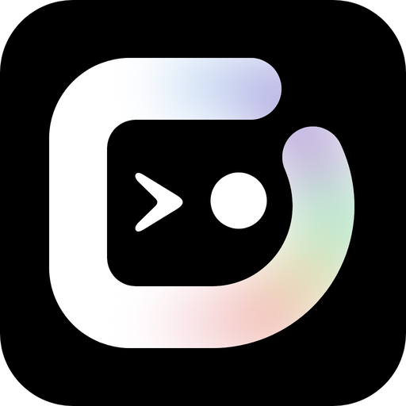

  <h1>VibeX</h1>

  <p>
    <strong>English</strong> · <a href="./README.zh-CN.md">简体中文</a>
  </p>

  <p><strong>Integrated Agent Development Environment (IADE)</strong></p>
  <p>Unify Claude Code, Codex, DeepSeek, Gemini CLI, Antigravity, Cursor, Kimi Code, OpenClaw, and more inside one plugin-native engineering workbench.<br/>Orchestrate tasks on an infinite canvas board, isolate parallel branches with Git Worktrees, collaborate in multi-Bot group spaces, inspect live DOM from the built-in browser, and review diffs in real time.</p>

  <p>
    <a href="https://vibex.xforever.xin"></a>
    <a href="https://vibex.xforever.xin/#download"></a>
    <a href="https://vibex.xforever.xin/docs"></a>
    <a href="https://vibex.xforever.xin/marketplace"></a>
    <a href="https://www.npmjs.com/package/@omnione/vibex"></a>
  </p>
</div>

---

## Introduction

Tired of juggling half a dozen terminal windows to run different coding agents? Frustrated when concurrent agents overwrite the same files and trigger merge conflicts? Tired of guessing what an agent actually changed inside a black-box terminal?

**VibeX** is an **Integrated Agent Development Environment (IADE)** built from the ground up for AI-native software engineering. By unifying mainstream coding agents through the **Agent Client Protocol (ACP)** and combining **conflict-free Git Worktree isolation**, **infinite canvas kanban orchestration**, **VibeX-Bot multi-role group collaboration**, and an **Everything-is-a-Plugin** microkernel architecture, VibeX turns you from a single-threaded terminal watcher into the commander of a full AI engineering team.

---

## Product Screenshots

<p align="center">
  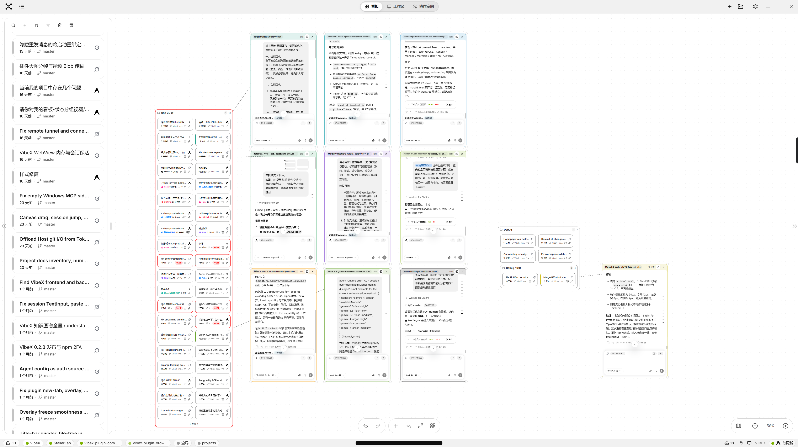
</p>

<p align="center">
  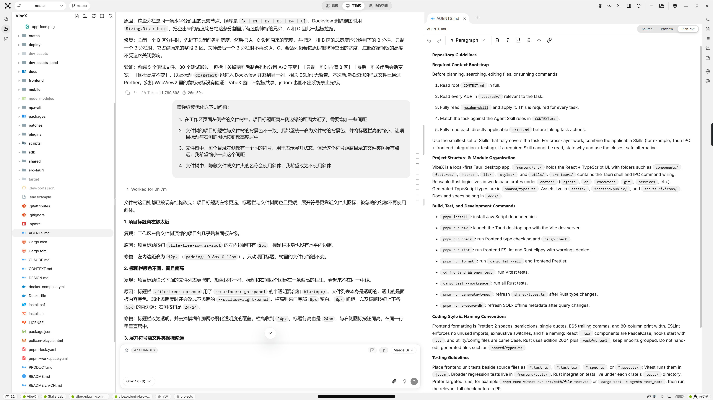
</p>

<p align="center">
  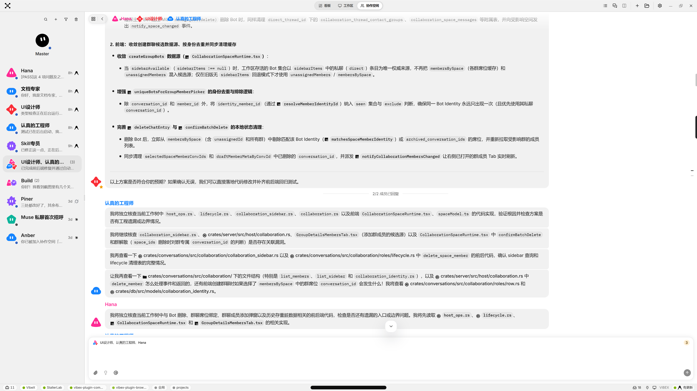
</p>

<p align="center">
  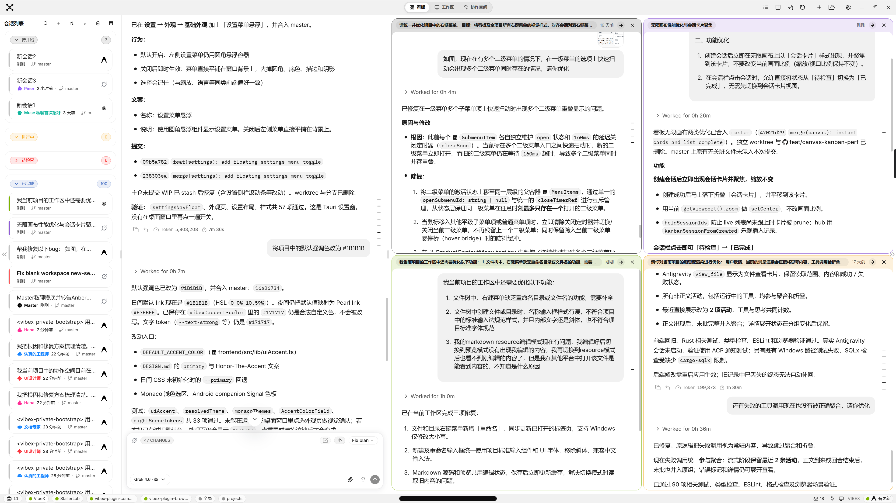
</p>

<p align="center">
  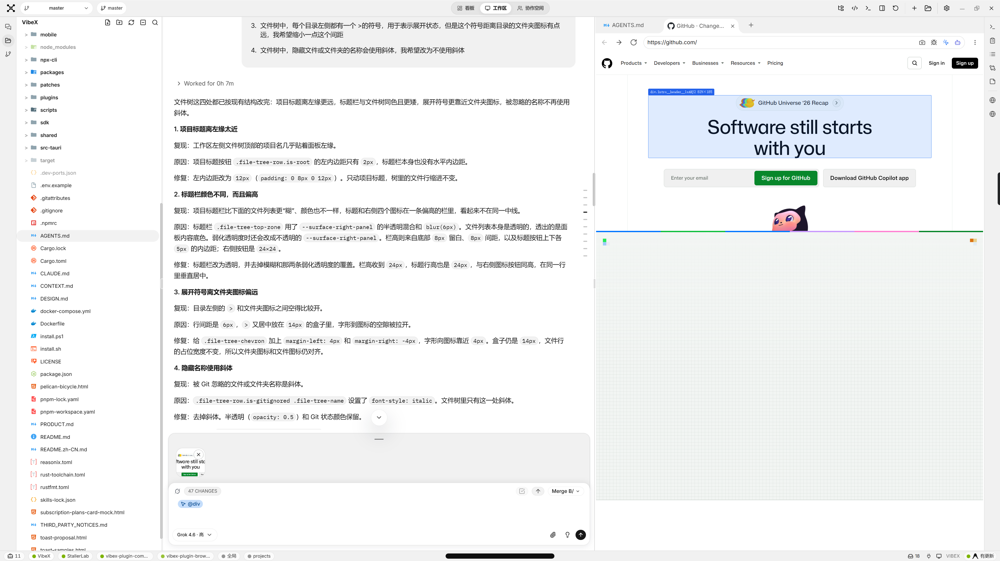
</p>

<p align="center">
  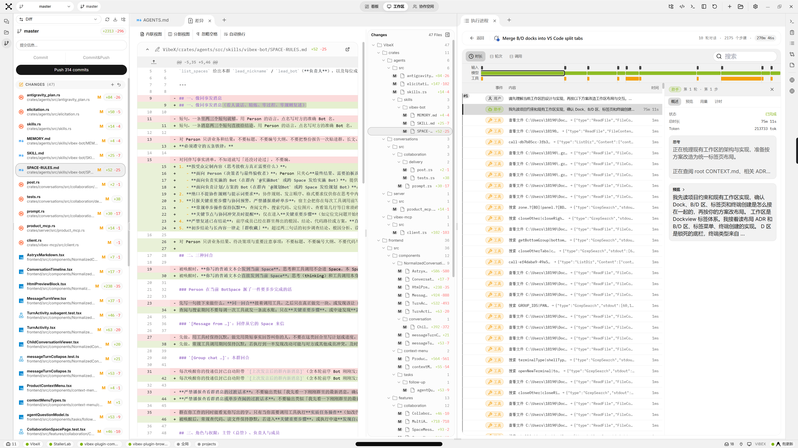
</p>

<p align="center">
  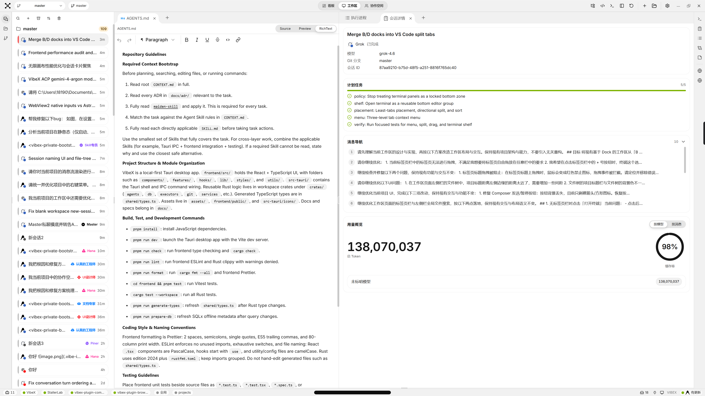
</p>

<p align="center">
  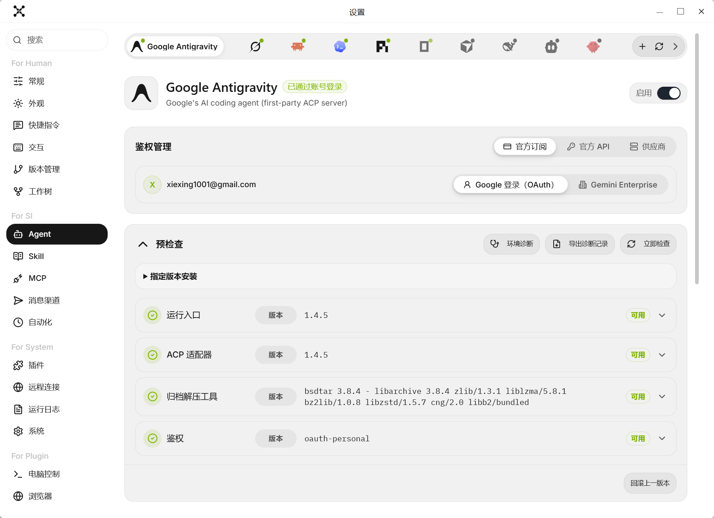
</p>

---

## Architecture

<p align="center">
  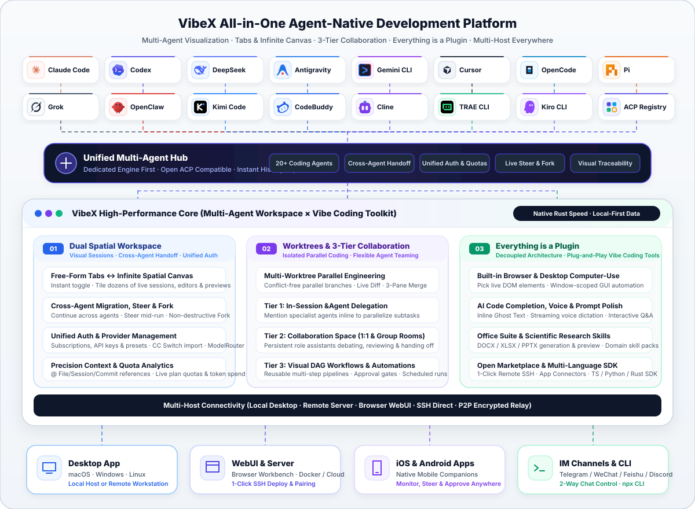
</p>

---

## Highlights

- **16+ Mainstream Coding Agents Out of the Box**: Built-in support for Claude Code, Codex, DeepSeek, Antigravity, Gemini CLI, Cursor, Kimi Code, OpenClaw, Cline, TRAE CLI, Kiro CLI, OMP, plus ACP Registry extensions. Automatic runtime detection, one-click repair, and model provider switching let Claude design architecture, Codex write unit tests, and Gemini polish UI in the same project.
- **Infinite Canvas Board + 4-Column Kanban**: Switch seamlessly between a classic 4-column board and a zoomable **infinite canvas board** that lays out task cards, linked conversations, execution states, and dependency edges across a spatial canvas.
- **Conflict-Free Parallelism via Git Worktrees**: Each task card can bind to its own dedicated branch and Git Worktree so multiple agents can refactor, fix bugs, and ship features simultaneously without polluting your working tree—complete with live Git diff review, staging, commits, rebasing, and merging.
- **VibeX-Bot Multi-Role Collaboration Space (Group Handoffs + `&Agent` Delegation)**: Assemble specialized AI bots (PM, Architect, Frontend, QA, Docs) in direct or group spaces with `@Bot` mention handoffs and shared folders, or delegate background research and sub-tasks from any workspace input via `&Agent`.
- **Built-in Browser + Visual DOM Picker + Live Steering**: Preview your running app right inside the workbench, click **Pick Element** to inject live DOM nodes and styles into the agent prompt, and steer an active turn in real time whenever an agent drifts off course.
- **Everything-is-a-Plugin + Cross-Agent Capability Projection**: Install plugins from the marketplace with instant hot-reloading. Any MCP server or Agent Skill contributed by a plugin is managed by the Host and automatically projected to every coding agent in your session.
- **Local-First Ownership, Take Over Anywhere**: All source code, Git history, and event-sourced JSONL session logs stay on your own machine or self-hosted server. Monitor progress, send prompts, and approve sensitive tool permissions on the go via the Mobile companion app, WeChat, WeCom, or Telegram.

---

## Deployment

### 1. Desktop App (Recommended)

Download the native installer for your platform from the [Official Download Page](https://vibex.xforever.xin/#download) or follow the [Desktop Installation Guide](https://vibex.xforever.xin/docs/install-desktop):

| OS | Supported Architectures & Formats |
| :--- | :--- |
| **macOS** | Apple Silicon (`aarch64` `.dmg`) · Intel (`x64` `.dmg`) |
| **Windows** | Windows 10 / 11 (`x64` / `arm64` `.exe` installer) |
| **Linux** | Ubuntu / Debian / Arch (`x64` / `arm64` `.AppImage`) |

### 2. One-Command CLI Launch (Node.js)

Launch the local VibeX service and Web workbench directly from your terminal:

```bash
# Run directly via npx (automatically verifies and downloads the platform binary)
npx @omnione/vibex

# Or install globally
npm install -g @omnione/vibex
vibex
```

### 3. Headless Server Deployment (`vibex-server` + WebUI)

Ideal for remote devboxes, cloud VMs, NAS, or on-prem servers accessed via browser or remote Desktop pairing (see [Server & WebUI Guide](https://vibex.xforever.xin/docs/install-server)):

```bash
# Build the headless server with embedded static frontend assets
cargo build --release -p server --features embed-frontend

# Start the server (default port 3001, configurable via PORT)
PORT=3001 ./target/release/vibex-server
```

Open `http://localhost:3001` in your browser to access the full WebUI workbench, or pair your Desktop / Mobile clients over TLS.

---

## Development

### Prerequisites

- **Rust**: Stable toolchain (`1.89+` recommended)
- **Node.js**: `>= 20`
- **pnpm**: `>= 9`

### 1. Desktop Local Development (Vite HMR)

The default development entry launches the desktop workbench, builds local plugins, starts the **Vite dev server** for frontend **HMR**, and watches the Rust host:

```bash
# Install dependencies
pnpm install

# Start desktop dev mode with Vite dev server HMR (alias for pnpm run dev:desktop)
pnpm run dev
```

### 2. Server & Frontend Checks

```bash
# Build all built-in plugins and run frontend typechecks
pnpm run plugins:build
pnpm --dir frontend run check

# Start the headless server in development mode
pnpm run server:dev
```

### 3. Plugin Development (`@vibex/plugin-sdk`)

VibeX ships a full plugin CLI and SDK (see [Developer Docs](https://vibex.xforever.xin/docs/developers)) for building UI tabs/panels, kanban views, custom editors, MCP tools, and background workers:

```bash
# Inspect plugin CLI commands (create, validate, build, link, pack)
pnpm exec vibex-plugin --help

# Build all official plugins in the repository
pnpm run plugins:build
```

---

## Official Links

- **Official Website**: [https://vibex.xforever.xin](https://vibex.xforever.xin)
- **Download**: [https://vibex.xforever.xin/#download](https://vibex.xforever.xin/#download)
- **Documentation**: [https://vibex.xforever.xin/docs](https://vibex.xforever.xin/docs)
- **Developer Docs**: [https://vibex.xforever.xin/docs/developers](https://vibex.xforever.xin/docs/developers)
- **Plugin Marketplace**: [https://vibex.xforever.xin/marketplace](https://vibex.xforever.xin/marketplace)

<div align="center">
  <table>
    <tr>
      <td align="center" width="260">
        <br />
        <sub><b>WeChat Community</b> (Scan to Join)</sub>
      </td>
      <td align="center" width="260">
        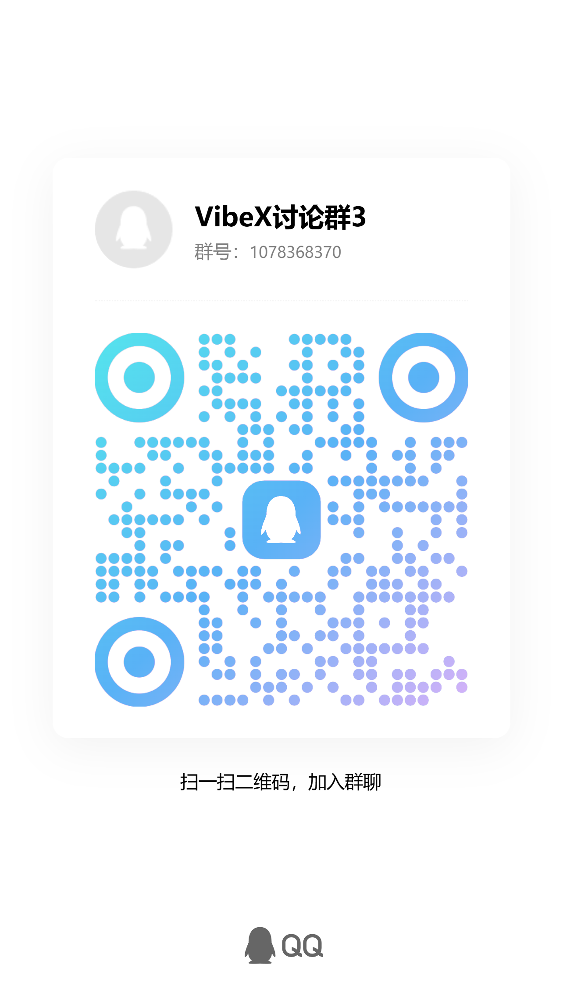<br />
        <sub><b>QQ Community</b> (Scan to Join)</sub>
      </td>
    </tr>
  </table>
  <p><strong>WeChat (微信号)</strong>: <code>M1X3X1X4</code></p>
</div>
