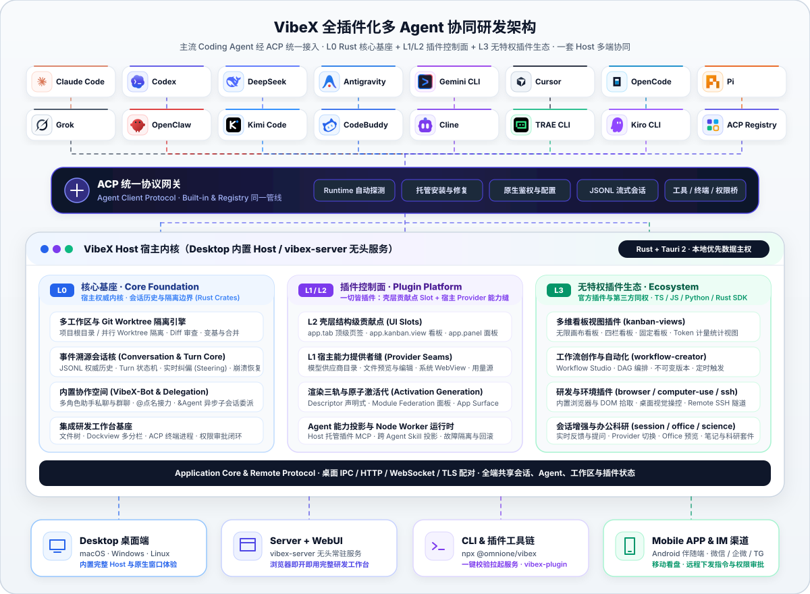

<div align="center">
  

  <h1>VibeX</h1>

  <p>
    <a href="./README.md">English</a> · <strong>简体中文</strong>
  </p>

  <p><strong>集成智能体开发环境（IADE · Integrated Agent Development Environment）</strong></p>
  <p>把 Claude Code、Codex、DeepSeek、Gemini CLI、Antigravity、Cursor、Kimi Code、OpenClaw 等主流 Coding Agent 装进同一个全插件化研发工作台。<br/>支持无限画布看板调度、Git Worktree 并行隔离、多 Bot 群聊协作、内置浏览器 DOM 拾取与实时 Diff 审查。</p>

  <p>
    <a href="https://vibex.xforever.xin"></a>
    <a href="https://vibex.xforever.xin/#download"></a>
    <a href="https://vibex.xforever.xin/docs"></a>
    <a href="https://vibex.xforever.xin/marketplace"></a>
    <a href="https://www.npmjs.com/package/@omnione/vibex"></a>
  </p>
</div>

---

## 项目简介

还在同时开着五六个终端窗口跑不同的 Coding Agent？还在因为多个 Agent 同时改同一份代码导致冲突而抓狂？还在终端黑框里盲猜 Agent 到底改了哪几行代码、页面变成了什么样？

**VibeX** 是专为 AI 原生研发打造的 **集成智能体开发环境（IADE）**。它通过统一的 **ACP（Agent Client Protocol）** 协议将市面上主流的 Coding Agent 汇聚到同一座可视化工作台中，配合 **Git Worktree 零冲突并行隔离**、**无限画布看板编排**、**VibeX-Bot 多角色群聊接力** 以及 **一切皆插件（Everything-is-a-Plugin）** 的微内核架构，让你从「单线程盯终端」跃升为「一人指挥一支 AI 研发团队」。

---

## 产品图

<p align="center">
  
</p>

<p align="center">
  
</p>

<p align="center">
  
</p>

<p align="center">
  
</p>

<p align="center">
  
</p>

<p align="center">
  
</p>

<p align="center">
  
</p>

<p align="center">
  
</p>

---

## 架构

<p align="center">
  
</p>

---

## 优点

- **主流 Coding Agent 开箱即用，自由混编**：内置 Claude Code、Codex、DeepSeek、Antigravity、Gemini CLI、Cursor、Kimi Code、OpenClaw、Cline、TRAE CLI、Kiro CLI、OMP 等主流 Agent 并支持 ACP Registry 扩展，自动探测本机环境、一键安装修复与供应商切换；同一个项目里可以让 Claude 写架构、Codex 写单测、Gemini 调前端。
- **无限画布看板 + 四栏看板，全局掌控并发任务**：在经典四栏看板之外提供自由缩放的**无限画布看板视图**，将任务卡片、关联对话、执行状态与依赖连线铺展在同一张空间画布上，几十个并发任务也一目了然。
- **Git Worktree 零冲突并行隔离**：每张任务卡可自动绑定独立分支与 Git Worktree，多个 Agent 同时重构、修 Bug、写新功能互不污染工作区；内置实时 Git Diff 审查、文件树对比、一键暂存、提交、变基与合并。
- **VibeX-Bot 多角色协作空间（群聊接力 + `&Agent` 异步委派）**：像拉工作群一样组建你的 AI 专家团队（产品经理、架构师、前端、QA、文档专家），支持 `@Bot` 点名接力、共享空间文件夹，也能在工作区任意输入框中通过 `&Agent` 将耗时调研或子任务异步委派给后台子会话。
- **内置浏览器 + 视觉元素拾取 + 实时纠偏（Steering）**：在工作区右侧直接打开内置浏览器预览页面，点击「拾取元素」即可将真实 DOM 结构与样式直接注入 Agent 上下文；Agent 执行偏离预期时无需强行中断重来，随时在当前轮次追加纠偏指令。
- **全插件化架构 + 跨 Agent 能力投影**：内置插件市场与一键热加载能力；任何插件提供的 MCP 工具或 Skill 都会由宿主统一托管，自动赋能给你正在使用的所有 Coding Agent。
- **本地优先，全端随时接管**：所有代码、Git 历史与 JSONL 会话日志均存储在你自己的设备或私有服务器上；下班路上可通过手机端或微信 / 企微 / Telegram 随时查看进度、下发指令、完成高危命令权限审批。

---

## 部署

### 1. 桌面客户端安装（推荐）

前往 [VibeX 官方下载页](https://vibex.xforever.xin/#download) 或参考 [桌面端安装文档](https://vibex.xforever.xin/docs/install-desktop) 获取对应系统的安装包，开箱即用：

| 操作系统 | 支持架构与安装包格式 |
| :--- | :--- |
| **macOS** | Apple Silicon (`aarch64` `.dmg`) · Intel (`x64` `.dmg`) |
| **Windows** | Windows 10 / 11 (`x64` / `arm64` `.exe` 安装包) |
| **Linux** | Ubuntu / Debian / Arch 等 (`x64` / `arm64` `.AppImage`) |

### 2. CLI 一键启动（Node.js 环境）

如果你希望通过命令行直接拉起 VibeX 本地服务与 Web 工作台：

```bash
# 直接通过 npx 启动（自动校验并下载匹配当前平台的二进制）
npx @omnione/vibex

# 或全局安装后随时启动
npm install -g @omnione/vibex
vibex
```

### 3. 无头服务端部署（`vibex-server` + WebUI）

适合部署在远程开发机、云主机、NAS 或团队内网服务器，通过浏览器或桌面端远程连接（详见 [Server 与 WebUI 部署文档](https://vibex.xforever.xin/docs/install-server)）：

```bash
# 从源码编译无头服务端并启用内置静态前端托管
cargo build --release -p server --features embed-frontend

# 启动服务端（默认端口 3001，可通过 PORT 环境变量指定）
PORT=3001 ./target/release/vibex-server
```

启动后在浏览器访问 `http://localhost:3001` 即可使用完整的 WebUI 研发工作台，也可在设置中开启远程访问配对或接入 SSH 远程项目。

---

## 开发

### 环境要求

- **Rust**：Stable 工具链（建议 `1.89+`）
- **Node.js**：`>= 20`
- **pnpm**：`>= 9`

### 1. 桌面端本地开发（Vite HMR 热更新）

VibeX 默认开发入口直连桌面工作台，自动构建本地插件并启动 **Vite dev server** 提供前端 **HMR 热更新** 与 Rust 宿主自动重编译：

```bash
# 安装依赖
pnpm install

# 启动桌面端热更新开发模式（等同于 pnpm run dev:desktop）
pnpm run dev
```

### 2. 服务端与前端独立联调

```bash
# 构建所有内置插件并检查类型
pnpm run plugins:build
pnpm --dir frontend run check

# 仅启动无头服务端开发模式
pnpm run server:dev
```

### 3. 插件开发（`@vibex/plugin-sdk`）

VibeX 提供完整的插件脚手架与开发工具链（详见 [插件开发者文档](https://vibex.xforever.xin/docs/developers)），支持开发 UI 页签/面板、看板视图、自定义编辑器、MCP 工具与后台 Worker：

```bash
# 查看插件 CLI 帮助（创建、校验、构建、热链接、打包）
pnpm exec vibex-plugin --help

# 构建仓库内全部官方插件
pnpm run plugins:build
```

---

## 官网

- **官方网站**：[https://vibex.xforever.xin](https://vibex.xforever.xin)
- **客户端下载**：[https://vibex.xforever.xin/#download](https://vibex.xforever.xin/#download)
- **文档中心**：[https://vibex.xforever.xin/docs](https://vibex.xforever.xin/docs)
- **插件开发文档**：[https://vibex.xforever.xin/docs/developers](https://vibex.xforever.xin/docs/developers)
- **插件市场**：[https://vibex.xforever.xin/marketplace](https://vibex.xforever.xin/marketplace)

<div align="center">
  <table>
    <tr>
      <td align="center" width="260">
        <br />
        <sub><b>微信交流群</b>（扫码加入）</sub>
      </td>
      <td align="center" width="260">
        <br />
        <sub><b>QQ 交流群</b>（扫码加入）</sub>
      </td>
    </tr>
  </table>
  <p><strong>微信号</strong>：<code>M1X3X1X4</code></p>
</div>
