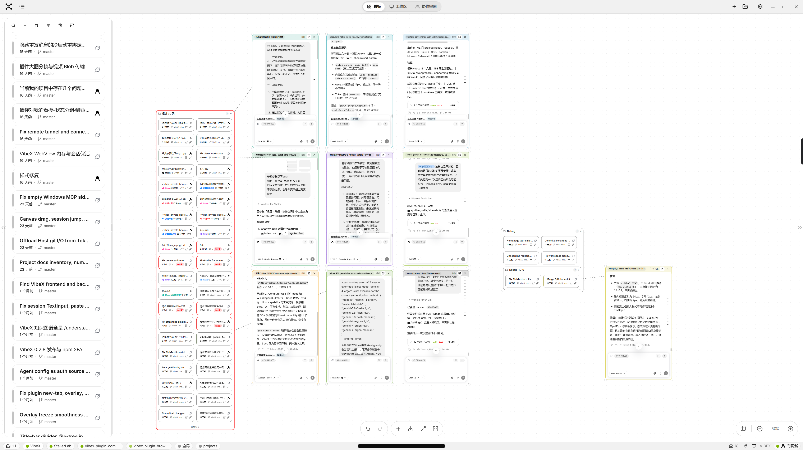
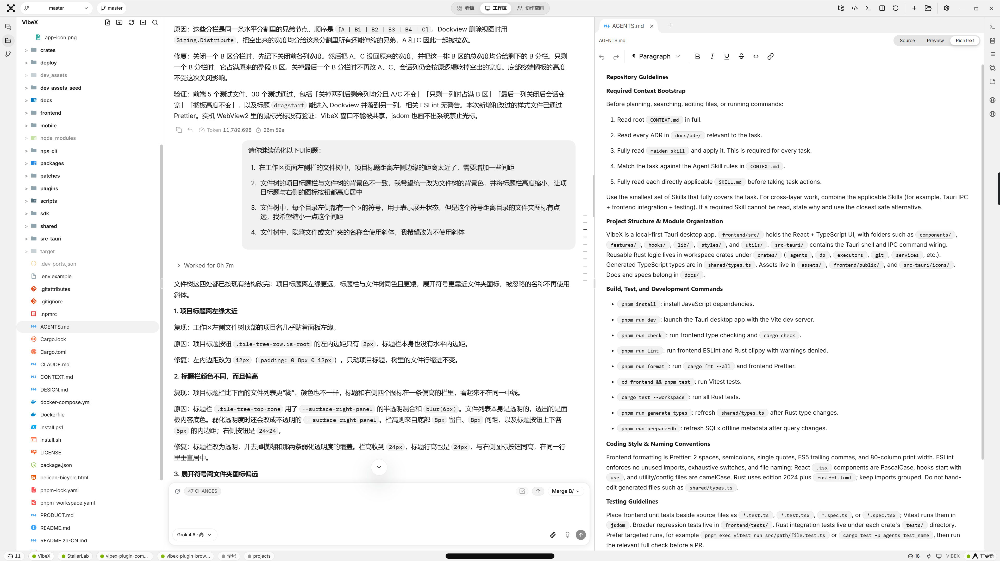
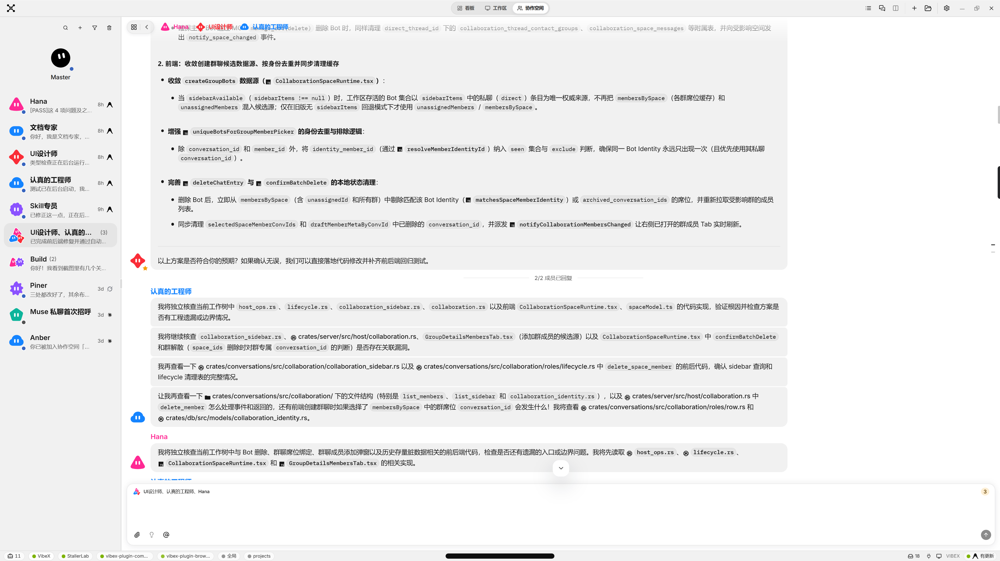
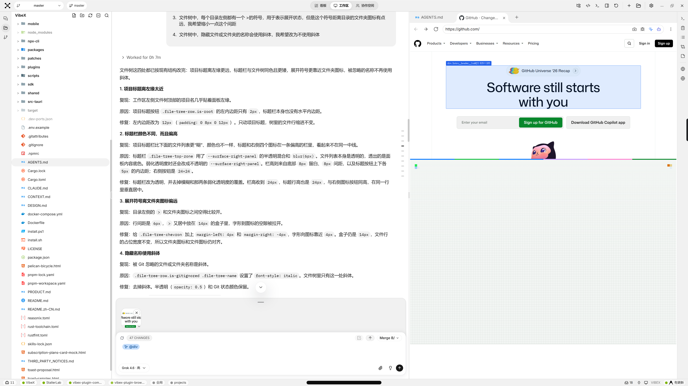
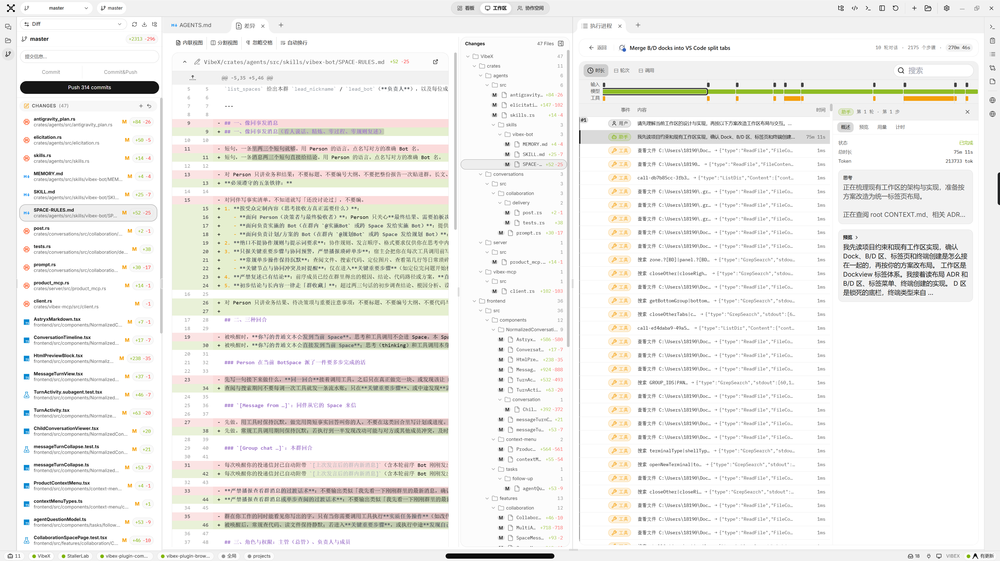
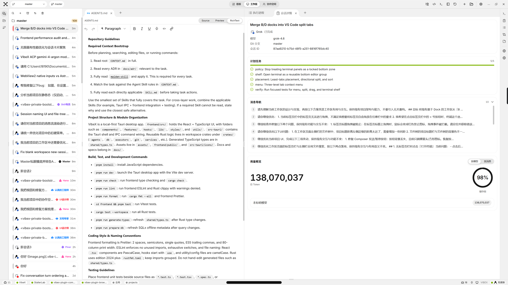
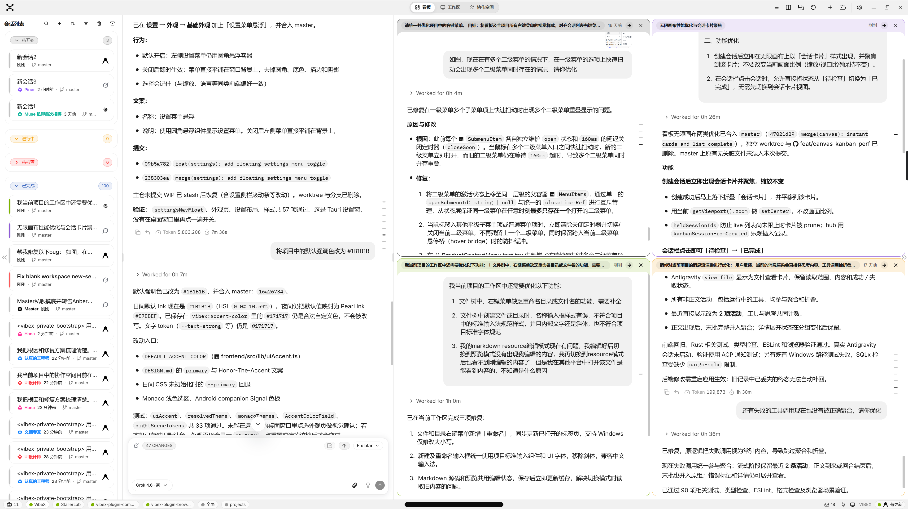
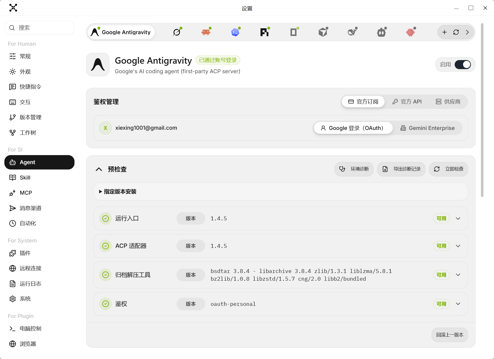
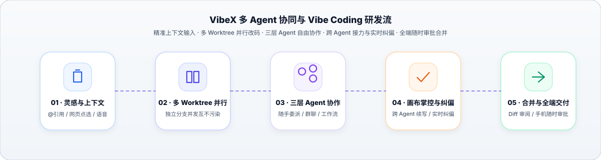
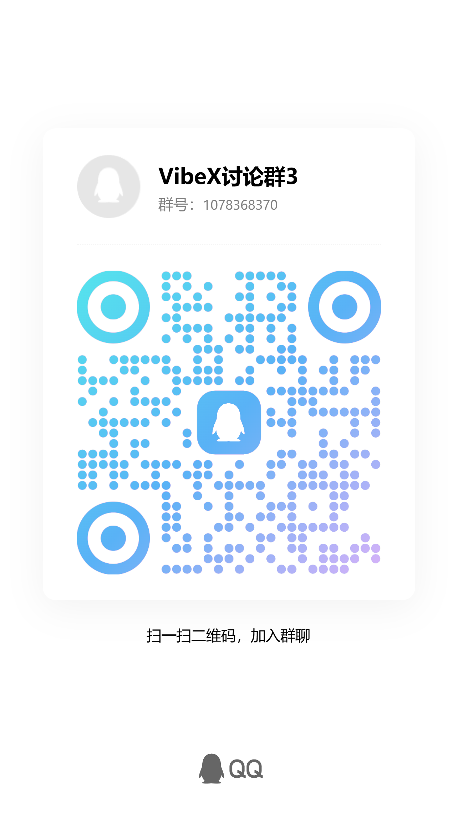

<div align="center">
  

  <h1>VibeX</h1>

  <p>
    <a href="./README.md">English</a> · <strong>简体中文</strong>
  </p>

  <p><strong>集成多 Agent 开发环境与 Vibe Coding 工具的综合一体化 Agent-Native 开发平台</strong></p>
  <p>
    提供多 Agent 可视化、手机 / 桌面端 / WebUI / Server 多 Host 互联开发、多 Worktree 工程化开发、<br/>
    三层 Agent 自由协作引擎、跨 Agent 会话迁移、多 Agent 鉴权及配置管理、自由标签 / 无限画布式工作空间等实用能力。<br/>
    <strong>一切皆插件</strong>的高度解耦与高性能设计，带给你最好的 Vibe Coding 体验。
  </p>

  <p>
    <a href="https://vibex.xforever.xin"></a>
    <a href="https://vibex.xforever.xin/#download"></a>
    <a href="https://vibex.xforever.xin/docs"></a>
    <a href="https://vibex.xforever.xin/marketplace"></a>
    <a href="https://www.npmjs.com/package/@omnione/vibex"></a>
  </p>
</div>

---

## 为什么选择 VibeX？

在真实的 Vibe Coding 中，开发者往往同时使用 Claude Code、Codex、Cursor、OpenCode、Antigravity 等多个 Agent，却受困于多开终端的割裂上下文、并发改码的代码冲突、单一编辑器的模型锁定，以及离开电脑就无法操控的断联体验。

**VibeX** 将多 Agent 开发环境与全套 Vibe Coding 生产力工具融为一体：

- **集成Agent，自由协作**：把主流 Coding Agent都变为可视化，多会话协作或GrokBot式的Team式协作，共享项目上下文、技能与工具生态，在不同 Agent 之间自由迁移迁移，自由协作。
- **既能直觉创造，也能严谨交付**：自由标签页与无限画布双模式，随你发挥，多 Worktree 并行隔离、实时 Diff 与冲突合并，让高频并发的 Vibe Coding 始终井然有序。
- **轻量高速，全端在线**：Rust 原生高性能底座配合「一切皆插件」的解耦设计，按需装配不臃肿；桌面、WebUI、远程服务器与手机 / IM 随时随地无缝接管。

---

## 核心功能与特色

### 1. 多 Agent 可视化开发环境
原生集成 **Claude Code、Codex、OpenCode、Cursor、Antigravity、DeepSeek、Grok** 等 20+ 主流 Coding Agent，采用**独立 Agent 引擎深度适配优先、ACP 生态兼容**策略。将原本黑盒的命令行转化为清晰的思考过程、工具调用、权限审批与改动轨迹，并支持一键扫描导入本机历史会话。

### 2. 自由标签页 / 无限画布双工作空间
将数十个实时交互会话窗口与代码编辑器、Git Diff、内置浏览器、终端同屏平铺、自由缩放与连线编组。

### 3. 三层 Agent 自由协作引擎
- **手动委派**：在输入框键入 `&Agent`（如 `&Codex`），即可派生对应Agent子会话并行处理独立任务，子会话也是一等公民。
- **AI 团队协作空间**：组建 Bot 团队，与GrokBot一样的体验！
- **可视化工作流与定时自动化**：拖拽编排多节点研发流水线与审批关卡，支持断点调试与定时自动运行。

### 4. 跨 Agent 会话迁移 · 实时纠偏 · 会话分叉
支持将当前会话上下文无缝**迁移至其他 Agent** 继续推进（例如由擅长架构的 Agent 完成设计后交由擅长编码的 Agent 实现）；生成途中可随时发送补充指令**实时纠偏（Steering）**而无需中断重来，也可从任意节点一键**分叉（Fork）**同时验证多种思路。

### 5. 多 Worktree 工程化并行开发
多路 Agent 同时开发新功能、修 Bug 或跑自动化任务时，自动分配独立的 **Git Worktree** 工作目录，保护主分支干净零冲突；内置代码编辑、分栏/统一 Diff 审阅、提交历史图谱与三栏可视化冲突合并器。

### 6. 多 Agent 鉴权及配置一站式管理
统一管理各 Agent 的官方账号订阅、API Key 与第三方供应商配置（支持一键导入 CC Switch 配置与接口测速），内置统一模型路由网关，并提供各账号套餐剩余额度、Token 用量与成本统计看板。

### 7. 手机 / 桌面端 / WebUI / Server 多 Host 互联开发
支持本地桌面端、远程无头 Server、浏览器 WebUI、一键 SSH 远端接入以及免公网 IP 的端到端加密异地直连；配备原生 **iOS / Android App**，并打通**微信、企业微信、飞书、Telegram、Slack、Discord** 机器人，随时随地查看进度、批复权限、下发新任务。

### 8. 「一切皆插件」的高度解耦与高性能设计
基于 Rust 打造轻量高速内核，坚持**一切皆插件**的模块化理念——无论是**内置浏览器**（网页元素点选直传 AI）、**Office 文档创作与预览**、**桌面电脑视觉操控**、**AI 行内代码补全**、**混合语音输入**、**提示词优化**还是**科研技能包**，均可按需即插即用，并可通过开放插件市场与多语言 SDK 自由扩展。

---

## 产品界面一览

<p align="center">
  
</p>

<p align="center">
  
</p>

<p align="center">
  
</p>

<p align="center">
  
</p>

<p align="center">
  
</p>

<p align="center">
  
</p>

<p align="center">
  
</p>

<p align="center">
  
</p>

---

## 平台全景与体验对比

<p align="center">
  
</p>

<p align="center">
  
</p>

| 体验维度 | 传统多开 CLI 终端 | 单一 AI 编辑器 | VibeX Agent-Native 开发平台 |
| :--- | :--- | :--- | :--- |
| **Agent 支持** | 多个终端各自为战 | 绑定单一内置模型/Agent | **20+ 主流 Agent 可视化统一调度与混编** |
| **工作空间** | 纯文本滚动窗口 | 固定单窗口布局 | **自由标签页 ↔ 无限画布一键无损切换** |
| **会话连续性** | 换工具即丢失上下文 | 跑偏需中断重来 | **跨 Agent 会话迁移 + 实时纠偏 + 自由分叉** |
| **多 Agent 协作** | 手动复制粘贴中转 | 仅限单会话内部调用 | **`&Agent` 随手委派 + AI 群聊空间 + 可视化工作流** |
| **工程化并行** | 手动切分支，极易冲突 | 单目录串行修改 | **多 Worktree 自动隔离 + Diff 审阅 + 三栏冲突合并** |
| **鉴权与配置** | 逐个命令行重复配置 | 封闭账号体系 | **订阅 / API / 供应商一站式管理 + 额度用量看板** |
| **跨端互联** | 依赖 SSH + tmux | 仅限本地桌面 | **手机 / 桌面 / WebUI / Server 多 Host 与主流 IM 互联** |
| **工具扩展** | 能力分散难复用 | 封闭耦合、越来越重 | **「一切皆插件」高解耦高性能设计，按需装配** |

---

## 快速开始

### 1. 下载桌面客户端（推荐）

前往 [VibeX 官方下载页](https://vibex.xforever.xin/#download) 获取原生安装包（支持自动更新）：

- **macOS**：Apple Silicon (`aarch64` `.dmg`) · Intel (`x64` `.dmg`)
- **Windows**：Windows 10 / 11 (`x64` / `arm64` `.exe`)
- **Linux**：主流发行版 (`x64` / `arm64` `.AppImage`)

### 2. 命令行 / Server / WebUI 一键启动

无需安装桌面端，也可在本地、远程服务器、云主机或 NAS 上一键启动服务端与 WebUI：

```bash
# macOS / Linux 一键安装
curl -fsSL https://raw.githubusercontent.com/Xircth/VibeX/master/install.sh | sh

# Windows PowerShell 一键安装
irm https://raw.githubusercontent.com/Xircth/VibeX/master/install.ps1 | iex
```

或通过 `npx` 直接运行：

```bash
npx @omnione/vibex          # 本机启动
npx @omnione/vibex serve    # 开启局域网 / 远程 WebUI 访问
npx @omnione/vibex list     # 查看支持一键安装的 Coding Agent
```

也支持 Docker 一键部署：`docker compose up -d`（更多服务端配置见 [无头 Server 部署指南](./docs/deployment/headless-server.md)）。

---

## 本地开发与文档导航

环境要求：Rust（见 [`rust-toolchain.toml`](./rust-toolchain.toml)）、Node.js `>= 20`、`pnpm 10.x`。

```bash
pnpm install      # 安装依赖
pnpm run dev      # 启动桌面端开发模式
pnpm run check    # 运行前后端类型与编译检查
```

- 架构设计、远程协议与工程文档：[**仓库文档总览 (`docs/README.md`)**](./docs/README.md)
- 插件使用与扩展开发指南：[**插件生态文档 (`docs/plugins/README.md`)**](./docs/plugins/README.md)

---

## 官方链接与社区交流

- **官方网站**：[https://vibex.xforever.xin](https://vibex.xforever.xin)
- **客户端下载**：[https://vibex.xforever.xin/#download](https://vibex.xforever.xin/#download)
- **在线文档**：[https://vibex.xforever.xin/docs](https://vibex.xforever.xin/docs)
- **插件市场**：[https://vibex.xforever.xin/marketplace](https://vibex.xforever.xin/marketplace)
- **CLI 工具包**：[https://www.npmjs.com/package/@omnione/vibex](https://www.npmjs.com/package/@omnione/vibex)

<div align="center">
  <table>
    <tr>
      <td align="center" width="260">
        <br />
        <sub><b>微信交流群</b>（扫码加入）</sub>
      </td>
      <td align="center" width="260">
        <br />
        <sub><b>QQ 交流群</b>（扫码加入）</sub>
      </td>
    </tr>
  </table>
  <p><strong>微信号</strong>：<code>M1X3X1X4</code></p>
</div>
