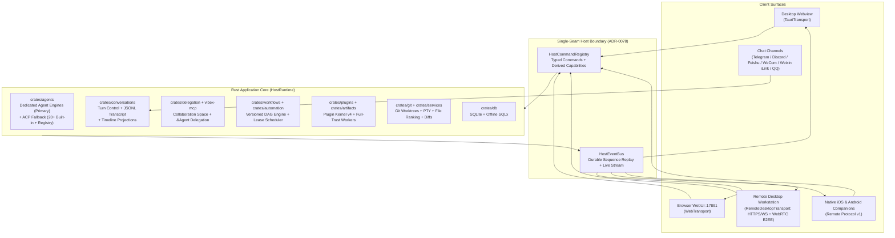

# VibeX System Architecture

VibeX is an all-in-one **Agent-Native Development Platform & Vibe Coding Toolkit** built on a Rust workspace backend and a React + TypeScript frontend. A single Rust execution core (**VibeX Host**) powers the native Tauri desktop app (`vibex`), the headless daemon (`vibex-server`), browser WebUI, remote desktop workstations (SSH / LAN / E2EE WebRTC), native iOS & Android companions, and bidirectional IM channels.

For domain terminology, read [`CONTEXT.md`](../CONTEXT.md). For historical design rationale, see [`docs/adr/`](adr/).

---

## 1. End-to-End Topology & Single-Seam Host

Only one **VibeX Host** owns a VibeX SQLite data directory at a time ([ADR-0033](adr/0033-shared-application-core-and-versioned-remote-transport.md), [ADR-0054](adr/0054-host-family-distribution-and-client-surfaces.md), [ADR-0078](adr/0078-host-command-registry-single-seam.md)). Every agent process, Git worktree, PTY terminal, DAG workflow, automation scheduler, plugin worker, and IM channel runs on the Host — clients render projections and issue typed commands over a unified seam.

### Key Architectural Seams

1. **`HostRuntime` & `ApplicationCore`** (`crates/application`, `crates/deployment`, `crates/local-deployment`): Tauri-agnostic and Axum-agnostic composition of all domain services. Neither `src-tauri` nor `crates/server` implements business rules; both adapt authentication and transport framing onto `HostRuntime`.
2. **`HostCommandRegistry` & `HostEventBus`** ([ADR-0078](adr/0078-host-command-registry-single-seam.md)): Every product command is registered once in `HostCommandRegistry` (`shared/hostCommands.ts` mirrors the contract on the frontend), and `/api/v1/capabilities` derives directly from it. Desktop-shell-only helpers (native OS file dialogs, CEF window host, local Host Console) stay explicitly outside the shared product registry. All push updates (conversation row-ops, workspace diffs, terminal streams, workflow progress) flow through `HostEventBus`.
3. **Frontend `BackendTransport`** (`frontend/src/lib/transport/`): React components and hooks never branch on Tauri vs HTTP vs WebRTC. At bootstrap, the window binds to a single `ServerProfile` ([ADR-0059](adr/0059-host-identity-and-pairing-invitation.md)) and instantiates:
   - `TauriTransport` for the local Desktop Host;
   - `WebTransport` for browser WebUI (`vibex serve`);
   - `RemoteDesktopTransport` for paired remote Hosts over LAN/SSH/Tailscale HTTPS+WS or NAT-traversing E2EE WebRTC DataChannels (`vibex-webrtc://`).

---

## 2. Dual-Stage Workbench (`frontend/src`)

VibeX pairs two synchronized workspaces over the same live conversation, file, terminal, and preview state:

- **Dockview IDE Stage** ([ADR-0042](adr/0042-conversations-are-first-class-dockview-panels.md), [ADR-0068](adr/0068-workspace-default-surfaces-and-activity.md)): Conversations are first-class Dockview tabs alongside CodeMirror/Monaco editors, 3-pane Git merge & diff views, multi-tab PTY + agent terminals, embedded CEF/Web preview tabs, and plugin App surfaces. Opening a project defaults to its **Project-root workspace** (`use_worktree: false`) rather than forcing an isolated worktree upfront.
- **Infinite Spatial Canvas Stage** (`@xyflow/react`): One-click toggle (`Alt+Shift+C`) projects up to **24 live interactive windows** onto a pan-and-zoom 2D canvas with 8-direction resize, smart snap guides, radial quick-create menu, minimap, and viewport persistence. Closing or rearranging panels only alters layout — in-flight turns continue uninterrupted on the Host.

Visual styling follows [`DESIGN.md`](../DESIGN.md) (`LegacyDesignScope`, tokenized CSS variables in `frontend/src/styles/legacy/index.css`, Liquid-Glass chrome over opaque content surfaces).

---

## 3. Agent Runtime: Dedicated Engine Adapters First, ACP Fallback (`crates/agents`)

All coding agents execute through `crates/agents` (`AgentRuntime`) under a two-tier integration policy (**Dedicated Agent Engine First, ACP Secondary**; [ADR-0087](adr/0087-dedicated-agent-engine-first-acp-fallback.md), [ADR-0010](adr/0010-agent-runtime-topology.md), [ADR-0035](adr/0035-acp-v2-dual-protocol-session-items.md), [ADR-0060](adr/0060-agent-installs-use-user-environment.md)):

- **Tier 1 — Dedicated Agent Engine Adapters (Primary)**: Core and deep-integration Coding Agents bind directly to their official SDKs, native protocols (such as `app-server` JSON-RPC), and native session/config/auth state rather than routing through generic `*-acp` wrappers. Dedicated engines preserve first-party control-plane fidelity (exact token & Prompt Cache TTL accounting, rate-limit reset timestamps, native steering, coordinated session/git rewind, subagent streams, and native status/quota visibility) and take precedence over generic ACP advertisements.
- **Tier 2 — ACP Compatibility Pipeline (Secondary Fallback)**: Built-in profiles without a dedicated native engine driver, dynamic entries from the **ACP Official Registry**, and user-declared `npx`/`uvx`/binary distributions run through the shared Agent Client Protocol (ACP v1 baseline + v2 negotiated capabilities) pipeline.
- **20 Built-in Agent Profiles** (`BuiltInProfileCatalog::bundled()` in `crates/agents/src/profiles.rs`): Claude Code, Codex, Pi, OpenCode, Grok, Cursor, DeepSeek Harness, Google Antigravity, Cline, OpenClaw, Hermes, CodeBuddy, Kimi Code, Qoder, Kiro CLI, Auggie, TRAE CLI, Command Code, ZCode, and OMP.
- **User-Environment Installation**: Agents install into and resolve from the user's own environment (`PATH`, npm global prefix, `uv tool`, `~/.local/bin`), recorded via verifiable `InstallationLock` entries rather than opaque private runtime copies.
- **Unified Auth & Provider Presets** ([ADR-0063](adr/0063-model-provider-presets-not-cc-switch.md), [ADR-0064](adr/0064-unified-agent-authentication-modes.md), [ADR-0085](adr/0085-modelrouter-is-a-webview-side-provider-source.md)): Each profile declares supported auth modes (`Official Subscription`, `Official API`, or `Model Provider Preset`). Secrets remain in Rust/native config files and are never echoed back to the frontend.
- **Role of `crates/executors`**: `crates/executors` **never runs coding agents**. It retains only (1) `ScriptRequest` execution for setup/cleanup/dev-server shell scripts, (2) legacy `BaseCodingAgent` / `ExecutorConfig` profile types, and (3) shared `NormalizedEntry` log structures.

---

## 4. Conversations, Turns & Transcript Authority

Conversations separate **control-plane state** from **user-visible history** ([ADR-0044](adr/0044-conversation-control-plane-and-durable-inputs.md), [ADR-0082](adr/0082-jsonl-transcript-window.md)):

- **JSONL / Vendor Transcript Authority**: User-visible conversation history is anchored in append-only JSONL or native vendor session files (`ADR-0082`), surviving process restarts independently of any running agent PID.
- **Durable Control Plane (`crates/conversations` & `crates/db`)**: Tracks revisioned drafts, ordered queued inputs, delayed inputs, in-flight **Turn Steering**, interactive permission/question prompts, **Session Fork** ([ADR-0005](adr/0005-session-fork-copies-events.md)), and deterministic startup recovery (`Completed | Failed | Cancelled | Interrupted`).
- **Timeline Row Projections**: Events fold into monotonic `TimelineRow` (`row_id` + `revision`) updates streamed over `HostEventBus` and rendered exclusively by `AgentTimelineConversation`.

---

## 5. Multi-Agent Collaboration, Delegation & DAG Workflows

VibeX provides three complementary orchestration primitives — each designed for a distinct coordination pattern:

### Collaboration Member Identity {#collaboration-member-identity}

**Collaboration Space** is a built-in Host capability (toggled under `Settings → General → Collaboration Space`, enabled by default; see [ADR-0057](adr/0057-session-enhance-and-multi-agent-plugins.md) and [ADR-0069](adr/0069-everything-is-a-plugin-platform.md)):

- **Bot (`collaboration_members` / `member_id`)**: A persistent collaborator identity configured with a display name, optional persona/role seed, bound Agent profile, and workspace scope. In UI copy, a bot is labeled **助手 / Bot** (`member` in Rust/TS identifiers).
- **Hidden Seat Conversations**: Users interact with bots and rooms, never raw underlying session IDs. Each bot owns a family of hidden conversations:
  - **Direct Thread (`dm`)**: One 1:1 conversation with stable key `direct:<member_id>`, created when the bot is created.
  - **Group Space (`space` / `kind: group`)**: A multi-bot room with an append-only shared room log (`space_messages` with monotonic sequence numbers). Each bot in the room occupies a **Space Member Seat** backed by its own hidden conversation for that group.
- **Per-Recipient Delivery Receipts**: Posting a `SpaceMessage` appends once to the shared room log and dispatches per-recipient deliveries to targeted bot seat conversations, tracking `DeliveryReceipt` states (`queued → processing → replied | passed | timed_out | cancelled`, plus derived `failed` / `limit_reached`). Changing a Role or Bot configuration later does not retroactively mutate persona projections on existing conversations.

### `&Agent` LLM-Mediated Delegation (`crates/delegation` + `crates/vibex-mcp`)

Typing `&Agent` in the Composer inserts a structured mention ([ADR-0031](adr/0031-llm-mediated-delegation-and-ampersand-agent-mentions.md), [ADR-0065](adr/0065-composer-at-reference-panel.md)). Rather than blindly spawning a frontend tab, the parent agent invokes `delegate_to_agent` via `vibex-mcp` to spin up an audited, bounded child `DelegatedConversation` (configurable max depth, defaults to `1`), or `create_conversation` for a persistent peer `SpawnedConversation`.

### Versioned DAG Workflows & Automations (`crates/workflows` + `crates/automation`)

- **Workflows** ([ADR-0045](adr/0045-workflows-orchestrate-conversation-turns.md)): `*.vibex-workflow.json` source artifacts edit cleanly in Workflow Studio or via `vibex-workflow-mcp`, and explicitly **publish** into immutable `WorkflowDefinition` versions. Steps (`AgentStep` backed by real child Conversations + `ApprovalStep` + `CompletionGate`) pass outputs along DAG edges, supporting pause/resume, per-node breakpoints, `needs_review` safety stops, and checkpoint-verified partial reruns (`DerivedWorkflowRun`).
- **Automations**: Versioned manual or cron triggers pinned to either a single-conversation Turn or an exact published Workflow version. A single-owner database lease ensures only one Host claims due runs, isolating work in dedicated Git worktrees by default with 30-day / 10 GiB retention.

---

## 6. Plugin Platform v4 (`crates/plugins`)

Under **Everything is a Plugin** ([ADR-0046](adr/0046-full-stack-plugin-platform-and-isolated-sdk.md), [ADR-0047](adr/0047-product-centric-plugin-package-and-content-model.md), [ADR-0048](adr/0048-full-trust-plugin-execution-model.md), [ADR-0069](adr/0069-everything-is-a-plugin-platform.md)):

- **Zero Official Privilege**: Official plugins (`plugins/*` and `vibex-plugin.json`) use the exact same public `@vibex/plugin-sdk` (`^2.0.0`), manifest schema, and **23 contribution kinds** (`L0` Content, `L1` Descriptor UI, `L2` Provider Seams, `L3` Custom Views across host descriptor, Module Federation, and sandboxed iframe tracks) as third-party authors — enforced in CI by `pnpm run plugin:no-privilege`.
- **Single-Layer Extension**: Plugins target Host contribution points only; plugins never depend on or expose extension points to other plugins.
- **Activation Generations & Dual Activation Semantics**: Enabling or updating a plugin atomically publishes an immutable `ActivationGeneration` after verifying `RuntimeInstallationLock` probes. UI & Provider contributions take effect immediately; Agent contributions (Skills, MCP, Hooks) apply cleanly to newly created or rebound sessions.

---

## 7. Repository & Workspace Map

### Rust Cargo Workspace (26 Members)

| Crate / Binary | Responsibility |
| --- | --- |
| `src-tauri` (`vibex`) | Native Tauri v2 desktop shell, multi-window management, CEF host integration, local Host Console, and IPC wiring onto `HostRuntime`. |
| `crates/server` (`vibex-server`) | Headless Axum HTTP + WebSocket Host binary serving Remote Protocol v1 and static WebUI (`web/`), plus in-place host upgrade logic. |
| `crates/application` | Transport-agnostic `ApplicationCore` & `HostRuntime` use-case facade. |
| `crates/remote-protocol` | Versioned Remote Protocol v1 DTOs, capability bitsets, pairing envelopes, durable attach frames, and OpenAPI/JSON Schema generator. |
| `crates/agents` | Unified `AgentRuntime`: dedicated native Agent engine drivers (primary) + ACP v1/v2 compatibility runtime (secondary), 20 built-in profiles, ACP Registry client, auth/provider projection, and plan/usage probes. |
| `crates/conversations` | Event-sourced Turn lifecycle, durable input queue, Turn Steering, JSONL transcript windowing, and `TimelineRow` projections. |
| `crates/delegation` & `crates/delegation-proto` | Broker, spawner, Collaboration Space message/receipt engine, and wire protocol for agent-to-agent delegation. |
| `crates/vibex-mcp` (`vibex-mcp`) | Host-managed stdio/HTTP MCP companion exposing delegation, Collaboration Space, and `vibex.session-enhance` tools to agent sessions. |
| `crates/workflows` | Immutable DAG `WorkflowDefinition` compiler, checkpointed `WorkflowRun` state machine, debug runs, and run subscriptions. |
| `crates/vibex-workflow-mcp` (`vibex-workflow-mcp`) | Host-managed MCP companion adapting `workflow_*` authoring, inspection, and debug tools to `crates/workflows`. |
| `crates/automation` | Single-owner lease scheduler, due-claim transactions, recovery reconciliation, and worktree/disk retention GC. |
| `crates/plugins` | Plugin Kernel v4: package inspector, marketplace/GitHub installer, runtime lock resolver, Full-Trust Node/Python/Rust worker supervisor, and contribution registry. |
| `crates/plugin-sdk` | Rust Worker SDK for authoring native VibeX v4 plugin workers. |
| `crates/tool-runtime` | Deterministic CLI/binary runtime resolution, SHA-256 verification, bounded health probing, and reference-counted installation locks. |
| `crates/artifacts` | File-backed artifact identity tracking and reference-counted `ArtifactPreviewLease` lifecycle. |
| `crates/browser-host` | Embedded browser tab lifecycle, cookie persistence, DOM element inspection, and preview bridge. |
| `crates/git` | Domain-split Git engine (worktrees, diffs, branches, remotes, 3-way conflict resolution, commit stats) over `git2` + CLI fallback. |
| `crates/services` | Workspace orchestration, filesystem watcher, fuzzy file ranking, PR monitoring, chat channels (6 IM platforms), config, and approvals. |
| `crates/db` | SQLite persistence layer, SQLx migrations, and offline `.sqlx` query cache. |
| `crates/deployment` & `crates/local-deployment` | Core `Deployment` service trait and local process/PTY/worktree implementation. |
| `crates/executors` | Workspace lifecycle shell scripts (`ScriptRequest`), `BaseCodingAgent` identity/config schemas, and shared log normalization. |
| `crates/review` | Standalone CLI code-review utility. |
| `crates/api-types` & `crates/utils` | Shared wire/API types (`#[derive(TS)]` → `shared/types.ts`) and cross-platform utilities. |

### Frontend, Packages, Plugins & Mobile

| Directory | Responsibility |
| --- | --- |
| `frontend/` | React 18 + TypeScript + Vite workbench (Dockview IDE stage, `@xyflow/react` Spatial Canvas, `BackendTransport`, NormalizedConversation, Settings). |
| `shared/` | Generated Rust→TS contracts (`shared/types.ts`) and unified Host command catalog (`shared/hostCommands.ts`). |
| `packages/` | Plugin toolchain monorepo packages: `@vibex/plugin-sdk` (`plugin-sdk/`), `vibex-plugin` CLI (`plugin-cli/`), `@vibex/plugin-contract` (`plugin-contract/`), `@vibex/plugin-sdk-python` (`plugin-sdk-python/`). |
| `plugins/` | 17 official full-trust v4 plugins (`ayu-theme`, `browser`, `code-completion`, `computer-use`, `kanban-views`, `notes`, `office`, `open-connector`, `plugin-development`, `prompt-enhancer`, `provider-switch`, `remote-ssh`, `science`, `session-enhance`, `tauri-ui-debugger`, `voice-input`, `workflow-creator`). |
| `npx-cli/` | `@omnione/vibex` npm CLI (`vibex serve`, `vibex list/install`, remote Host commands, and `vibex plugin` management). |
| `mobile/ios/` & `mobile/android/` | Native SwiftUI iOS ([ADR-0084](adr/0084-native-swiftui-ios-companion.md)) and Kotlin/Jetpack Compose Android ([ADR-0041](adr/0041-native-kotlin-compose-android-companion.md)) Companion apps over Remote Protocol v1. |
