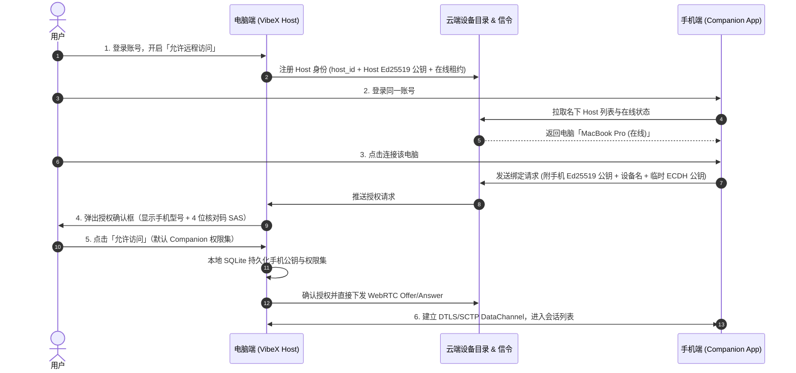
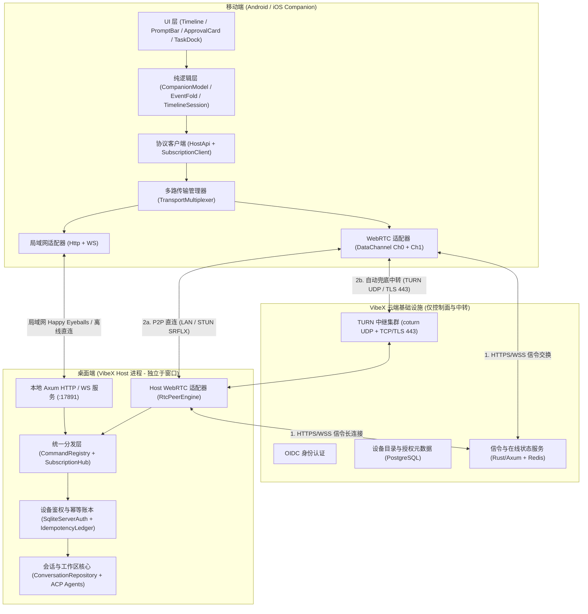

# VibeX 跨网络设备互联与 WebRTC 传输架构开发文档

- **文档状态**：Draft（架构设计与开发规范，暂不改动业务代码）
- **适用范围**：VibeX Desktop Host (`crates/server`, `crates/remote-protocol`, `crates/application`)、Android Companion (`mobile/android`)、iOS Companion (`mobile/ios`)、VibeX Cloud Signaling & TURN Service
- **关联文档**：
  - [ADR-0033: Shared Application Core and Versioned Remote Transport](../adr/0033-shared-application-core-and-versioned-remote-transport.md)
  - [ADR-0041: Native Kotlin Compose Android Companion](../adr/0041-native-kotlin-compose-android-companion.md)
  - [ADR-0054: Host Family Distribution and Client Surfaces](../adr/0054-host-family-distribution-and-client-surfaces.md)
  - [ADR-0059: Host Identity and Pairing Invitation](../adr/0059-host-identity-and-pairing-invitation.md)
  - [ADR-0078: Host Command Registry Single Seam](../adr/0078-host-command-registry-single-seam.md)
  - [ADR-0084: Native SwiftUI iOS Companion](../adr/0084-native-swiftui-ios-companion.md)
  - [Host 事件与时间线折叠规范](./host-events.md)

---

## 1. 设计背景与核心目标

### 1.1 解决的核心问题
现有配对与连接依赖用户理解“局域网 IP、二维码重扫、USB `adb reverse`、手动远程隧道”，在以下真实场景中摩擦极大：
1. **公共/办公/校园 Wi-Fi 开启 AP 客户端隔离**：手机与电脑虽在同一子网（如 `172.24.0.0/16`），但二层 ARP 不通，局域网直连必现超时。
2. **电脑开启代理软件 TUN 模式（Clash / Surge / Mihomo）**：虚拟网卡（`utun*`，`198.18.0.0/15`）污染局域网地址列表并劫持默认路由。
3. **跨网段与移动场景**：用户从办公室 Wi-Fi 走到电梯（5G 蜂窝网络）再回到家，IP 变化导致连接中断或需手动切换入口。
4. **连接假死与状态失真**：网络切换或前后台切换后，通道未及时恢复，或将连接超时错误展示为“高延迟”。

### 1.2 总体设计原则（五句话纲领）
1. **账号统一设备发现**：登录同一账号即可看到名下电脑及其实时在线/休眠状态，无需手工输入 IP 或端口。
2. **设备密钥建立信任**：账号只负责“找到电脑”，首次连接必须经电脑端显式确认并绑定设备非对称公钥；登录同一账号不等于自动获得控制权。
3. **WebRTC 优先直连，TURN 首包并行兜底**：从连接发起第 0 毫秒起同时收集局域网、STUN 与 TURN（UDP + TCP/TLS 443）候选，Trickle ICE 边收集边协商，谁先通就用谁。
4. **业务层负责断线恢复与幂等**：WebRTC 只做传输管道，不承担业务可靠性；命令去重、漏消息补齐、会话恢复完全复用 VibeX 现有的持久序号（`sequence`）与命令注册表。
5. **云服务可选，局域网兜底**：不强制所有用户注册登录云账号；未登录用户仍可使用本机与局域网扫码配对。

---

## 2. 用户体验与状态机规范（UX & State Machine Spec）

### 2.1 首次使用体验（零配置信任建立）


### 2.2 日常使用与连接体验规范
1. **零操作直连**：
   - 手机冷启动后，若名下只有一台已授权电脑，直接自动发起连接并展示上次打开的项目/会话，不增加“选设备”步骤。
   - 名下有多台电脑时，默认连接上次活跃的电脑，顶部设备栏可一键切换其它电脑。
2. **单一入口跨全网**：
   - 同一 Wi-Fi、校园隔离网、5G 蜂窝网络、异地宽带全部走同一套自动寻路逻辑，**严禁在 UI 上让用户手动切换“局域网模式 / 公网模式 / 隧道模式”**。
3. **精确区分电脑状态**：
   - `Online（在线）`：绿色呼吸点，实时收发。
   - `Reconnecting（恢复中）`：手机切网或刚从后台切回，顶部细横幅无阻塞重连，允许查看已缓存内容。
   - `Host Sleeping（电脑已休眠）`：电脑合盖休眠前主动上报 `sleeping` 状态，手机明确展示“电脑已休眠”，进入离线只读模式。
   - `Host Offline（电脑已离线）`：电脑退出 VibeX 或断网超时，展示“电脑离线”，保留本地历史会话只读浏览。
4. **指标展示规范（强制执行）**：
   - **「上次连接耗时（Connect Duration）」** 与 **「实时网络往返延迟（RTT）」** 必须拆分为两个独立字段。
   - 连接失败或超时时，必须明确展示 `连接失败（原因：电脑离线 / 网络受限 / 授权已撤销）`，**严禁将 48 秒超时时间显示为 `48000ms` 延迟**。

---

## 3. 系统架构与 VibeX 接入边界

### 3.1 分层架构图


### 3.2 VibeX 现有模块复用与改造边界

| 现有能力 | 代码位置 | 处理方式 | 规范要求 |
| :--- | :--- | :--- | :--- |
| **Host 身份 (`host_id`)** | `crates/utils/src/assets.rs` (`load_or_create_host_id`)<br>`<data_dir>/host-identity.json` | **直接复用** | 云端设备目录直接关联现有 `host_id`，在同一身份文件中补充或关联 Host 的 Ed25519 公钥。 |
| **网卡枚举与代理过滤** | `crates/utils/src/net.rs` (`host_interface_addresses`, `is_advertisable_ipv4`) | **扩展增强** | 复用已有 `198.18.0.0/15` / loopback / link-local 过滤，新增虚拟隧道网卡名黑名单（非 Tailscale 的 `utun*`/`tun*` 等）与物理网卡绑定。 |
| **设备权限体系** | `crates/remote-protocol/src/device_auth.rs` (`DevicePermissionPreset`)<br>`mobile/ios/Sources/CompanionCore/CompanionScopes.swift` | **直接复用** | 保持 `companion` 预设权限边界（可读会话、可发消息、可审批、禁止越权写插件/任意宿主机命令）。 |
| **设备鉴权与存储** | `crates/server/src/auth.rs` (`SqliteServerAuth`)<br>`crates/db/migrations/` | **扩展字段** | 在 `server_device_credentials` 表扩展 `public_key_ed25519` 字段与 `companion_idempotency_ledger` 幂等去重账本表；同一 `DeviceId` 同时支持 Bearer `token_hash`（局域网 HTTP/WS）与 Ed25519 公钥（WebRTC DTLS 绑定），一次配对双通道通用。 |
| **业务命令分发** | `crates/application/src/command.rs` (`CommandRegistry::execute_name`)<br>`crates/server/src/runtime.rs` (`/api/v1/call/{command}`) | **100% 复用** | WebRTC 控制通道收到的 RPC 请求直接路由至 `CommandRegistry::execute_name` 及只读端点（`capabilities` / `offline` / `notification_summary`），复用 `CommandRequest.operation_id`，不写第二套业务逻辑。 |
| **会话事件与增量补齐** | `crates/server/src/ws.rs`<br>`crates/remote-protocol/src/subscription.rs` | **100% 复用** | WebRTC 事件流直接复用 `SubscriptionClientMessage`（`attach` / `detach` / `ping`）与 `SubscriptionServerMessage`（`ready` / `snapshot` / `event` / `live` / `detached` / `pong` / `error`）及 `after_sequence` 机制。 |
| **局域网 HTTP / WS** | `crates/server/src/runtime.rs`<br>`mobile/ios/Sources/CompanionCore/HostClient.swift` | **完整保留** | 作为未登录云账号时的离线入口，以及同局域网下的 Happy Eyeballs 加速通道。 |
| **宿主进程生命周期** | `src-tauri/` + `crates/server` | **强制约束** | **WebRTC 引擎必须运行在 Rust Host 后台服务侧**，绝不能运行在前端 Tauri WebView 窗口中。 |

---

## 4. 连接策略与穿透工程规范（WebRTC + ICE + TURN）

### 4.1 Happy Eyeballs 并发寻路策略
手机端发起连接时，由 `TransportMultiplexer` 自动执行以下流水线（用户无感知）：
1. **第 0ms 同时启动**：
   - **WebRTC Trickle ICE 全量通道**：向信令服务发送连接请求，同时向本机网卡、STUN、TURN（UDP 与 TCP/TLS 443）发起候选收集（**严禁等直连超时后再申请 TURN 候选**）。
   - **局域网快速探针（仅当设备目录含局域网地址或本地已缓存时）**：并发对局域网地址发起 250ms 超时的健康/鉴权探测。
2. **路径选定与防抖（Anti-Flapping）**：
   - ICE 按标准优先级自动优选可用的直连路径（`host` > `srflx` > `prflx` > `relay`）。
   - **关键稳定性红线**：一旦通过 `relay`（TURN 中转）成功建立连接并正在进行会话交互，**严禁为了追求“必须 P2P”而主动断开或频繁重协商打断当前正在进行的生成/审批操作**。仅在下一次空闲心跳周期或网络接口发生变化时才尝试平滑迁移。

### 4.2 本机代理虚拟网卡（TUN）与 AP 隔离防御规范
针对桌面端开启 Clash / Surge / Mihomo / VPN 等工具的场景，Rust Host 端必须满足以下硬性规范：
1. **虚拟接口与保留网段黑名单**：
   - 在枚举 Host Candidate 时，必须过滤：
     - 基准测试与 Fake-IP 网段：`198.18.0.0/15`（`198.18.0.0` ~ `198.19.255.255`）
     - 链路本地与环回：`127.0.0.0/8`、`169.254.0.0/16`、`fe80::/10`
     - 代理虚拟隧道网卡：非 Tailscale（`100.64.0.0/10`）的 `utun*`、`tun*`、`tap*`、`veth*`、`docker*`
2. **物理出口网卡绑定（Socket Interface Binding）**：
   - Host 侧发起 STUN / TURN 连接时，应探测系统真实物理默认网关网卡（如 macOS `en0`），通过 `IP_BOUND_IF`（macOS）或 `SO_BINDTODEVICE`（Linux）绑定物理网卡，防止 TURN UDP 流量被本机 TUN 代理规则吞噬。

### 4.3 TURN 生产服务配置规范（`coturn`）
1. **多协议入口**：
   - `UDP 3478`：常规低延迟穿透与中转路径。
   - `TCP / TLS 443`：针对禁用 UDP 的企业网/校园网/严格防火墙。**注意：TURN 443 端口必须直连 `coturn` 进程或四层负载均衡（NLB/HAProxy TCP），严禁套在 Nginx/Cloudflare 普通七层 HTTP 反向代理后面**。
   - **明确支持边界**：对于强制要求所有 443 流量通过企业 HTTP CONNECT 代理并实施 SSL 解密审查的极端内网，文档与错误提示需明确告知不支持，不做“100% 穿透一切网络”的虚假承诺。
2. **短期动态凭据（REST API Ephemeral Credentials）**：
   - 严禁在客户端硬编码静态 TURN 账号密码。
   - 采用 `coturn` 标准 `use-auth-secret`（HMAC-SHA1 动态令牌）：信令服务在验证设备授权关系后，动态签发有效期为 **600 秒（10 分钟）** 的临时凭据（`username = "<unix_expiry>:<device_id>"`）。
3. **配额与带宽保护**：
   - 单设备最大并发 Allocation 数：`<= 4`。
   - 单会话带宽上限（`bps-capacity`）：`2,097,152 bps`（约 2MB/s，足以支撑实时流式对话、代码浏览与 Diff 传输，同时防止恶意跑满云带宽）。
   - 安全禁止项：必须在 `coturn` 中开启 `no-loopback-peers`、`no-multicast-peers` 并屏蔽云内网元数据网段（`10.0.0.0/8`、`169.254.169.254` 等），防止 SSRF 攻击。

---

## 5. 信任机制、密钥绑定与撤销闭环规范

### 5.1 端到端设备密钥体系
1. **密钥算法**：统一采用标准 **Ed25519**（签名/验签）与 **X25519**（密钥协商），使用经过安全审计的标准密码库（Rust 端使用 `ed25519-dalek` / `ring`；Android 使用 `AndroidKeyStore` / `Tink`；iOS 使用 `CryptoKit` + `Keychain`）。**严禁自创加密算法或手写密码学原语**。
2. **密钥生命周期**：
   - 每台客户端与每台 Host 在首次初始化时生成独立的设备身份密钥对。
   - 私钥永久保存在操作系统安全存储中，不可导出；云端设备目录仅存储设备公钥与基础元数据（设备名、系统类型、创建时间）。

### 5.2 信令与 DTLS 信道绑定（Channel Binding）
为防止信令服务器被攻破或重放攻击，采用 **SDP DTLS 指纹签名绑定**：
1. 手机与 Host 在生成 WebRTC SDP `offer` / `answer` 时，提取 SDP 中的本端 DTLS 证书指纹（`a=fingerprint:sha-256 <FINGERPRINT>`）。
2. 发送方构造签名原文：
   ```text
   vibex-webrtc-v1|<session_nonce>|<sender_device_id>|<recipient_device_id>|<unix_timestamp>|<dtls_fingerprint>
   ```
3. 使用本端 **Ed25519 私钥** 对上述原文签名，随信令包一同发送。
4. 接收方收到信令后：
   - 第一步：检查 `recipient_device_id`、`unix_timestamp`（允许 ±60s 偏差）及 `session_nonce` 是否重放。
   - 第二步：使用本地已信任的对方 **Ed25519 公钥** 验证签名。
   - 第三步：验签通过后，强制校验后续 DTLS 握手对端证书哈希与签名中的 `<dtls_fingerprint>` 完全一致。
5. **效果**：无需在 DataChannel 内再套一层 TLS，直接把 WebRTC 原生 DTLS 信道死死绑定在双方的硬件级设备密钥上。

### 5.3 首次授权与防弹窗冒充（SAS 核对码）
1. 新设备首次请求连接某台 Host 时，Host 绝不自动放行。
2. Host 与手机基于双方公钥与 `session_nonce` 计算 HKDF，取前 2 字节生成 **4 位十进制核对码（SAS，如 `8392`）**。
3. 手机屏幕显示“正在等待电脑确认（核对码：`8392`）”，电脑弹窗显示“手机 `Honor DIO-AN00` 请求访问（核对码：`8392`）”。
4. 用户在电脑端点击「允许」后，Host 将 `{ device_id, public_key_ed25519, scopes, trusted_at }` 写入本地 SQLite `server_device_credentials` 表，并同步授权关系摘要至云端。

### 5.4 设备撤销三级闭环（Revocation Closure）
当用户在电脑端或账号中心撤销某台手机时，必须同时完成以下三步：
1. **云端即时拒签**：云端设备目录将该授权标记为 `revoked`，立即停止向该手机签发新的 TURN 凭据，并拒绝转发其发往该 Host 的任何信令。
2. **在线 Host 秒级断连**：云端通过信令长连接向在线 Host 推送 `device_revoked` 事件；Host 立即更新本地 SQLite，并主动销毁（`close()`）该设备当前活跃的所有 WebRTC PeerConnection 与本地 WebSocket 会话。
3. **离线 Host 启动同步**：若撤销发生时 Host 处于休眠/离线状态，Host 下次启动连接云端时，**必须先完成撤销列表同步并更新本地 SQLite，然后才开始处理任何入站连接请求**。

---

## 6. 双 DataChannel 协议与业务恢复规范

### 6.1 双 DataChannel 职责与流控规范

在同一 `RTCPeerConnection` 下固定创建两条 DataChannel：

| 通道名称 | Label | 配置属性 | 承载内容 | 限流与背压规范 |
| :--- | :--- | :--- | :--- | :--- |
| **控制与事件通道** | `vibex.control.v1` | `ordered = true`<br>`maxRetransmits = null` (可靠) | 1. RPC 请求与响应（发送消息、审批、回答问题、模式切换）<br>2. 会话订阅 (`attach`) 与实时增量事件 (`event`)<br>3. 应用层心跳 (`ping`/`pong`) | 单帧最大 `64KB`；高优先级立即入队。 |
| **批量数据通道** | `vibex.bulk.v1` | `ordered = true`<br>`maxRetransmits = null` (可靠) | 1. 工作区文件树与文件内容读取<br>2. 大体积 Git Unified Diff<br>3. 图片/附件分块上传与下载 | **强制分片**：每片 `16KB ~ 32KB`。<br>**水位线背压**：设置 `bufferedAmountLowThreshold = 64KB`；当 `bufferedAmount > 128KB` 时立即暂停写入，等待 `onBufferedAmountLow` 触发，严禁填满底层 SCTP 拥塞窗口阻塞控制通道。 |

### 6.2 控制通道与批量通道帧协议（JSON Envelope）
为实现与现有 `CommandRegistry`（[ADR-0078](../adr/0078-host-command-registry-single-seam.md)）、`HostClient` 和 `ws.rs` 零成本对接，消除双套信封或双套幂等键：
- 命令调用直接复用 `CommandRequest` 的 `operation_id` 作为唯一请求 ID 与幂等去重键（与 [host-events.md](./host-events.md) 第 3 节「所有写都带客户端生成的 `operation_id`，重试同一 id 不得产生第二条输入」保持严格一致）。
- 订阅控制与推送帧直接内嵌 `crates/remote-protocol/src/subscription.rs` 中的 `SubscriptionClientMessage` 与 `SubscriptionServerMessage` 序列化结构，不做二次字段重命名。

```json
// 1. 命令调用请求帧 (对应 POST /api/v1/call/{command} 的 CommandRequest)
{
  "frame": "rpc_request",
  "operation_id": "01930c8a-7b12-7000-8000-000000000001",
  "command": "conversation_input_submit",
  "args": {
    "request": {
      "conversationId": "c8b6d31f-0000-4000-8000-000000000000",
      "payload": {
        "agentId": "claude_code",
        "workspaceId": "w1",
        "text": "帮我检查一下单元测试"
      }
    }
  }
}

// 2. 命令调用成功响应帧 (对应 CommandResponse<T>)
{
  "frame": "rpc_response",
  "operation_id": "01930c8a-7b12-7000-8000-000000000001",
  "status": 200,
  "data": { "inputId": "f1e2d3c4-0000-4000-8000-000000000000", "status": "submitted" }
}

// 3. 命令调用错误响应帧 (对应 ErrorEnvelope)
{
  "frame": "rpc_error",
  "operation_id": "01930c8a-7b12-7000-8000-000000000001",
  "status": 409,
  "error": {
    "code": "conflict",
    "message": "turn has already completed",
    "retryable": false,
    "operation_id": "01930c8a-7b12-7000-8000-000000000001"
  }
}

// 4. 订阅控制帧 (100% 复用 SubscriptionClientMessage)
{
  "frame": "sub_client",
  "payload": {
    "type": "attach",
    "request": {
      "subscription_id": "01930c8a-7b12-7000-8000-000000000010",
      "resource": "conversation",
      "conversation_id": "c8b6d31f-0000-4000-8000-000000000000",
      "after_sequence": 142
    }
  }
}

// 5. 订阅服务端推送帧 (100% 复用 SubscriptionServerMessage)
{
  "frame": "sub_server",
  "payload": {
    "type": "event",
    "subscription_id": "01930c8a-7b12-7000-8000-000000000010",
    "event": {
      "sequence": 143,
      "kind": "assistant_text_delta",
      "payload": { "message_id": "m1", "delta": "好的，我来检查..." }
    }
  }
}
```

对于大体积只读命令（如 `conversation_workspace_diff`、`conversation_workspace_file`、`conversation_timeline_image`、`conversation_timeline_page`），请求经 `vibex.bulk.v1` 发出或当响应序列化体积超过 `32KB` 时自动在 `vibex.bulk.v1` 按分片帧（`bulk_start` → `bulk_chunk` × N → `bulk_end`，支持客户端发送 `bulk_cancel` 中途终止）传输。

### 6.3 六大异常场景恢复规范

| 异常场景 | 客户端行为规范 | Host 端行为规范 |
| :--- | :--- | :--- |
| **1. 手机断线，电脑仍在生成回复** | 保持本地已收到的 `lastSequence`（持久化在 `OfflineStore`）；重连成功后立即发送 `attach(after_sequence = lastSequence)`。 | Agent 执行与本地 SQLite 事件落盘完全不受客户端断线影响；收到重连 `attach` 后从 `lastSequence + 1` 补发全部增量事件。 |
| **2. 命令发出后断网，不知是否成功** | 为每条写操作（发消息、审批、回答问题）生成唯一 `operation_id`（UUIDv7）；断线重连后对未收到确认的命令使用**原 `operation_id`** 重试。 | 维护 SQLite 幂等账本 `companion_idempotency_ledger`（保留 24 小时）：若同一 `(device_id, operation_id)` 已执行，直接回放上次 `CommandResponse`，**严禁重复执行**。 |
| **3. Wi-Fi 切换蜂窝网络** | 监听系统网络变更回调：先触发 `ICE Restart`（耗时通常 300~800ms）；若 3 秒内未恢复，立即销毁旧 PeerConnection 重建新连接并自动重发 `after_sequence` 订阅。 | 支持对同一设备会话无缝切换底层 PeerConnection，自动接管订阅游标。 |
| **4. 手机切后台与回到前台** | **切后台 > 15s**：若无大文件传输，主动发送 `suspend` 并关闭 PeerConnection 省电。<br>**回前台**：在重连信令 `Offer` 中捎带 `{ conversation_id, after_sequence }`；收到信令 `Answer` 时优先渲染捎带的增量事件，同时等待 DataChannel 连通。 | 收到带游标的 `Offer` 时，若增量事件总大小 `<= 32KB`，直接将增量事件列表打包进信令 `Answer` 返回（**Signaling Piggyback**），实现“回前台秒级刷出新消息”。 |
| **5. 电脑进程重启** | 重连后通过 `capabilities` 与会话快照校准 `inFlightTurnId` 与真实运行状态，清理过期悬空的本地 Loading 态。 | 启动时根据持久化的会话状态恢复真实状态，**绝不因为客户端重连而自动重复启动已中断的任务**。 |
| **6. 大文件/大 Diff 传输中聊天与审批** | 批量通道拉取大 Diff 时按 16KB~32KB 分片接收，支持中途取消（`bulk_cancel`）。 | 严格执行批量通道 `128KB` 缓冲区上限背压，确保控制通道的审批与聊天指令 0 排队优先发出。 |

---

## 7. 组件选型、分阶段开发路线与编码规范

### 7.1 核心组件技术选型

| 模块 | 选型方案 | 选型理由与约束 |
| :--- | :--- | :--- |
| **信令与设备目录服务** | **Rust + Axum + Tokio** | 与 VibeX 桌面后端技术栈 100% 一致，可共享 `crates/remote-protocol` 中的数据结构定义。 |
| **账号身份认证** | **标准 OIDC 服务** | 复用成熟 OIDC 身份提供商，不自建密码哈希与找回体系。 |
| **持久化元数据存储** | **PostgreSQL** | 存储用户账号、Host 注册信息、设备公钥及授权关系权威数据。 |
| **在线状态与信令路由** | **Redis** | 仅存储 Host 在线心跳租约（TTL 45s）与跨信令实例的 WebSocket 路由，**绝不作为设备授权的权威数据源**。 |
| **TURN 中继服务** | **coturn** | 工业级标准，支持 UDP / TCP / TLS 443 与 HMAC 动态短期凭据。 |
| **Android / iOS WebRTC** | **原生 `libwebrtc` 预编译包** | 移动端社区成熟度最高，硬件网络切换适配最完善。 |
| **Rust Host WebRTC** | **定义 `RtcPeerEngine` Trait，原型期对比验证 `libdatachannel` 绑定与 `str0m`** | VibeX 仅需 DataChannel（ICE + DTLS + SCTP），无需 100MB+ 的音视频编解码管线；必须在 macOS / Windows / Linux 三端完成与移动端 `libwebrtc` 的跨平台压测后再锁定最终实现。 |
| **离线推送通知** | **APNs (iOS) + FCM / 系统推送 (Android)** | 仅在任务完成、出错或需要审批/提问且设备处于后台离线时触发；**推送 Payload 仅含会话 ID 与状态类型，严禁包含任何敏感代码或对话正文**。 |

### 7.2 四阶段研发路线图（Phased Roadmap）

#### Phase 0：独立验证原型（PoC，不改动现有主干业务代码）
- **目标**：独立 CLI / Demo 验证“真实手机外网连接、TURN 443 兜底、切网恢复、Ed25519 密钥授权”四件事。
- **交付物**：
  1. 最小信令服务 + `coturn` 部署脚本。
  2. Rust Host CLI 原型与移动端测试页，跑通 `vibex.control.v1` 与 `vibex.bulk.v1` 双通道收发。
  3. 输出实测报告：覆盖电脑开 Clash TUN、手机 5G 蜂窝网、Wi-Fi 切蜂窝、UDP 封禁走 TLS 443 四类场景的连通率与耗时。

#### Phase 1：Host 端幂等账本、设备密钥绑定与传输抽象层
- **目标**：在 `crates/server` 与 `crates/remote-protocol` 中完成传输层解耦与安全加固。
- **交付物**：
  1. `server_device_credentials` 扩展 Ed25519 公钥存储与撤销同步接口。
  2. 新增 `companion_idempotency_ledger` 表与基于 `CommandRequest.operation_id` 的写命令去重机制。
  3. 抽离 `TransportSession` 统一接口，使本地 HTTP/WS 与 WebRTC DataChannel 共用同一套 `CommandRegistry` 与订阅分发逻辑。

#### Phase 2：移动端 `TransportMultiplexer` 与无感连接体验接入
- **目标**：Android (`companion-core` + `app`) 与 iOS (`mobile/ios`) 接入设备目录与 WebRTC 适配器。
- **交付物**：
  1. 实现 `WebRtcTransport`（承载 `HostApi` 与 `EventSocket` 契约）及 `Happy Eyeballs` 局域网/WebRTC 并发选择器。
  2. 实现前后台生命周期管理（15s 后台挂起 + 回前台信令 Piggyback 增量恢复）。
  3. 改造连接状态 UI：展示设备列表、在线/休眠状态，拆分“连接用时”与“实时延迟”。

#### Phase 3：混沌测试、可观测性埋点与生产灰度
- **目标**：按第 8 节上线标准完成全场景验收与指标监控。

### 7.3 开发规范（Coding & Engineering Standards）

1. **模块深模块原则（Deep Modules）**：
   - 上层业务（`TimelineScreen`、`CompanionModel`、`EventFold`）**严禁感知 WebRTC、ICE Candidate、SDP 或 TURN 的存在**。
   - 传输层对上只暴露：
     - `ConnectionState`（`Offline` / `Connecting` / `Online` / `Recovering` / `HostSleeping` / `AuthRequired`）
     - `executeRpc(request): Response`
     - `subscribeEvents(conversationId, afterSequence): Flow<RemoteEvent>`
2. **所有超时与魔法数字必须配置化并有明确语义**：
   - 信令握手超时：`5,000 ms`
   - Happy Eyeballs 局域网优先窗口：`200 ms`
   - 全路径 ICE 建连总超时：`12,000 ms`
   - DataChannel 心跳间隔：`15,000 ms`（3 秒未收到 `pong` 立即触发通道探测/ICE Restart）
3. **安全红线（Security Redlines）**：
   - 严禁在日志、崩溃上报或信令服务器落盘日志中打印 `access_token`、私钥、SDP 明文聊天内容或 TURN 长期密钥。
   - 严禁信任客户端上报的权限声明；所有 RPC 命令在 Host 端必须通过 `AuthenticatedCredential::allows(scope)` 强制鉴权。
   - 严禁在云端 Redis/PostgreSQL 中存储用户的会话正文、代码片段或 Git Diff。

---

## 8. 上线验收标准与观测指标（Production Acceptance Matrix）

在未完成以下矩阵实测并获得真实数据前，不得对外承诺连接成功率或连接耗时指标。

### 8.1 必测网络与故障场景矩阵

| 编号 | 测试场景 | 预期行为与通过标准 |
| :--- | :--- | :--- |
| **S1** | 家庭宽带（NAT3/NAT4）与手机 5G 蜂窝网络互连 | Trickle ICE 自动完成 STUN 直连或 TURN UDP 中转，无需任何手动配置。 |
| **S2** | 运营商 CGNAT / 双重对称型 NAT（Symmetric NAT） | 首包并发收集的 TURN 候选在直连无法打通时无缝接管，总建连时间不因等待直连超时而劣化。 |
| **S3** | 电脑开启 Clash / Surge / Mihomo TUN 模式 + 校园网 AP 隔离 | Host 自动过滤 `198.18.0.0/15` 虚拟网卡并绑定物理网卡连通信令/TURN；手机跨过隔离的局域网直接通过 WebRTC 连通。 |
| **S4** | 防火墙完全禁用 UDP（仅开放 TCP 80/443） | 自动回落至 `coturn` 的 `TURNS (TLS over TCP 443)` 候选并建立 DataChannel。 |
| **S5** | IPv4 / IPv6 纯栈与双栈混合环境 | 双栈候选正常收集与配对，不因 IPv6 ULA (`fd00::/8`) 不可达而卡死。 |
| **S6** | AI 正在流式输出时，手机关闭 Wi-Fi 切换至 5G | 触发 ICE Restart 或自动重连，通过 `after_sequence` 补齐断网期间生成的 token，最终文本无缺失、无乱序。 |
| **S7** | 点击「发送消息」或「允许权限」瞬间断网，3 秒后恢复 | 重连后携带同一 `operation_id` 重试，Host 幂等账本拦截重复执行并回放原响应，会话中只出现一条消息。 |
| **S8** | 手机切后台 60 秒后切回前台 | 后台自动释放连接；回前台通过信令捎带（Piggyback）在 1 秒内刷新出断线期间的新消息并恢复实时流。 |
| **S9** | 正在加载 2MB Git Diff 时点击「批准权限」 | 批量通道严格受 `128KB` 背压限制，控制通道的审批请求在 `< 200ms` 内得到响应，无队头阻塞。 |
| **S10** | 电脑端点击「撤销该手机设备」 | 在线手机在 `< 2s` 内被强制断开并跳转至未授权页；重放旧信令或旧请求全部被拒绝。 |

### 8.2 必须采集的 5 项核心遥测指标
1. **连接成功率与失败归因分布**（区分：`host_offline` / `auth_revoked` / `signaling_timeout` / `ice_all_failed` / `dtls_handshake_failed`）。
2. **耗时分位数（P50 / P90 / P99）**：
   - `cold_connect_ms`（冷启动首次建连耗时）
   - `foreground_resume_ms`（从后台切回前台恢复可用耗时）
3. **路径分布比例**：
   - `lan_direct_ratio`（局域网直连占比）
   - `webrtc_p2p_ratio`（STUN P2P 直连占比）
   - `webrtc_turn_udp_ratio`（TURN UDP 中转占比）
   - `webrtc_turn_tls443_ratio`（TURN TLS 443 中转占比）及单设备日均 TURN 流量消耗。
4. **通道健康度**：连接建立后的真实 DataChannel `ping/pong` 往返延迟（RTT ms）。
5. **业务恢复准确度**：每次重连补齐的增量事件数（`replayed_events_count`）与幂等账本命中次数（`idempotency_hit_count`）。
