# VibeX 静息态内存占用深度分析与优化实施计划（对标 Codeg）

- **日期**：2026-10-16
- **目标基线**：将 VibeX 桌面端静息态（仅启动并打开项目工作区、无活跃 Agent 会话）全进程树内存占用从 **`930.7 MB ~ 1,028.7 MB`**（Private Working Set）降至 **`≤ 200 MB`**（其中 WebView2 进程群 **`≤ 155 MB`**，主窗口 Renderer **`≤ 90 MB`**），全面对齐或优于同类项目 [Codeg](https://github.com/spacering-net/codeg)（同机实测 WebView2 进程群 `172.4 MB`、主窗口 Renderer `94.9 MB`）。
- **核心约束**：**不得削弱任何现有功能，不得降低任何用户交互体验**。

---

## 一、现状与差距量化（Baseline & Gap Analysis）

### 1.1 VibeX 与 Codeg 静息态实测基线对比

基于同一台 Windows 11 机器（1.75x DPI 缩放，同时打开 `VibeX` 仓库目录）的任务管理器（`WorkingSetPrivate` 专用工作集口径）与 `Win32_PerfFormattedData_PerfProc_Process` / `Win32_Process` 实测进程快照，两者在零会话静息态下的逐层内存分布如下：

| 排名 | 进程/组件分层 | VibeX 截图占用 (Private WS) | VibeX 实测快照 (Private WS / Total WS / Commit) | Codeg 同机基线 (Private WS) | 绝对差距 (VibeX - Codeg) | 差距占比 |
| :---: | :--- | :---: | :---: | :---: | :---: | :---: |
| **1** | **WebView2 主窗口 Renderer 进程**<br>`msedgewebview2.exe --type=renderer`<br>(`WebView2: VibeX \| Vib...`) | **399.1 MB** | **444.5 MB**<br>(`528.3 MB` / `501.7 MB`) | **94.9 MB** | **+304.2 ~ +349.6 MB** | **40.1%** |
| **2** | **Tauri Rust 主进程**<br>`vibex.exe` vs `codeg.exe` | **225.9 MB*** | **212.5 MB**<br>(`292.1 MB` / `227.4 MB`) | **~28.0 MB** | **+184.5 ~ +197.9 MB** | **24.3%** |
| **3** | **WebView2 共享基础进程群**<br>(GPU + Browser + Network + Storage + Crashpad) | **164.8 MB** | **179.6 MB**<br>(`419.5 MB` / `477.3 MB`) | **77.5 MB** | **+87.3 ~ +102.1 MB** | **11.5%** |
| **4** | **WebView2 设置窗口 Renderer 进程**<br>`msedgewebview2.exe --type=renderer`<br>(`WebView2: VibeX` / `设置`, `label="settings"`) | **104.8 MB** | **106.2 MB**<br>(`176.1 MB` / `129.5 MB`) | **0 MB**<br>*(常态单窗口，关窗即毁)* | **+104.8 ~ +106.2 MB** | **13.8%** |
| **5** | **常驻 Node.js 插件 Worker 进程群**<br>`node.exe` × 3 (`computer-use` / `browser` / `remote-ssh`) | *(并入主进程组)* | **53.6 MB**<br>(`140.1 MB` / `70.8 MB`) | **0 MB**<br>*(无 Node 插件进程)* | **+53.6 MB** | **6.2%** |
| **6** | **Computer-Use 常驻守护进程树**<br>`vibex-computer-helper.exe` × 2 + `cua-driver.exe` + `conhost.exe` × 2 | **36.1 MB**<br>(`20.9 + 15.2 MB`) | **29.7 MB**<br>(`75.6 MB` / `44.3 MB`) | **0 MB**<br>*(严格 On-first-use)* | **+29.7 ~ +36.1 MB** | **3.8%** |
| **7** | **Agent 预热残留进程与 MCP 桥接进程**<br>`agy_acp_server.exe` + `vibex-mcp.exe` | **0.6 MB** | **2.6 MB**<br>(`15.0 MB` / `6.4 MB`) | **0 MB** | **+2.6 MB** | **0.3%** |
| **合计** | **全应用静息态总内存** | **930.7 MB** | **1,028.7 MB**<br>(`1,646.7 MB` / `1,457.4 MB`) | **~200.4 MB** | **+730.3 ~ +828.3 MB** | **100%** |

> *注：任务管理器中 `VibeX (2) 225.9 MB` 为 `vibex.exe` 主进程与归并在同一应用组下的无窗口子进程汇总；WebView2 共享基础进程群中，**GPU 进程**单进程占 `117.2 MB` Private WS（`178.3 MB` Total WS，**`393.8 MB` Commit**），Browser 主控进程占 `48.7 MB` Private WS，Network Service 占 `8.8 MB`，Storage Service 占 `3.2 MB`，Crashpad 占 `1.7 MB`。

---

### 1.2 核心占用模块与七大根因（Root Causes）

通过对 VibeX 与 Codeg 源码、构建产物（`frontend/dist/assets`）及运行时进程树进行逐一对照，确认 VibeX 静息内存高出 `730 ~ 830 MB` 由以下 7 个可验证根因叠加所致：

| 根因编号 | 模块归属 | 根因定位（可追溯代码位置） | 导致静息内存膨胀的直接机制（VibeX vs Codeg） |
| :--- | :--- | :--- | :--- |
| **RC-1** | **前端工作区视图挂载模型** | `frontend/src/components/layout/IDELayout.tsx#L1141-L1166`<br>`frontend/src/components/panels/DockviewKanbanPanel.tsx#L156-L175`<br>`frontend/src/components/common/KeepAliveSurface.tsx#L18-L41`<br>`frontend/src/stores/useLayoutStore.ts#L130` | **三重叠加常驻挂载 vs 单视图挂载**：<br>1. VibeX 进入项目时默认 `activeTab: 'kanban'`，`IDELayout` **同时挂载**底层的完整 `<DockviewReact>` 多面板网格（`DockviewWelcomePanel`、`DockviewFileTreePanel`、`DockviewAIChatPanel`、`RightPanelContent`，仅用 `invisible pointer-events-none` 隐藏）与顶层的 `<KeepAliveSurface><LazyKanbanBoard /></KeepAliveSurface>`。<br>2. `KanbanBoard` 使用 `width: ${KANBAN_VIEW_LIST.length * 100}%` 横向滑动轨道，通过 `.map()` **一次性同时挂载全部看板子视图**（`KanbanSessionHub`、含 `@xyflow/react` 节点画布的 `SessionCanvasView`、`KanbanUsageDashboard` 等）。<br>3. Codeg 的 `src/app/workspace/page.tsx` 仅 9 行代码，只挂载单一 `<ConversationDetailPanel />`。 |
| **RC-2** | **前端首屏分包与 Shiki 语法高亮打包** | `frontend/vite.config.ts#L31-L82`<br>`frontend/dist/index.html#L20-L22`<br>`frontend/src/utils/shikiHighlighter.ts#L31-L58`<br>`frontend/src/components/file-tree/FileTreePanel.tsx#L23`<br>`frontend/src/styles/fonts.css#L1-L2` | **单体巨包预加载 vs 路由级按需加载**：<br>1. `vite.config.ts#L74` 将除 Monaco/Shiki/Mermaid/Xterm/Dockview 外的全部 `node_modules` 强制合并进单一 `vendor.js`（**`4,582.1 KB` / `4.58 MB`**），连同 `index.js`（**`1,228.9 KB` / `1.23 MB`**）在 `index.html` 中通过 `modulepreload` 无条件加载（每个窗口启动即解析编译 **`5.81 MB`** 压缩 JS）。<br>2. `vite.config.ts#L43-L50` 将全部 `/node_modules/shiki/` 与 `/@shikijs/` 强制合并为单个 **`9,106.5 KB`（`9.11 MB`）** 的 `vendor-shiki.js`，彻底破坏了 Shiki 按语言动态 `import()` 的设计；`shikiHighlighter.ts` 初始化时一次性加载该 `9.11 MB` chunk 并向 Oniguruma WASM 注册 12 门语言语法与 2 套主题。<br>3. `fonts.css` 全量引入 `@fontsource-variable/noto-sans-sc` 与 `inter`（120+ 个 `.woff2` 字体切片，约 `4.5 MB`）。<br>4. Codeg 采用 Next.js 静态按路由导出（`output: "export"`），Monaco 通过 `public/vs/loader.js` 在真正打开代码编辑器时才按需加载，中文直接使用系统原生字体。 |
| **RC-3** | **WebView2 浏览器引擎启动参数** | `src-tauri/src/windows_webview2.rs#L11-L18`<br>`src-tauri/src/lib.rs#L160` | **人为放宽 V8 堆上限并禁用遮挡回收 vs 默认策略**：<br>1. VibeX 注入 `--js-flags=--max-old-space-size=1536`，将每个 WebView2 Renderer 的 V8 老生代上限抬高至 **1.5 GB**，导致首屏解析编译峰值后的临时对象与字节码页迟迟不触发 Major GC / Memory Reducer。<br>2. 注入 `--disable-features=CalculateNativeWinOcclusion,ApplyNativeOcclusionToCompositor`，禁止 Chromium 在窗口或图层被遮挡时释放 GPU 光栅化表面与合成器磁贴（导致 GPU 进程 Commit 膨胀至 `393.8 MB`）。<br>3. Codeg 未注入任何上述自定义膨胀参数。 |
| **RC-4** | **多窗口驻留与设置页全量并发预加载** | `src-tauri/src/commands/settings_window.rs#L73-L89`<br>`frontend/src/components/settings/SettingsLayout.tsx#L192`<br>`frontend/src/lib/settingsPreload.ts#L103-L119`<br>`src-tauri/src/commands/desktop_toast.rs#L53-L91` | **设置窗口空闲并发拉取 16 个子路由**：<br>1. 独立 `settings` WebView2 窗口打开时，除加载 `5.81 MB` 基础包外，`SettingsLayout.tsx#L192` 调用 `scheduleRemainingSettingsPreload()`，在空闲回调中通过 `Promise.allSettled` **一次性并发动态导入全部 16 个设置子页与插件页**（传递拉入 `AstryxMarkdown`、`vendor-dockview` 等重模块），使设置窗口 Renderer 膨胀至 **`104.8 ~ 106.2 MB`**。<br>2. `desktop-toast` 窗口在关闭时仅 `.hide()` 不销毁。<br>3. Codeg 常态仅单窗口运行，且设置窗口仅加载当前单个设置分区。 |
| **RC-5** | **常驻 Node.js 插件 Worker 进程群** | `src-tauri/src/state.rs#L246-L323`<br>`src-tauri/src/lib.rs#L297` | **每插件独立 `node.exe` 启动即常驻 vs 零 Node 进程**：<br>VibeX 在启动阶段执行 `spawn_plugin_worker_provision` → `recover_enabled_workers`，为每个已启用插件（`vibex-plugin-computer-use`: `28.8 MB`、`vibex.browser`: `14.6 MB`、`vibex.remote-ssh`: `10.2 MB`）各拉起一个常驻 `node.exe --max-old-space-size=512` 进程（合计 **`53.6 MB` Private WS / `140.1 MB` Total WS**）。Codeg 将相关能力内聚于 Rust，静息态 `node.exe` 数为 **0**。 |
| **RC-6** | **Computer-Use 守护进程树常驻** | `vibex-plugin-computer-use` Worker | **启动即常驻守护 vs 严格 On-First-Use**：<br>VibeX 启动即由插件拉起 `vibex-computer-helper.exe --daemon` + 工作进程 `vibex-computer-helper.exe` + `cua-driver.exe mcp --direct --no-overlay`（合计 **`29.7 ~ 36.1 MB`**）。Codeg 在 `src-tauri/src/computer/local.rs#L30-L33` 中严格采用 **"started on first use, stopped when computer use is switched off"**，静息态占 **0 MB**。 |
| **RC-7** | **Rust 主进程启动期重任务与重复解压** | `src-tauri/src/state.rs#L121`, `src-tauri/src/state.rs#L265`<br>`src-tauri/src/lib.rs#L180-L356` | **启动期双重插件解压 + 轮询 + CLI 探测**：<br>1. `install_bundled_official_plugins` 在 `AppState::new`（`state.rs#L121`）与 `provision_plugin_workers`（`state.rs#L265`）中被**重复调用两次**。<br>2. 启动即运行 5 个本地 HTTP/TCP Loopback 服务、每 2 秒一次的 `workflow_dispatcher.tick()` 轮询、全量历史会话 FTS 索引回填 `conversations::backfill_missing`。<br>3. `warm_local_runtime_discovery` 与 `warm_agent_management` 在启动时遍历并拉起本机所有 Agent CLI 子进程探测（导致残留 `agy_acp_server.exe` 子进程并推高主进程堆峰值至 `212.5 MB`）。 |

---

## 二、优化策略全景（按“收益 / 风险 / 改动面”排序）

以下 12 项可执行技术措施覆盖四大领域（**进程与缓存、渲染与前端分包、插件与辅助进程、Rust 主进程与生命周期**），每项均确保**现有功能零删减、交互体验不回退**。

### 2.1 优化措施总览与排序

| 优先级 | 编号 | 策略名称 | 所属领域 | 预期内存降幅 (Private WS) | 风险等级 | 改动面 | 阶段归属 |
| :---: | :--- | :--- | :--- | :---: | :---: | :---: | :---: |
| **1** | **S1** | **修正 WebView2 启动参数：移除 1.5GB V8 堆覆盖并恢复遮挡回收** | 进程与缓存 | **-110 ~ -160 MB** | 低 | 1 个文件 | P0 快速见效 |
| **2** | **S2** | **拆分 `vendor-shiki` 9.1MB 巨包，改为 Shiki 按需语言加载 + JS 引擎** | 渲染与前端 | **-70 ~ -110 MB** | 低 | 3 个文件 | P0 快速见效 |
| **3** | **S3** | **消除 `KanbanBoard` 轮播全量挂载，改为单活动视图挂载 + 过渡双缓冲** | 渲染与前端 | **-60 ~ -90 MB** | 低 | 2 个文件 | P0 快速见效 |
| **4** | **S4** | **移除设置窗口 `scheduleRemainingSettingsPreload` 全量 16 页并发预加载** | 渲染与前端 | **-45 ~ -60 MB** *(设置打开时)* | 极低 | 2 个文件 | P0 快速见效 |
| **5** | **S5** | **Computer-Use 辅助进程树改为严格 On-First-Use 按需启动与空闲退出** | 插件与后台 | **-30 ~ -36 MB** | 低 | 2 个文件 | P0 快速见效 |
| **6** | **S6** | **消除 `IDELayout` 中 `DockviewReact` 与 `KanbanBoard` 的双树同时挂载** | 渲染与前端 | **-60 ~ -90 MB** | 中 | 3 个文件 | P1 中期重构 |
| **7** | **S7** | **重构 `vite.config.ts` 单体 `vendor.js` (4.58MB) 与字体按需策略** | 渲染与前端 | **-50 ~ -80 MB** | 低 | 3 个文件 | P1 中期重构 |
| **8** | **S8** | **插件 Worker 改为“按需激活 (Lazy Activation) + 单宿主线程复用”** | 插件与后台 | **-45 ~ -54 MB** | 中 | 4 个文件 | P1 中期重构 |
| **9** | **S9** | **Rust 主进程启动去重、后台任务事件驱动化与 SQLite/堆内存瘦身** | 后台与生命周期 | **-120 ~ -150 MB** | 中 | 6 个文件 | P1 中期重构 |
| **10** | **S10** | **辅助窗口（`settings` / `desktop-toast`）关闭即销毁与空闲自动回收** | 资源与生命周期 | **-105 MB** *(关窗后 0 残留)* | 低 | 3 个文件 | P2 长期治理 |
| **11** | **S11** | **WebView2 空闲内存裁剪（`MemoryUsageTargetLevel`）与 Query 缓存 GC** | 资源与生命周期 | **-30 ~ -50 MB** | 低 | 3 个文件 | P2 长期治理 |
| **12** | **S12** | **CI 构建 Chunk 体积门禁与静息内存自动化回归基准（Memory Gate）** | 长期治理 | *(防回退保障)* | 极低 | CI 脚本 | P2 长期治理 |

---

### 2.2 逐项详细技术方案

#### 【S1】修正 WebView2 启动参数：移除 `--max-old-space-size=1536` 并恢复原生窗口遮挡回收
- **对应根因**：RC-3（`src-tauri/src/windows_webview2.rs#L11-L18`）。
- **原理与具体改法**：
  1. 修改 `src-tauri/src/windows_webview2.rs` 中的 `REQUIRED_WEBVIEW2_BROWSER_ARGS`：
     - **移除 `--js-flags=--max-old-space-size=1536`**：恢复 Chromium/V8 默认动态堆策略，使 V8 在首屏编译高峰后积极运行 Memory Reducer 释放未使用的老生代页。
     - **从 `--disable-features` 中移除 `CalculateNativeWinOcclusion,ApplyNativeOcclusionToCompositor`**：仅保留禁用 Edge 浮层 UI 的 `msWebOOUI,msPdfOOUI,msSmartScreenProtection`。恢复 Windows 原生遮挡检测后，WebView2 合成器可自动释放被遮挡区域与后台窗口的 GPU 光栅化磁贴（将 GPU 进程 `393.8 MB` Commit 压回正常水平）。
     - **将 `--disk-cache-size=104857600` (100 MB) 调小至 `33554432` (32 MB)**。
- **体验保障**：保留 `--enable-features=SmoothScrolling` 与暗色窗口原生底色同步；配合 S3/S6 消除双层隐藏 DOM 后，窗口唤醒切换不会出现闪烁或白屏。
- **预期降幅**：WebView2 主 Renderer + GPU + Network 进程合计降低 **`110 ~ 160 MB`**。
- **影响范围**：`src-tauri/src/windows_webview2.rs`。

#### 【S2】拆分 `vendor-shiki` (`9.11 MB`) 巨包，改为细粒度按需语言加载 + JavaScript RegExp 引擎
- **对应根因**：RC-2（`frontend/vite.config.ts#L43-L50`、`frontend/src/utils/shikiHighlighter.ts#L31-L58`、`frontend/src/components/file-tree/FileTreePanel.tsx#L23`）。
- **原理与具体改法**：
  1. **修改 `frontend/vite.config.ts#L43-L50`**：删除将所有 `/node_modules/shiki/` 和 `/node_modules/@shikijs/` 强制合并进 `vendor-shiki` 的规则。仅将 `shiki/core` 与 `shiki/engine/javascript` 归入 `vendor-shiki-core`（约 `80 KB`），让 `@shikijs/langs/*` 与 `@shikijs/themes/*` 保持 Rollup 原生独立按需 chunk（单语言仅 `15 ~ 80 KB`）。
  2. **重构 `frontend/src/utils/shikiHighlighter.ts`**：
     - 使用 `createHighlighterCore` + `createJavaScriptRegexEngine()` 替代 `Oniguruma` WASM 引擎（消除 WASM 线性内存分配）；
     - 初始化 Highlighter 时设置 `langs: []`（零预加载语言），仅加载当前生效的 1 个主题；
     - 在渲染代码块时通过 `ensureLanguageLoaded(highlighter, lang)` 动态 `import()` 实际用到的单门语言。
  3. **修改 `frontend/src/components/file-tree/FileTreePanel.tsx#L23`**：将静态导入的 `FilePreviewPopover` 改为 `React.lazy(() => import('./FilePreviewPopover'))`，仅当用户触发文件预览浮层时才加载预览组件与 Shiki。
- **体验保障**：支持的语法高亮语言范围与明暗主题完全不变；本地协议动态导入几十 KB 语言包耗时 `< 3ms`，用户视觉完全无感。
- **预期降幅**：主窗口 Renderer 降低 **`70 ~ 110 MB`**。
- **影响范围**：`frontend/vite.config.ts`、`frontend/src/utils/shikiHighlighter.ts`、`frontend/src/components/file-tree/FileTreePanel.tsx`。

#### 【S3】消除 `KanbanBoard` 轮播全量挂载，改为单活动视图挂载 + 过渡双缓冲
- **对应根因**：RC-1（`frontend/src/components/panels/DockviewKanbanPanel.tsx#L156-L175`）。
- **原理与具体改法**：
  1. 修改 `DockviewKanbanPanel.tsx#L156-L175`：
     - 停止在 `width: ${KANBAN_VIEW_LIST.length * 100}%` 容器中同时渲染全部看板子视图；
     - 静止状态下**仅挂载当前 `activeViewId` 对应的单个视图组件**（默认启动即仅挂载 `KanbanSessionHub`）；
     - 当用户切换视图（如切到 `SessionCanvasView` 或 `KanbanUsageDashboard`）时，在 `300ms` CSS 过渡动画期间仅同时挂载 `previousView` 与 `activeView`，`onTransitionEnd` 后立即卸载 `previousView`。
  2. 在 `frontend/src/components/kanban/views/registry.ts` 中，将 `SessionCanvasView`（重度依赖 `@xyflow/react`）与 `KanbanUsageDashboard` 改为 `React.lazy` 懒加载组件。
- **体验保障**：300ms 横向切换过渡动画完全保留；各视图的筛选条件、画布视口位置已持久化在 `useKanbanViewStore` / `useSessionCanvasStore` 中，来回切换状态零丢失。
- **预期降幅**：主窗口 Renderer 降低 **`60 ~ 90 MB`**。
- **影响范围**：`frontend/src/components/panels/DockviewKanbanPanel.tsx`、`frontend/src/components/kanban/views/registry.ts`。

#### 【S4】移除设置窗口 `scheduleRemainingSettingsPreload` 全量 16 页并发预加载
- **对应根因**：RC-4（`frontend/src/components/settings/SettingsLayout.tsx#L192`、`frontend/src/lib/settingsPreload.ts#L103-L119`）。
- **原理与具体改法**：
  1. 移除 `SettingsLayout.tsx#L192` 中的 `scheduleRemainingSettingsPreload()` 调用。
  2. 仅保留设置侧边栏菜单项在 `onMouseEnter` / `onFocus` 时调用 `preloadSettingsPath(item.path)` 单项按需预加载。
- **体验保障**：用户鼠标移向任意设置菜单项时即完成对应子路由 chunk 预热，点击切换依然瞬时完成。
- **预期降幅**：独立设置窗口打开时的 Renderer 内存从 `104.8 MB` 降至 **`~45 ~ 55 MB`**（净降 **`45 ~ 60 MB`**）。
- **影响范围**：`frontend/src/components/settings/SettingsLayout.tsx`、`frontend/src/lib/settingsPreload.ts`。

#### 【S5】Computer-Use 辅助进程树改为严格 On-First-Use 按需启动与空闲自动退出
- **对应根因**：RC-6（`vibex-computer-helper.exe` × 2 + `cua-driver.exe` 常驻占 `36.1 MB`）。
- **原理与具体改法**：
  1. 对齐 Codeg `src-tauri/src/computer/local.rs#L30-L33` 的按需生命周期设计：
     - 启动时不拉起 `vibex-computer-helper.exe --daemon` 与 `cua-driver.exe`；
     - 仅当用户在 UI 中开启了屏幕/窗口共享（Grant 激活）、打开了 Computer Use 设置检测面板，或 Agent 实际调用了 `computer_*` MCP 工具时，才按需启动 helper 与 driver 进程；
     - 当所有窗口共享关闭且连续空闲 `5 分钟` 无调用时，自动停止 helper 与 driver 进程树。
- **体验保障**：MCP 工具定义在静息态仍通过插件清单静态注册并暴露给 Agent；首次实际调用时毫秒级拉起本地进程，功能与安全性完全不变。
- **预期降幅**：静息态直接消除 3 个原生进程 + 2 个 `conhost.exe`，净降 **`30 ~ 36.1 MB`**（降至 **0 MB**）。
- **影响范围**：`vibex-plugin-computer-use` Worker 及 `crates/plugins` 宿主桥接。

#### 【S6】消除 `IDELayout` 中 `DockviewReact` 与 `KanbanBoard` 的双树同时挂载
- **对应根因**：RC-1（`frontend/src/components/layout/IDELayout.tsx#L1141-L1166`、`frontend/src/components/common/KeepAliveSurface.tsx`）。
- **原理与具体改法**：
  1. **延迟挂载 `<DockviewReact>`**：当应用启动处于全屏看板模式（`effectiveActiveTab === 'kanban'`）且尚未打开任何代码文件或进入 IDE 布局时，不渲染底层的 `<DockviewReact>`（避免在后台隐式挂载 `FileTreePanel`、`AIChatPanel`、`WelcomePanel` 及 `RightPanelContent` Portal）；当用户切换到 IDE 视图或点击打开文件/会话面板时再挂载。
  2. **`KeepAliveSurface` 增加后台超时驱逐（TTL Eviction）**：为 `KeepAliveSurface` 增加 `evictAfterMs = 30_000` 参数。当用户从看板切入 IDE 模式后，`30 秒` 内高频切回直接复用 DOM；超过 `30 秒` 仍停留在 IDE 模式时自动卸载隐藏的 `KanbanBoard` DOM 树（Store 状态保留）。
- **体验保障**：首屏启动更快（少挂载一整套隐藏的 Dockview 树），高频切换期 30s 内零重建，超时后切回从内存 Store 恢复亦在单帧内完成。
- **预期降幅**：主窗口 Renderer 再降 **`60 ~ 90 MB`**。
- **影响范围**：`frontend/src/components/layout/IDELayout.tsx`、`frontend/src/components/common/KeepAliveSurface.tsx`。

#### 【S7】重构 `vite.config.ts` 单体 `vendor.js` (`4.58 MB`) 与字体按需策略
- **对应根因**：RC-2（`frontend/vite.config.ts#L31-L82`、`frontend/src/styles/fonts.css#L1-L2`）。
- **原理与具体改法**：
  1. **拆解 `vite.config.ts#L74` 的兜底 `vendor`**：
     - 将重型低频库拆分为独立按需 chunk：
       - `vendor-xyflow`：`@xyflow/react`、`@xyflow/system`、`d3-*`（仅画布视图加载）；
       - `vendor-gsap`：`gsap`（仅动效组件加载）；
       - `vendor-markdown`：`react-markdown`、`remark-*`、`rehype-*`、`unified`、`micromark*`（仅会话消息/Markdown 渲染时加载）；
       - 核心首屏 `vendor-react` 仅保留 `react`、`react-dom`、`react-router-dom`、`zustand`、`@tanstack/react-query`、`i18next`（控制在 **`< 600 KB`**）。
  2. **窗口路由级代码隔离（`frontend/src/App.tsx`）**：
     - `/settings/*` 与 `/desktop-toast` 路由通过顶层 `React.lazy` 独立分支加载，不引入主工作区的 `MainAppRoutes`。
  3. **优化中文字体策略（`frontend/src/styles/fonts.css`）**：
     - 在 Windows / macOS 上优先使用系统原生高品質中文字体（`Microsoft YaHei UI` / `PingFang SC`，与 Codeg 一致），不再在首屏无条件加载 110+ 个 `@fontsource-variable/noto-sans-sc` `.woff2` 分片（节省 DirectWrite/Skia 私有字形缓存）。
- **体验保障**：UI 视觉、排版、动画、画布功能 100% 保持一致，首屏 JS 解析体积从 `5.81 MB` 降至 **`< 1.2 MB`**。
- **预期降幅**：主窗口与辅助窗口 Renderer 合计降低 **`50 ~ 80 MB`**。
- **影响范围**：`frontend/vite.config.ts`、`frontend/src/App.tsx`、`frontend/src/styles/fonts.css`。

#### 【S8】插件 Worker 进程模型重构：按需激活（Lazy Activation）+ 单宿主线程复用
- **对应根因**：RC-5（`src-tauri/src/state.rs#L246-L323`，3 个常驻 `node.exe` 进程占 `53.6 MB` Private WS / `140.1 MB` Total WS）。
- **原理与具体改法**：
  1. **按需激活（Lazy Activation）**：
     - 修改 `crates/plugins` 的 `recover_enabled_workers`：启动时仅从 `plugin.json` 解析并注册插件的 Capability、MCP Tool Schema、Settings Schema 与 App Surface 元数据，**不立即拉起 `node.exe` 进程**；
     - 当前端发起 `plugin_host_call`、打开插件 Surface（如 Remote SSH 面板、Browser 面板）或 Agent 调用该插件的 MCP 工具时，由 `PluginControlPlane` 自动按需拉起对应 Worker 并转发请求（首次唤醒 `< 150ms`）；
     - 插件无活跃连接/任务且空闲超过 `10 分钟` 时自动终止回收 Worker。
  2. **单 `node.exe` 宿主进程 + `node:worker_threads` 隔离（并将单 Worker 堆上限从 `512 MB` 下调至 `128 MB`）**：
     - 当多个插件同时处于活跃态时，复用同一个 `node.exe` 宿主进程，在内部通过 `worker_threads` 隔离各插件 `worker.mjs`，避免重复加载多份 Node/V8 二进制与基础库。
- **体验保障**：所有插件 UI 入口与 MCP 工具在启动时立即可见、可调用，无任何功能缺失。
- **预期降幅**：静息态下 3 个 `node.exe` 进程降至 **0 个**，净降 **`53.6 MB` Private WS（`140.1 MB` Total WS）**。
- **影响范围**：`src-tauri/src/state.rs`、`crates/plugins/src/worker_supervisor.rs`、`crates/plugins/src/control_plane.rs`。

#### 【S9】Rust 主进程（`vibex.exe`）启动去重、后台任务事件驱动化与内存池瘦身
- **对应根因**：RC-7（`src-tauri/src/state.rs#L121`, `#L265`、`src-tauri/src/lib.rs#L180-L356`）。
- **原理与具体改法**：
  1. **消除 `install_bundled_official_plugins` 双次调用与重复解压**：
     - 移除 `AppState::new`（`state.rs#L121`）中的同步阻塞调用，仅保留异步校验；并在解压前比对已安装插件的 `version + manifest_hash`，版本未变时直接跳过文件解压与写入。
  2. **Agent CLI 探测改为缓存优先 + 按需刷新（`lib.rs#L306-L334`）**：
     - `warm_local_runtime_discovery` 与 `warm_agent_management` 启动时优先读取本地持久化的 CLI 探测缓存（结合二进制路径 `mtime` 校验），不在启动静息态拉起 `agy_acp_server.exe` 等外部 CLI 进程；仅当缓存失效、二进制更新或用户打开 Agent 设置/发起会话时才执行进程探测，且探测子进程严格设置 `kill_on_drop(true)`。
  3. **`workflow_dispatcher` 改为 `tokio::sync::Notify` 事件驱动（`lib.rs#L248-L259`）**：
     - 启动恢复中断任务后，若无 `Pending / Running` 工作流，则挂起等待 `Notify` 信号，消除每 2 秒一次的 SQLite 轮询。
  4. **`conversations::backfill_missing` 快速短路（`lib.rs#L276-L294`）**：
     - 先以单条轻量查询检查是否存在未建立 FTS 索引的会话，若无则立即返回，不分配历史消息缓冲。
  5. **SQLite 连接池收敛与启动后工作集整理**：
     - 桌面端 SQLite Pool `max_connections` 收敛为 `3`，设置 `PRAGMA cache_size = -4000;`（单连接缓存上限 4MB）；启动任务完成后调用 `sqlite3_db_release_memory` 并在 Windows 下执行一次 `_heapmin()` 释放启动峰值碎片页。
- **体验保障**：所有本地网关、工作流、全文检索、Agent CLI 管理功能 100% 保持一致，启动 I/O 与 CPU 峰值显著降低。
- **预期降幅**：`vibex.exe` 主进程从 `212.5 MB` 降至 **`~50 ~ 65 MB`**（净降 **`120 ~ 150 MB`**）。
- **影响范围**：`src-tauri/src/state.rs`、`src-tauri/src/lib.rs`、`crates/db`、`crates/plugins`。

#### 【S10】辅助窗口（`settings` / `desktop-toast`）关闭即销毁与空闲自动回收
- **对应根因**：RC-4（`src-tauri/src/commands/desktop_toast.rs#L53-L91`、`src-tauri/src/commands/settings_window.rs`）。
- **原理与具体改法**：
  1. `desktop-toast` 窗口在通知全部关闭且空闲 `60 秒` 后调用 `window.destroy()` 释放 Renderer 进程，下次通知到来时按需重建。
  2. 确保 `settings` 窗口关闭时彻底销毁 Webview 实例，消除后台常驻的第二 Renderer（`104.8 MB`）。
- **预期降幅**：非设置/非通知期间消除 **`104.8 MB`** 辅助 Renderer 进程。
- **影响范围**：`src-tauri/src/commands/desktop_toast.rs`、`src-tauri/src/commands/settings_window.rs`。

#### 【S11】WebView2 空闲内存裁剪（`MemoryUsageTargetLevel`）与 TanStack Query 缓存 GC
- **对应根因**：RC-1 / RC-3。
- **原理与具体改法**：
  1. 在 `frontend/src/main.tsx` 中为 `QueryClient` 配置合理的 `gcTime: 2 * 60 * 1000`（2 分钟无组件订阅即回收非活动缓存）。
  2. 当主窗口最小化到托盘或处于后台非激活状态超过 `3 分钟` 时，通过 WebView2 `ICoreWebView2_19::put_MemoryUsageTargetLevel(COREWEBVIEW2_MEMORY_USAGE_TARGET_LEVEL_LOW)` 主动通知 Chromium 压缩工作集，窗口恢复前台时立即切回 `NORMAL`。
- **预期降幅**：前台静息态降低 **`30 ~ 50 MB`**，最小化到托盘时额外降低 **`80+ MB`**。
- **影响范围**：`frontend/src/main.tsx`、`src-tauri/src/windows_webview2.rs`。

#### 【S12】CI 构建分包体积门禁与静息态内存回归检测（Memory Gate）
- **原理与具体改法**：
  1. 在前端构建脚本中添加 Bundle Size 断言：
     - 首屏核心包（`index-*.js` + `vendor-react-*.js`）总大小必须 **`≤ 1.6 MB`**；
     - 除 `vendor-monaco` 外，任何单个 chunk 不得超过 **`1.5 MB`**（防止 `9.11 MB` 的 `vendor-shiki` 再次出现）。
  2. 提供标准化的 PowerShell 静息态内存采样脚本（见第五节），在发版前自动验证全进程树 Private WS `≤ 200 MB`。

---

## 三、分阶段实施排期（Implementation Roadmap）

```mermaid
flowchart LR
    subgraph P0["阶段一：P0 快速见效 (第 1-2 天)"]
        direction TB
        P0_1["S1: WebView2 参数修正<br/>(-110 ~ -160 MB)"]
        P0_2["S2: 拆分 9.1MB vendor-shiki<br/>(-70 ~ -110 MB)"]
        P0_3["S3: Kanban 轮播改为单活动视图挂载<br/>(-60 ~ -90 MB)"]
        P0_4["S4: 移除设置窗口 16 页并发预加载<br/>(-45 ~ -60 MB)"]
        P0_5["S5: Computer-Use Helper 按需启动<br/>(-30 ~ -36 MB)"]
    end

    subgraph P1["阶段二：P1 中期重构 (第 3-5 天)"]
        direction TB
        P1_1["S6: 消除 IDELayout 双树同时挂载<br/>(-60 ~ -90 MB)"]
        P1_2["S7: 拆分 4.58MB vendor.js + 字体按需<br/>(-50 ~ -80 MB)"]
        P1_3["S8: 插件 Worker 按需激活 + 线程复用<br/>(-45 ~ -54 MB)"]
        P1_4["S9: Rust 主进程去重/事件化/内存池瘦身<br/>(-120 ~ -150 MB)"]
    end

    subgraph P2["阶段三：P2 长期治理 (第 6-7 天)"]
        direction TB
        P2_1["S10: 辅助窗口空闲自动销毁<br/>(-105 MB 关窗零残留)"]
        P2_2["S11: WebView2 MemoryTargetLevel + Query GC<br/>(-30 ~ -50 MB)"]
        P2_3["S12: CI 构建分包门禁与静息内存自动化验收"]
    end

    P0 -->|"里程碑 M1: 静息总内存 ≤ 480 MB"| P1
    P1 -->|"里程碑 M2: 静息总内存 ≤ 200 MB (追平 Codeg)"| P2
    P2 -->|"里程碑 M3: 静息总内存 ≤ 175 MB + 防回退门禁"| Done(["达成目标"])
```



| 阶段 | 包含任务 | 预计工期 | 依赖关系 | 里程碑验收指标（Private WS） | 回滚条件与预案 |
| :--- | :--- | :---: | :--- | :--- | :--- |
| **P0 快速见效** | **S1, S2, S3, S4, S5** | 1~2 天 | 无前置依赖，可并行实施 | • `vendor-shiki` 拆分为按需微包（无 `>1MB` Shiki chunk）<br>• 静息态 `vibex-computer-helper` / `cua-driver` 进程数为 `0`<br>• 主窗口 Renderer **`≤ 200 MB`**<br>• 单主窗口全应用静息总内存 **`≤ 480 MB`** | 若特定显卡在移除 `CalculateNativeWinOcclusion` 后出现最小化恢复闪烁，可单独通过环境变量恢复该 Feature Flag 而不回退 V8 堆限制。 |
| **P1 中期重构** | **S6, S7, S8, S9** | 3~4 天 | S6 依赖 S3；<br>S8 依赖 S5 | • 首屏预加载 JS 总量 **`≤ 1.5 MB`**<br>• 静息态 `node.exe` 与 `agy_acp_server.exe` 进程数为 **`0`**<br>• `vibex.exe` 主进程 **`≤ 65 MB`**<br>• WebView2 进程群合计 **`≤ 155 MB`**（主 Renderer **`≤ 90 MB`**）<br>• 全应用静息总内存 **`≤ 200 MB`**（全面追平 Codeg） | S8 保留 `VIBEX_EAGER_PLUGIN_WORKERS=1` 调试开关，出现插件唤醒兼容问题时可一键切回预热模式。 |
| **P2 长期治理** | **S10, S11, S12** | 1~2 天 | 依赖 P0, P1 完成 | • 关闭 `设置` 或 `desktop-toast` 60s 后辅助 Renderer 100% 销毁<br>• 最小化到托盘静置 3 分钟后 WebView2 进程群 **`≤ 90 MB`**<br>• CI 分包体积门禁上线生效 | `MemoryUsageTargetLevel` 仅在窗口最小化/隐藏时切为 `LOW`，前台聚焦时始终保持 `NORMAL`，零性能风险。 |

---

## 四、风险控制与用户体验底线（Risks & UX Invariants）

### 4.1 必须保持不变的用户路径与体验底线

1. **看板与工作区视图切换零劣化**：
   - `SessionHub`、`SessionCanvasView`（节点画布）、`KanbanUsageDashboard` 切换时的 300ms 滑动动画保持流畅；
   - 看板与 `Dockview` IDE 模式切换时，已打开的代码标签页、文件树展开路径、会话滚动位置及筛选状态 100% 保持不变。
2. **代码高亮与文件预览零降级**：
   - 聊天消息代码块、Diff 视图、文件树悬停预览支持的全部编程语言与明暗主题样式保持完全一致。
3. **插件与 MCP 工具即插即用**：
   - `computer-use`、`browser`、`remote-ssh` 及第三方插件的 UI 面板、设置页与 MCP 工具列表在应用启动后立即可见；首次调用自动透明唤醒对应 Worker（延迟 `< 150ms`）。
4. **设置窗口瞬时切换**：
   - 侧边栏菜单项保留悬停/聚焦按需预加载（`onMouseEnter` / `onFocus`），点击任意设置分类无白屏或加载闪烁。
5. **后台服务与自动化完整可用**：
   - 本地 MCP / Preview Loopback 端口、定时 Automation 调度、中断的工作流恢复能力全部保持原样。

### 4.2 风险识别与应对预案

| 风险项 | 触发场景 | 应对与兜底措施 |
| :--- | :--- | :--- |
| **R1：首次插件调用唤醒延迟** | 静息态首次调用 `browser_*` 或 `computer_*` 工具时需拉起 Worker 进程 | 控制面基于 `plugin.json` 静态接管元数据查询（0ms）；实际执行工具时才唤醒进程（`~100ms`），且唤醒后在活跃期保持常驻（空闲 5~10 分钟才休眠），兼顾静息零占用与连续调用零延迟。 |
| **R2：Rollup 拆分 `vendor.js` 循环依赖** | 激进拆分基础小包可能导致模块初始化顺序异常 | 仅将体积大、无反向依赖的叶子重型库（`@xyflow`、`gsap`、`shiki`、`mermaid`、`xterm`、`monaco-editor`、`dockview`）显式拆出，其余通用小包交由 Rollup 自动分析公共依赖图。 |
| **R3：Windows 暗色模式窗口恢复白闪** | 移除遮挡禁用标志后窗口从后台切回前台 | 保持 WebView2 原生窗口底色与主题同步（暗色模式 `rgb(9, 9, 11)`），确保合成器光栅化恢复前底色一致无白闪。 |

---

## 五、验证方法、测量口径与回归清单（Verification）

### 5.1 标准化测量口径与采样脚本

- **测量口径**：
  - **主指标**：Windows **专用工作集（Private Working Set，`Win32_PerfFormattedData_PerfProc_Process.WorkingSetPrivate`）**——与 Windows 任务管理器“内存”列完全一致；
  - **辅助指标**：**总工作集（Total Working Set，`WorkingSetSize`）** 与 **提交大小（Commit Size，`PrivatePageCount`）**。
- **基准测试步骤**：
  1. 启动应用并打开 `C:\Users\18190\Documents\projects\VibeX` 项目工作区；
  2. 不启动任何 Agent 会话，静置 **60 秒**；
  3. 运行以下 PowerShell 脚本采集 VibeX 全进程树内存并与 Codeg 对比：

```powershell
$procs = Get-CimInstance Win32_Process | Where-Object {
  $_.Name -match 'vibex|msedgewebview2|cua-driver|agy_acp' -or
  ($_.Name -eq 'node.exe' -and $_.CommandLine -match 'vibex')
}
$perf = Get-CimInstance Win32_PerfFormattedData_PerfProc_Process
$rows = $procs | ForEach-Object {
  $p = $_
  $pf = $perf | Where-Object { $_.IDProcess -eq $p.ProcessId } | Select-Object -First 1
  [PSCustomObject]@{
    PID          = $p.ProcessId
    PPID         = $p.ParentProcessId
    Name         = $p.Name
    PrivateWS_MB = [math]::Round(($pf.WorkingSetPrivate / 1MB), 1)
    TotalWS_MB   = [math]::Round(($p.WorkingSetSize / 1MB), 1)
    Commit_MB    = [math]::Round(($p.PrivatePageCount / 1MB), 1)
  }
} | Sort-Object PrivateWS_MB -Descending
$rows | Format-Table -AutoSize
"TOTAL PrivateWS (MB): " + [math]::Round(($rows | Measure-Object -Property PrivateWS_MB -Sum).Sum, 1)
"TOTAL WorkingSet (MB): " + [math]::Round(($rows | Measure-Object -Property TotalWS_MB -Sum).Sum, 1)
"TOTAL Commit (MB): " + [math]::Round(($rows | Measure-Object -Property Commit_MB -Sum).Sum, 1)
```

### 5.2 成功标准对照表（Success Criteria）

| 验证场景与分项指标 | VibeX 优化前基线 | Codeg 同机基线 | VibeX 优化后目标值 | 验收判定 |
| :--- | :---: | :---: | :---: | :--- |
| **场景 1：冷启动静息态 60s（全进程树 Private WS 总和）** | **930.7 ~ 1,028.7 MB** | **~200.4 MB** | **≤ 195.0 MB** | 优于或持平 Codeg |
| ├─ **WebView2 进程群合计** (`WebView2 管理器`) | **668.7 ~ 730.3 MB** | **172.4 MB** | **≤ 150.0 MB** | 比 Codeg 低 `10%+` |
| ├─ **WebView2 主窗口 Renderer** | **399.1 ~ 444.5 MB** | **94.9 MB** | **≤ 85.0 MB** | 比 Codeg 低 `10%+` |
| ├─ **WebView2 GPU 进程** | **117.2 MB** *(Commit 394MB)* | **~45.0 MB** | **≤ 45.0 MB** *(Commit ≤ 120MB)* | 遮挡回收生效 |
| ├─ **Rust 主进程 (`vibex.exe`)** | **212.5 MB** | **~28.0 MB** | **≤ 55.0 MB** | 降幅 `> 70%` |
| └─ **常驻 Node Worker + Computer Helper 子进程** | **83.3 ~ 89.7 MB** | **0 MB** | **0 MB** | 静息态 0 外部子进程 |
| **场景 2：打开 `设置` 浏览 3 个页面后关闭（静置 30s）** | **+104.8 MB 常驻不退** | **打开 +45MB / 关闭 +0MB** | **打开 ≤ +45MB / 关闭后 ≤ +5MB** | 辅助窗口彻底销毁 |
| **场景 3：看板子视图（Hub ↔ Canvas ↔ Usage）切换 5 次后回到 Hub** | **444.5 MB** | — | **≤ 110.0 MB** | 无 DOM / Fiber 泄漏 |
| **场景 4：主窗口最小化到托盘后台静置 3 分钟** | **~900 MB** | **~110 MB** | **≤ 90.0 MB** | 后台低功耗压缩生效 |

### 5.3 功能与体验回归清单（Regression Checklist）

- [ ] **看板与画布交互**：`SessionHub`、`SessionCanvasView`（`@xyflow` 画布拖拽、缩放、连线）、`KanbanUsageDashboard` 切换动画流畅，状态零丢失。
- [ ] **看板与 IDE 模式切换**：在全屏看板与 `Dockview` 编辑器视图之间往返切换，文件树、终端、代码编辑器 Tab 与聊天面板状态正常。
- [ ] **代码高亮与预览**：会话消息中的多语言代码块、Git Diff 视图、文件树 `FilePreviewPopover` 悬停预览高亮与主题切换正常。
- [ ] **设置窗口全路径**：16 个设置子页面与插件管理页切换无卡顿，关闭设置窗口后对应 WebView2 Renderer 进程彻底退出。
- [ ] **插件与 Computer-Use 按需唤醒**：静息态无 `node.exe` 与 `vibex-computer-helper.exe`；首次使用屏幕共享、内置浏览器或 Remote SSH 时自动唤醒且功能正常；空闲超时后自动退出。
- [ ] **Agent 会话与工作流**：本地 Agent CLI 状态识别、新建会话流式输出、MCP 工具调用与 Workflow 执行正常。
