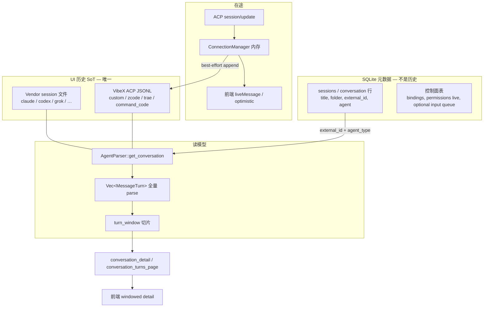
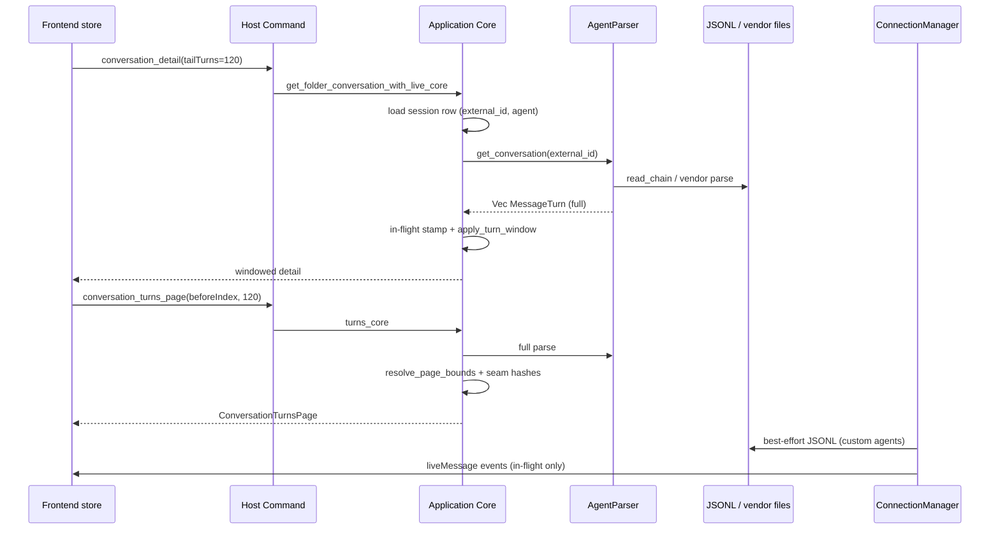

# VibeX 会话窗口协议 + 反向无限滚动 + JSONL 存储改进方案

- **作者**：VibeX maintainers
- **日期**：2026-10-18
- **状态**：Draft
- **对照权威**：Codeg `origin/main` SHA `2e657fac44f19a66bdc7ebda6426b3596101848c`
  （sibling checkout `C:\Users\18190\Documents\projects\codeg`；本地工作树
  `592131c7` 已落后，实施时一律以 `git show 2e657fac:<path>` 为准）
- **被替换方**：VibeX 事件溯源 transcript（`conversation_events` +
  `ConversationProjector` + TimelineRow 分页）
- **配套 ADR**：本方案落地前必须新增 **ADR-0082**（见 §8），显式 supersede
  ADR-0035 / 0044 / 0071 / 0075 / 0081 中「Event Log 是 UI transcript 唯一权威」
  的句子。不得静默与它们矛盾。
- **回滚**：git revert + 恢复迁移前 data dir 备份。禁止 feature flag 双写。

---

## Overview

VibeX 今天把可见会话历史存在 SQLite `conversation_events` 里，打开时
`project_open` 只下发最近 16 条 `TimelineRow`，再靠 `prefetchOlder` /
`mergeOpenTimelineRows` / `protectLoaded` / 80 行·768KiB 预算在前端拼出「看起来
像有历史」的窗口。这套补丁与 Codeg 的 **MessageTurn 窗口协议** 不是同一件事：
刷新只重发尾窗、没有 prefix fingerprint、没有 seam proof、滚动触发是
`scrollTop<=64` 的绝对位置，自动预取会把整段历史灌进内存。

Codeg 的真相源是：

1. **UI 历史** = 磁盘 transcript。内置 Agent 走 vendor session 文件 + 专用
   parser；无 vendor store 的 Agent（`Custom` / `ZCode` / `Trae` /
   `CommandCode`）走 Codeg 自己的 ACP JSONL
   (`<root>/<registry-id>/<session-id>.jsonl`)。
2. **SQLite `conversation` 行** 只持有元数据（folder、title、agent_type、
   `external_id`、status、kind、message_count）。
3. **打开/刷新/上翻** 对已解析的完整 `Vec<MessageTurn>` 做窗口切片：冷开
   `tailTurns=120`，刷新 `fromIndex=turns_offset` + FNV-1a `prefix_hash`，
   上翻 120 回合且必须通过 `prefix_hash_before_index` seam；compaction 失配则
   丢弃已加载窗口、改拉新鲜 tail。
4. **反向无限滚动** 只在距顶 240px 的**向下穿越**时触发，另有 loader 按钮；
   virtua `shift` 由 `olderTurnsPrependEpoch` 显式驱动。

本方案 **以 Codeg 为唯一权威实现**：把 `acp_transcript.rs`、`turn_window.rs`、
`parsers/*`、`turn-window.ts`、`conversation-runtime-store` 窗口协议、
`virtualized-message-thread.tsx` **移植/复制**进 VibeX（只改 crate / 包前缀与
Conversation 身份类型 UUID），删除 VibeX 事件日志作为 transcript 的全部读写。
一次迁移把既有 `conversation_events` 投影成 Codeg 兼容 JSONL，成功后停止对
transcript 写 `conversation_events`。禁止 `if event_log else jsonl`、禁止双写、
禁止把现有 `mergeOpenTimelineRows` 当 fallback。

验收：实施后存储形态、加载行为、滚动/刷新/空态/compaction/并发与 Codeg
`2e657fac` 一致。

---

## Background & Motivation

### 现状（VibeX）

| 层 | 做法 | 证据 |
| --- | --- | --- |
| 写路径 | ACP 更新先 append `conversation_events`，再投影 | `crates/conversations/src/projection.rs` `ConversationEventAppender::append`（persist-before-dispatch，同一事务） |
| 读路径 | `ConversationProjector::project_open(..., OPEN_TIMELINE_ROW_LIMIT=16)` | `projection.rs:48,685-708`；`src-tauri/src/commands/conversations.rs` `conversation_detail_core` |
| 更早页 | `conversation_timeline_page`，16 行一页 | `timelinePaging.ts` `TIMELINE_OLDER_PAGE_SIZE=16` |
| 前端拼窗 | `prefetchOlder` 自动翻完；`mergeOpenTimelineRows` / `protectLoaded` / `preferLoadedOlderCursor` 在 tail reload 时保住已加载行 | `conversationTimelineRegistry.ts:309,530`；`conversationStore.ts` |
| 渲染预算 | `TIMELINE_RETAINED_ROW_LIMIT=80`、`TIMELINE_RETAINED_BYTE_BUDGET=768KiB`，超预算从最旧端丢掉 | `conversationStore.ts:461-462`；ADR-0080 |
| 上翻触发 | `scrollTop<=64` 且 `firstVirtualIndex===0` 且不在底部 | `AgentTimelineConversation.tsx` `shouldLoadOlderTimelinePage` |
| 前置恢复 | 用第一条 item key + `scrollTop` delta | 无 `olderTurnsPrependEpoch`，无 `loadOlderTurnsThrough` |
| 权威声明 | Event Log 是唯一 UI transcript | CONTEXT.md「Event log」；ADR-0035 §2；ADR-0044 driver 1；ADR-0071 §1；ADR-0081 Overview |

痛点不是「16 改成 120」能修的：

1. **窗口没有身份。** 刷新重发尾 16 行；已上翻的历史靠客户端 merge 苟活，compaction
   / 投影版本变化时无法证明 seam。
2. **自动预取 + 尾窗刷新** 是最差组合：内存按全历史涨，IPC 却只给尾窗。
3. **TimelineRow 不是 MessageTurn。** Codeg 窗口单位是回合；VibeX 把 user /
   assistant / tool / permission / notice 拆成行，16 行可能盖不住一轮工具调用。
4. **恢复回放与持久化绑死。** ADR-0071 要求 `session/load` 回放全部丢弃，前提是
   宿主日志本来就完整。Codeg 的 gate 相反：只在 `has_recorded_history == false`
   时把回放写入 JSONL。两套合同不能并存。
5. **计量、fork、Remote attach 都把 event log 当 transcript。** 不换 SoT，窗口
   协议只能继续打补丁。

### Codeg 当前合同（pin `2e657fac`）

- 冷开：`TAIL_TURNS_DEFAULT = 120`。
- 上翻：`OLDER_TURNS_PAGE_SIZE = 120`，服务端 `MAX_WINDOW_TURNS = 500`、
  `ROUND_ALIGN_CAP = 200`。
- 刷新：`fromIndex = turns_offset`；`prefix_hash` 失配（compaction）则改拉
  新鲜 tail。
- 指纹：FNV-1a 64-bit，按 `(role_tag, timestamp_millis LE)` 链式更新，**不含
  turn id**（parser id 是 `turn-N`，在途 user turn 会被改成 broadcast id）。
- JSONL 写入：**best-effort，永不阻塞 turn**；流式 chunk 最多缓冲
  `FLUSH_WINDOW = 1s` 后 `compact_batch` 合并；Prompt / TurnEnd / Header 立即
  flush。
- `session/load` 回放：仅当 `has_recorded_history(dir, sid) == false` 才落盘。
- `continues_from`：自定义 Agent `session/load` 失败后 `session/new`，新文件
  header 指向旧 sid，reader 把链拼成**同一段 UI 会话**。

用户已拍板：不要在现有实现上打补丁，不要把现有逻辑当 fallback，不要「灵感对齐」。
以 Codeg 为唯一权威，可直接复用其源码与结构。

---

## Goals & Non-Goals

### Goals

1. UI 历史唯一 SoT = JSONL（自定义 / 无 vendor parser 的 Agent）或 vendor
   session 文件（内置 parser），经 `AgentParser::get_conversation` 投影为
   `Vec<MessageTurn>`。投影、store、窗口都是该 parse 的读模型。
2. 窗口协议、反向无限滚动、compaction 回退、fetch generation、seam proof、
   virtua shift、stick-to-bottom、空态、错误、键盘滚动、jump-to-message 与
   Codeg 一致。
3. 一次迁移：旧 `conversation_events` → Codeg 兼容 JSONL；成功后删除
   transcript 写路径与 TimelineRow 分页。
4. 控制面与 transcript 的拆分对齐 Codeg：权限 / 在途纠偏 / composer 队列不是
   UI 历史；可见回合只来自 JSONL / vendor parse。
5. 计量改走 Codeg `token_usage`（parser 物化）+ 既有 vendor_log 补充，不再从
   `conversation_events.UsageUpdated` 出账。
6. Fork 复制 transcript 文件（及 vendor 文件由 Agent `session/fork` 产生的
   那份），不再 `copy_conversation_history` 复制事件。
7. Remote 用同一套 windowed detail / turns page，不再以 event sequence 为
   transcript attach 权威。

### Non-Goals

- 不保留 `conversation_events` 作为第二份 transcript，即使「只读兼容」。
- 不引入 `transcript_backend = event_log | jsonl` 配置或 feature flag。
- 不把 TimelineRow 协议「映射」成 MessageTurn 窗口；窗口单位就是 MessageTurn。
- 不在本方案重写 ACP 连接生命周期（ADR-0081 的 connect-time bind 仍有效）；
  只替换 **记录与读取历史** 的那一段。
- 不把 Codeg 的 i32 `conversation.id` 引进 VibeX。VibeX Conversation 身份
  继续是 UUID；移植时只替换身份类型，窗口字段与 JSONL schema 保持 Codeg 字节
  合同。
- 不把权限审批、queued input、steering 注记重新塞进 JSONL 当「第二套事件日志」。
  Codeg 也不这么做。
- 不在本方案做 ACP v2 Session Item 重写（ADR-0035 的 Adapter seam 仍在；变的是
  Adapter 下游的持久权威）。

---

## Key Decisions

| ID | 决定 | 理由 |
| --- | --- | --- |
| D1 | **UI transcript SoT = Codeg JSONL + vendor parsers**。SQLite 只保留 conversation 元数据与非可见控制面表。 | 用户最终决定；Codeg 已证明这是可工作的完整合同。Event log 作 UI 权威是 VibeX 自造的第二套实现。 |
| D2 | **禁止双路径。** 迁移成功的同一进程世代起，停止对 transcript 写 `conversation_events`。回滚 = git revert + 数据目录备份。 | 双写会永久分叉；flag 会让两套 SoT 共存。 |
| D3 | **移植 Codeg 源码结构，不「灵感对齐」。** 可改的只有 crate/包前缀、VibeX UUID、Host Command 名。算法、常量、错误文案、测试向量保持一致。 | 窗口协议的正确性靠 Rust/TS 共享 FNV 向量与 seam 测试锁死；重写会漂。 |
| D4 | **JSONL writer 是 best-effort，永不阻塞 turn。** 队列满则丢记录打 debug；磁盘失败重试；部分写入无法回滚则放弃该 batch 而不是重复追加。 | Codeg `acp_transcript.rs` 模块合同。VibeX persist-before-dispatch 会把磁盘抖动变成 turn 失败，违反 D4。 |
| D5 | **`session/load` 回放只在 `has_recorded_history == false` 时写入 JSONL。** 这替换 ADR-0071「恢复窗口内内容类 update 一律丢弃」。 | Codeg 用回放补「从未录过」的自定义 Agent；已有 JSONL 时回放是重复，gate 保守方向是「宁可当有历史」。 |
| D6 | **`continues_from` 文件链是自定义 Agent SoT 的一部分。** load 失败 → `session/new` + 新文件 header 指向旧 sid；UI 仍是一个 Conversation。 | 已部分出现在 `AgentBindingRecovered.continues_from` 注释里，但没有文件链就无法诚实地拼历史。 |
| D7 | **窗口单位是 MessageTurn，不是 TimelineRow。** Tail 120 / page 120 / clamp `1..=500`。Tail 向 user-round 对齐（`ROUND_ALIGN_CAP=200`）；FromIndex 绝不对齐。 | 与 Codeg `turn_window.rs` 逐条相同。 |
| D8 | **刷新走 `fromIndex=turns_offset` + prefix_hash；失配则新鲜 tail。** 上翻页必须 `prefix_hash_before_index == 当前 prefix_hash`。 | compaction / rewrite 下旧坐标是垃圾；猜缝比丢窗口更糟。 |
| D9 | **反向无限滚动：240px 向下穿越 + loader 按钮；virtua `shift` 来自 `olderTurnsPrependEpoch`；禁止 auto-prefetch-all。** | Codeg `virtualized-message-thread.tsx`。VibeX `scrollTop<=64` 会在 stick-to-bottom 首帧误触发。 |
| D10 | **fetch generation 全序 detail 刷新与 older pages。** 过期响应丢弃。 | 与 Codeg `bumpFetchGeneration` / `isLatestGeneration` 相同。 |
| D11 | **控制面与 transcript 拆分抄 Codeg，不保留 event log 当第二份历史。** 权限 = 连接内存队列 + 实时事件；steering = 连接内存 + JSONL `Prompt{steer:true}`；composer 队列 = 客户端自动 flush（Remote 若需要持久排队，用 **非 transcript** 的 `conversation_input` 表，不投影进时间线）。`TurnInterrupted` **不写入 JSONL**；ADR-0001 的「崩溃不自动重发」留在进程恢复，不制造一条可见历史事件。 | Codeg 权限/反馈明确「不是 durable history」。把它们再写进 JSONL 就是第二套事件日志。 |
| D12 | **计量改为 parser `TurnUsage` 物化表（Codeg `token_usage_turn`）+ vendor_log 补充。** `conversation_usage_snapshots.last_sequence` 随 event log 一起废止。 | ADR-0075 的归属目标仍成立（按 conversation/workspace/agent），但证据源换成 parser，不再扫描 `UsageUpdated` 事件。 |
| D13 | **Fork 复制/生成 transcript，不再复制 `conversation_events`。** 有 `session/fork` 时 Agent 侧新 sid 的 vendor 文件即子历史；自定义 Agent 额外复制 JSONL 链到切点。VibeX `copy_conversation_history` 删除。 | ADR-0005 的「独立副本、亲子不参与读取」保留；实现换成 Codeg 的文件复制。 |
| D14 | **Remote 的 transcript 面改为 windowed detail / turns page**（与桌面同一 Application Core）。`after_sequence` attach 不再是 UI 历史权威。在途 turn 仍走实时 ACP 事件。 | ADR-0033 的「共用 Application Core」保留；变的是 payload。 |
| D15 | **身份类型例外。** Codeg `conversation.id: i32` → VibeX `Uuid`；IPC 命令名走 Host Command Registry。窗口字段名、指纹算法、JSONL schema、parser 输出 `MessageTurn` 不改。 | VibeX 全库 UUID 身份；改成 i32 是另一场迁移，与本方案无关。 |

---

## Proposed Design

### 1. 权威拆分（必须画清，避免第二份 transcript）



**对照 Codeg：** `get_folder_conversation_core` 先读 DB 行拿 `external_id` +
`agent_type`，再 `build_agent_parser(agent).get_conversation(external_id)`。
`turns` 来自文件；summary 的 title/model 可回填 DB，但 **DB 不是 transcript**。

**VibeX 今天的错误拆分：** `conversation_events` 既是控制面又是 UI 历史，投影成
`TimelineRow` 后再分页。本方案之后：

| 事实 | 权威 | 不是 |
| --- | --- | --- |
| 已完成的 user/assistant/tool/plan 回合 | JSONL 或 vendor 文件 | `conversation_events` |
| 在途流式输出 | 连接内存 + 前端 liveMessage | 未 flush 的 JSONL |
| 会话标题、folder、pinned、external_id | SQLite conversation/session 行 | transcript |
| 权限请求 | 连接内存队列（Codeg `connection.rs` permission queue） | 时间线 SoT |
| 原生 steering | 连接内存；落盘为 JSONL `Prompt` + `steer: true` | `conversation_events` |
| pull-channel feedback | 连接内存，turn-scoped，Codeg **故意不持久化** | event log |
| composer 未发送草稿 | 既有 Conversation draft | transcript |
| 崩溃恢复「不自动重发」 | 进程启动时清 in-flight 运行态（ADR-0001） | 不写 Interrupted 行进 JSONL |

### 2. JSONL 格式（原样移植）

路径（Codeg `paths.rs` `codeg_acp_transcripts_root`）：

```text
$VIBEX_HOME/acp-transcripts/<registry-id>/<session-id>.jsonl
```

解析顺序与 Codeg 相同：`$VIBEX_HOME` → `$VIBEX_DATA_DIR` → 平台 data dir 下
`acp-transcripts`。`registry-id` 与 `session-id` 必须通过 `safe_component`
（ASCII 字母数字、`-` `_` `.`，长度 ≤128，不以 `.` 开头）。

文件合同（`acp_transcript.rs`）：

```jsonc
{"v":1,"kind":"header","agent":"custom:goose","session_id":"…","cwd":"/repo","started_at_ms":…,"continues_from":"prev-sid"}
{"t":1750000000000,"k":"prompt","p":[{"type":"text","text":"hi"}]}
{"t":1750000000123,"k":"update","p":{"sessionUpdate":"agent_message_chunk", …}}
{"t":1750000000450,"k":"turn_end","p":{"stopReason":"end_turn","durationMs":…,"model":…,"usage":{…}}}
{"t":1750000000800,"k":"prompt","s":true,"p":[{"type":"text","text":"steer note"}]}
```

- Schema `TRANSCRIPT_SCHEMA_VERSION = 1`。未知 version / 畸形行 **跳过**，缺文件
  = 无历史。
- `EntryKind::{Prompt, Update, TurnEnd}`。`steer` 字段 serde rename `"s"`，
  默认 false。
- Header 靠 `kind == "header"` 识别，不靠行号（文件可能跨重连拼接）。
- 只追加，落盘后永不改写/截断。崩溃最多丢未 flush 的 1s 窗口，**从不丢已完成
  turn**（TurnEnd 是 boundary，立即 flush）。

关键类型与 writer 行为直接复制 Codeg：

```rust
// codeg/src-tauri/src/acp_transcript.rs （2e657fac）
pub const TRANSCRIPT_SCHEMA_VERSION: u32 = 1;                 // :75
const TRANSCRIPT_QUEUE_CAP: usize = 8192;                     // :343
const FLUSH_WINDOW: std::time::Duration = std::time::Duration::from_secs(1); // :351
pub const MAX_CONTINUATION_DEPTH: usize = 512;                // :1150

pub fn has_recorded_history_in(root: &Path, agent_dir: &str, session_id: &str) -> bool {
    // :1108 pending prompt count OR first parseable TranscriptEntry on disk
}
```

移植清单（整文件复制，改 `crate::paths::codeg_acp_transcripts_root` →
`vibex_acp_transcripts_root`）：

- `TranscriptHeader` / `TranscriptEntry` / `EntryKind` / `Transcript`
- `SessionWriter` + `compact_batch` + `PENDING_PROMPTS` RAII guard
- `record_header` / `record_entry` / ack oneshot
- `read_transcript_in` / `read_chain_in` / `continuation_ancestors_in` /
  `superseded_session_ids_in` / `has_recorded_history_in`
- 全部 `#[cfg(test)]`（含 write-behind、replay gate、continues_from 环、
  v1 header 缺字段）

`compact_batch` 不变量（必须连测试一起搬）：只在 `compactable`（已写 Prompt、
尚未 TurnEnd）时合并连续 `agent_message_chunk` / `agent_thought_chunk` 的纯
text；`user_message_chunk`、image、tool、`_meta` 不同的记录不合并。合并对
`acp_native::project_turns` 不可见，因为 `push_text` 会再拼回去。

### 3. 写入点（替换 persist-before-dispatch 的 transcript 半边）

Codeg 连接层：

| 时机 | 函数 | 阻塞？ |
| --- | --- | --- |
| session 绑定成功 | `record_transcript_header(agent, sid, cwd, continues_from?)` | 否（header 入队） |
| 即将 `session/prompt` | `record_prompt` **bound-wait ack** | 有界等待（为了 replay gate：文件里必须先看到 Prompt，否则 load 回放会当成「无历史」再录一份） |
| 每条 `session/update` | `record_entry(Update)` | 否，满 8192 丢 |
| `session/prompt` 响应 | `record_entry(TurnEnd)` | 否，但 TurnEnd 是 boundary，writer 立即 flush |
| `session/load` 回放 | 仅 `hydrate_from_replay = transcript_dir_for(agent).is_some_and(\|dir\| !has_recorded_history(dir, &sid))` | drain 必须跑完（会话在回放耗尽前不可用）；录制可因 writer stall 停 |

VibeX 对应改动：

- `crates/agents` 连接循环：删除「内容类 update → `ConversationEvent::AssistantTextDelta` /
  `ToolCallUpsert` / … → `ConversationEventAppender::append`」这条 transcript
  写路径。
- 改为 Codeg 的 `record_*`。`transcript_dir_for` 对
  `uses_acp_transcript()` 的 Agent 返回 registry id，其余返回 `None`（它们的
  历史由 vendor parser 读 CLI 自己的文件，Codeg 不另写一份 ACP JSONL）。
- **ADR-0071 §1 作废。** 新合同是 D5。控制类 update（mode / config /
  available commands）仍然更新 binding / 前端 session controls，不进 JSONL
  （与 Codeg 一致：这些不是回合历史）。

`uses_acp_transcript` 原样移植（`models/agent.rs:81`，pin `2e657fac`；
Codeg 内置已是 **19** 个，含 Kiro / ZCode / Trae / CommandCode）：

```rust
// codeg/src-tauri/src/models/agent.rs:81
pub fn uses_acp_transcript(&self) -> bool {
    matches!(
        self,
        AgentType::Custom(_) | AgentType::ZCode | AgentType::Trae | AgentType::CommandCode
    )
}
```

VibeX 今天的 `AgentKind`（`crates/api-types/src/agent_kind.rs`）只有 14 个产品
内置 + `QaMock`，**没有** Gemini / Kiro / ZCode / Trae / CommandCode。映射规则：

| VibeX `AgentKind` / 身份 | 读历史 |
| --- | --- |
| ClaudeCode, Codex, Opencode, Grok, Cursor, DeepseekHarness, Antigravity, Cline, Openclaw, Hermes, Codebuddy, KimiCode, Pi, Qoder | 对应 Codeg vendor parser（整树移植，只 match 已有 kind） |
| 用户声明 ACP Agent（ADR-0036） | `AcpNativeParser` + JSONL（等同 `AgentType::Custom`） |
| QaMock | 测试 fixture；走 `acp_native` 或内存 fixture，禁止写 `conversation_events` |
| 日后新增、无 vendor store 的内置 | 必须先声明 `uses_acp_transcript=true`，不得再开 event-log 分支 |

禁止为「暂时还没 parser」的内置 Agent 继续写 `conversation_events`。Parser
源文件建议整树搬入，`build_agent_parser` 只 match 已有 `AgentKind`，以免下次
加 Agent 又走第二套存储。

### 4. Parser 路由（读路径）

Codeg 唯一构造点：

```rust
// codeg/src-tauri/src/parsers/mod.rs  （2e657fac）
pub fn build_agent_parser(agent_type: AgentType, env: &AgentEnv) -> Box<dyn AgentParser> {
    match agent_type {
        AgentType::ClaudeCode => Box::new(claude::ClaudeParser::new()),
        AgentType::Codex => Box::new(codex::CodexParser::new()),
        // … OpenCode Gemini OpenClaw Cline Hermes CodeBuddy KimiCode Pi Grok
        //   Cursor DeepSeek Qoder Antigravity Kiro …
        AgentType::Custom(_) | AgentType::ZCode | AgentType::Trae | AgentType::CommandCode => {
            Box::new(acp_native::AcpNativeParser::new(agent_type))
        }
    }
}
```

`AcpNativeParser::get_conversation`：`read_chain_in` → `project_turns(&entries)`。
Turn 边界：有 `TurnEnd` 用它；load 回放没有 TurnEnd 时，user message chunk 开启
新 turn。`steer` prompt 把当前 assistant 切开，再插入一条 user turn，然后继续
同一 TurnEnd。

VibeX 放置：

```text
crates/agents/src/acp_transcript.rs          ← 整文件移植
crates/agents/src/parsers/mod.rs             ← build_agent_parser + AgentParser trait
crates/agents/src/parsers/acp_native.rs
crates/agents/src/parsers/{claude,codex,…}.rs
crates/conversations/src/turn_window.rs      ← 原 commands/turn_window.rs
```

vendor parser 是 Codeg 历史读路径的主体，必须整树移植（含测试与 fixture），
不能只搬 `acp_native` 却让 Claude/Codex 继续走 event log。Agent 环境变量
（`CLAUDE_CONFIG_DIR`、`CODEX_HOME`、`GROK_HOME`…）走既有
`AgentRuntimeLaunchSettings.env`。

`project_turns` 复用 Codeg 从 live 路径抽的 helper
（`serialize_tool_call_content`、`synthesize_edit_input_from_diffs`、
`extract_tool_call_images`、`json_value_to_text`），避免「历史一张脸、直播另一张脸」。
VibeX 连接层若 helper 名称不同，**先把 helper 对齐到 Codeg 再接入 parser**，
禁止为 VibeX 另写一套投影。

### 5. 窗口协议

#### 5.1 请求

互斥选择子，校验在 command 层（桌面 IPC 与 Web handler 同一错误）：

```rust
pub enum TurnWindowReq {
    Tail(usize),      // 最后 n 回合，再向 user-round 回对齐
    FromIndex(usize), // 精确 turns[min(from,total)..]，绝不 round-align
}
```

`resolve_turn_window_req(tail_turns, from_index)`：

- 两者都有 → `invalid_input("tailTurns and fromIndex are mutually exclusive")`
- 都没有 → `Ok(None)`（**VibeX 不提供这个 legacy 全量响应。** Codeg 保留是为了
  旧客户端；VibeX 没有已发布的 windowed 客户端，open/refresh **必须**带
  `tailTurns` 或 `fromIndex`。缺省按 Tail(120) 处理，而不是返回全量。）

这是对 Codeg 的一处产品收紧，不是第二套切片算法：切片函数仍是
`resolve_window_offset` / `apply_turn_window`。

#### 5.2 切片与元数据

全量 parse + 全量 post-process（delegation meta、auto-title、in-flight id
stamping）**之后**才切片。窗口内字节必须与全量对应区间相同。

```rust
pub const MAX_WINDOW_TURNS: usize = 500;
pub const ROUND_ALIGN_CAP: usize = 200;

pub fn prefix_fingerprint(turns: &[MessageTurn]) -> String { /* FNV-1a 16-hex */ }
pub fn resolve_window_offset(turns: &[MessageTurn], req: TurnWindowReq) -> usize { … }
pub fn resolve_page_bounds(turns: &[MessageTurn], before_index: usize, limit: usize) -> (usize, usize) { … }
pub fn window_meta(turns: &[MessageTurn], offset: usize) -> WindowMeta { … }
```

`DbConversationDetail` 增加 Codeg 字段（VibeX 现有 `timeline: ConversationTimeline`
**删除**；`turns` 不再是「为了 TS 兼容而空着的数组」）：

```text
turns                          // full[offset..]
turns_offset
turns_total                    // 全量回合数；summary/stats/watermark 仍描述全量
assistant_turns_before_offset
user_turns_before_offset
prefix_hash                    // 16-hex string，禁止 u64 JSON number
uncovered_prefix_max_ts
in_flight_user_turn_id
transcript_watermark           // Claude 单文件 byte watermark；其它 parser None
session_stats
```

`ConversationTurnsPage`：

```text
turns, turns_offset, turns_total,
assistant_turns_before_offset, user_turns_before_offset,
prefix_hash,                       // 新窗口指纹
prefix_hash_before_index,          // seam：必须等于客户端当前 prefix_hash
uncovered_prefix_max_ts
```

前端镜像（整文件移植 `src/lib/turn-window.ts` + `turn-window.test.ts`）：

```ts
export const FNV_SEED_HEX = "cbf29ce484222325"
export function turnsOffsetOf(detail): number
export function turnsTotalOf(detail): number
export function isWindowedDetail(detail): boolean
export function extendPrefixFingerprint(seedHex, turns): string | null
```

共享测试向量（Rust `fingerprint_shared_test_vector` ↔ TS）：

```text
[]                         → cbf29ce484222325
[U @ 1700000001]           → 7060d8542023feb2
[U, A, System @ +1/+2/+3]  → f171a62320fc10d3
```

#### 5.3 IPC / Host Command

| Codeg | VibeX（替换，不并存） |
| --- | --- |
| `get_folder_conversation(id, tail_turns?, from_index?)` | `conversation_detail` 改为接受 `{ conversationId, tailTurns?, fromIndex? }`，内部 `get_folder_conversation_with_live_core` |
| `get_folder_conversation_turns(id, before_index, limit)` | **新** `conversation_turns_page`；删除 `conversation_timeline_page` |
| Web `POST /get_folder_conversation` | Remote / Host Command 同一 core |
| （无）`conversation_events_since` 作为历史 | 删除 transcript 用途；在途 row_ops 改为 live ACP 事件，不回放 event log |

`shared/types.ts` 由 `pnpm run generate-types` 从 Rust `#[derive(TS)]` 再生。
禁止手改。

### 6. 前端 store 与加载协议

**删除（禁止再包一层）：**

- `frontend/src/features/conversation/timelinePaging.ts`
  （`TIMELINE_OLDER_PAGE_SIZE=16`、`mergeOpenTimelineRows`、
  `preferLoadedOlderCursor`、`nextOlderTimelinePage`）
- `conversationStore.ts` 的 `protectLoaded`、`TIMELINE_RETAINED_*`、
  `enforceTimelineBudget`、`insertTimelineRow` 作为「第二投影」
- `conversationTimelineRegistry.ts` 的 `prefetchOlder`、`loadDetail` 只拉 tail
  16、`eventsSince` 当历史补洞
- `useConversationTimeline.ts` 对上述 registry 的订阅（可留薄 hook，但数据必须
  来自移植后的 runtime store）

**移植：** `codeg/src/stores/conversation-runtime-store.ts` 中窗口相关状态机
与 actions（不是整个 Codeg store 的 canvas/delegation overlay，除非同一文件
不可分。可分则只搬窗口；不可分则整文件搬再删 VibeX 用不到的 overlay）。
最低限度必须包含：

常量：

```ts
export const TAIL_TURNS_DEFAULT = 120
export const OLDER_TURNS_PAGE_SIZE = 120
```

状态：`detail`、`loadingOlderTurns`、`olderTurnsPrependEpoch`、
`batchBoundaryIndex`、`batchBoundaryPrefixHash`。

行为（`conversation-window-loading.test.ts` 整文件移植为验收锁）：

1. **cold `fetchDetail`** → `{ tailTurns: 120 }`。
2. **`refetchDetail` 在 windowed detail 上** → `{ fromIndex: turns_offset }`；
   若返回的 `prefix_hash` 不同或 `turns_total < offset`，再请求
   `{ tailTurns: 120 }` 并提交 tail。
3. **`loadOlderTurns`** single-flight；`beforeIndex = turns_offset`；
   `prefix_hash_before_index !== expectedSeamHash` → 不 merge，走 refetch
   （preserveLive）。
4. **fetch generation**：older page 与 refetch 共享；过期 page 丢弃。
5. **`PREPEND_OLDER_TURNS`** 产生 **新的 detail 对象**（identity-keyed cache
   失效），`olderTurnsPrependEpoch++`。
6. **`loadOlderTurnsThrough(id, globalIndex)`** 循环 `loadOlderTurns` 直到
   目标 index 进入窗口（message navigator / jump-to-message）。
7. Keys **不含 positional index**（`persisted-${conversationId}-${turn.id}`），
   prepend 不 remount。

VibeX 特有的 live `row_ops` 批次（`requestAnimationFrame`）在 cutover 后只服务
**在途 liveMessage**，不再 upsert 历史 TimelineRow。历史刷新一律走
`fetchDetailWindowed`。

### 7. 反向无限滚动与 stick-to-bottom

移植 `codeg/src/components/message/virtualized-message-thread.tsx` 与
`codeg/src/components/ai-elements/message-thread.tsx`。

关键合同：

```ts
const LOAD_OLDER_THRESHOLD_PX = 240

export function shouldShiftForPrepend(prev, next): boolean {
  return prev.scope === next.scope && next.epoch !== prev.epoch
}
```

- 触发：`offset < 240 && prev >= 240`（穿越，不是绝对位置）。首帧
  stick-to-bottom 在 offset 0 **不会**级联翻页。
- 短列表（无需滚动）靠顶部 loader **按钮**。
- virtua `shift={shift}`，shift 只在 prependEpoch 前进的那一次 committed
  render 为 true。禁止「第一条 key 是否还在」启发式（连续 assistant 回合合并
  时第一条 key 会变，启发式恰好在必须 shift 的那帧失败）。
- viewport `tabIndex=0`，pointerdown 聚焦以便方向键滚动；交互控件不抢焦点。
- `use-stick-to-bottom`：`StickToBottom initial="instant" resize="smooth"`。
  删除 VibeX `shouldLoadOlderTimelinePage` 与 first-key prepend。

`AgentTimelineConversation.tsx` / `VirtualizedList.tsx`：改为消费 MessageTurn
窗口列表 + 移植后的 VirtualizedMessageThread。保留 VibeX 权限卡片、session
notice、composer 停靠，但它们是 **live / 控制面**，不是 TimelineRow 历史。

### 8. 控制面对齐（发现结果，不是猜测）

Codeg 实际做法（`2e657fac`）：

| 能力 | Codeg | VibeX 今天 | 本方案 |
| --- | --- | --- | --- |
| 权限 | 连接内 FIFO 队列；`permission_required` 事件；`respond_to_permission`；**不进 transcript** | `PermissionRequested` 事件 + `conversation_permissions` 表 + 投影成 side row | 抄 Codeg：live 队列 + 实时事件。删除权限 side row 作为历史。表可留作审计，但 **不是 UI SoT**。 |
| 原生 steering | `_session/steering`；JSONL `Prompt{s:true}`；`FeedbackItem` 在 `SessionState`，**故意不持久化**（`acp/feedback.rs` 模块文档） | `conversation_steering` + 事件，投影成切开的气泡 | 可见切开气泡来自 JSONL steer prompt（`acp_native` 已处理）。内存 note 抄 Codeg。删除 steering 事件作 transcript。 |
| pull feedback | MCP `check_user_feedback`，turn-scoped | `conversation_feedback_note` + 一串 UserFeedback* 事件 | 保持 pull 通道诚实（ADR-0044 §3 的 native/pull/none），但 note **不进入 JSONL**。Turn 结束后过期，与 Codeg 一致。 |
| 排队输入 | 前端 composer 在 turn settle 后 auto-flush；**无服务端 event-sourced queue** | ADR-0044 `conversation_input` 事件状态机 | **可见历史上没有「排队中」行。** 桌面抄 Codeg auto-flush。Remote / Automation / MCP 若必须在 Host 崩溃后仍保住未发送输入，保留 `conversation_input` **控制面表**（不投影进时间线，不写 JSONL）。这不是第二套 transcript。 |
| TurnInterrupted | 无此事件。崩溃 = 最多丢 1s 未 flush chunk；重开从磁盘 parse | ADR-0001 写 Interrupted 终态事件，UI 专门相位 | **不写 Interrupted 进 JSONL。** 启动恢复仍禁止自动重发（ADR-0001 进程合同保留）。用户看到的是磁盘上不完整的最后一轮，与 Codeg 相同。 |
| session/load 回放 | D5 gate | ADR-0071 全部丢弃 | D5 |

### 9. Fork（替换 ADR-0005 的复制实现，保留独立副本语义）

Codeg：`session/fork` 产生新 sid；vendor 文件由 Agent 写入（fork 复制 parent
transcript 并在文件头写新 metadata，见 `background_watch.rs` 注释「A fork
copies the parent transcript… preserving ORIGINAL pre-fork timestamp」）。
自定义 Agent：新 JSONL 文件；UI 仍靠 `external_id` 指向新 sid。

VibeX `fork_visible_conversation` 今天 `copy_conversation_history` 把事件
rewrite sequence/idempotency 写入子会话（`service.rs:389+`）。删除该函数。

新路径：

1. 切点必须是已完成 assistant MessageTurn（Codeg `resolve_fork_point`：
   Claude/Codex/DeepSeek 的 `agent_message_id` + fingerprint + occurrence）。
   未命名非尾部切点不创建 Conversation（已有 ADR-0005 更新，保留）。
2. 发 `session/fork`；子 binding 持有新 sid。
3. **可见历史：** 对 `uses_acp_transcript` Agent，把 parent JSONL 链拷到切点
   写进子 sid 文件（或让 `acp_native` 读 parent 链直到切点再换 sid——若与
   Codeg 源码不一致，以 Codeg fork 落地代码为准，实施时对照
   `acp/manager.rs` `fork_session`）。对 vendor Agent，子历史就是新 sid 的
   vendor 文件；不要再写一份 ACP JSONL。
4. 亲子关系继续用 `conversation_relation`（导航），不参与 transcript 读取。

### 10. 计量（替换 ADR-0075 的证据源，保留归属目标）

Codeg `commands/token_usage.rs`：按 conversation `updated_at` 增量
`get_folder_conversation_core`，把每回合 `TurnUsage` 写入 `token_usage_turn`；
dashboard 从物化表聚合。accounting version 戳（当前 3）在计数规则变化时全量
rebuild。

VibeX：

- 删除 `conversation_usage_snapshots` 对 `last_sequence` / `UsageUpdated`
  事件的依赖。
- 移植 `token_usage_turn` 物化（或等价表），维度仍按
  `sessions.workspace_id` / `agent_id` / model（ADR-0075 的归属要求）。
- `protocol` 来源 = parser `TurnUsage` + ACP `PromptResponse.usage`（若有）。
- `vendor_log` 补充保留，按 `external_session_id` 对齐，不按路径猜。
- 缺失保持缺失（ADR-0058）。两来源不得加总。

### 11. Remote（ADR-0033 的 transcript 面）

今天：`ready → snapshot/replay(event sequence) → high-water → live`，离线缓存
「持久 sequence + open events」。

之后：

- **历史：** `conversation_detail(tailTurns|fromIndex)` 与
  `conversation_turns_page(beforeIndex, limit)`，与桌面同一 core。客户端保存
  `{ turns_offset, prefix_hash }`，刷新/上翻合同与桌面相同。
- **在途：** 现有 live ACP / permission / question 事件，**不**再带历史
  TimelineRow ops。
- **离线缓存：** 缓存最近一次 windowed detail + 已 prepend 的 pages（MessageTurn
  JSON），`read_only=true`。不再缓存 `conversation_events`。
- protocol schema bump：新 DTO，旧 `after_sequence` transcript attach 标记
  removed。未知 event kind 仍须可忽略（ADR-0033 前向兼容）。

### 12. 架构落点



VibeX 继续走 Application Core + Host Command Registry（ADR-0078），不把逻辑
堆回 `src-tauri` 独有路径。Codeg 的 `*_core` 函数对应 VibeX `crates/conversations`
use case；Tauri command 与 `crates/server` handler 只做 DTO。

---

## API / Interface Changes

### 删除

- IPC / Host Command：`conversation_timeline_page`、`conversation_events_since`
  （历史用途）、任何「按 sequence 折叠 timeline」的读接口。
- 类型：`ConversationTimeline` 作为 open-path 载荷、`ConversationRowOpBatch`
  作为历史增量、`OPEN_TIMELINE_ROW_LIMIT`、`TIMELINE_OLDER_PAGE_SIZE`、
  `TIMELINE_RETAINED_*`、`CONVERSATION_PROJECTION_VERSION`（transcript 投影）。
- 前端：`mergeOpenTimelineRows`、`prefetchOlder`、`protectLoaded`、
  `shouldLoadOlderTimelinePage`、`firstTimelineItemKey` prepend。

### 新增 / 替换

```ts
// conversation_detail
{
  conversationId: string, // VibeX UUID
  tailTurns?: number,     // 与 fromIndex 互斥
  fromIndex?: number
}
→ DbConversationDetail { turns, turns_offset, turns_total, prefix_hash, … }

// conversation_turns_page
{
  conversationId: string,
  beforeIndex: number,
  limit: number           // 服务端 clamp 1..=500
}
→ ConversationTurnsPage { turns, prefix_hash, prefix_hash_before_index, … }
```

前端 API 层移植 Codeg `getFolderConversation` / `getFolderConversationTurns`
形状（camelCase 字段与 Codeg web handler 一致，便于对照测试）。

Live 在途仍可推送：permission、question、live text/tool 补丁、TurnComplete。
这些 **不是** transcript page。

---

## Data Model Changes

### SQLite

**保留（元数据 / 控制面）：**

- `sessions`（VibeX conversation 行）：title、workspace、agent、
  `external_session_id`、pinned、status
- `conversation_agent_bindings`
- `conversation_relation`
- `conversation_input`（仅 Remote/Automation 持久排队，不投影时间线）
- `conversation_permissions`（可选审计；UI 不读它当历史）
- `conversation_feedback_note`（pull 通道；不进 JSONL）

**停止写入、迁移后删除或 tombstone：**

- `conversation_events` 作为 transcript（所有
  `AssistantTextDelta` / `ToolCallUpsert` / `UserTurnCreated` / `PlanUpdated` /
  `UsageUpdated` / `TurnCompleted` 等内容类）
- `conversation_projection_snapshots` / `conversation_timeline_rows`
- `conversation_tool_calls` 作为 UI 历史读模型（live 工具卡走连接态）
- `conversation_usage_snapshots.last_sequence`

**新增：**

- 磁盘：`acp-transcripts/<registry-id>/<sid>.jsonl`
- 表：`token_usage_turn`（Codeg 物化事实；accounting_version 列）
- 表：`transcript_migration`（one-shot：conversation_id、status、
  jsonl_path、event_count、error、backup_hint）

不把 JSONL 内容再镜像进 SQLite。

### 迁移策略（一次性，无双写窗口）

启动（或显式 `vibex migrate-transcripts`）：

1. **备份 data dir**（至少 `db.sqlite*` + 即将写入的 `acp-transcripts/`）。
   失败则拒绝继续。记录备份路径。
2. 对每个 conversation：
   1. 若 `agent.uses_acp_transcript()` 或 **没有**可用 vendor 文件：把
      `conversation_events` 折成 MessageTurn 序列，再编码为 Codeg JSONL
      （header + 每 user turn 一条 `Prompt` + 该回合 assistant/tool 的
      `Update` 近似 + `TurnEnd`）。`acp_native::project_turns` 必须能读回来。
      这不是「完美 ACP 线」，是 **可被唯一 reader 消费的转储**。
   2. 若内置 Agent 且 vendor 文件存在且 parser 能 `get_conversation`：
      **以 vendor 文件为 SoT**，不把 event log 再写一份 JSONL（Codeg 对
      Claude/Codex 也不另写）。若 vendor parse 回合数为 0 而 events 非空，
      退回 (2.1)，避免历史蒸发。
   3. 写 `external_session_id`（已有则保留；JSONL 文件名用它）。
3. 校验：抽样 `project_turns` / vendor parse 的 `turns_total` ≥ 迁移前
   user-turn 数（允许 tool 行合并导致「行数」变少，不允许 user prompt 丢失）。
4. 全部成功：写 `transcript_migration` = done；**此后代码路径不再 append
   内容类 conversation_events**（编译期删除，不是运行时 if）。
5. 任一会话失败：迁移标记 failed，**拒绝启动 Agent 写路径**直到用户选择
   重试或从备份还原。禁止「失败的走 event log、成功的走 JSONL」。

旧 DB：`conversation_events` 可在后续 cleanup PR 里 DROP。cutover PR 可以先
停写、留表，以免 revert 后数据已删。但 **读路径不得再查这张表当历史**。

编码注意：迁移器输出必须让 `acp_native` 现有 `project_turns` 接受，而不是给
VibeX 再写一个 reader。若某事件无法表达为 Prompt/Update/TurnEnd，降级为一条
`agent_message_chunk` 文本（带原始 kind 前缀），宁可丑，不要第二 schema。

---

## 完整改动面

### 后端模块 / 文件

| 路径 | 方向 |
| --- | --- |
| **新** `crates/agents/src/acp_transcript.rs` | 整文件移植 Codeg `src-tauri/src/acp_transcript.rs` |
| **新** `crates/agents/src/parsers/**` | 整树移植 Codeg `src-tauri/src/parsers/`（`mod.rs`、`acp_native.rs`、claude/codex/grok/…） |
| **新** `crates/conversations/src/turn_window.rs` | 整文件移植 `commands/turn_window.rs` |
| **新** `crates/conversations/src/migrate_jsonl.rs` | one-shot 迁移器 |
| **新** `crates/conversations/src/token_usage.rs`（或 `crates/services`） | 移植 `commands/token_usage.rs` 物化 |
| `crates/agents/src/manager.rs` / `acp/mod.rs` / connection 循环 | 接入 `record_*` + `has_recorded_history` gate + `continues_from` header；删除内容事件 append |
| `crates/conversations/src/service.rs` | 删除 persist-before-dispatch 的 transcript 半边；fork 不再 `copy_conversation_history`；turn 生命周期仍负责 prompt/cancel，但历史不落 events |
| `crates/conversations/src/projection.rs` | **删除** `project_open` / `project_row_window` / `CONVERSATION_PROJECTION_VERSION` 作为 UI 路径 |
| `crates/db/src/models/conversation_event.rs` | 停用 transcript 读写；cleanup PR DROP |
| `crates/db/migrations/20260616000000_event_sourced_conversation_core.sql` | 历史迁移，保留在树中作考古；新迁移停写/DROP |
| `crates/db/src/models/conversation_usage.rs` + `20260904020000_conversation_usage_snapshots.sql` | 改为 parser 物化 |
| `crates/db/src/models/conversation_timeline_row.rs` / snapshot | 删除读路径 |
| `src-tauri/src/commands/conversations.rs` | `conversation_detail` 窗口化；`conversation_turns_page`；删除 `conversation_timeline_page` |
| `crates/server/src/host/conversation.rs` | 同一 core |
| `crates/application/src/domain.rs` + `shared/hostCommands.ts` | 命令登记替换 |
| `src-tauri/src/bin/generate_types.rs` | 登记新 TS 类型，tombstone 旧 timeline page 类型 |
| `crates/conversations/src/service.rs` `fork_visible_conversation` | 换成文件/fork RPC |
| Remote protocol `docs/protocol/v1/` | windowed DTO；去掉 sequence snapshot 作为历史 |

### 前端

| 路径 | 方向 |
| --- | --- |
| **新** `frontend/src/lib/turn-window.ts` + `.test.ts` | 移植 |
| **新** `frontend/src/stores/conversation-window-loading.test.ts` | 移植整文件 |
| `frontend/src/features/conversation/conversationStore.ts` | 换成 Codeg windowed detail reducer（或新 store 文件替换） |
| `conversationTimelineRegistry.ts` | 删除 prefetch/merge；改为 fetchDetailWindowed / loadOlderTurns |
| `timelinePaging.ts` + `timelinePaging.test.ts` | **删除** |
| `useConversationTimeline.ts` | 改订阅 windowed store |
| `conversationApi.ts` | detail 带 tailTurns/fromIndex；新 turns page |
| `AgentTimelineConversation.tsx` | 换成 VirtualizedMessageThread 合同 |
| `VirtualizedList.tsx` | 保留入口，内部改 MessageTurn 窗口 |
| **新** `frontend/src/components/message/virtualized-message-thread.tsx` | 移植 |
| **新** `frontend/src/components/ai-elements/message-thread.tsx` 或接入既有 stick-to-bottom | 移植 `use-stick-to-bottom` 行为 |
| `UseConversationTimeline.test.tsx` / `conversationStore.test.ts` 中 16 行/prefetch/budget 用例 | 删除或改写为 Codeg 协议测试 |

### 文档 / 术语

| 路径 | 方向 |
| --- | --- |
| **新** `docs/adr/0082-jsonl-transcript-and-turn-window.md` | 本方案的决策 ADR |
| `CONTEXT.md` Conversation domain | Event log / Projection / Timeline row 不再是 UI 历史权威；改为 JSONL/vendor parse + MessageTurn 窗口 |
| ADR-0035、0044、0071、0075、0080、0081 | 顶部 amendment：transcript 句子被 0082 supersede |
| ADR-0005 | 复制实现改为 transcript 文件；语义「独立副本」保留 |
| ADR-0033 | attach payload 改为 windowed detail |
| `docs/adr/0080-windows-desktop-memory-and-performance.md` | 删除「打开 16 行 + prefetch」作为现行合同 |

### 调用链（替换后）

```text
打开面板
  → fetchDetail(id)  // generation++
  → conversation_detail { tailTurns: 120 }
  → parser 全量 + apply_turn_window(Tail(120))
  → store.detail = windowed
  → VirtualizedMessageThread(items=turns, hasOlder=offset>0)

刷新 / 重开已加载窗口
  → fetchDetailWindowed(fromIndex=offset)
  → prefix_hash 一致则原地替换 turns
  → 不一致 → tailTurns 120

上翻
  → 240px 穿越或 loader click
  → loadOlderTurns  // generation++，single-flight
  → conversation_turns_page(beforeIndex=offset, limit=120)
  → seam 匹配 → prepend + prependEpoch++
  → seam 失败 → refetchDetail(preserveLive)

在途
  → ACP live 事件 → liveMessage
  → 不写 conversation_events
  → custom Agent：record_entry best-effort
  → TurnEnd 后 refetch 窗口（Codeg syncTurnMetadata / viewer poll）
```

---

## Codeg 参考（实施时对照这些文件移植）

权威 SHA：`2e657fac44f19a66bdc7ebda6426b3596101848c`。

### JSONL SoT — `src-tauri/src/acp_transcript.rs`（`2e657fac`）

```rust
// :41-42 模块合同
//! recording is best-effort by contract and must never block or fail a turn.
pub const TRANSCRIPT_SCHEMA_VERSION: u32 = 1;                    // :75
const TRANSCRIPT_QUEUE_CAP: usize = 8192;                        // :343
const FLUSH_WINDOW: std::time::Duration = std::time::Duration::from_secs(1); // :351
fn compact_batch(pending: &[Queued], compactable: bool) -> (String, bool)    // :660
pub const MAX_CONTINUATION_DEPTH: usize = 512;                   // :1150

/// :1108  A `session/load` replay may be recorded only when this is false.
pub fn has_recorded_history_in(root: &Path, agent_dir: &str, session_id: &str) -> bool {
    let Some(path) = transcript_path_in(root, agent_dir, session_id) else {
        return false;
    };
    if has_pending_prompt(&path) {
        return true; // pending Prompt RAII counts as history (conservative)
    }
    has_entries_in(root, agent_dir, session_id)
}
```

`TranscriptHeader.continues_from`、`read_chain_in`、`compact_batch`、
`SessionWriter::flush` 的部分写失败合同整段复制。可复用点：**整个模块 + 全部
测试**。

### 回放门 — `src-tauri/src/acp/connection.rs:8044-8071`

```rust
let hydrate_from_replay = transcript_dir_for(agent_type).is_some_and(|dir| {
    !crate::acp_transcript::has_recorded_history(dir, &sid)
});
// header MUST land BEFORE any replayed entry
record_transcript_header(agent_type, &sid, &cwd.to_string_lossy());
let mut recording = hydrate_from_replay;
while let Ok(Ok(dispatch)) = tokio::time::timeout(
    std::time::Duration::from_millis(100),
    session.read_update(),
)
```

可复用点：hydrate 判断、header 必须先于 replay 落盘、drain 超时 100ms 循环。
本地 Codeg 工作树可能落后于 `origin/main`，**禁止按工作树行号移植**。

### 窗口 — `src-tauri/src/commands/turn_window.rs:30-156`

```rust
pub const MAX_WINDOW_TURNS: usize = 500;      // :30
pub const ROUND_ALIGN_CAP: usize = 200;       // :37
pub enum TurnWindowReq { Tail(usize), FromIndex(usize) }  // :47
pub fn prefix_fingerprint(turns: &[MessageTurn]) -> String { /* FNV-1a role_tag + millis LE */ }  // :105
pub fn resolve_window_offset(...) -> usize    // :131  Tail 对齐 / FromIndex 精确
pub fn resolve_page_bounds(...) -> (usize, usize)  // :144
pub fn window_meta(...) -> WindowMeta         // :156
```

可复用点：整文件（含 `nav_outline_turns`、共享指纹向量测试 `:281-288`）。

### 命令缝 — `src-tauri/src/commands/conversations.rs:1882-2034`

```rust
pub fn resolve_turn_window_req(                 // :1882
    tail_turns: Option<usize>,
    from_index: Option<usize>,
) -> Result<Option<TurnWindowReq>, AppCommandError> { … }

fn apply_turn_window(detail: &mut DbConversationDetail, req: TurnWindowReq) {  // :1902
    let offset = turn_window::resolve_window_offset(&detail.turns, req);
    let meta = turn_window::window_meta(&detail.turns, offset);
    detail.turns.drain(..offset);
    // stamp offset/total/hashes/…
}
```

`get_folder_conversation_core`：DB 行 → parser → 全量 turns。
`get_folder_conversation_with_live_core`：title/model backfill、in-flight
stamp、**最后** `apply_turn_window`。
`get_folder_conversation_turns_core`：全量 parse 后 `resolve_page_bounds`，
填 `prefix_hash_before_index`。

### 模型 — `src-tauri/src/models/conversation.rs:141-214`

`DbConversationDetail`（`:141`）窗口字段：`turns_offset` `:165`、
`turns_total`、`assistant_turns_before_offset`、`user_turns_before_offset`、
`prefix_hash` `:183`、`uncovered_prefix_max_ts`、`in_flight_user_turn_id`、
`transcript_watermark`。
`ConversationTurnsPage`（`:197`）含 seam 字段 `prefix_hash_before_index` `:212`。
`ConversationOutline` 紧随其后。可复用点：字段注释与 serde skip 规则。

### Parser — `src-tauri/src/parsers/mod.rs:398`、`acp_native.rs`、`models/agent.rs:81`

`AgentType::uses_acp_transcript`、`build_agent_parser` match、
`AcpNativeParser::get_conversation` → `project_turns`。可复用点：整棵
`parsers/`（vendor 文件布局 + 测试 fixture）。

### 前端协议 — `src/lib/turn-window.ts:15,21,79`

`FNV_SEED_HEX` `:15`；`turnsOffsetOf` `:21`；`extendPrefixFingerprint` `:79`
BigInt FNV，与 Rust `to_le_bytes` 一致。

### Store — `src/stores/conversation-runtime-store.ts`

```ts
export const TAIL_TURNS_DEFAULT = 120            // :143
export const OLDER_TURNS_PAGE_SIZE = 120         // :144
function bumpFetchGeneration(conversationId): number  // :3253
const fetchDetailWindowed = async (...)          // :4130
const loadOlderTurns = (...)                     // :4287
const loadOlderTurnsThrough = async (...)        // :4305
```

```ts
export const TAIL_TURNS_DEFAULT = 120
export const OLDER_TURNS_PAGE_SIZE = 120
const fetchGeneration = new Map<number, number>()

const fetchDetailWindowed = async (fetchId, currentDetail) => {
  if (!isWindowedDetail(currentDetail)) {
    return getFolderConversation(fetchId, { tailTurns: TAIL_TURNS_DEFAULT })
  }
  const offset = currentDetail.turns_offset
  const detail = await getFolderConversation(fetchId, { fromIndex: offset })
  const consistent =
    detail.turns_offset === offset &&
    detail.prefix_hash === currentDetail.prefix_hash &&
    detail.turns_total >= offset
  if (consistent) return detail
  return getFolderConversation(fetchId, { tailTurns: TAIL_TURNS_DEFAULT })
}
```

`loadOlderTurns` seam + `PREPEND_OLDER_TURNS` 里 `olderTurnsPrependEpoch+1`。
`loadOlderTurnsThrough`。可复用点：窗口 actions +
`conversation-window-loading.test.ts` **整文件**（cold tail、refetch 失配、
seam 失败、generation 竞态、fork dropLiveTurnIds、loadOlderTurnsThrough）。

### 滚动 — `src/components/message/virtualized-message-thread.tsx:25,112,239`

```ts
const LOAD_OLDER_THRESHOLD_PX = 240   // :25
export function shouldShiftForPrepend(prev, next): boolean  // :112
// :239 downward CROSSING only
offset < LOAD_OLDER_THRESHOLD_PX && prev >= LOAD_OLDER_THRESHOLD_PX
```

### Stick-to-bottom — `src/components/ai-elements/message-thread.tsx:11,264`

```ts
import { StickToBottom, useStickToBottomContext } from "use-stick-to-bottom"  // :11
<StickToBottom initial="instant" resize="smooth" role="log">                   // :264
```

### 计量 — `src-tauri/src/commands/token_usage.rs`

parser 物化 `token_usage_turn`；`MAX_SCANNED_FACTS = 500_000`；
accounting version bump。

### 路径 — `src-tauri/src/paths.rs:182-194`

```rust
/// 1. `$CODEG_HOME/acp-transcripts`
/// 2. `$CODEG_DATA_DIR/acp-transcripts`
/// 3. `~/.codeg/acp-transcripts`
pub fn codeg_acp_transcripts_root() -> PathBuf { /* :185 */ }
```

VibeX 对应 `$VIBEX_HOME` / `$VIBEX_DATA_DIR` / 平台 data dir。

### DB 行 vs 文件

`src-tauri/src/db/entities/conversation.rs`：`id, folder_id, title,
title_locked, agent_type, status, kind, model, git_branch, external_id, …`
**没有 transcript blob。** `external_id` 是 parser 键。

### 权限 / 队列

- 权限：`acp/connection.rs` 内存队列（`queued` depth、withdraw、
  `respond_cancelled`）。
- steering：`acp/feedback.rs` — 「intentionally NOT persisted」。
- JSONL steer：`TranscriptEntry.steer`。

---

## Alternatives Considered

### A. 保留 event log，只抄窗口协议（在 TimelineRow 上模拟 Tail/FromIndex）

用户已否决。即使把 16 改成 120、加上 prefix_hash，SoT 仍是 SQLite 事件、
`session/load` 合同仍是 ADR-0071、fork/计量/Remote 仍绑在 sequence 上。落地后
体验与 Codeg 仍会在 compaction、自定义 Agent 续写、崩溃丢失窗口上分叉。本方案
若选 A，等于继续打 `mergeOpenTimelineRows` 一类补丁。

### B. 双写 JSONL 与 conversation_events

用户已否决。双写期间两套权威必然分叉（best-effort JSONL vs
persist-before-dispatch SQLite）；feature flag 会把分叉运进生产。回滚成本更高
（不知该信哪边）。迁移必须是一次切换。

### C. （选定）替换 transcript SoT 为 Codeg JSONL + parsers + 窗口协议

唯一能让「存储形态、加载行为、交互体验与 Codeg 一致」成立的路径。代价是
ADR 修正、一次迁移、Remote schema bump、删除大量投影代码。这是根因修复。

---

## Security & Privacy Considerations

- JSONL 含完整 prompt / 工具输出。路径必须在 data dir 内；`safe_component`
  拒绝 `..`、盘符、隐藏前缀（Codeg 已有，连测试一起搬）。
- 备份 / 导出若「include conversation content」，按 Codeg
  `external_transcript_sources` 抄 vendor 根目录 allowlist，**不要**把
  `oauth_creds.json` / `auth.json` 打进包。
- Remote 离线缓存仍 `read_only`；windowed detail 含用户文本，加密与现有
  device credential 相同，不降级。
- writer 失败日志不得打印 prompt 正文（Codeg 只打 path + 错误）。
- 迁移器读旧 `conversation_events` 时同样不把 raw 打进 tracing。

威胁：恶意 `session_id` 写到 data dir 之外 → `safe_component` + join 根目录。
部分写损坏 → poison writer，停止追加，避免把新记录拼到撕裂行上（Codeg
`SessionWriter.poisoned`）。

---

## Observability

- tracing 字段对齐 Codeg：`[acp-transcript]` write defer / poison / cycle /
  hydrate_from_replay。
- 计数（进程内即可，仓库无 Prometheus）：queued drop、flush fail、
  seam mismatch refetch、migration conversation ok/fail。
- 迁移：每会话 status 进 `transcript_migration` 表，启动时打一条汇总。
- 不把 JSONL 全量 parse 延迟当「错误」；长会话 parse 走 `spawn_blocking`
  （Codeg `get_folder_conversation_core` 已如此）。目标：冷开 120 回合
  切片在本地 SSD 上与 Codeg 同量级（全量 parse + 切片，不在 SQL 里按行分页）。

---

## Rollout Plan

用户禁止 feature-flag 双路径。

1. 合并前：用户数据目录备份说明（安装器/设置「清除本地数据」旁增加「迁移前备份」
   不是 UI 说明书，是破坏性操作确认文案）。
2. **Cutover PR 合并 = 新二进制只认 JSONL/vendor。** 首次启动跑 one-shot
   迁移；成功前不接受新 turn。
3. 失败：UI 只显示迁移错误与备份路径，不静默回退 event log。
4. 回滚：git revert 部署旧二进制 + 用备份覆盖 data dir。新 JSONL 对旧二进制
   无意义；旧二进制继续读（备份里的）`conversation_events`。
5. 后续 cleanup PR：DROP `conversation_events`（或改名 `_retired`）、删除
   projection 源文件。DROP 前至少一版「停写但仍留表」以便紧急 revert 而不丢
   迁移前数据——**读路径已经不碰它**，这不是双 SoT。

兼容：

- 0.2.x 旧 DB：迁移器必跑。无 `external_session_id` 的会话：生成稳定 sid
  （可用 conversation UUID 的 hyphen-stripped 形式，满足 `safe_component`）
  写入 binding 与 JSONL 文件名。
- 已有 vendor 文件的 Claude/Codex：不二次编码事件，除非 vendor parse 为空。
- 远程旧客户端：capabilities 声明 `conversation.windowed_transcript=true`；
  不支持的客户端升级（P0 远程桌面与 Host family 同版本，可接受）。

---

## 风险

| 风险 | 严重度 | 缓解 |
| --- | --- | --- |
| 迁移丢失 user prompt | P0 | 校验 user-turn 计数；失败拒启动；备份可还原 |
| best-effort 丢 1s 流式 chunk | P1（Codeg 接受的合同） | TurnEnd/Prompt 立即 flush；文档化为已知窗口 |
| vendor parser 与 VibeX 旧投影视觉差异 | P1 | 移植 parser + live helper，禁止另写投影；用 Codeg fixture 回归 |
| 权限/Interrupted 从时间线消失 | P2（对齐 Codeg） | 权限仍是 live 卡片；崩溃不自动重发保留在恢复器 |
| 全量 parse 长会话卡顿 | P1 | spawn_blocking；窗口只序列化 120 回合；与 Codeg 相同取舍 |
| Remote 旧 sequence 缓存失效 | P1 | protocol bump；离线只读旧缓存可丢，提示重新下载窗口 |
| 移植时「顺手改」指纹/常量 | P0 | 共享测试向量 CI；禁止改 120/240/500/200/FNV |
| 身份 UUID vs i32 改坏窗口字段 | P1 | 只在 IPC 边界换 id 类型；`prefix_hash` 仍 16-hex |

---

## 验收标准

对照 Codeg `2e657fac` 与移植后的 VibeX，下列必须逐条通过（测试以移植的
`conversation-window-loading.test.ts`、`turn-window.test.ts`、
`turn_window.rs` tests、`acp_transcript.rs` tests 为锁）：

1. 自定义 Agent 的 UI 历史文件为 JSONL，schema 与 `TranscriptHeader` /
   `TranscriptEntry` 一致；SQLite 无内容类新事件。
2. 内置 Claude/Codex/Grok/… 打开会话走对应 parser，不走 `conversation_events`。
3. 冷开请求 `tailTurns=120`；返回 `turns_offset/turns_total/prefix_hash`。
4. 刷新已加载窗口用 `fromIndex`；指纹变化则第二次请求为 `tailTurns=120`。
5. 上翻 120、seam 失败不 merge；fetch generation 丢弃过期页。
6. 滚动仅 240px **穿越**触发；短列表可点 loader；无 prefetch-all。
7. virtua prepend 用 `olderTurnsPrependEpoch`，key 不含 index。
8. `session/load` 在已有 JSONL 时不把回放追加进文件
   （`has_recorded_history` 含 pending prompt）。
9. load 失败的自定义 Agent：`continues_from` 链在 UI 里是一段会话。
10. Writer 不阻塞 turn；队列溢出丢记录而非卡住 ACP read loop。
11. Fork 后子会话历史独立，父事件表不被复制；子可见回合来自文件。
12. 计量行来自 parser 物化 + 可选 vendor_log，不来自 `UsageUpdated` 事件。
13. 旧 DB 经一次迁移可打开；抽样 user prompt 不丢。
14. 代码树中不存在 `mergeOpenTimelineRows` / `prefetchOlder` /
    `OPEN_TIMELINE_ROW_LIMIT` / `project_open` 作为活路径。
15. ADR-0082 已合并；被 supersede 的 ADR 有 amendment 指针。

---

## Open Questions

本方案按用户已拍板的「完全对齐 Codeg、禁止双路径」闭合以下默认，实施时不再
作为产品分叉：

1. **nav outline：** 与滚动 PR（PR4）一起移植 `ConversationOutline` /
   `nav_outline_turns` / `loadOlderTurnsThrough`。能上翻就能跳到未加载回合。
2. **parser 体积：** 整树移植 Codeg `parsers/`；`build_agent_parser` 只 match
   已有 `AgentKind` + Custom。未引用的 Gemini/Kiro 等 parser 允许进树，禁止
   为此保留 event log。
3. **`conversation_input`：** 桌面抄 Codeg composer auto-flush，删除桌面
   event-sourced queue 投影。Remote / Automation / MCP 可留**非时间线**的
   控制面表，不写 JSONL。

若实施中发现 Codeg 源码与上表不一致，以 `2e657fac` 源码为准，改本文档后再改代码。

---

## References

- Codeg pin：`2e657fac44f19a66bdc7ebda6426b3596101848c`
  https://github.com/spacering-net/codeg
  行号一律来自 `git show 2e657fac:<path>`。本地 checkout `592131c7` 已漂移，禁止按工作树行号移植。
- 本仓库 ADR：0001、0003、0005、0033、0035、0044、0071、0075、0080、0081
- CONTEXT.md Conversation domain（本方案要求同步修改）
- Codeg 关键文件（均在 pin SHA）：
  - `src-tauri/src/acp_transcript.rs`
  - `src-tauri/src/commands/turn_window.rs`
  - `src-tauri/src/commands/conversations.rs`
  - `src-tauri/src/models/conversation.rs`
  - `src-tauri/src/models/agent.rs`
  - `src-tauri/src/parsers/mod.rs`、`parsers/acp_native.rs`
  - `src-tauri/src/commands/token_usage.rs`
  - `src-tauri/src/acp/connection.rs`、`acp/feedback.rs`、`acp/fork.rs`
  - `src/lib/turn-window.ts`、`src/lib/turn-window.test.ts`
  - `src/stores/conversation-runtime-store.ts`
  - `src/stores/conversation-window-loading.test.ts`
  - `src/components/message/virtualized-message-thread.tsx`
  - `src/components/ai-elements/message-thread.tsx`
- VibeX 将被替换的活路径：
  - `crates/db/src/models/conversation_event.rs`
  - `crates/db/migrations/20260616000000_event_sourced_conversation_core.sql`
  - `crates/conversations/src/projection.rs`、`service.rs`
  - `src-tauri/src/commands/conversations.rs`
  - `frontend/src/features/conversation/{conversationStore,conversationTimelineRegistry,timelinePaging,useConversationTimeline}.ts`
  - `frontend/src/components/logs/{AgentTimelineConversation,VirtualizedList}.tsx`

---

## PR Plan

每个 PR 交付该切片的 **完整 Codeg 合同**，合并后该切片没有旧路径可走。不设
flag。依赖顺序如下；除 PR1 外均以 ADR-0082 为前置。回滚 = revert 该 PR（及
其后依赖它的 PR）+ 必要时还原 data dir 备份。

### PR1 — ADR-0082 + 术语修正

- **标题：** `docs: ADR-0082 JSONL transcript and turn-window protocol (supersede event-log UI authority)`
- **文件：** `docs/adr/0082-jsonl-transcript-and-turn-window.md`；
  `CONTEXT.md` Conversation domain；ADR-0035/0044/0071/0075/0080/0081 顶部
  amendment 指针；本 plan 文件。
- **依赖：** 无。
- **说明：** 先把权威写死。不含运行时行为变化。不留「Event Log 仍是 UI 权威」
  的活句子。

### PR2 — JSONL writer + replay gate + continues_from（自定义 Agent 切片）

- **标题：** `feat(agents): port Codeg ACP JSONL transcript writer and load replay gate`
- **文件：** `crates/agents/src/acp_transcript.rs`（整文件）；paths；
  connection/manager 写入点；`has_recorded_history` 替换 ADR-0071 drain-all；
  删除内容类 `ConversationEvent` append（**所有 Agent** 的 transcript 写，
  不只 custom——否则仍在双写）。内置 Agent 此 PR 起历史改由即将到来的 parser
  读 vendor 文件；在 PR3 合并前，内置 Agent 打开旧会话需 PR2+PR3 同列车发布。
- **依赖：** PR1。
- **说明：** 本 PR 与 PR3 必须作为同一发布列车（可分 commit，不可只上 PR2
  给用户）。单独合并 PR2 会使内置 Agent 既不写 events 又还没有 parser。CI
  用 `acp_transcript` 单测先绿。

### PR3 — Parsers + windowed detail/turns page + 迁移器（存储切面完成）

- **标题：** `feat(conversations): port Codeg parsers, turn-window IPC, and one-shot JSONL migrator`
- **文件：** `crates/agents/src/parsers/**`；`crates/conversations/src/turn_window.rs`；
  `migrate_jsonl.rs`；`conversation_detail` / `conversation_turns_page`；
  删除 `project_open` / `conversation_timeline_page` 活路径；
  `generate-types`；server host 同一 core；启动迁移。
- **依赖：** PR2（同列车）。
- **说明：** 合并后 UI 若未改会暂时对不上类型——因此 **PR4 必须同一列车**。
  迁移失败 fail-closed。此切片完成：磁盘 SoT、IPC、旧 DB 兼容。

### PR4 — 前端窗口协议 + 反向无限滚动（体验切面完成）

- **标题：** `feat(conversation): port Codeg turn-window store and reverse infinite scroll`
- **文件：** `turn-window.ts` + tests；runtime store 窗口 actions；
  `conversation-window-loading.test.ts` 整文件；
  `virtualized-message-thread.tsx`；stick-to-bottom；替换
  `conversationStore` / registry / `AgentTimelineConversation`；
  **删除** `timelinePaging.ts`、`prefetchOlder`、`mergeOpenTimelineRows`、
  retain budget、`shouldLoadOlderTimelinePage`。
- **依赖：** PR3。
- **说明：** 用户可见加载/滚动/刷新与 Codeg 一致。无 auto-prefetch。含
  `loadOlderTurnsThrough` + navigator jump（Open Question 1 的默认闭合）。

### PR5 — Fork 文件复制 + 计量物化

- **标题：** `feat(conversations): fork copies transcripts; usage from parser facts`
- **文件：** 删除 `copy_conversation_history`；fork 走 `session/fork` + 文件；
  `token_usage_turn` 移植；Kanban 计量改读物化表；删除
  `conversation_usage_snapshots` 对 event sequence 的依赖。
- **依赖：** PR3（parser 已能出 `TurnUsage`）。可与 PR4 并行开发，但发布在
  PR3 之后。
- **说明：** ADR-0005/0075 实现替换完成。不留「fork 仍 copy events」分支。

### PR6 — Remote windowed transcript + 控制面去时间线化

- **标题：** `feat(remote): windowed conversation protocol; permissions stay live-only`
- **文件：** `docs/protocol/v1` schema；Host Event Bus 去掉历史 row_ops；
  离线缓存改 MessageTurn 窗口；权限/queue/Interrupted 按 D11 从时间线移除。
- **依赖：** PR4（桌面合同已稳定）。
- **说明：** 桌面与 Remote 同一 core。旧 sequence attach 删除，不兼容旧
  companion 缓存（同版本 Host family）。

### PR7 — 删除 event-log transcript 残渣

- **标题：** `chore: drop conversation_events transcript path and projection residue`
- **文件：** DROP/停用 `conversation_events`（或 rename retired）；删除
  `projection.rs` UI 折叠、`conversation_timeline_row`、相关测试与
  `CONVERSATION_PROJECTION_VERSION`；clippy 保证无引用。
- **依赖：** PR6 发布至少一版之后（便于 revert 仍能看到旧表）。若发行策略
  允许 cutover 即 DROP，可与 PR3 同列车但作为最后 commit。
- **说明：** Leave no residue。没有「万一还要读 events」的死代码。
