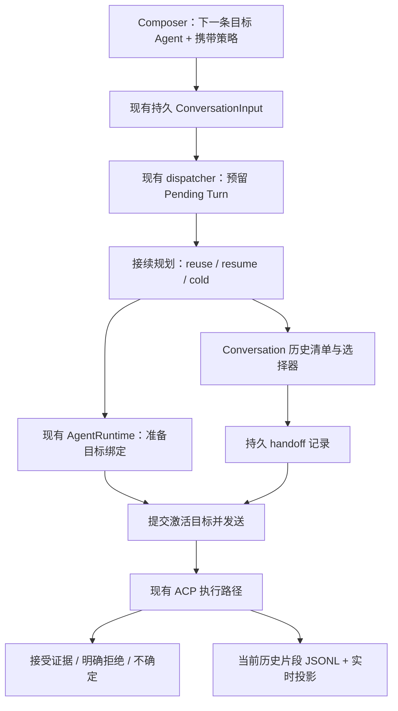

# VibeX 跨 Agent / Provider 接续方案

日期：2026-11-13。状态：提案，尚未实施；不替代已接受的 ADR。

本文基于当前工作区源码分析。工作区存在其他并行修改，文中的函数名与职责比行号更稳定。T3 对照固定在 `pingdotgg/t3code@e0d6aadb88d229746be9503c510baaccbad84f4f`，完整对比见[研究报告](../research/2026-11-13-t3code-vibex-comparison.md)。

## 1. 建议与目标

建议沿用 VibeX 的 Conversation、持久输入队列和 Turn 控制面，补齐三项能力：**可返回的原生会话绑定、与当前 Agent 无关的历史读取、可核对的上下文交付记录**。在现有 `ConversationSessionService` 内完成编排，不另建 Provider 编排框架。

目标体验：用户在同一个 Conversation 中先让 Claude 工作，下一条交给 Codex，之后再切回 Claude；面板、历史和工作目录连续，Agent 原生隐藏状态按各自能力恢复，缺失的可见历史通过有预算的交接补充。

这里的“连续”有三个独立层次：

| 层次 | 承诺 | 不可由此推导的承诺 |
| --- | --- | --- |
| 产品会话 | Conversation ID、历史、文件工作区连续 | 文件自动回滚或隔离 |
| 可见上下文 | 交付选中的历史原文，并提供遗漏内容的读取方式 | 全量历史一定进入上下文窗口 |
| 原生会话 | 条件允许时恢复目标 Agent 自己的 native session | 思考、压缩状态、缓存、权限、工具句柄可跨 Agent 搬迁 |

首个完整验收场景是 **Claude → Codex → Claude**。它在 VibeX 中首先是跨 Agent 接续；不能把设置里的 Model Provider 预设直接等同于 T3 的运行时 Provider thread。

## 2. 范围与术语

### 2.1 四类变化分别处理

| 操作 | 处理方式 |
| --- | --- |
| 同 Agent、原生允许的模型/思考等级变化 | 继续现有 mode/config 控制流程，通常复用原生会话 |
| Claude ↔ Codex 等不同 Agent | 本方案：目标绑定选择 + resume/cold + 历史交接 |
| 同 Agent 换账号、端点或 Provider 预设 | 先具备独立启动配置/凭据命名空间，再纳入本方案的绑定身份判断 |
| rebind | 用户主动废弃原生上下文，建立新绑定；默认仍不自动交接历史，可显式选择携带 |

[ADR-0063](../adr/0063-model-provider-presets-not-cc-switch.md) 下，预设绑定投影到 Agent 原生配置。逐条输入切换全局预设会影响其他 Conversation，不能作为会话级 Provider 路由实现。

### 2.2 首版边界

- 只在 Turn 边界切换。运行中选择新 Agent，只影响后续提交的输入，不给在途 Turn 换执行者。
- 同一 Conversation 最多一个在途 Turn、一个已激活的执行连接；旧 Agent 可以保留可恢复的原生会话标识，无须保活所有进程。
- 首版要求同一规范化工作目录。目录/账号身份不兼容时，不恢复旧 native session。
- Workflow worker、委派任务、Bot 隐藏会话的 Agent 身份由各自拥有者定义。核心路径校验并拒绝普通跨 Agent 切换；未来若开放，先修改其独立契约。参见 [ADR-0053](../adr/0053-agent-step-native-session-text-handoff-and-confirmation-projections.md)。
- 源会话有未完成审批、未结束工具或可继续修改工作区的后台工作时，首版要求先停止并确认收尾。不能把这些操作静默转交给目标 Agent。
- Git 工作区仍是同一份文件。可附带当下的 Git 状态观察，不隐式提交、建 worktree、合并或回滚。

`CONTEXT.md` 目前把 Conversation 定义为“用户与一个 agent 之间的持久对话”。实施前应通过新 ADR 明确允许**顺序使用多个 Agent**，并补充 binding 与历史交接术语；本提案不直接改写已接受的领域定义。

## 3. 已有机制能复用什么，缺什么

| 位置与现状 | 影响 | 具体改法 |
| --- | --- | --- |
| [queue.rs](../../crates/conversations/src/turn/queue.rs) 的输入 payload 已持久化 `agent_id`、profile、mode/config；dispatch 发现 Agent 不同就 detach | 已有目标选择和串行执行入口，无须再加一套切换队列 | 保留每条输入的目标快照，在队首执行时生成接续计划 |
| [recover.rs](../../crates/conversations/src/turn/recover.rs) 的 `detach_agent_session` 清空最新 binding 的 `acp_session_id` | 直接拿 rebind 做切换，会毁掉切回旧 Agent 所需的恢复依据 | 拆分“释放运行连接”和“废弃原生上下文” |
| [conversation.rs](../../crates/db/src/models/conversation.rs) 已有多条 binding，但许多地方取最新一条，native ID 可以被更新 | 创建顺序不能代表当前执行者；同 Agent 多代绑定可能归错 | 增加显式 active binding 指针；一条 binding 对应一代 native session |
| [binding.rs](../../crates/conversations/src/turn/binding.rs) 已有 prepare/resume、配置应用和冷启动防护 | 可复用；目标配置不能从源 Agent 的最新 binding 随意继承 | 由计划指定目标 binding 与恢复原因；只读取目标身份的设置 |
| [jsonl_history.rs](../../crates/conversations/src/jsonl_history.rs) 根据当前 Agent 与多个 native ID 找历史 | 跨 Agent 后缺少明确的来源、顺序和稳定 item ID | 用 Conversation 历史清单按顺序读取明确 JSONL 片段 |
| [acp_transcript.rs](../../crates/agents/src/acp_transcript.rs) 已有跨 Agent 目录 fallback | 当前并非“换 Agent 就必定丢历史”，但兜底扫描不能证明哪份副本权威 | 对接管后的会话禁用启发式来源选择，旧格式保留兼容读取 |
| [commit.rs](../../crates/conversations/src/turn/commit.rs)、[prompt.rs](../../crates/agents/src/manager/runner/prompt.rs) 区分实际 prompt 与 display blocks | 可隐藏交接包装，避免重复用户消息 | 加 Host 专属历史上下文块，保留原有用户可见内容 |
| [start.rs](../../crates/conversations/src/turn/start.rs) 调用 `send_prompt_with_display_blocks` | 本地调用返回不等于远端接受 | 在协议执行路径记录可验证的接受结果与不确定结果 |
| [runtime_events.rs](../../crates/conversations/src/runtime_events.rs) 存在按 Agent 查最新 binding 的事件归属 | 旧连接迟到输出或切回旧 binding 可能归错 | 显式携带 binding、连接代次、attempt、Turn 身份 |
| [session_info.rs](../../crates/conversations/src/session_info.rs) 已提供压缩历史读取，后段优先 JSONL，但截断单条文本 | 可复用读取入口，不能直接当完整交接历史 | 保留旧 compact 模式，增加稳定 item 与文本偏移分页 |

另一个必须一起改的地方：当前 queue 在创建 Turn 前、持有 turn lock 时进行 `ensure_session_controls_locked`。跨 Agent 加上 flush、恢复和历史准备后，继续把这些工作塞进锁内，会放大取消与启动状态的竞态；应先持久预留 Turn，再在锁外准备。

## 4. 总体结构



内部增加 `continuation/` 模块，隐藏绑定身份匹配、历史预算、交付恢复等复杂性。对现有队列暴露一个准备接续的 Interface；纯计划与选择逻辑独立于进程/RPC，实际文件与 Agent I/O 仍由现有实现承接。不开新的 crate，不把每一个步骤都包装成转发层。

## 5. 数据模型

字段名为建议，迁移时遵循现有 SQLx、Rust 枚举和生成类型惯例。

### 5.1 原生绑定：保留历史身份，明确当前指针

在物理 `sessions` 记录增加：

- `active_agent_binding_id`：当前选定的原生绑定；不能再用 `ORDER BY created_at` 推断。
- `binding_revision`：每次激活或废弃绑定递增，供并发修改与缓存失效使用。
- `history_revision`：对应历史清单的结构版本；追加与前缀指纹配合，截断/重写时使旧计划失效。

在现有 `conversation_agent_bindings` 增加：

- `continuation_key`：Agent ID + 规范化工作目录 + 原生配置/认证命名空间 + 必要兼容信息的非密钥身份摘要。未知兼容性不能视为相同。
- `resume_allowed` 与 `invalidated_reason`：显式禁止恢复被 rebind 或取消超时废弃的绑定。
- `is_resume_head`：每个 Conversation + continuation key 最多一个可选恢复头。目标建立并激活新代次时，以同一事务替换恢复头；fresh/rebind 废弃的旧代次不能成为隐式 fallback。

`binding.id` 就是一代 native session 的身份，不另加重复的 generation 主键。native ID 从未建立时允许由空变为真实值；已建立后，不用同一行覆盖成另一个 native ID。恢复同一个 native session 保留行，冷启动新建行。

普通切换保留源 key 的恢复头；目标 key 只选择自己的恢复头，失败后不得依次试遍更早的 binding。候选建立失败不替换原恢复头；显式 rebind 则先提交对旧头的失效意图，失败也不复活它。迁移旧数据时尊重现有“最新代次已被 rebind”的屏障，不能从旧 native ID 批量推导恢复资格。

`status` 继续描述连接/建立状态，不能同时用它猜“是不是 active”“能不能恢复”。若新增状态，迁移 CHECK 与 Rust 枚举必须一起更新；本方案无需为“暂停”专门新增状态。

在 `conversation_turns` 增加 `agent_binding_id`，准备阶段可空，在发送前固定。profile/model 仍按每轮实际选择记录。`sessions.agent_id/external_session_id` 作为兼容读字段，与 active 指针在同一事务更新，不能成为另一份可独立修改的权威。

### 5.2 历史：有序清单 + JSONL 片段

选择 **Conversation 历史清单 + 每次激活的 JSONL 片段**，避免将所有消息写入 SQLite，也避免反复扫描、拼接并覆盖多份 Agent 历史。

新增 `conversation_transcript_segments` 元数据表：

| 字段组 | 用途 |
| --- | --- |
| `id / conversation_id / ordinal` | 片段稳定身份与唯一顺序 |
| `binding_id` | 来源 native session；旧导入不确定时可空并标明来源 |
| `locator / format_version` | Host 管理的明确文件位置与格式 |
| `state / sealed_length / digest` | 活跃或封存、可验证的文件边界 |
| `first_turn_id / last_turn_id` | Turn 定位与分页加速；不是内容权威 |

清单的 ordinal 唯一，每个 Conversation 最多一个 active 片段；在同一 DB 事务封存旧片段并发布新片段，读者不能见到两个可追加目的地。文件落盘确认先于这个事务。

同一 Claude binding 切回来后会开启新片段，所以历史是 `Claude片段1 → Codex片段2 → Claude片段3`，而不是“把 Claude 所有 native 历史放在前面”。

接管后的写入位置建议为 `acp-transcripts/conversations/<conversation_id>/<segment_id>.jsonl`，沿用现有 `TranscriptEntry` 内容格式，扩展稳定 Turn/block 标识。item ID 使用 `segment_id + turn_id + block_id`，文本用 UTF-8 安全的偏移协议读取；不能依赖随重建改变的 UI row ID。

**权威切换必须同时改读与写：**

1. 第一次接续前 flush 旧写入器，经现有 reader 得到已确认的产品历史，写入一个封存的 legacy 片段。只做一次确定性导入，不在每次切换时重新 flatten。
2. 对历史来源有冲突、读失败或无法解释的旧副本，返回明确错误并保留原文件；不能猜一份后宣告完整。
3. 文件持久化成功后，事务性发布清单与历史 revision，再让新增内容写入新片段。若文件成功而 DB 失败，只留下未引用文件，恢复时清理/复用；不能发布指向未完成文件的清单。
4. 接管后 UI 打开、分页、交接选择、导出、`session_info`、fork、truncate 全部走清单。vendor 文件与 native transcript 只服务诊断/原生恢复，不再与清单争夺产品历史权威。
5. runner 的 prompt、updates、Turn end 写入器都接收显式 transcript target；resume replay 不追加，交接 prompt 只记录 display blocks。不能只改 `jsonl_history` 的读取辅助函数。
6. 切换、fork、truncate 前等待严格 flush/checkpoint 确认。常规流式写入仍可保持现有策略；跨 Agent 边界不能忽略 flush 错误。

定义 `history_revision` 与前缀指纹：普通追加能证明先前前缀仍有效；truncate/重写改变 ancestry，旧分页游标与交接计划失效。fork 复制所需片段到独立文件，保留原 item 的来源引用但生成 child 的独立身份，遵守 ADR-0082 的独立副本语义。

这会扩展 [ADR-0082](../adr/0082-jsonl-transcript-window.md) 的文件组织方式，保留其“正文在 JSONL、事件日志是控制面、默认窗口加载”的原则，应在新 ADR 中明确记录。

### 5.3 交接：持久记录计划、目标和交付证据

新增 `conversation_handoffs`：

- 身份：handoff ID、Conversation ID、operation ID、input ID、Turn ID、source/target binding ID、attempt ID。
- 来源：history revision、前缀指纹、明确的来源范围。
- 选择：策略、included item IDs、omitted item 引用、预算与选择算法版本。
- 载荷：有界的实际序列化内容及 digest。它是本次执行证据，不供 UI 作为第二份完整历史读取。
- 结果：`planned / sending / delivered / refused / uncertain / cancelled`、证据类型、时间、错误。

同一输入到同一目标代次只允许一项有效交接；重试不能覆盖不确定的发送证据。一次输入可有历史 attempt，用 attempt ID 区分，不重复消费用户意图。

“原生已有范围”和“补充交付范围”分别记录：前者来自同一 native session 的已确认 Turn 与恢复连续性，后者来自 handoff 的具体 included IDs。**遗漏 item 不因落在某个序号水位以下就被标为已交付。**

## 6. 接续决策与历史预算

### 6.1 运行决策表

| 条件 | 原生策略 | 历史策略 |
| --- | --- | --- |
| 目标就是 active binding，连接健康 | reuse | 通常不交接 |
| 目标为已有兼容且允许恢复的 binding，resume 成功 | resume | 只选其尚未知的历史；有界 delta |
| 首次使用目标 Agent | new binding + cold | 选当前 Conversation 的有界历史 |
| 用户选择 fresh | new binding + cold | 不交接，不回用旧 native session |
| rebind 默认路径 | 废弃当前代次 + cold | 不交接，保持现有用户控制语义 |
| rebind 显式 portable | 废弃当前代次 + cold | 首条实际输入携带选中历史 |
| resume 失败，且尚未发送当前用户输入 | 保留失败证据，按已授权 portable 策略 cold | 重新按完整可用来源选择；展示已冷启动 |
| 账号/目录/配置身份不明或不兼容 | 不 resume | portable 冷启动，或拒绝不支持的切换 |
| 交付或用户输入接受情况不确定 | 不自动重发 | 等用户明确处理，必要时新建 native 代次 |

`portable` 授权“尽力恢复兼容绑定，否则新建并交接”；单纯的普通 resume 失败不应因此获得任意冷启动授权。保留当前中途冷启动防护，只让明确的 transition reason 放行。

### 6.2 交接内容算法

首版采用确定性选择原文，**不让另一个 LLM 生成摘要**：

1. 冻结来源边界，排除当前待发送用户输入，排除先前的交接包装与非公开思考。
2. 根据目标 native 已知范围得到缺口。提取用户/助手可见消息及必要工具结果的可读表示；不复制可执行工具调用、权限授权、活动终端句柄。
3. 先构建本轮用户消息、persona、文件引用、插件与必要控制文本，再计算历史剩余预算。当前用户输入不因交接超预算被截断。
4. 首版建议双重上限：历史估算 token 上限 16k、UTF-8 序列化体积上限 64 KiB；若已知模型窗口，还受窗口减去本轮与输出预留的限制。这些是待实测调优的默认值，不是协议保证。
5. 预留 coverage/来源说明预算，优先选最近完整对话组，并在有余量时保留最初需求；最终按时间顺序输出。单条超长内容不伪装为完整原文，而提供 item ID 与按偏移读取入口。
6. 先序列化再核算，必要时整组移除。确定性的选择与 digest 可重建；没有可靠 tokenizer 时明确用估算值，并依靠额外体积限制，不能声称精确 token 安全。
7. 包装明确标注“历史引文”，与本轮指令分开；历史中出现的指令、工具结果不升级为宿主系统指令。附件只按目标能力交付，遗漏必须有事实说明。

若预算连最小来源说明都装不下，发送前失败并让用户选 fresh 或缩减本轮输入；不能静默把 portable 变成 fresh。

目标 Claude 切回来时，例如它已原生处理第 1–3 轮、此前没有接收 Codex 的第 4–6 轮，则恢复 Claude 并选第 4–6 轮缺口。若缺口太大，`delivered` 只证明选中条目被接受，不证明整个缺口已进入模型上下文；遗漏仍可读取。

## 7. 队列、锁与发送时序

### 7.1 提交：沿用现有 durable input

建议扩展现有提交参数，示意如下（非生成类型的直接修改）：

```typescript
{
  operationId,
  expectedBindingRevision,
  payload: {
    // 保留现有 text/profile/mode/config/refs 等字段
    agentId: targetAgentId,
    continuation: { policy: 'portable' } // 或 fresh
  }
}
```

Host 生成历史与来源，客户端不得上传任意历史正文冒充 Conversation 权威。

- `operationId` 先去重；同一 ID 不同 payload 必须冲突，不能重复创建输入。
- `expectedBindingRevision` 在接受提交时校验，用于发现另一设备已改变绑定。不能在 dispatch 时原样比较，因为队列前面的合法切换本来就会递增 revision。
- 排队输入固定自己的目标 Agent、设置与策略。之后修改 Composer 选择不改旧输入；编辑旧输入走现有修订机制。
- 缺省 continuation 的兼容规则：同 Agent 保持现有行为；跨 Agent 的旧调用走明确的历史不交接冷启动策略并记录事实，不能因升级自动把全部历史送给新 Agent。新 UI 显式传策略。

### 7.2 执行：先预留 Turn，锁外建立目标

1. 短 turn lock 内确认无在途 Turn，claim 队首，校验拥有者策略；在同一 DB 事务把 input 绑定到一个 Pending Turn，设置 active Turn，写入唯一的 `UserTurnCreated`、Dispatched 与启动意图。这个 Pending Turn 是唯一执行预留，建立失败时用户仍能看见自己的原始输入与失败事实。
2. 拆分当前 `commit_new_turn`：预留只使用已接受的用户可见 text/images/refs，不调用插件/Agent或读取文件。实际 prompt 的引用解析、persona、hook 等放在锁外；不能把实际 prompt 回写为第二条用户消息。历史来源固定为此 Turn 之前，排除刚写入的当前用户输入。
3. 释放锁，严格 flush/封存源历史，计算目标身份与计划。源文件确认前不修改 active binding，不清空旧 native ID。
4. 释放源运行连接，保留原生绑定。现有一个 live runtime slot 继续使用；候选连接通过 prepare 暂存，未激活不广播为当前执行者。无需同时运行两个 Agent。候选失败时旧逻辑绑定仍可恢复，但不自动发送用户输入。
5. 准备/恢复目标，在目标配置 schema 内应用本轮明确设置。不能将 Claude 的 mode/config key 填进 Codex。权限设置无法确认时先报错，不静默降级或扩大权限。
6. 构建一次本轮 prompt 与历史载荷。插件 hook 不因网络重试而重复执行；为本次 attempt 冻结实际 payload 与 digest。
7. 再取短锁，检查 Turn、attempt、取消与 revision 仍有效；事务提交目标激活、Turn→binding、交接计划与发送意图。文件已就绪后才发布目标片段指针。源封存边界不包含待发送 Turn：它的用户消息按 Turn ID 写入目标片段一次；若准备失败，则由失败收尾路径把用户输入写入确定的历史片段一次，不能因尚未发送而从刷新后的历史消失。
8. 锁外发送。每次真正发送前再核对 attempt。由协议执行路径产生交付证据，后续内容只写当前绑定的当前片段。
9. 建立失败或发送明确失败，让已预留 Turn 到达 Failed/Cancelled；不把已经 dispatched 的输入重新当作未消费队列项。下一条输入是否继续沿用现有队列规则，但绝不自动重发失败项。

没有一个事务能横跨 SQLite、JSONL 与远端 RPC。恢复依据是已持久的阶段、文件边界与接受证据，不能声称“整个切换原子完成”。

Stop 必须能取消启动中的 Pending Turn。恢复/zombie 判断要识别“已持久预留、正在建立候选连接”，不能仅凭还没有 bound process 就把正常启动当孤立 Turn。宿主重启仍将遗留在途 Turn 判为 Interrupted，不自动重发。

准备阶段的 attempt/phase 与取消状态必须持久化，并在 recovery 中收敛。rebind、truncate、其他设置写入同样遵守 Pending Turn 预留与预期 revision，不能绕过 dispatcher 改掉正在准备的源/目标。短锁之外没有隐含的独占权，真正的互斥来自这个持久预留与发送前核验。

Pending Turn 的可见 input blocks 已在数据库持久化。若在确定 transcript target 前失败或崩溃，收尾/recovery 必须先按稳定 Turn/item ID 将该用户输入补入清单指定的片段，再发布最终历史窗口；这个单次恢复动作不把事件日志变成日常正文读取源。写入器应能根据稳定 ID 判断“已写但 DB 未确认”，而不是通过文本相同来去重。

### 7.3 异步归属与迟到输出

事件路径绑定 `(conversation_id, binding_id, connection_epoch, attempt_id, turn_id)`。没有匹配在途 Turn 的内容，按 [ADR-0071](../adr/0071-conversation-turn-integrity.md) 丢弃并记诊断；旧连接不准写新片段、更新新设置或结束新 Turn。

所有 `latest_for_conversation` / `latest_binding_id_for_agent` 的执行归属读取应审计替换。历史列表可以继续按创建时间排序，执行者不能这样选。

## 8. 上下文交付状态与崩溃恢复

第一版统一用 inline 历史块 + 当前用户消息，复用 prompt/display 分离。ACP 能创建或恢复会话，不代表支持 T3 Codex 路径的 `thread/inject_items`；只有适配器具备真实且已验证的能力，才增加 native injection。

| 阶段/证据 | 交接结果 | 恢复规则 |
| --- | --- | --- |
| 已计划，尚未开始发送，且能证明未发送 | planned | 若 Turn 仍有效，可继续准备；宿主重启则遵守 Interrupted 规则 |
| 即将向远端发送，已记录 sending | sending | 崩溃后先视为 uncertain，不能靠未收到响应推断未接受 |
| 远端明确在消费前拒绝 | refused | 当前 Turn 失败；用户可显式重试 |
| 真实协议接受确认或可归因的执行证据 | delivered | 记录具体 included IDs 与目标 native 身份 |
| 连接断开、超时或响应无法判明 | uncertain | 不自动重发；显式处理后再决定恢复/新代次 |

ACP v1 的 prompt 最终响应可证明该次请求被处理；在此之前，只有能与本次请求明确关联的工具/输出事实才可作为接受证据，不能把 session 级无关广播当确认。协商到支持接受确认的版本时使用其真实确认事件。**发送函数本地排队成功不构成证据。**

上下文接受与 Turn 成功是两回事：历史可能已送达而后续工具失败，不能因此再次注入；用户请求是否已接受也必须单独由现有 Turn/发送事实表达。

若未来 native injection 与用户 prompt 分两步，分别保存接受结果。只有能证明当前用户 prompt 尚未发送时，才可能在新代次重新准备历史；涉及未知用户输入或工具副作用，一律不自动重发。取消超时后失效 native binding，不能切回来继续复用。

这沿用 [ADR-0044](../adr/0044-conversation-control-plane-and-durable-inputs.md) 的 durable input 与不重复派发原则，不承诺跨进程/远端 exactly-once。

## 9. rebind 的保留语义

在 `recover.rs` 拆出两个不同操作：

- `release_runtime_for_switch`：停止/释放运行连接，严格保存历史，保留旧 binding 的 native ID 与恢复资格。
- `invalidate_binding_for_rebind`：将指定 binding 标记不可恢复，保留 native ID 作为历史证据，创建新 binding。不得再通过“往更早 binding 回退”复活用户废弃的上下文。

`rebind_session` 保持独立用户意图，增加每次调用唯一的 operation ID；不能用 Conversation ID 做永久去重键。默认 `contextPolicy: none`，旧客户端行为不变。

若提供 `contextPolicy: portable`，以 rebind operation ID 保存待交接来源与策略，建立冷会话但不发空 prompt。下一次实际输入在队首消费该意图并绑定 handoff；它若指定 fresh 或不同目标，先明确处理冲突，不能暗中把历史交给另一个 Agent。已有排队输入时，首版拒绝 portable rebind 并提示先处理队列，避免改变已接受输入的上下文契约。

历史截断导致的失效也必须走明确 invalidation，不把旧 native 会话带着已删除的后半段继续恢复。rebind 默认不交接不代表清除产品历史，fresh 也不代表遗忘或擦除此前已传给服务商的数据。

## 10. Host Interface 与前端

复用 [共享命令注册表](../../crates/application/src/domain.rs) 与 [Host Conversation 模块](../../crates/server/src/host/conversation.rs)，桌面和 headless 使用同一条执行路径。`shared/types.ts` 与 `shared/hostCommands.ts` 由源定义生成，不手改。

必要变化：

1. submit payload 增加 continuation policy；响应/摘要提供 active binding revision 与当前 Agent，队列每项返回固定目标。
2. 可选增加只读 `conversation_plan_continuation`，返回预估恢复方式、来源范围和预计携带量。preview 不是执行承诺，dispatch 必须重算并校验。
3. rebind 参数扩展 operation ID 与可选 context policy。保留 `conversation.write` 权限与现有 principal 检查。
4. 结构化错误区分 `continuation_not_allowed`、`binding_revision_conflict`、`history_checkpoint_failed`、`target_unavailable`、`handoff_budget_exceeded`、`handoff_delivery_uncertain`。不要全部变成不可恢复的 `bad_request` 字符串。
5. 扩展现有 session history 读取请求：支持 `itemId / afterItemId / textOffset / maxChars`，返回稳定下一页/下一段游标。沿用 [delegation-proto](../../crates/delegation-proto/src/transport.rs) 的传输能力与鉴权，保留旧 compact 模式。
6. 按需读取自身交接历史应是当前 Conversation 的窄 Host 能力，不依赖用户启用了完整协作插件。若目标 Agent 无法接入该读取能力，必须在接续计划中说明遗漏不可由 Agent 自助补读；不能交付一条不存在的工具说明。

前端以行为为主，不在产品文案里展示 binding、JSONL、digest：

- 在现有 [Composer topbar](../../frontend/src/components/tasks/follow-up/SessionComposerTopbar.tsx) 身份区选择“下一条由谁执行”，与 SessionSelector 的“切换 Conversation”区别清楚。
- 携带策略为“携带对话历史 / 全新上下文”；首次更换目标可展开查看将发送的范围、附件限制与遗漏。选中目标本身不立即切断连接。
- [useSessionComposerQueue](../../frontend/src/components/tasks/follow-up/useSessionComposerQueue.ts) 已从 profile 写入 `agentId`，在此扩展策略；排队列表显示每条固定目标。
- 时间线仅加一条事实：“Claude → Codex · 已携带 N 条，另有 M 条可读取”。只有交付证据成立后才写“已携带”；不确定时提供明确处理入口，不显示成功。
- rebind 错误入口保持“重建上下文”含义，不复用成普通切换按钮。[sessionControlsQuery](../../frontend/src/features/agents/sessionControlsQuery.ts) 分开缓存目标可选 schema 和当前已确认设置，并以绑定 revision 失效。
- 切回旧 Agent 时保留其自己的 mode/config 记忆；用量、错误与模型显示按 Turn/binding 归属，不用当前 Agent 回填历史。

本节是功能交互约束，不包含视觉重设计；实现具体 UI 时再按仓库设计规范做视觉与可访问性评审。

## 11. 按文件落地

| 改动区域 | 主要文件/目录 | 必须完成的变化 |
| --- | --- | --- |
| 领域与决策 | `CONTEXT.md`、`docs/adr/` | 批准后明确顺序多 Agent、binding 代次、文件权威与 rebind 差异 |
| DB | `crates/db/migrations/`、`crates/db/src/models/conversation.rs` | active 指针/revision、绑定身份与失效、Turn binding、segments 与 handoffs；回填和约束 |
| 输入契约 | `crates/db` 的 ConversationInput payload、`crates/application` | 策略与提交修订校验；操作幂等 |
| 调度 | `crates/conversations/src/turn/queue.rs`、`commit.rs`、`start.rs` | 预留 Turn、锁外准备、单次 prompt 构建、发送前绑定与交接 intent |
| 绑定/恢复 | `turn/binding.rs`、`turn/recover.rs` | switch release 与 rebind invalidation 分开；显式选择目标，保留恢复护栏 |
| 接续实现 | 建议 `crates/conversations/src/continuation/` | 纯计划/历史选择/coverage；复用队列、runtime 与文件读写 |
| 历史读写 | `jsonl_history.rs`、`crates/agents/src/acp_transcript.rs`、`manager/runner/prompt.rs`、`replay.rs` | 清单、稳定 item、明确 writer target、严格边界、恢复去重、fork/truncate/export |
| 运行与归属 | `crates/agents/src/runtime.rs`、`crates/conversations/src/runtime_events.rs` | 候选暂存、连接代次、接受证据、迟到输出隔离与崩溃恢复 |
| 补读 | `crates/conversations/src/session_info.rs`、`crates/delegation-proto/src/transport.rs` | 在现有读取路径增加完整分页，不用 compact 截断结果做交接权威 |
| Host | `crates/application/src/domain.rs`、`crates/server/src/host/conversation.rs`、`crates/server/src/domains.rs` | 共享参数、错误和可选预览，不另建 Tauri 专用行为 |
| 前端 | `TaskFollowUpSection.tsx`、Composer topbar/queue、`conversationApi.ts`、状态 dock/timeline、sessionControlsQuery | 下一条目标、固定队列目标、携带策略、交付状态和恢复入口 |
| 生成与文案 | `src-tauri/src/bin/generate_types.rs`、生成 shared 文件、i18n | 按源定义生成类型，补中英文最少必要文案 |

其中 transcript reader/writer 与绑定归属是跨层主工作量。仅修改 Composer + `rebind_session` + prompt 前缀，无法完成可返回且可恢复的接续。

## 12. 实施顺序与可交付切片

| 阶段 | 依赖与交付 | 验收边界 |
| --- | --- | --- |
| A：身份与历史基础 | 显式 active binding；拆 release/invalidate；清单读写与旧会话接管；Turn/连接归属 | 同 Agent 行为不回退，rebind 不复活旧代次，历史读取/导出/fork 正确 |
| B：完整冷启动跨 Agent | A + 输入策略、锁外准备、inline 选择、交付记录、补读和最小 UI | Claude → Codex 能工作；失败/Stop/崩溃不重复发送。每次跨 Agent 可先冷启动，但 UI 如实说明 |
| C：恢复与增量 | B + continuation key、目标旧 binding resume、具体已知范围 | Claude → Codex → Claude 恢复旧 Claude，只补它缺失的历史；达到本文主要目标 |
| D：能力与 Provider 扩展 | C + 实际适配器能力；同 Agent 多端点需先有配置隔离 | 可选 native injection；不改全局预设实现局部路由 |

**建议把 A–C 作为完整能力的发布目标。** B 可以内部验证或作为明确标注“冷启动接续”的阶段版本，不能宣称已经等同于 T3 的切回恢复。D 不应阻塞通用 ACP inline 接续。

不用预估天数掩盖跨层范围：A、B、C 均需要数据库与 runtime/协议回归；D 的可行性取决于实际 Agent 能力。实现时再沿上述顺序拆小 PR，避免一个 PR 同时切换全部历史权威与所有 Agent 接入方式。

## 13. 验收与验证

### 13.1 必须覆盖的行为

| 场景 | 通过标准 |
| --- | --- |
| A → B → A | 同 Conversation；原生 ID 保留；A 恢复时只补真实缺口；无重复用户气泡 |
| portable / fresh / rebind | 三种策略事实可辨；fresh 与 rebind 不恢复被放弃代次 |
| A、B、A 排队 | 每条目标固定，顺序与单在途约束保持，提交 revision 不误伤后续执行 |
| 双设备/双 dispatcher | operation 去重、同 ID 异 payload 冲突、唯一预留、过期 claim 不造成双发送 |
| 长历史/长单条/图片 | 本轮输入完整；有界历史与遗漏准确；分页可读完整单条；不可传附件不伪装成功 |
| 再次交接 | 历史包装不进入下一次来源；遗漏不被错误标记已知 |
| 启动中 Stop/候选失败 | Turn 可终态；源身份保留；没有无法取消的长锁 |
| 源 flush 失败 | 不发布目标片段，不破坏 active 事实，不忽略错误继续切 |
| resume replay/迟到输出 | 不重复历史，不写入新 Turn，不结束新 Turn |
| 崩溃各阶段 | 文件完成前/后、DB pointer 前/后、sending 前/后、接受后落库前都可解释；不自动重发未知请求 |
| fork/truncate/import/export | 来源顺序、独立副本、历史 revision 与旧 native 失效正确 |
| 配置/拥有者约束 | 不跨 Agent 套 config，不改变全局 Provider 预设；固定 Workflow/Bot 身份被核心拒绝 |
| 读取能力缺失 | 仍能进行有界交接，但如实报告补读限制，不向 Agent 宣称不存在的工具 |
| 桌面/headless | 同输入契约、事件、错误与终态 |

### 13.2 实现时的现有命令

先按 TDD 编写跨队列/绑定/历史行为测试与 fixture Agent 接受/超时测试，再写最小实现。Rust 测试放到相应 crate 现有测试目录，前端 Vitest 邻近现有 queue/topbar 测试，不新增治理脚本。

```powershell
cargo test -p conversations
cargo test -p agents
cargo test -p db
cargo test -p application
pnpm --dir frontend exec vitest run src/components/tasks/follow-up/UseSessionComposerQueue.test.tsx src/features/agents/sessionControlsQuery.test.ts
pnpm run generate-types
pnpm run prepare-db
pnpm run check
pnpm run lint
```

按改动范围先跑针对性测试，再运行相关完整检查；新增测试文件落地后把它们加入对应命令。数据库或类型无改动的切片无需机械重复生成。真实 Claude/Codex 做 A → B → A、重启、Stop 和预算边界验收；fixture 通过不等于已验证所有真实 Agent 的接受语义。

本文仅新增设计文档，未修改产品代码、执行迁移或运行上述产品测试。

## 14. 最终取舍

VibeX 已有持久 Conversation、按输入指定 Agent、队列和原生恢复基础，不需要照搬 T3 的技术栈。需要接受的核心改动是：**binding 从“最新连接信息”变成可保留和激活的原生代次；历史从“按当前 Agent 找文件”变成 Conversation 明确排序的文件集合；交接从 prompt 拼接变成有接受证据的持久执行事实。**

先完成通用 inline 路径与切回恢复，再扩展原生注入和多 Provider 配置隔离，能直接覆盖用户需要的 Claude ↔ Codex 接续，同时保持现有 rebind、队列、不自动重发和 JSONL 权威语义可解释。
