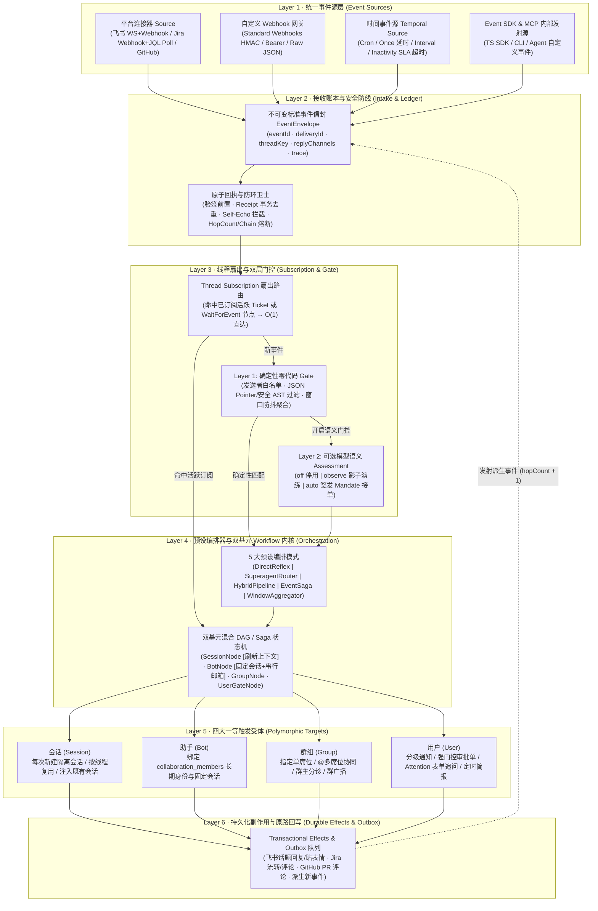
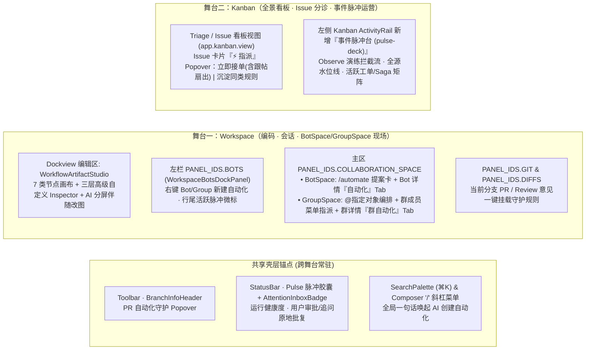

# VibeX AI-Native 事件驱动与混合自动化引擎（Pulse）完整技术方案与实施计划

日期：2026-11-15  
状态：待实施（下一优先执行 Feature）  
参考标杆：`nightly-labs/openbot`（事件路由与安全回执） · `deepseek-ai/dsh-superagent-prototype`（Source-Thread-Subscription 扇出、双层 Eval 门控与事务副作用队列） · `pingdotgg/t3code`（原生引擎控制面与回退）

---

## 0. 全局路线图上下文与战略定位

### 0.1 六大待选 Feature 原始评估与战略提级说明

在项目全局盘点中，六个演进方向的原始技术底座关系如下：

| 原始评估顺位 | Feature 项 | 战略调整后执行顺位 | 调整依据与协同边界 |
| :---: | :--- | :---: | :--- |
| 原 P0-1 | 1. 部分主力 Agent 驱动引擎从 ACP 迁移为原生引擎（[ADR-0087](../adr/0087-dedicated-agent-engine-first-acp-fallback.md)） | **并行底层轨 / 紧随其后** | 事件引擎通过统一 `AgentRuntime` / `ConversationHost` 接缝触发会话与 Bot，不耦合底层是 ACP 还是原生驱动，两者可完全解耦并行推进 |
| **原 P2 → 现 P0** | **2. AI-Native 事件驱动与混合自动化引擎（Pulse）** | **当前第一顺位执行（本文档）** | 吸收 `openbot` + `dsh-superagent` 从零构建独立领域内核，全量能力 MCP + Skill 化，打通外部平台事件、时间事件、SDK 自定义事件与双基元 Workflow |
| 原 P0-2 | 4. 全 Agent 会话 Rewind 完整能力（[ADR-0086](../adr/0086-conversation-binding-generations-and-history-segments.md)） | 第二阶段 | 复用于人工交互会话与自动化调试运行的代码/对话回退 |
| 原 P1-1 | 5. 参考 Magpie 的本地 Provider 聚合网关（多模型路由与熔断） | 第二阶段 | 上线后可直接为事件引擎的轻量 Router 评估与高并发后台 Worker 提供抗限流熔断保护 |
| 原 P1-2 | 6. 无限画布晾晒区（上方独立挂起区域） | 前端独立快赢轨 | 零后端依赖，可随时穿插在 `workspace` 空间画布迭代中交付 |
| 原 P3 | 3. Bot 市场 / 角色市场（Bot & Group 开箱即用模板） | 第三阶段（生态收口） | 待事件驱动引擎与双基元 Workflow 落地后，导出的 Bot/Group 模板可直接携带预设触发器与标准 SOP 工作流，成为真正的「数字团队包」 |

### 0.2 本方案核心目标（Clean-Slate 零历史包袱设计）

本方案**不拘泥于旧 `manual | schedule` 单表模型的历史限制**，而是面向终局直接设计一套独立的 **Pulse 事件驱动与混合编排体系**，一次性达成五大核心能力：

1. **全源接入（Platform + Webhook + Temporal）**：原生支持飞书、Jira、GitHub 等平台事件、Standard Webhooks 自定义网关，以及将「时间」（Cron、延时闹钟、周期节拍、SLA 静默超时条件）作为一等事件源。
2. **Event SDK 与 100% MCP + Skill 化（AI-Native）**：提供同构的 TypeScript/CLI Event SDK 与 Host-managed MCP 工具集 + 专属领域 Skills；用户与 Agent 均可自定义事件 Schema、发射事件、编排触发规则与 Workflow，UI 操作与 AI 调用读写**同一份声明式契约**。
3. **四类多态触发受体（Rich Targets）**：事件触发结果原生覆盖 **会话（Session）**、**持久助手（Bot）**、**协作群组（Group，支持精细指定群内席位对象）** 与 **人类用户（User：分级通知 / 强门控审批 / 结构化追问 / 聚合简报）**。
4. **双基元混合 Workflow 编排器**：同一张编排图内支持混编 **瞬态会话节点（每次运行新建、强制刷新干净上下文）** 与 **持久 Bot 节点（绑定长期身份与固定会话、跨运行累积记忆、串行邮箱防冲突）**，内置 7 类可编辑节点、三层渐进式高级自定义 Inspector 与 5 大预设编排器。
5. **严丝合缝锚定 `workspace` + `kanban` 双重前端结构**：顶栏保持纯净的 `Workspace | Kanban` 双舞台切页，所有创作、指派（Issue / PR / BotSpace / GroupSpace）与监控入口精确挂载到对应舞台组件。

---

## 1. 标杆架构吸收与融合设计原则

| 核心挑战 | 吸收自 `nightly-labs/openbot` | 吸收自 `deepseek-ai/dsh-superagent-prototype` | VibeX Pulse 引擎融合设计 |
| :--- | :--- | :--- | :--- |
| **入站安全与幂等** | Standard Webhooks（`whsec_` 密钥加密存储；**验签先于 JSON 解析**；5 分钟防重放窗口；64KiB 载荷上限）；7 天回执表与运行同事务提交去重 | `Source` 自带持久化读取水位线（`cursor`），保证进程重启绝不重复回放旧事件 | 统一 `pulse_receipts` 唯一键 `(source_id, delivery_id)` 事务幂等；外部载荷进入 Prompt 强制加不可信隔离边界 |
| **过滤与智能门控** | 最多 128 条 JSON Pointer 标量过滤规则，**过滤器与模板绝不执行任意代码（Zero-Eval）** | 双层 `Eval`（确定性 `Gate` 白名单/准入表 + 模型 `Assessment` 语义研判）；`off / observe / auto` 三档模式；不可变 `Mandate` 授权凭据 | 常规自动化走**零 Token 确定性直通（Fast-Path）**；高噪群聊/工单流可选开启轻量 Router 评估与 `observe` 影子演练模式 |
| **上下文持续跟进** | IM 触发器支持「事件认领（Claim）」，拦截后不重复开启普通对话；携带原消息坐标供下游回复或贴表情 | **`Thread` + `Subscription` 多对多扇出**：Ticket 订阅外部线程后，后续人类跟帖免 `@`、免二次评估直接注入对应执行会话 | 事件携带标准 `threadKey` 与 `replyChannels`，无论指派给瞬态 Session 还是持久 Bot，均可一键开启外部线程后续自动跟进 |
| **防死循环与防风暴** | `self` 自回声拦截（对比自身出站动作对象 ID）+ `chain` 熔断（同一对象 10 分钟最多触发 3 次） | Source 层前置丢弃 Bot 自身消息；单 SQLite 事务副作用队列 `Effects` 按 `(kind, key)` 合并去重与指数退避 | 内核级三道硬防线：**`actor.isSelf` 源头丢弃 + `trace.hopCount` 级联跳数上限（默认 ≤ 5）+ 单 `threadKey` 滑动窗口速率熔断** |
| **防止外部注入自繁殖** | `create/update_webhook_routine` 仅允许在**人类直接发起的回合**中生效，拒绝在携带不可信 Webhook 载荷的回合静默改规则 | 只有 `Eval` 可签发 `Mandate`，权限变更不腰斩在途任务但记录审计通知 | **Mandate 溯源铁律**：不可信外部事件驱动的回合调用规则修改 MCP 时，只能生成待人工确认的草稿卡，绝不静默启用 |

---

## 2. 系统总体架构与领域模型

### 2.1 六层解耦流水线拓扑



### 2.2 核心领域数据结构规范

#### （1）标准不可变事件信封 `EventEnvelope`
所有外部与内部事件在进入内核的第一时间归一化为此结构，内核绝不耦合特定平台的私有字段：

```typescript
export interface EventEnvelope<TPayload = Record<string, unknown>> {
  /** 全局单调可排唯一 ID (ULID) */
  eventId: string;
  /** 源端幂等投递键（如飞书 message_id、Jira webhookEvent+timestamp、Cron 槽位 ID） */
  deliveryId: string;
  /** 事件来源身份与信任等级 */
  source: {
    kind:
      | 'feishu'
      | 'jira'
      | 'github'
      | 'webhook.standard'
      | 'webhook.custom'
      | 'time.cron'
      | 'time.once'
      | 'time.interval'
      | 'time.sla'
      | 'sdk.custom'
      | 'system.internal';
    instanceId: string;
    trustLevel: 'trusted_human' | 'trusted_internal' | 'verified_external' | 'untrusted_external';
  };
  /** 语义化事件类型，例如 "jira.issue.transitioned" | "feishu.im.mention" | "ci.coverage.dropped" */
  eventType: string;
  /** ISO-8601 UTC 发生时间 */
  occurredAt: string;
  /** 触发者源端原生身份（不强行做跨平台账号合并） */
  actor: {
    id: string;
    displayName?: string;
    roles?: string[];
    isBot: boolean;
    isSelf: boolean;
  };
  /** 外部上下文线程聚合键，例如 "jira:CORE-128"、"github:pr:acme/repo#42"、"feishu:topic:om_xxx" */
  threadKey?: string;
  /** 仅补充参考上下文、不直接触发扇出路由的关联线程键 */
  correlations?: string[];
  /** 原路回写通道地址簿（供下游节点一键回复原话题、贴表情或更新工单） */
  replyChannels: ReplyChannelAddress[];
  /** 链路追踪与防死循环跳数 */
  trace: {
    rootEventId: string;
    parentRunId?: string;
    hopCount: number;
  };
  /** 标准化结构化载荷 */
  payload: TPayload;
}
```

#### （2）四大触发受体联合契约 `PulseTargetSpec`

```typescript
export type PulseTargetSpec =
  | {
      kind: 'session';
      mode: 'ephemeral_fresh' | 'thread_keyed' | 'existing_session';
      agentId: string;
      modelOverride?: string;
      workspaceIsolation: 'isolated_worktree' | 'project_root' | 'scratch';
      existingSessionId?: string;
      deliveryStrategy?: 'queue' | 'steer';
      subscribeThread: boolean;
      promptTemplate: string;
    }
  | {
      kind: 'bot';
      memberId: string; // 绑定固定 Bot 身份
      conversationScope: 'fixed_primary' | 'per_thread_topic'; // 默认 fixed_primary 不刷新上下文
      mailboxPolicy: 'fifo_serial' | 'coalesce_batch'; // 并发打入时串行排队或批次合并
      subscribeThread: boolean;
      promptTemplate: string;
    }
  | {
      kind: 'group';
      spaceId: string;
      dispatchMode:
        | { type: 'specific_seat'; memberId: string } // 仅唤醒群内指定单个 Bot
        | { type: 'mention_seats'; memberIds: string[]; order: 'parallel' | 'sequential' } // 指定多个 Bot
        | { type: 'moderator_triage'; moderatorMemberId: string } // 群主 Bot 先分诊再派单
        | { type: 'broadcast_log_only' }; // 仅写入群共享事件卡片，不自动唤醒 Bot
      messageTemplate: string;
    }
  | {
      kind: 'user';
      interactionKind: 'notify' | 'approval' | 'ask_form' | 'digest';
      severity: 'info' | 'warning' | 'urgent';
      titleTemplate: string;
      bodyTemplate: string;
      mirrorToChannels?: string[]; // 可同步镜像到飞书/Telegram 私聊卡片，一处点击全端消解
      approvalOptions?: Array<{ id: string; label: string; style?: 'primary' | 'destructive'; requireNote?: boolean }>;
      formSchema?: Record<string, unknown>;
      slaTimeoutSeconds?: number;
    }
  | {
      kind: 'workflow';
      workflowId: string;
      pinnedVersion: number;
      inputMapping: Record<string, string>;
    };
```

---

## 3. 事件源体系详细设计（平台 · Webhook · 时间）

遵循 [ADR-0069](../adr/0069-everything-is-a-plugin-platform.md) 内核最小化原则：Rust 内核提供统一的 `SourceRegistry`、水位线存储、加解密、回执幂等与 `TemporalSource` / `StandardWebhookGateway`；飞书、Jira、GitHub 等具体第三方平台协议通过 `provider.pulse.source` 插件接缝（如升级官方 `plugins/open-connector`）实现，内置源与插件源完全同权。

### 3.1 平台与自定义 Webhook 事件源
1. **飞书源（`feishu.*`）**：
   * **连接方式**：默认推荐 **飞书官方 WebSocket 长连接模式**（桌面与内网无需公网 IP 或反向代理即可实时收事件）+ 可选加密 Webhook 模式；断线重连后利用 `cursor` 补拉活跃订阅话题的历史消息。
   * **预设事件类型**：`feishu.im.mention`（群/私聊 `@`）、`feishu.im.message`（关键词/正则匹配）、`feishu.im.reaction_added`（例如给某条报错消息贴 `🛠️` 表情直接触发排障工作流）、`feishu.approval.status_changed`、`feishu.bitable.record_updated`。
   * **事件独占认领（Claim）**：命中声明了 `claim: true` 的自动化规则后，该消息不再重复进入普通聊天通道，并自动经 `Outbox` 给原消息贴 `👀` 处理中表情回执。
2. **Jira 源（`jira.*`）**：
   * **连接方式**：支持 **Webhook 签名接入** + **JQL 增量水位线轮询（Polling）** 双模（解决企业内网 Jira 无法回调个人开发机的问题，轮询器自动保存上次 `updated` 游标与关键字段哈希，计算精确的 `from → to` 变更）。
   * **预设事件类型**：`jira.issue.created`、`jira.issue.transitioned`、`jira.issue.assigned`、`jira.issue.commented`、`jira.issue.priority_escalated`。天然以 `jira:<ISSUE_KEY>` 作为 `threadKey`。
3. **GitHub / GitLab 研发源（`github.*`）**：
   * **预设事件类型**：`github.issue.opened`、`github.issue.assigned`、`github.pr.opened`、`github.pr.review_submitted`、`github.pr. synchronize`（新 Commit 推送）、`github.ci.failed`、`github.pr.merged`。
   * **防回声增强**：记录自身 Workflow 创建的 Comment / Review / Commit SHA 到 `pulse_outbound_artifacts`，收到自身动作引发的回声事件直接标记 `skipped: self`。
4. **自定义 Webhook 网关（`webhook.standard` / `webhook.custom`）**：
   * 每个 Webhook 触发器生成独立 `routeId` 与 `whsec_` 密钥（落盘使用宿主密钥链加密，明文仅创建/轮换时返回一次）。
   * **严格校验序**：路由存在性检查 → Body 大小检查（≤ 64KiB） → **常量时间验证 `HMAC-SHA256(secret, "<timestamp>.<deliveryId>.<rawBody>")` 及 5 分钟时间戳窗口** → UTF-8 JSON 解析 → 事务写入 `pulse_receipts` 并入队。

### 3.2 时间事件源（`TemporalSource`）
由持有 `FileOwnerLock` 单实例租约的宿主统一驱动，所有时间触发最终都生成标准 `EventEnvelope` 走同一条管道：
- **`time.cron`**：5/6 段 Cron + IANA 时区 + 工作日日历过滤 + 停机错失策略（`skip` / `catch_up_once`）。
- **`time.once`**：指定绝对时间 `fireAt` 或相对延迟 `delaySeconds` 的一次性精准唤醒。
- **`time.interval`**：固定周期心跳，支持免打扰时间窗（`quietHours`）与 `skipIfRunning`。
- **`time.sla`（静默超时条件源）**：绑定活跃 `threadKey` 或挂起的审批单，在约定时间内未观测到目标终态事件（如 *“Jira P0 创建 30 分钟无进展”* 或 *“PR 评审请求发出 24 小时未响应”*）时自动派生超时升级事件。

---

## 4. 双基元 Workflow 编排引擎与预设编排器

### 4.1 双核心执行基元：`SessionNode` vs `BotNode`

打破传统工作流「要么全无状态、要么全挤在一个污染会话」的二元对立，将**上下文生命周期**定义为节点的一等公民：

| 维度 | 瞬态会话单元 (`SessionNode`) | 持久 Bot 单元 (`BotNode`) |
| :--- | :--- | :--- |
| **绑定实体** | 动态指定 `agentId`（如 Codex / Claude Code）+ 可选 Role 种子 | 绑定协作空间中已存在的 `memberId`（Bot 长期身份） |
| **会话与上下文策略** | **每次节点激活（含重试、循环每轮）强制新建独立 Conversation**，上下文 100% 干净刷新，只接收本节点 Prompt 与显式上游输入 | **绑定该 Bot 的固定持久会话（`fixed_primary`）或按 `threadKey` 归档的话题会话**，跨多次 Workflow 运行保留历史决策与长期项目记忆 |
| **工作区文件策略** | 默认运行在当前 Workflow Run 的隔离 Git Worktree（或只读根工作区） | 可同时访问 Bot 专属知识目录与当前 Run 传入的目标代码工作区 |
| **并发安全机制** | **无锁水平并发**：100 个事件可同时拉起 100 个瞬态会话并行执行 | **内置 `BotTurnMailbox` 串行信箱**：多个并发 Run 同时抵达同一 `BotNode` 时自动按 `FIFO` 串行执行 Turn（或按窗口合并批次），彻底杜绝同一固定会话并发写乱序 |
| **长跑防膨胀** | 单次节点结束即封存快照，无上下文膨胀 | 配合会话自动摘要压缩（Compaction）与 `member_memory` 沉淀核心事实 |
| **典型分工** | 独立写代码、跑单测、零偏见安全/代码审查、并行分片处理 | 迭代 PM 总控、值班 SRE 分诊官、架构守门人、跨周跟进同一需求的主理人 |

### 4.2 七大可编辑节点类型（Workflow Studio Node Catalog）

1. **`TriggerNode`（多源触发入口）**：支持同一画布挂载多个触发器（如「Jira 自动触发」+「飞书手动 `@` 触发」+「每日定时巡检」汇入同一套流程），节点上直接提供 `Off | Observe | Auto` 模式切换。
2. **`SessionNode`（瞬态会话节点 — 刷新上下文）**：支持配置 Agent/Model、Worktree 隔离、工具权限边界、单步超时与输出契约。
3. **`BotNode`（持久 Bot 节点 — 固定身份会话）**：支持选择目标 Bot、固定主会话/分话题模式、并发邮箱合并策略。
4. **`GroupStageNode`（群组协同会商节点）**：将指定 Group 作为编排图中的一步，支持「群主总结收敛」或「固定轮数讨论」，将群共识作为节点输出传给下一步。
5. **`UserGateNode`（人类交互门控节点）**：支持 `Approval`（多分支按钮如 `批准合并 / 打回修改 / 放弃`）、`AskForm`（结构化表单提问）与 `Notify`；等待期间持久化挂起、零后台进程占用。
6. **`ControlNode`（高级控制与挂起节点）**：
   * `Condition / Switch`：基于确定性表达式或轻量模型分类走不同分支；
   * `Parallel Fan-out / Join`：并发执行多条子链路并按 `all / any / n_of_m` 汇聚；
   * `BoundedLoop`：带强制 `maxIterations` 上限的回路（例如：`Coder SessionNode → Test/Review SessionNode → 不通过则带评语回到 Coder`，最多循环 3 次，超限转 `UserGateNode`）；
   * `WaitForEvent`：Saga 挂起节点，中途等待外部关联事件（如提完 PR 后挂起等待 `github.ci.completed` 或 `jira.issue.transitioned`，带超时分支）。
7. **`OutboxActionNode`（确定性回写与事件发射节点）**：无需启动大模型即可直接通过事务 Outbox 回复原飞书话题、贴表情、更新 Jira 状态/评论、调用外部 Webhook 或调用 `emit` 发射自定义派生事件。

### 4.3 五大预设事件编排器（开箱即用模板）

1. **`DirectReflex`（直达反射器）**：`Trigger → 确定性过滤 → 单/多路 Target（Session / Bot / Group / User）`。
2. **`SuperagentRouter`（分诊派单编排器）**：复刻 `dsh-superagent`——常驻分诊 `BotNode`（评估噪音与权限） + 动态派生隔离编码 `SessionNode` + `Thread Subscription` 自动跟帖扇出 + `Outbox` 原路回写。
3. **`HybridPipeline`（混合研发流水线）**：持久 PM `BotNode` 拆解 → 并行编码/测试瞬态 `SessionNode` → 有界 Review 打回循环 → `UserGateNode` 人工放行 → 回写 Jira/GitHub。
4. **`EventSaga`（跨天长周期状态机）**：串联多个 `WaitForEvent` 与 `time.sla` 超时提醒，驱动跨系统的长链路交付。
5. **`WindowAggregator`（防抖与简报聚合器）**：按滑动静默窗口或定时翻滚窗口收集高频同类事件，交由单个节点汇总去重后推送至 `Group` 或 `User` 简报匣。

---

## 5. 100% AI-Native：Event SDK + MCP + Skill 完整设计

前端 UI 与 Agent 工具共享同一个 Rust `ApplicationCore` 命令层（`HostCommandRegistry`），确保**人类能在界面上点出来的一切能力，Agent 都能通过 MCP + Skill 独立编排；Agent 编排出的任何产物，人类都能在界面上可视化审阅与二次编辑**。

### 5.1 Event SDK（`@vibex/pulse-sdk` & CLI）
面向用户自定义脚本、Git Hooks、CI 流水线及第三方 VibeX 插件提供强类型 SDK：
- `pulse.defineEvent({ type, summary, schema })`：注册自定义业务事件 Schema 到宿主事件目录（支持 JSON Schema 静态校验）。
- `pulse.emit(eventType, { deliveryId, threadKey, payload, replyChannels })`：向本地或远端配对 VibeX Host 发射事件（同时提供命令行 `vibex pulse emit <type> --json '...'`）。
- `pulse.rules.propose / list / toggle / testMatch`：声明式管理触发规则，并用样本载荷执行离线干跑测试（Dry-Run）。
- `pulse.workflows.compile / publish / trigger`：以 TypeScript Builder DSL 构建双基元混合 Workflow 并编译为标准 `*.vibex-workflow.json`。

### 5.2 Host-Managed MCP 工具集（扩展 `crates/vibex-mcp` 与 `crates/vibex-workflow-mcp`）

| MCP 工具名 | 核心职责 | 安全与 Mandate 约束 |
| :--- | :--- | :--- |
| `pulse_catalog_inspect` | 查询当前可用事件源实例、预设触发器模板、已注册自定义事件 Schema、可选 Bot/Group 列表 | 只读开放 |
| `pulse_event_define` | 定义或演进自定义 SDK 事件类型与载荷 JSON Schema | 需 Workspace 写权限 |
| `pulse_event_emit` | 由 Agent 在任务执行中主动发射自定义事件（驱动下游解耦订阅者） | 自动继承当前 `trace.hopCount + 1`，超上限拒绝 |
| `pulse_timer_schedule` | 创建一次性延时唤醒（`time.once`）或周期任务（`time.cron`） | 外部不可信回合创建的周期任务进草稿态 |
| `pulse_rule_propose_or_save` | 创建/更新事件自动化规则（支持绑定 Session / Bot / Group 指定席位 / User / Workflow） | **人类显式发起回合**可直接创建或渲染确认卡；**外部事件回合**强制仅生成 `draft` 待人工点确认；自动隐藏生成的 Webhook Secret 明文 |
| `pulse_rule_dry_run` | 输入模拟或历史捕获的 `EventEnvelope`，返回过滤命中结果、渲染后的 Prompt 与目标路由预览 | 纯沙箱计算、零副作用，Exhaustive 一次性返回全部校验错误 |
| `pulse_thread_subscribe` | 将当前会话或指定 Ticket 订阅/退订某个外部 `threadKey`（如跟进关联 PR 或 Jira 单） | 退订仅限非起源线程或人工确认 |
| `workflow_graph_patch` | 对 `*.vibex-workflow.json` 执行结构化节点/连线增删改、切换 `SessionNode`/`BotNode`、配置高级过滤器 | 全量静态图拓扑与循环上限校验（单次返回全部违规项，严禁 Fail-Fast） |

### 5.3 内置 AI-Native Skills（`.agents/skills/` & 官方插件投影）
1. **`pulse-automation-architect`**：指导 Agent 如何将用户的模糊意图（如 *“帮我盯紧这个 PR 的 CI，挂了自动修，修不好叫我”* 或 *“在这个群里让 QA 助手每天汇总 Jira 漏测单”*）精准转化为 `pulse_rule_propose_or_save` 参数，合理选择 `observe` vs `auto` 门控及防抖窗口。
2. **`pulse-workflow-author`**：指导 Agent 何时选用**瞬态 `SessionNode`**（隔离编码、客观审查、高并发分片）vs 何时选用**持久 `BotNode`**（保留上下文记忆的 PM/值班主理人），并确保所有循环边显式声明 `maxIterations` 与 `UserGateNode` 兜底出口。

---

## 6. 前端接入点全景设计（严格锚定 `workspace` + `kanban` 双重结构）

遵循 [DESIGN.md](../../DESIGN.md)（macOS Tahoe 双层材质、不透明内容面、动态数字统一启用 `tabular-nums`）与当前双舞台代码结构：
- **顶栏切换器**（[Toolbar.tsx](../../frontend/src/components/layout/Toolbar.tsx#L641-L670)）严格维持 **`Workspace` | `Kanban`** 两个一级舞台，不增加顶栏噪音。
- **协作空间（BotSpace / GroupSpace）** 位于 **`workspace` 舞台内部**（左栏 `PANEL_IDS.BOTS` + 主编辑区 `PANEL_IDS.COLLABORATION_SPACE`）。



### 6.1 模块一：升级版 Workflow 编排器（`workspace` Dockview 主区）
- **精确代码挂载点**：
  - 扩展 [WorkflowArtifactStudio.tsx](../../frontend/src/features/workflow/WorkflowArtifactStudio.tsx) 与 `frontend/src/features/workflow/workflow-studio/*`；
  - 在 [WorkspaceTabAddMenu.tsx](../../frontend/src/components/layout/panels/WorkspaceTabAddMenu.tsx) 增加「新建 Workflow 编排」入口；
  - 在对话流 `<AutomationProposalCard />` 提供「在编排器中分屏打开」动作，调用 `PanelActionsContext` 在相邻 `group-editor-*` 打开画布，右侧保留当前会话实现 **AI 伴随式改图**。
- **节点与高级自定义交互细节**：
  1. **双基元视觉秒懂**：`SessionNode` 头部带「瞬态新会话 · 刷新上下文」标识与 Worktree 隔离图标；`BotNode` 头部直接挂载 [MemberBotAvatar.tsx](../../frontend/src/features/collaboration/MemberBotAvatar.tsx) 与「固定身份会话 · 记忆连续」标识。
  2. **三层渐进式右侧 Inspector（[WorkflowStudioInspector.tsx](../../frontend/src/features/workflow/workflow-studio/WorkflowStudioInspector.tsx)）**：
     - **Tab 1 `配置 (Visual)`**：模型/Bot 选择、`/` 或 `{{` 上游输出与 `event.payload` 变量胶囊选择器、完成门策略、工具与 Skill 勾选。
     - **Tab 2 `高级契约 (Advanced)`**：结构化输入/输出 JSON Schema 编辑器、零代码条件过滤器（支持粘贴历史真实飞书/Jira JSON 实时高亮匹配验证）、循环最大次数与重试退避策略、自定义环境变量与 Git Checkpoint 策略。
     - **Tab 3 `JSON / AI 微调`**：Monaco 源码直编（带全量非短路 Schema 校验提示）+ 底部单节点自然语言微调指令框。
  3. **顶部调试栏（[WorkflowStudioToolbar.tsx](../../frontend/src/features/workflow/workflow-studio/WorkflowStudioToolbar.tsx)）**：新增「历史捕获事件重放（Replay Captured Event）」下拉框与单步断点开关。

### 6.2 模块二：从 Issue 指派自动化（`kanban` 主场 + `workspace` 引用联动）
- **精确代码挂载点**：
  - 主入口：`plugins/kanban-views` 的 `triage-board` / Issue 卡片操作栏及右键菜单；
  - 辅入口：`workspace` 会话 Composer 中 `@` 引用面板（[ADR-0065](../adr/0065-composer-at-reference-panel.md)）的外部 Issue / 任务条目悬浮操作。
- **双模式「⚡ 指派 (Dispatch)」Popover 设计**：
  1. **立即接单（One-Shot Ticket）**：选择执行受体（`新建隔离 Worktree 会话` / `指定持久 Bot` / `指定 Group 会诊` / `指定已发布 Workflow`），默认勾选 **`☑ 自动订阅此 Issue 后续评论（Thread Subscription）`** 与 **`☑ 进展自动回写源 Issue`**。派单后卡片实时展示工单阶段徽章。
  2. **保存为同类 Issue 自动规则（Automate Similar）**：自动提取当前 Issue 的源平台属性（项目、优先级、标签、经办人）预填为 `Gate` 过滤条件，用户一键选定 `Observe（先演练）` 或 `Auto（全自动接单）` 即完成规则创建。

### 6.3 模块三：从 PR 指派自动化（共享 `Toolbar` 分支区 + `workspace` Git/Diff 面板）
- **精确代码挂载点**：
  - 顶栏 [BranchInfoHeader.tsx](../../frontend/src/components/layout/BranchInfoHeader.tsx)（[Toolbar.tsx](../../frontend/src/components/layout/Toolbar.tsx) 内当前分支与关联 PR 胶囊）；
  - `workspace` 左栏 `PANEL_IDS.GIT` 的 PR 列表项菜单与主区 `PANEL_IDS.DIFFS` 工具栏。
- **快捷守护菜单项**：
  - **指派深度 Code Review**（拉起干净 `SessionNode` 或指定 Reviewer Bot，支持先发给【用户】审批后再推回 GitHub PR）；
  - **开启 CI 失败自动修复守护**（绑定当前 PR `threadKey`，监听 `github.ci.failed` 自动拉日志改码提交，带最大重试熔断）；
  - **订阅新 Review Comment 自动跟进**；
  - 底部一键 **「升格为本仓库所有新 PR 的默认规则」**。

### 6.4 模块四：在 BotSpace / GroupSpace 中为 Bot 或群组指定对象编写自动化（`workspace` 内聚）
- **精确代码挂载点**：
  - 左栏联系人树：[WorkspaceBotsDockPanel.tsx](../../frontend/src/features/collaboration/WorkspaceBotsDockPanel.tsx)、[GroupListPanel.tsx](../../frontend/src/features/collaboration/space/GroupListPanel.tsx)、[contactRowMenu.ts](../../frontend/src/features/collaboration/contactRowMenu.ts)；
  - 主区协作面板：[WorkspaceCollaborationStagePanel.tsx](../../frontend/src/features/collaboration/WorkspaceCollaborationStagePanel.tsx)、[ComposerDock.tsx](../../frontend/src/features/collaboration/space/ComposerDock.tsx)、[MessageStream.tsx](../../frontend/src/features/collaboration/space/MessageStream.tsx)、[MemberPanel.tsx](../../frontend/src/features/collaboration/space/MemberPanel.tsx)、[memberAvatarMenu.ts](../../frontend/src/features/collaboration/memberAvatarMenu.ts)、[ScheduledMessages.tsx](../../frontend/src/features/collaboration/space/ScheduledMessages.tsx)。
- **BotSpace（1v1 私聊）三处联动入口**：
  1. **聊天框 `/automate` 或自然语言直出草稿卡**：对当前 Bot 说出触发条件与任务，消息流内渲染交互式 `<AutomationProposalCard />`（默认绑定该 Bot 的固定主会话，也可一键切为“每次新建独立子会话处理完向本私聊汇报”），点击「启用」即完成授权。
  2. **左栏 Bot 行右键菜单**：直接「为此助手新建自动化任务」。
  3. **Bot 详情面板新增 `自动化` Tab**（并升级顶栏 `ScheduledMessages` 气泡）：集中管理绑定在该 Bot 身上的定时巡检、Webhook URL 与活跃线程订阅。
- **GroupSpace（多 Bot 群组）精准指定触发对象的三处入口**：
  1. **群聊输入框 `@指定对象 + /automate`**：支持在群内直接用 `@` 点名单个 Bot（`@QA-Bot`）、多个协同 Bot（`@PM-Bot @Arch-Bot`）、群主分诊 Bot，或人类用户自己（`@我`），AI 自动生成精准指向该群内席位的自动化草稿卡。
  2. **右侧群成员栏（`MemberPanel`）席位级菜单**：点击群内任意一个 Bot 头像或用户自己 → 选择 **「为该成员添加本群事件触发器」**，直接锁定该席位作为触发受体（不会惊动群内无关 Bot）。
  3. **群详情面板新增 `群自动化 (Group Pulse)` Tab**：可视化管理本群所有触发规则，自由切换四种群分发策略（`指定单席位` | `多席位点名协同` | `群主 Bot 智能分诊` | `直达群内人类用户审批/通知`）。

### 6.5 模块五：全景脉冲监控（`kanban` 舞台）与人类闭环收件箱（`StatusBar`）
- **`kanban` 舞台新增 `pulse-deck` 视图**：在 [WorkspaceActivityRail.tsx](../../frontend/src/components/layout/WorkspaceActivityRail.tsx#L61-L73)（`mode="kanban"`）挂载「事件脉冲台」视图，采用高密度紧凑表格（遵循 Astryx 规范：密集数据用 `Table/List` 行而非卡片套娃，`tabular-nums` 对齐计数器）展示：
  1. **Observe 演练拦截池**：查看若开启 `auto` 本会触发哪些动作，支持一键「放行执行本次」或「转正为 Auto」；
  2. **活跃 Ticket / Saga 运行表**：一眼掌控哪些流程卡在 `WaitForEvent` 或 `Waiting User`；
  3. **事件源健康与回执审计表**：各飞书/Jira/Webhook/Cron 源的水位线、验签拒绝数与熔断计数。
- **底部 `StatusBar` 常驻闭环**：
  - 升级 [AttentionInboxBadge.tsx](../../frontend/src/components/layout/AttentionInboxBadge.tsx)：承载所有触发给「用户（User）」的审批单（Approval）、表单追问（AskForm）与高优告警，不切离当前代码文件即可一键批复。
  - 升级 [AutomationFailureBadge.tsx](../../frontend/src/components/layout/AutomationFailureBadge.tsx) 为 `PulseStatusPill`：显示实时运行脉冲，点击可快速跳至 `kanban` 脉冲台；原设置页 [AutomationCenter.tsx](../../frontend/src/pages/settings/AutomationCenter.tsx) 收敛为全局平台连接器凭据配置与跨机导入导出中心。

---

## 7. 后端模块划分与数据库 Schema 概要

### 7.1 Rust Workspace 与 Packages 模块职责

| 模块路径 | 类型 | 核心职责（严守单文件 ≤ 1,500 行边界） |
| :--- | :--- | :--- |
| `crates/pulse` *(新建或演进 `crates/automation`)* | Rust Crate | 纯领域内核：`EventEnvelope`、Standard Webhooks 常量时间验签、`Gate` 零代码过滤 AST、防环熔断器、`ThreadSubscription` 路由、双层 `Eval` 状态机、`TransactionalEffects` 调度器 |
| `crates/workflows` *(扩展)* | Rust Crate | 在既有不可变版本与 Checkpoint 基础上，新增 `BotNode`（对接 `BotTurnMailbox`）、`GroupStageNode`、`UserGateNode`、`BoundedLoop`、`WaitForEvent` 与 `OutboxActionNode` |
| `crates/db` *(迁移扩展)* | Rust Crate | SQLite 持久化表与离线 `.sqlx` 查询元数据（`pnpm run prepare-db`） |
| `crates/application` & `crates/remote-protocol` | Rust Crate | 在 `HostCommandRegistry` 注册 `pulse_*` 命令与 `HostEventBus` 实时流，派生 `/api/v1/capabilities` 与 OpenAPI Schema |
| `crates/vibex-mcp` & `crates/vibex-workflow-mcp` | Rust Binary | 暴露全套 `pulse_*` 与增强版 `workflow_*` MCP 工具，实施 `Mandate` 权限溯源拦截 |
| `packages/pulse-sdk` | TS Package | 面向用户脚本、CLI 与插件的 `@vibex/pulse-sdk`（`defineEvent` / `emit` / `rules` / `workflows`） |
| `plugins/open-connector` *(升级)* | Official v4 Plugin | 基于公共 `@vibex/plugin-sdk` 贡献飞书（WS + Webhook + 话题回写）、Jira（Webhook + JQL Poll + 状态回写）与 GitHub 事件连接器（通过 `pnpm run plugin:no-privilege` 零特权校验） |

### 7.2 核心 SQLite 表清单

1. `pulse_sources`：连接器实例、加密密钥密文、启停状态、增量读取水位线 `cursor_json`、健康度快照。
2. `pulse_event_schemas`：内置与用户/Agent 通过 SDK 注册的自定义事件 Schema 目录。
3. `pulse_receipts`：唯一索引 `(source_id, delivery_id)`，记录状态码与忽略原因（不落盘冗余大体积原始 Body，默认 7~30 天滑动清理）。
4. `pulse_events`：标准化的 `EventEnvelope` 持久化账本，联合索引 `(thread_key, occurred_at, event_id)`。
5. `pulse_rules`：版本化触发规则定义（`gate_filter_ast`、`eval_mode: off|observe|auto`、`debounce_ms`、`targets_json`、创建时的 `mandate_origin`）。
6. `pulse_subscriptions`：`thread_key` 到活跃 Ticket / `Bot` / `WorkflowStepRun(WaitForEvent)` 的多对多订阅索引。
7. `pulse_bot_mailboxes`：持久 Bot 固定会话的串行执行锁与待合并事件批次队列。
8. `pulse_user_interactions`：面向人类用户的待决 `Approval` / `AskForm` / `Digest` 记录（支持桌面端与外部 IM 通道幂等消解）。
9. `pulse_effects` & `pulse_outbox`：事务内写入的待执行副作用与外部平台回写回执（指数退避重试 + 自回声对象 ID 登记）。

---

## 8. 分阶段开发计划与验收标准（Development Roadmap）

严格遵循 Maiden 工程纪律：**所有静态校验与 Schema/DSL 解析器一次性收集并返回全部错误（No Fail-Fast）；不新增未授权治理包装脚本，复用现有 6 项门禁预算（`check` / `lint` / `generate-types:check` / `prepare-db:check` / `remote-protocol-schema:check` / `arch:check` & `plugin:no-privilege`）**。

### Phase 1：Pulse 事件内核 + 时间源 + Webhook 网关 + 四大受体直达（预计 1.5 ~ 2 周）
- **研发内容**：
  - 完成 SQLite 表迁移与 `crates/pulse` 核心流水线（`EventEnvelope`、验签前置、Receipt 事务幂等、`actor.isSelf` 与 `hopCount` 防环熔断、零代码 JSON Pointer 过滤 AST）。
  - 落地内置 `TemporalSource`（`cron / once / interval / sla`）与 `StandardWebhookGateway`。
  - 打通四大受体投递器：瞬态/绑定 `Session`、持久 `Bot`（含 `BotTurnMailbox` 串行队列）、`Group`（四种席位分发模式）、`User`（对接 `AttentionInboxBadge` 审批/提问/通知）。
- **里程碑验收**：
  - 发送带 Standard Webhooks 签名的请求或到达 Cron 时间点，可稳定触发单会话、固定 Bot、群内指定 `@Bot` 席位或底部状态栏用户审批卡；重复 `deliveryId` 100% 幂等返回 `200 Duplicate`。

### Phase 2：100% AI-Native 闭环 — Event SDK + MCP 工具集 + Skills + 对话提案卡（预计 1 周）
- **研发内容**：
  - 发布 `@vibex/pulse-sdk` 与 `vibex pulse emit` CLI；落地 `pulse_*` 全套 MCP 工具与 `Mandate` 溯源安全护栏。
  - 编写 `pulse-automation-architect` 与 `pulse-workflow-author` Skills。
  - 前端完成通用 `<AutomationProposalCard />` 组件，接入普通会话、`BotSpace` 私聊与 `GroupSpace` 群聊（`/automate` + `@指定成员` + `MemberPanel` 席位右键菜单 + 详情 `自动化` Tab）。
- **里程碑验收**：
  - 用户在 GroupSpace 输入 *“每天 18:00 让 @QA-Bot 汇总今日未关闭缺陷发到群里，若有 P0 则弹审批问 @我 是否推迟发版”*，Agent 调用 MCP 产出提案卡，点击确认后规则持久生效；外部不可信 Webhook 回合尝试调 MCP 改规则被可靠拦截为待审草稿。

### Phase 3：双基元混合 Workflow 引擎 + 升级版 Workflow Studio（预计 2 周）
- **研发内容**：
  - 扩展 `crates/workflows` 支持 `SessionNode`（强制刷新上下文）与 `BotNode`（固定身份会话）混编，新增 `GroupStageNode`、`UserGateNode`、`BoundedLoop`（强制最大迭代次数）与 `WaitForEvent` Saga 挂起恢复，内置 5 大预设编排器模板。
  - 升级 `workspace` 舞台的 `WorkflowStudio`：落地 7 类可视化节点、右侧三层渐进式高级 Inspector（含粘贴历史 JSON 实时校验过滤器）、历史事件一键重放与 AI 分屏伴随改图。
- **里程碑验收**：
  - 单张 Workflow 画布内同时包含持久 PM `BotNode`、并行瞬态编码 `SessionNode`、打回循环、挂起等待事件与人工审批门控，支持断点试跑、进程重启零丢失恢复。

### Phase 4：飞书/Jira/GitHub 连接器 + Issue/PR 就地指派 + Kanban 脉冲台（预计 1.5 ~ 2 周）
- **研发内容**：
  - 在 `plugins/open-connector` 落地飞书（WebSocket 长连接 + 话题/表情 Outbox 回写）、Jira（Webhook + JQL 水位线轮询 + 状态评论回写）与 GitHub PR/Issue/CI 连接器，打通 `Thread Subscription` 自动跟帖扇出与可选 `SuperagentRouter` 语义门控（`off / observe / auto`）。
  - 前端落地 **`kanban` 舞台 Issue 卡片「⚡ 指派」Popover**、**`Toolbar` `BranchInfoHeader` / `GIT` / `DIFFS` 的 PR 守护菜单**，以及 **`kanban` 左侧窄轨新增的 `pulse-deck` 全景事件脉冲视图**。
- **里程碑验收**：
  - 在 `kanban` Issue 卡点击指派后自动拉起隔离 Worktree 会话并订阅 Jira/GitHub 后续评论免 `@` 直达；在 `Toolbar` 分支胶囊一键开启 PR CI 失败自动修复；在 `kanban` 脉冲台可实时检视 `Observe` 演练拦截记录并一键转正；全套前后端类型、SQLx、Remote Protocol Schema 与零插件特权门禁全绿通过。
