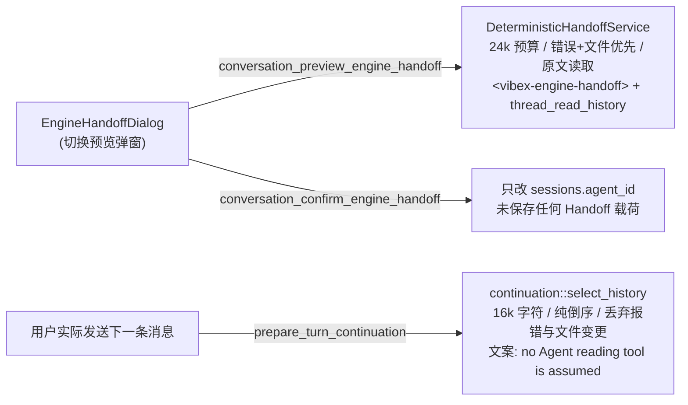

# VibeX 会话跨 Agent 接力（Handoff）审查与对标 T3Code 优化改进方案

> 日期：2026-11-15  
> 对标基准：`pingdotgg/t3code`（`apps/server/src/orchestration-v2/` & `packages/provider-core/src/server/`）  
> 关联文档：[跨 Agent 接续原设计](./2026-11-13-cross-agent-continuation.md) · [VibeX 参考 T3Code 优化改进事项清单](./VibeX参考T3Code优化改进事项清单.md)

---

## 1. 执行摘要

对照当前工作区源码与 `pingdotgg/t3code`（以下简称 **T3Code**）的 `orchestration-v2` 跨 Provider 接力实现，VibeX 目前已经完成多代绑定（`conversation_agent_bindings`）、Stage B 投递证据表（`conversation_handoffs`）、Stage C 同键恢复与增量去重（`delivered_item_ids` / `known_segment_prefixes`）以及 `thread_read_history` 分页读取（`session_info.rs`）等基础建设。

但在实际执行链路上，审查发现一个**核心结构性割裂**：**“切换前预览与确认链路（`DeterministicHandoffService`）”和“发消息时实际打包与注入链路（`continuation::select_history`）”目前运行在两套完全不同的逻辑上**；同时在多实例身份隔离（`ProviderInstance`）、`uncertain` 状态自愈、动态窗口预算以及时间线持久化方面存在明确短板。

---

## 2. VibeX vs T3Code 核心实现对照表

| 对比维度 | VibeX 当前实现 | T3Code（`pingdotgg/t3code`）实现 | 差异评估 |
| :--- | :--- | :--- | :--- |
| **编排与状态权威** | SQLite 状态表（`sessions.active_agent_binding_id`、`conversation_agent_bindings`、`conversation_handoffs`）+ 局部运行时事件 | 全事件溯源（`OrchestrationV2ContextTransfer` + `OrchestrationV2ContextHandoff` + `OrchestrationV2ProviderThread`）；同一 App Thread 下按 Provider 维护各自原生线程与 `handoffIds` | VibeX 确认切换时只改写 `sessions.agent_id`，未产生可审计、可回放的 Transfer/Handoff 事实记录 |
| **切换策略与复用键** | `crates/conversations/src/turn/continuation.rs`：`continuation_key` 仅为 `"{agent_id}\|{working_dir}"`；未纳入 `provider_instance_id`、`model` 或 `runtimeMode` | `ProviderSessionTransitionPolicy.ts`：`decideProviderSessionTransition` 严格校验 `driverKind`、`continuationKey`、`instanceId`、`runtimeMode`、`workspace` 与适配器 `selectionTransition`，输出 `reuse` / `switch_model_in_session` / `restart_and_resume` / `create_with_handoff` / `reject` | VibeX 已有 `provider_instances` 隔离机制（`host.rs`），但未接入 `continuation_key`，同引擎切换不同账号/端点时会误 `resume` 旧原生会话 |
| **上下文打包算法** | **双轨割裂**： 1. 预览用 `handoff.rs` 的 `DeterministicHandoffService`（24k 预算、优先级 `UnresolvedError > RecentTurn(3) > FileModification > HistoricalTurn`、读未截断原事件） 2. 实际发送用 `continuation.rs` 的 `select_history`（16k 字符 / 64KB、仅按轮次倒序、丢弃 `ToolUse`/`TurnError`/`FileChangeSummary`） | 统一使用 `handoffBudget.ts` + `ContextHandoffService.ts`： 锚定 `首轮用户请求` + `最近用户` + `最近助手`，按最新到最旧填充；包含消息、命令执行、报错、中断结果、文件变更与计划 | **用户弹窗预览的上下文与目标 Agent 实际收到的上下文完全不一致** |
| **Token 预算计算** | 静态固定上限： 预览固定 `24_000`；实际发送固定 `min(64KB, 128KB - current_bytes)` 且 `chars <= 16_000`，未感知模型窗口与附件占用 | `handoffBudget.ts` 动态窗口扣减： `min(cap, 64KB, window - nativeUsedTokens - currentTurnWithAttachments - workReserve)`（图片按 8192、附件按 4096 估算，`workReserve` 为窗口 1/4~1/2） | VibeX 无法防止“大窗口切小窗口模型”、带图切换或老会话 Stage C 增量溢出导致的上下文爆窗 |
| **投递通道与防污染** | 仅支持首部文本拼接： `prepared.agent_blocks.insert(0, AgentContentBlock::Text { text })` | `ContextHandoffDelivery.ts` 双通道： 1. 优先 Adapter 原生 `session.injectHistory`（如 Codex 结构化 `historyResponseItems`） 2. 回退 `withInlineContext`；对 `/compact`、`/goal` 等维护指令支持 `deferInline` 延迟投递 | VibeX 在切换后首轮若发 `/compact` 等控制指令，会把接力历史直接消耗在维护指令上 |
| **Omitted 历史回溯** | `session_info.rs` 的 `read_history_page` 已完整支持 `history_revision`、`item_ids`、`item_id + text_offset` 分页；但实际发送的 `continuation::history_prompt` 却写明 *"no Agent reading tool is assumed"* 且未列出 `omitted_ids` | `selectHistory` 预留至多 1/8 预算列出最近 20 个 omitted ID，并在文案中精确引导调用 `t3_thread_read(threadId, view:"activity", itemId, maxCharsPerItem, textOffset)` | VibeX 的 MCP 回溯工具已完备，但实际发送的 Prompt 反而阻止了 Agent 去按需回溯 |
| **不确定状态与异常恢复** | `handoff.rs` 实现了 `planned -> sending -> delivered \| uncertain \| cancelled`，但 `prepare_turn_continuation` 匹配 `resume_candidate` 时**未检查是否存在 `uncertain` 记录**，也无预算溢出自动新建会话机制 | `ProviderTurnStartService.ts` + `ContextHandoffDelivery.ts`： 1. 若发现 `delivery.status === "pending"`（即 uncertain）或 `resume_failed`，拒绝复用，强制建新原生线程并投递 `full_thread_summary` 2. 预算溢出时自动切换为新建原生线程 3. `refusedBeforePrompt` 时回滚 `unsent` 保护复用资格；失败/中断轮次自动生成 `prepareRetryHandoff` | VibeX 把 `uncertain` 状态存进了数据库但未在选路逻辑消费，存在静默上下文分裂与卡死风险 |
| **时间线 UI 展示** | `ContextHandoffDivider.tsx` 的 `ConversationTailHandoff` 仅读取内存 ref `usePendingAgentHandoff`，发消息后或刷新页面即消失；`projection/rows.rs` 仅在底层异常重绑时渲染警告条 | `Orchestrator.ts` & `ProviderTurnStartService.ts` 在切换/Fork/Merge-back 时持久化发射 `type: "handoff"` `TurnItem`（含双方引擎、模型、策略与摘要） | VibeX 缺乏对话中历史切换节点的可视化锚点，用户回看长会话不知道哪一轮换过 Agent |
| **SideChat & 限流联动** | `side_chat.rs` 为内存单次问答，由前端传 `context_turns`；`rate_limit_recovery.rs` 仅支持同引擎等 `resetAt` 自动续跑 | SideChat 为 `lineage.sideChat = true` 的真实 Thread，支持 `prepareSideChatContext` 与跨引擎切换 | SideChat 无法切引擎深聊；限流恢复未联动跨引擎接力作为即时替代方案 |

---

## 3. 已核实的关键问题与根因分析

### 问题一（P0）：预览链路与实际投递链路“双轨割裂”

* **代码证据**：
  * 预览与确认：[`crates/server/src/host/conversation_handoff.rs`](file:///C:/Users/18190/Documents/projects/VibeX/crates/server/src/host/conversation_handoff.rs) 调用 [`DeterministicHandoffService::build_handoff_context`](file:///C:/Users/18190/Documents/projects/VibeX/crates/conversations/src/handoff.rs#L246) 与 [`confirm_engine_handoff`](file:///C:/Users/18190/Documents/projects/VibeX/crates/conversations/src/handoff.rs#L782)。确认时特意保留 `active_agent_binding_id`，等待下一轮触发切换，但**不持久化选中的上下文**。
  * 实际发送：[`prepare_turn_continuation`](file:///C:/Users/18190/Documents/projects/VibeX/crates/conversations/src/turn/continuation.rs#L120) 与 Stage C 分支（[`turn/continuation.rs:266`](file:///C:/Users/18190/Documents/projects/VibeX/crates/conversations/src/turn/continuation.rs#L266)）调用的是旧版 [`continuation::select_history`](file:///C:/Users/18190/Documents/projects/VibeX/crates/conversations/src/continuation.rs#L121)。
  * 具体退化点：
    1. [`continuation::visible_items`](file:///C:/Users/18190/Documents/projects/VibeX/crates/conversations/src/continuation.rs#L76-L106) 丢弃了 `TurnError`、`FileChangeSummary`、`ToolUse`、`Plan` 等高价值调试上下文，且读取来源是 `project_turns_summary` 而非未截断原事件；
    2. `continuation::select_history` 仅按对话组从后往前硬凑 16k 字符，若会话较长且当前报错发生在早期，或需要保留最初任务目标，目标 Agent 将丢失关键现场；
    3. [`continuation::history_prompt`](file:///C:/Users/18190/Documents/projects/VibeX/crates/conversations/src/continuation.rs#L160) 明确提示 `"no Agent reading tool is assumed"`，且不输出 `omitted_ids`，使 [`crates/vibex-mcp/src/main.rs`](file:///C:/Users/18190/Documents/projects/VibeX/crates/vibex-mcp/src/main.rs) 中已实现的 `thread_read_history` 与 [`read_history_page`](file:///C:/Users/18190/Documents/projects/VibeX/crates/conversations/src/session_info.rs#L54) 几乎无法在真实跨引擎接力中被自动触发。

### 问题二（P0）：`ProviderInstance` 身份未纳入 `continuation_key`

* **代码证据**：
  * [`crates/conversations/src/turn/continuation.rs:13-15`](file:///C:/Users/18190/Documents/projects/VibeX/crates/conversations/src/turn/continuation.rs#L13-L15) 定义 `continuation_key(agent_id, working_dir)` 仅为 `format!("{agent_id}|{working_dir}")`。
  * 前端 [`ComposerProviderInstanceSlot`](file:///C:/Users/18190/Documents/projects/VibeX/frontend/src/components/tasks/follow-up/ComposerEngineHandoffControl.tsx#L27-L80) 仅在组件内部维护 `selectedByAgent` 的局部 `useState`，既没有向上同步给 [`TaskFollowUpSection`](file:///C:/Users/18190/Documents/projects/VibeX/frontend/src/components/tasks/TaskFollowUpSection.tsx)，也未随 `confirmEngineHandoff` 或发消息 payload 下发给后端。
  * 后端 [`apply_provider_instance_launch_env`](file:///C:/Users/18190/Documents/projects/VibeX/crates/conversations/src/host.rs#L592-L640) 已经通过 `VIBEX_PROVIDER_INSTANCE_ID` 做了环境变量、API Key 与独立 OAuth 目录隔离。
* **后果**：当同一 `agent_id`（例如 `codex` 或 `claude_code`）切换不同 `provider_instance_id`（不同账号/中转/配置目录）时，系统既不会识别为需要 Handoff，也会把旧实例产生的 `acp_session_id` 直接用于新实例的 `resume_session`。

### 问题三（P0）：`uncertain` 状态与异常恢复闭环未闭合

* **代码证据**：
  * [`crates/conversations/src/handoff.rs:61-84`](file:///C:/Users/18190/Documents/projects/VibeX/crates/conversations/src/handoff.rs#L61-L84) 已正确在失败/取消/重启时把 `'sending'` 态置为 `'uncertain'`，且 [`delivered_item_ids`](file:///C:/Users/18190/Documents/projects/VibeX/crates/conversations/src/handoff.rs#L92-L111) 只认 `'delivered'`。
  * 但 [`prepare_turn_continuation`](file:///C:/Users/18190/Documents/projects/VibeX/crates/conversations/src/turn/continuation.rs#L61-L73) 挑选 `resume_candidate` 时，只过滤了 `b.resume_allowed && b.acp_session_id.is_some()`，**没有查询该 `binding` 是否挂有 `status = 'uncertain'` 的历史 handoff 记录**。
  * 此外，当 Stage C 增量体积加上本轮输入导致 [`handoff_budget_exceeded`](file:///C:/Users/18190/Documents/projects/VibeX/crates/conversations/src/turn/continuation.rs#L267-L271) 时，VibeX 直接返回 `SessionUnavailable` 错误阻断发送，而没有像 T3Code 一样自动退回到新建原生会话重建上下文。
* **后果**：
  1. 若某次切回目标 Agent 在 `sending` 阶段中断（实际对端可能已消费部分或全部提示词），再次切回时仍会强行 `resume` 该已被污染的原生会话，造成静默上下文分裂或重复；
  2. 较长会话在 Stage C 切回旧 binding 时一旦超预算就只能报错，用户必须手工开新会话；
  3. 缺少 `refused_before_prompt` 回滚态，底层在消费 prompt 之前明确拒收时无法安全撤销 `'sending'` 标记。

### 问题四（P1）：时间线上的 Handoff 分割线仅内存可见、刷新即失

* **代码证据**：
  * [`ContextHandoffDivider.tsx`](file:///C:/Users/18190/Documents/projects/VibeX/frontend/src/components/NormalizedConversation/ContextHandoffDivider.tsx#L172-L257) 的 `ConversationTailHandoff` 依赖 [`usePendingAgentHandoff`](file:///C:/Users/18190/Documents/projects/VibeX/frontend/src/contexts/ActiveExecutorProfileContext.tsx#L124-L140)。
  * [`crates/conversations/src/projection/rows.rs`](file:///C:/Users/18190/Documents/projects/VibeX/crates/conversations/src/projection/rows.rs#L439-L500) 只处理了 `ConversationEvent::AgentBindingRecovered` 并生成一条警告类的 `SessionNotice`（`"Agent 会话已重新绑定"`），没有任何正常接力切换的持久事件与投影行。
* **后果**：只有用户“选好新 Agent 但还没点发送”时能在聊天底部看到一条过渡线；一旦发出消息或刷新对话，历史记录里看不到任何切换边界。

### 问题五（P1/P2）：动态窗口预算、`deferInline` 与关联能力不足

1. **静态预算与附件缺失**：[`turn/continuation.rs:119,265`](file:///C:/Users/18190/Documents/projects/VibeX/crates/conversations/src/turn/continuation.rs#L119) 使用固定 `64 KiB` 与 `16_000 chars`，未扣除目标模型真实窗口限制、Stage C 原生线程已占用的 Token（`native_used_tokens`）、本轮图片/文件引用占用以及生成回答所需的安全工作空间（`workReserve`）。
2. **控制指令缺少 `deferInline`**：切换引擎后若先执行 `/compact` 等维护类请求，内联历史会被提前消耗进维护轮次；参考 T3Code 应延迟到下一条正常对话 Turn 再投递。
3. **缺少原生 `injectHistory` 抽象**：当前统一走文本前缀注入，未来升级原生 Codex `app-server` 与 Claude SDK 桥接后，若支持结构化注入（区分 `user`/`assistant` 角色流），应优先走原生历史注入，减少对用户首轮 Prompt 的文本污染。
4. **限流自动接力与 SideChat 脱节**：[`rate_limit_recovery.rs`](file:///C:/Users/18190/Documents/projects/VibeX/crates/agents/src/rate_limit_recovery.rs) 仅支持同引擎倒计时续跑；[`side_chat.rs`](file:///C:/Users/18190/Documents/projects/VibeX/crates/server/src/host/side_chat.rs) 依赖前端上传 `context_turns` 且无持久化会话能力。

---

## 4. 优化改进路线图（可执行清单）

### Phase P0：消除割裂与修复安全边界（必须优先落地）

#### P0-1 统一预览与实际投递为 `DeterministicHandoffService`
* **改动范围**：
  * [`crates/conversations/src/handoff.rs`](file:///C:/Users/18190/Documents/projects/VibeX/crates/conversations/src/handoff.rs)
  * [`crates/conversations/src/turn/continuation.rs`](file:///C:/Users/18190/Documents/projects/VibeX/crates/conversations/src/turn/continuation.rs)
  * [`crates/conversations/src/continuation.rs`](file:///C:/Users/18190/Documents/projects/VibeX/crates/conversations/src/continuation.rs)
* **具体做法**：
  1. 为 `DeterministicHandoffService` 增加 `exclude_item_ids` / `known_prefixes`（或直接过滤 `unknown_turns` 对应的原始事件），使 Cold Start 与 Stage C Delta 共用同一套打包、优先级排序与 `<vibex-engine-handoff>` 渲染逻辑。
  2. 参照 T3Code `handoffBudget.ts`，在优先级桶中强制加入 **Anchor（首轮用户请求 + 最近一轮用户/助手消息）**，保证长对话切换不丢最初目标。
  3. 统一 `delivered_item_ids` 的序列化结构体，同时持久记录本次纳入的 `included_item_ids` 与被裁剪的 `omitted_item_ids`；在 `<omitted_history>` 中列出最近最多 20 个 omitted ID（总提示说明体积不超过预算 1/8），并明确给出 [`thread_read_history`](file:///C:/Users/18190/Documents/projects/VibeX/crates/conversations/src/session_info.rs#L54) 的 `item_ids` / `item_id + text_offset` + `history_revision` 调用模板，删除冲突的 `"no Agent reading tool is assumed"` 文案。
  4. 废弃 `continuation::select_history` 仅做兜底兼容或移除双轨实现，使弹窗预览与真实下发做到**所见即所得**。

#### P0-2 把 `provider_instance_id` 接入切换决策与 `continuation_key`
* **改动范围**：
  * [`crates/conversations/src/turn/continuation.rs`](file:///C:/Users/18190/Documents/projects/VibeX/crates/conversations/src/turn/continuation.rs)
  * [`crates/conversations/src/turn/binding.rs`](file:///C:/Users/18190/Documents/projects/VibeX/crates/conversations/src/turn/binding.rs)
  * [`frontend/src/components/tasks/follow-up/ComposerEngineHandoffControl.tsx`](file:///C:/Users/18190/Documents/projects/VibeX/frontend/src/components/tasks/follow-up/ComposerEngineHandoffControl.tsx) & [`TaskFollowUpSection.tsx`](file:///C:/Users/18190/Documents/projects/VibeX/frontend/src/components/tasks/TaskFollowUpSection.tsx)
* **具体做法**：
  1. 将 `continuation_key` 升级为包含 `provider_instance_id`（缺省 `"default"`）：`"{agent_id}|{instance_id}|{working_dir}"`；若不同实例配置明确共享底层会话兼容性，再通过白名单策略显式放行。
  2. 参考 T3Code [`ProviderSessionTransitionPolicy.ts`](https://github.com/pingdotgg/t3code/blob/main/apps/server/src/orchestration-v2/ProviderSessionTransitionPolicy.ts)，在切换规划中显式区分：`reuse`、`switch_model_in_session`、`restart_and_resume`、`create_with_handoff`。
  3. 将前端 `ComposerProviderInstanceSlot` 的选中状态纳入会话草稿与发送参数，切实例时同步写入 `VIBEX_PROVIDER_INSTANCE_ID` 并按需触发 Handoff 预览。

#### P0-3 补齐 `uncertain` 阻断、预算溢出降级与 `refused` 回滚
* **改动范围**：
  * [`crates/conversations/src/handoff.rs`](file:///C:/Users/18190/Documents/projects/VibeX/crates/conversations/src/handoff.rs)
  * [`crates/conversations/src/turn/continuation.rs`](file:///C:/Users/18190/Documents/projects/VibeX/crates/conversations/src/turn/continuation.rs)
  * [`crates/conversations/src/turn/start.rs`](file:///C:/Users/18190/Documents/projects/VibeX/crates/conversations/src/turn/start.rs)
* **具体做法**：
  1. 在 `prepare_turn_continuation` 查询 `resume_candidate` 时增加 `NOT EXISTS (SELECT 1 FROM conversation_handoffs WHERE target_binding_id = b.id AND status = 'uncertain')`；若命中 `uncertain`（或 `resume_session` 失败且尚未消费当前输入），立即将旧 binding 置为 `resume_allowed = 0`（`invalidated_reason = 'uncertain_handoff'` / `'resume_failed'`），**自动降级走 Cold Start 新建原生会话并携带完整可见历史**。
  2. Stage C Resume 路径若计算得到 `handoff_budget_exceeded`（且无活跃异步子任务），自动降级为新建原生会话重算全量摘要预算，不再直接向用户报错中断。
  3. 当 `send_prompt` 在远端消费前明确失败（如连接握手拒收、进程未启动即退出）时，将 `'sending'` 回滚为 `'refused'` / `'cancelled'` 而非 `'uncertain'`，避免误杀健康原生绑定。
  4. 增加 `prepare_retry_handoff` 补偿逻辑：当目标原生会话此前存在未送达模型的 `failed` / `interrupted` 轮次时，自动把这部分可见请求补充进下一次发送的 Delta Handoff。

---

### Phase P1：预算精确化与历史时间线持久化

#### P1-1 持久化时间线 Handoff 分割线
* **改动范围**：
  * `crates/agents`（新增 `ConversationEvent::ContextHandoffRecorded`）
  * [`crates/conversations/src/turn/continuation.rs`](file:///C:/Users/18190/Documents/projects/VibeX/crates/conversations/src/turn/continuation.rs) & [`projection/rows.rs`](file:///C:/Users/18190/Documents/projects/VibeX/crates/conversations/src/projection/rows.rs)
  * [`frontend/src/components/NormalizedConversation/ContextHandoffDivider.tsx`](file:///C:/Users/18190/Documents/projects/VibeX/frontend/src/components/NormalizedConversation/ContextHandoffDivider.tsx) & [`ConversationTimeline.tsx`](file:///C:/Users/18190/Documents/projects/VibeX/frontend/src/components/NormalizedConversation/ConversationTimeline.tsx)
* **具体做法**：
  * 当一次切换在 `turn/continuation.rs` 正式完成目标绑定后，向事件流追加 `ContextHandoffRecorded`（记录 `from_agent`、`to_agent`、`from_model`、`to_model`、`policy`、`strategy`、`included_count`、`omitted_count`）。
  * `projection/rows.rs` 将其投影为持久化的时间线 Divider 行，使切换记录在发消息后与重启刷新后仍永久保留在对话时间线中。

#### P1-2 模型窗口感知的动态预算与 `deferInline`
* **改动范围**：
  * [`crates/conversations/src/handoff.rs`](file:///C:/Users/18190/Documents/projects/VibeX/crates/conversations/src/handoff.rs) & [`turn/continuation.rs`](file:///C:/Users/18190/Documents/projects/VibeX/crates/conversations/src/turn/continuation.rs)
* **具体做法**：
  1. 引入动态预算公式：`budget = clamp(min(24_000, context_window - native_used_tokens - current_turn_with_attachments - work_reserve), 1_024, 24_000)`，其中图片按 `8_192` tokens、文件引用按 `4_096` tokens 预留，`work_reserve = min(max(16_000, window / 4), window / 2)`。
  2. 在识别到 `/compact` 等维护指令时启用 `deferInline`：先执行维护或直接跳过内联接力历史消耗，保留待投递状态直到下一轮普通用户消息到来。

---

### Phase P2：生态联动与协议演进

#### P2-1 原生 `inject_history` 适配器抽象
* 配合 [`VibeX参考T3Code优化改进事项清单.md`](./VibeX参考T3Code优化改进事项清单.md) 中的 Codex `app-server` / Claude SDK 原生驱动升级，在 `agents` runtime 中暴露可选的 `inject_history` 能力：支持结构化角色历史注入的通道直接下发消息列表（避免污染首轮用户 Prompt 文本），不支持的 ACP 引擎保持 `<vibex-engine-handoff>` 内联注入。

#### P2-2 限流恢复（`UsageLimitRecovery`）一键跨引擎接力
* 在 [`RateLimitRecoveryBanner.tsx`](file:///C:/Users/18190/Documents/projects/VibeX/frontend/src/components/NormalizedConversation/RateLimitRecoveryBanner.tsx) 与 [`rate_limit_recovery.rs`](file:///C:/Users/18190/Documents/projects/VibeX/crates/agents/src/rate_limit_recovery.rs) 中增加“立即移交给备用 Agent”按钮：用户无需等待数小时 `reset_at`，可直接用 `DeterministicHandoffService` 将当前进度移交到另一可用引擎并自动发送续跑提示词。

#### P2-3 SideChat 持久化关联与复用 `read_history_page`
* 逐步将 [`side_chat.rs`](file:///C:/Users/18190/Documents/projects/VibeX/crates/server/src/host/side_chat.rs) 从前端传参的内存态单轮接口升级为带 `conversation_relations`（`kind = 'side_chat'`）的轻量持久化会话，复用服务端 [`read_history_page`](file:///C:/Users/18190/Documents/projects/VibeX/crates/conversations/src/session_info.rs#L54) 跟踪主会话进度并支持在 SideChat 内独立切换引擎。

---

## 5. 推荐验证与回归测试清单

1. **预览/投递一致性测试**（扩展 [`crates/conversations/tests/continuation.rs`](file:///C:/Users/18190/Documents/projects/VibeX/crates/conversations/tests/continuation.rs)）：同一会话有报错、文件修改与超长轮次时，验证 `preview_engine_handoff` 与下一轮实际下发给目标 Agent 的块内容、`included_ids`、`omitted_ids` 一致。
2. **`ProviderInstance` 隔离测试**：同 `agent_id` 在 `instance_a` 与 `instance_b` 间切换，确认生成不同 `continuation_key`，不会误 resume 对方 `acp_session_id`。
3. **`uncertain` 自愈与预算溢出降级测试**：手动制造一条 `status = 'uncertain'` 的 `conversation_handoffs` 记录后切回原 Agent，验证系统禁止 resume 旧 binding 并自动新建原生会话投递完整历史；制造 Stage C 增量超预算场景，验证自动降级 Cold Start 而非直接失败。
4. **时间线持久化测试**：切换并完成一轮对话后重新投影 `conversation_timeline_rows`，验证存在持久化的 `ContextHandoffDivider` 行且顺序正确。
