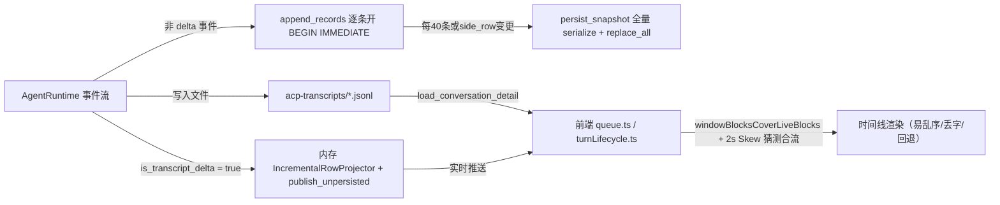
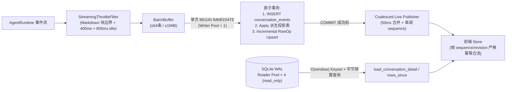

# VibeX SQLite 单权威投影重构技术规格书（Phase 1 #1）

> **文档定位**：面向架构与研发团队的工程落地规格书。基于对 VibeX 现网代码与 T3Code（`pingdotgg/t3code`）源码的一手核验，指导 VibeX **废除 `acp-transcripts/*.jsonl` 在线双轨、根治消息乱序/丢字/刷新回退、并将 SQLite 规范化投影重构为高性能唯一读写权威源**。  
> **关联文档**：`T3Code与VibeX核心架构竞品调研报告.md`、`VibeX参考T3Code优化改进事项清单.md`（Phase 1 #1）。

---

## 1. 现状病灶与根因核验

当前 VibeX 存在“事件日志/投影表 + `acp-transcripts/*.jsonl` + 内存流”多轨并存的架构撕裂。通过对源码的逐行核验，确认以下 4 个相互耦合的根因：

| 病灶点 | VibeX 现网已验证实现 | 导致后果 |
| :--- | :--- | :--- |
| **1. 核心对话内容被踢出 SQLite 事件日志** | `crates/conversations/src/jsonl_history.rs`（`is_transcript_delta`）与 `runtime_events.rs`（`is_unpersisted_conversation_event`）将 `AssistantTextDelta`、`AssistantReasoningDelta`、`AssistantContentAppended`、`PlanUpdated`、`ToolCallUpsert` 全部跳过 `conversation_events` 持久化，仅走 `publish_unpersisted` 与 JSONL 文件。 | 数据库权威事件流中缺失整个 AI 回答与工具调用过程；刷新、多端同步、断线重连和后端重启完全依赖磁盘 JSONL flush 时序。 |
| **2. 逐条开事务 + 无节流写压力** | `runtime_events.rs` 的 `ConversationEventCoalescer` 仅做相邻同类型内存合并，无时间/语义边界节流；且 `append_records` 在 `for` 循环中逐条调用 `ConversationEventAppender::append` 单独开启 `BEGIN IMMEDIATE` 事务。 | 早期走 SQLite 时每条事件一次事务，引发写锁争抢；`crates/db/src/lib.rs` 中 `max_connections(3)` 的读写共享池进一步放大阻塞。 |
| **3. 投影更新采用“全表重算 + 全删全插”** | `projection.rs` 设 `SNAPSHOT_REFRESH_EVENT_GAP = 40`，每次触发 `persist_snapshot`（`projection/cache.rs`）都会把整段会话所有 `turn` 组装成全部 `TimelineRow`、整体序列化 `fold_json`，并执行 `ConversationTimelineRowRecord::replace_all`（`DELETE` 全表后再逐行 `INSERT`）。 | 长会话写入呈 $O(N)$ 退化，刷新与并发写入极易互相卡顿。 |
| **4. 读写双源撕裂逼出前端启发式补丁** | `crates/server/src/host/conversation.rs`（`load_conversation_detail`）直接从 `jsonl_history::load_window` 读窗口，而实时流走内存推送；前端 `frontend/src/features/conversation/store/queue.ts` 与 `turnLifecycle.ts` 被迫用 `windowBlocksCoverLiveBlocks` 和 `SAME_TURN_STAMP_SKEW_MS = 2_000` 猜测窗口是否覆盖了实时流。 | 窗口时间戳偏差、JSONL flush 延迟或部分文本包含碰撞时，出现消息乱序、覆盖回退或刷新丢字。 |

---

## 2. 重构目标与架构不变量（Invariants）

### 2.1 核心目标
将 VibeX 会话存储收敛为 **SQLite 规范化投影 + 事件日志单权威源（Single Source of Truth）**，借鉴 T3Code 的写入节流、微批单事务、增量行级 Upsert 与读写隔离策略，在**彻底消除乱序与丢字**的同时，保证长会话读写的 $O(1)$ / $O(\text{window})$ 性能。

### 2.2 必须坚守的 4 条架构不变量
1. **单权威读写源**：`conversation_events`（不可变事实日志）+ `conversation_timeline_rows` 及规范化派生表（读投影）为唯一在线权威源。`acp-transcripts/*.jsonl` **退出在线读写链路**，仅保留历史冷迁移与外部导入解析能力。
2. **先 Commit、后 Publish**：任何持久态行变更必须与对应事件在同一 `BEGIN IMMEDIATE` 事务内原子提交；只有 `COMMIT` 成功后，才允许向前端广播携带单调 `sequence` 的增量 `ConversationRowOp` / 事件。
3. **热路径零全表重算**：增量事件只更新受影响的 `row_id` 行（`O(1)` Upsert/Patch/Delete），废除每 40 条事件重跑 `replace_all` 的设计。
4. **流式文本不逐 Token 落盘**：通过“Markdown 块边界 + 400ms 节流 + 800ms 空闲刷出”控制 SQLite 写入频率，同时把单次 flush 内的多条事件合并进同一个事务。

---

## 3. 目标架构与数据流

---

## 4. 详细技术方案设计

### 4.1 子系统 A：流式写入节流与微批单事务（`crates/conversations/src/runtime_events.rs`、`projection/applier.rs`）

#### A1. 恢复全部内容事件持久化
- 修改 `runtime_events.rs` 的 `is_unpersisted_conversation_event`：
  - **移除** `crate::jsonl_history::is_transcript_delta(event)`；`AssistantTextDelta`、`AssistantReasoningDelta`、`AssistantContentAppended`、`PlanUpdated`、`ToolCallUpsert` 全部重新纳入 `conversation_events` 与事务投影。
  - **仅保留**纯瞬态交互提示（如 `PromptSuggestionUpdated`）走非持久化广播。

#### A2. 引入 Markdown 块边界 + 400ms 流式节流器（对标 T3Code `assistantStreaming.ts`）
在 `ConversationEventCoalescer` 升级为带时间窗口与语义边界的 `StreamingThrottleCoalescer`：
- **合并对象**：同一 `(conversation_id, turn_id, connection_id, message_id)` 的连续 `AssistantTextDelta`、`AssistantReasoningDelta`、以及同 `tool_call_id` 的连续 `ToolCallUpsert`（running 状态）。
- **放行（Flush）条件（满足任一即触发写库）**：
  1. **控制/结构边界切换**：紧随其后到达非增量事件（如 `AssistantContentAppended`、`ToolCallUpsert` 状态跃迁、`PermissionRequested`、`TurnCompleted` 等），立即先 Flush 缓冲中的增量。
  2. **Markdown 安全边界 + 最小间隔 400ms**：针对 `AssistantTextDelta`，维护轻量增量行扫描器（参考 T3Code `advanceScan`：`openFence` 状态、空行、顶层 `#` 标题、列表项起始），当扫描到安全渲染边界且距上次提交 `>= 400ms` 时 Flush。
  3. **空闲兜底 800ms（`IDLE_FLUSH_MS = 800`）**：当流式输出暂停（如等待长耗时工具或思考停顿）超过 800ms 未触发边界 Flush，由 Recorder 宿主的 tick 定时器调用 `flush_due()` 强制落盘，防止文本停留在缓冲区看似丢失。
  4. **缓冲区上限**：单条累积文本超过 `64 KiB` 时强制 Flush。
- **可选体验增强（待决策项）**：若交互上希望保留“字符级打字机丝滑感”，可在 `publish_ephemeral_preview` 通道发纯内存预览包，但**前端必须严格将其视为临时态**——一旦带有正式 `sequence` 的持久化 `RowOp` 到达或发生页面刷新/断线重连，立即以 SQLite 投影为准覆写替换。

#### A3. 单事务微批提交（`ConversationEventAppender::append_batch`）
- 在 `crates/conversations/src/projection/applier.rs` 新增 `append_batch(pool, &[AppendConversationEvent])`：
  - 每次 `append_records` 收到的批次（或外部攒批队列，单批上限 **`MAX_BATCH_EVENTS = 64`** 或 **`MAX_BATCH_BYTES = 1 MiB`**），**只获取一次写连接并开启一次 `BEGIN IMMEDIATE`**。
  - 批内逐条执行：幂等键检查 → `insert_conversation_event` → `ConversationStateApplier::apply_record` → 收集增量 `ConversationRowOp`（**用 `SAVEPOINT sp_i` 包裹单条外键容错重放**，避免单个无效事件拖垮整批事务）。
  - 批末统一在事务内执行一次增量行投影持久化（见 4.2），最后 `COMMIT`。
  - **严格先 Commit 后 Publish**：事务提交成功后，再调用 `event_publisher.publish_batch(&committed_records)` 广播事件与对应 `RowOp`。

---

### 4.2 子系统 B：行级增量投影持久化（淘汰全删全插 `replace_all`）

#### B1. 废除热路径 `persist_snapshot` 全量重写
- 审查 `crates/conversations/src/projection.rs` 的 `refresh_snapshot_on_settle` 与 `projection/cache.rs` 的 `persist_snapshot`：
  - **彻底删除** `SNAPSHOT_REFRESH_EVENT_GAP = 40` 的热路径定时全量重建触发器。
  - **彻底废除**热路径调用 `ConversationTimelineRowRecord::replace_all`（全删全插整表）的行为。
  - **彻底移除** `refresh_snapshot_on_settle` 中回头读取 `jsonl_history::flush_and_read_existing_transcript_turns` 来重建 FTS 的分支——FTS 直接从权威投影表增量文本提取。

#### B2. 增量 `ConversationRowOp` → 行级 SQL Upsert/Delete
- 在 `crates/db/src/models/conversation_timeline_row.rs` 改造写接口：
  - 为表 `conversation_timeline_rows` 保持 `(conversation_id, row_id)` 主键，并将 `sort_index` 改为**稀疏步长或 `(turn_ordinal * 1_000_000 + local_offset)`（参考 T3Code `Foundation.ts` 中的 `run.ordinal * 1000000 + row_number`）**，或者引入可插序的 `sort_key` 列，确保在中间插入 `prefix_segment` 或 `side_row` 时**无需重排全会话所有行的 `sort_index`**。
  - 复用已有的 `IncrementalRowProjector` / `ProjectionFold::apply` 产出的 `Vec<ConversationRowOp>`：
    - `Upsert { row }`：在写入前执行载荷裁边（`cap_timeline_row_preview_fields` + 大 diff/工具输出截断 `32 KiB`），单行执行 `INSERT INTO conversation_timeline_rows ... ON CONFLICT(conversation_id, row_id) DO UPDATE SET sort_index=excluded.sort_index, revision=excluded.revision, row_json=excluded.row_json`。
    - `AppendText { row_id, revision, stream, delta }` / `PatchBlocks { row_id, revision, ... }`：对内存常驻 `CachedRowProjector` 命中的行直接编码最新 `TimelineRow` 并单行 `UPDATE conversation_timeline_rows SET revision = ?, row_json = ? WHERE conversation_id = ? AND row_id = ?`（未命中缓存时再从单行 `SELECT row_json` 补丁或从单 Turn 重建）。
    - `Delete { row_id }`：单行 `DELETE FROM conversation_timeline_rows WHERE conversation_id = ? AND row_id = ?`。
  - 同步更新 `conversation_projection_snapshots` 的 `last_sequence`、`total_rows`（通过增量 `+delta_rows` 维护或轻量计数查询）及 `session_stats_json`（仅在 `TurnCompleted` / Usage 变更时更新）。
  - `fold_json` 大字段不再每次事件重序列化，仅在 `rebuild_projection` 或版本升级时使用；日常热路径只依赖轻量 `CachedRowProjector`（LRU 上限如 8~16 个活跃会话）与单行 SQL 更新。

---

### 4.3 子系统 C：SQLite 读写连接分离与索引/分页加固（`crates/db`）

#### C1. 读写双池隔离（对标 T3Code `Sqlite.ts` `readerWorker` / `writerWorker`）
修改 `crates/db/src/lib.rs` 的 `DBService`：
- **保留 WAL + `synchronous = NORMAL`**，补充 `PRAGMA temp_store = MEMORY;` 与 `PRAGMA journal_size_limit = 134217728;`（128 MiB 上限）。
- **拆分为职责分离的双连接池**：
  - `writer_pool`：**`max_connections(1)`**（应用进程内唯一串行写入通道），彻底消除多线程并发 `BEGIN IMMEDIATE` 导致的 `SQLITE_BUSY` 锁等待与重试开销。
  - `reader_pool`：**`max_connections(4)`**（设置 `.read_only(true)`），供 `project_open`、`project_row_window`、`rows_since`、侧边栏列表及搜索查询使用。依托 WAL 快照隔离，高频流式写入与任意长会话读取**互不阻塞**。

#### C2. 索引与分页预算优化
- **新增增量同步与列表索引**（新迁移 SQL）：
  - `CREATE INDEX idx_conversation_timeline_rows_revision ON conversation_timeline_rows (conversation_id, revision);` —— 确保断线/切回追平 `rows_since(after_sequence)` 为纯索引范围扫描。
  - 确认并补齐局部活跃索引（如 `conversation_turns(conversation_id, status) WHERE status IN ('pending', 'queued', 'running', 'blocked')`），加速侧边栏状态聚合。
- **Keyset 游标 + 字节预算分页**（对标 T3Code `threadHistoryPaging.ts`）：
  - 改造 `ConversationProjector::project_open` 与 `project_row_window`：在 `LIMIT` 之外引入 **`MAX_WINDOW_BYTES = 1 MiB`** 累计字节预算截断，防止少数包含巨型代码块的 Turn 拖垮单次 IPC/HTTP 响应与前端首屏解析。
  - 分页游标由单纯数组下标 `offset` 升级为基于 `(sort_index, row_id)` 的 **Keyset 游标**，避免新消息插入或 side_row 删除导致翻页抖动。

---

### 4.4 子系统 D：服务端读路径统一与存量数据懒回填

#### D1. 全部 `jsonl_history` 下游依赖切换清单
核验以下源码调用点，统一切换至 `ConversationProjector` / SQLite 权威投影：

| 调用位置 | 现网用途 | 重构目标方案 |
| :--- | :--- | :--- |
| `crates/server/src/host/conversation.rs` (`load_conversation_detail`) | 调 `jsonl_history::load_window` 构造详情页 | 改调 `ConversationProjector::project_open` / `project_row_window`（返回统一 `TimelineRow` 窗口与 `last_sequence`）。 |
| `crates/server/src/host/conversation.rs` (`export_title_and_timeline`) | 调 `jsonl_history::load_all_turns` 导出 | 改调 `ConversationProjector::project`。 |
| `crates/conversations/src/search.rs` | 调 `jsonl_history::load_all_turns` 建 FTS 索引 | 直接从 `conversation_timeline_rows` / `ProjectionFold` 提取文本索引。 |
| `crates/conversations/src/bundle.rs` | 导出/Fork 时回退读取 JSONL turns | 所有消息已在 `conversation_events`，导出/Fork 直接基于 `conversation_events` + 投影表。 |
| `crates/conversations/src/member_memory.rs`、`collaboration_sidebar.rs`、`session_info.rs`、`crates/workflows` | 调 `jsonl_history::load_all_turns` 提取记忆/上下文 | 统一封装 `ConversationProjector::project_turns_summary` 从权威投影读取。 |
| `crates/conversations/src/turn/recover.rs`、`projection/applier.rs` | Truncate/Rewind 时同时去截断 JSONL 文件 | 移除 JSONL 截断逻辑，由 SQLite 事务原子回滚 `conversation_events` + `conversation_timeline_rows`。 |
| `crates/conversations/src/turn/binding.rs`、`collaboration/roles/session_config.rs` | detach 前调 `preserve_transcript_before_detach` | 废除，事件早已实时入库，detach 不再有未落盘 transcript 风险。 |

#### D2. 存量历史会话零丢失迁移（Lazy Backfill）
对于升级前已经存在、且内容仅在 `acp-transcripts/*.jsonl` 而不在 `conversation_events` 的历史会话：
- 在 `sessions`（或 `conversation_projection_snapshots`）增加状态标记 `legacy_jsonl_migrated INTEGER NOT NULL DEFAULT 0`。
- 当打开会话或执行全局检索遇到 `legacy_jsonl_migrated == 0` 且 `conversation_events` 中缺少 assistant 内容事件时，在独立事务中**一次性读取旧 `acp-transcripts/*.jsonl` 并合成为规范 `ConversationEvent` 写入 `conversation_events` + 构建 `conversation_timeline_rows`**，置 `legacy_jsonl_migrated = 1`。
- 迁移完成后永久走 SQLite 权威路径，不再触碰 JSONL 文件。

---

### 4.5 子系统 E：前端 Store 对账补丁清理与实时推送合并

1. **服务端推送层（`crates/server`）**：
   - 对标 T3Code `ThreadLiveEventCoalescer.ts`（`50ms` 窗口、`MAX_PENDING_UPDATES = 512`），在 WebSocket/Tauri Event 广播层对同一 `row_id` 的连续 `Streaming` 更新做 50ms 节流合并，保证下发频率 ≤ 20 FPS，不阻塞前端主线程。
2. **前端 Store 层（`frontend/src/features/conversation/store/queue.ts`、`turnLifecycle.ts`）**：
   - **删除启发式对账补丁**：彻底移除 `windowBlocksCoverLiveBlocks`、`SAME_TURN_STAMP_SKEW_MS = 2_000` 等“比较文本包含关系与 2 秒时间戳误差”的脆弱逻辑。
   - **单一序列号驱动状态机**：
     - 首屏/窗口请求返回 `(rows, last_sequence)`；
     - 实时流每条 `ConversationRowOp` 携带严格单调递增的 `revision`（即 `event.sequence`）；
     - 若实时流事件 `revision <= loaded_last_sequence` 则幂等丢弃；若发现 `revision > expected_next_sequence`（发生丢包/重连），直接调用 `/rows_since?after_sequence=...` 从 SQLite `reader_pool` 索引精确拉取缺口行，按 `row_id` 与 `revision` 覆写合流。

---

## 5. 分阶段实施路线与风险控制

| 阶段 | 核心交付内容 | 依赖与回滚保护 | 验收标准（Exit Criteria） |
| :--- | :--- | :--- | :--- |
| **Step 1：DB 底座与写路径升级** | 1. `DBService` 拆分为 `writer_pool(1)` + `reader_pool(4)`； 2. 新增 `revision` 索引与稀疏 `sort_index` 方案； 3. 实现 `StreamingThrottleCoalescer`（400ms/块边界/800ms idle）+ `append_batch` 单事务提交 + 行级 `apply_row_ops`。 | 先保持 `is_transcript_delta` 逻辑不变或通过 Feature Flag 开关控制；确保所有现有单元测试与增量投影一致性测试通过。 | 1. 连续流式输出 2000 字，SQLite 写事务数 ≤ 20 次； 2. 100 轮长会话单次写落盘 P99 < 15ms； 3. 不再触发 `replace_all`。 |
| **Step 2：恢复持久化 + 存量懒回填** | 1. 移除 `is_unpersisted_conversation_event` 对 delta/tool/plan 的屏蔽； 2. 上线 `legacy_jsonl_migrated` 存量会话一次性回填器。 | 上线初期可保留“仅写不读”的 JSONL 旁路日志开关作为应急对比，确认无误后关闭。 | 1. 运行中强制 Kill 进程/刷新页面，已达 400ms 或 800ms idle 的内容 100% 从 SQLite 恢复，零丢字； 2. 旧版本历史会话打开自动回填且文本无缺失。 |
| **Step 3：读路径切换 + 前端拆补丁** | 1. `load_conversation_detail` / `search` / `bundle` / `member_memory` 全部切向 `ConversationProjector`； 2. 引入 `1 MiB` Keyset 分页； 3. 前端删除 `windowBlocksCoverLiveBlocks` 与 `SAME_TURN_STAMP_SKEW_MS`，切换为 `sequence` 单调合流 + `rows_since` 补洞； 4. 下线在线 JSONL 写入器。 | 前端与后端同步发布序列号合流协议，保留 `acp-transcripts` 解析器仅用于外部导入。 | 1. 高频并发流式期间反复切换会话/刷新页面/断网重连，消息顺序 100% 稳定，零回退； 2. 500 轮长会话首屏打开耗时 P95 < 50ms。 |

---

## 6. 需要团队拍板的 2 个设计决策点

1. **流式动画质感选择**：
   - **方案一（同 T3Code）**：纯走 `400ms + Markdown 块边界` 持久化推送，渲染以段落/行步进，前端状态极简、零临时态。
   - **方案二（丝滑兼得）**：保留 `400ms` 落盘，同时附加无状态内存 Preview 流供实时打字机展示，一旦正式 `sequence` 到达或刷新即以 SQLite 为准。*建议先按方案一落地跑稳，确认无竞态后再按需叠加方案二。*
2. **存量旧会话回填时机**：
   - 采用**按需懒回填**（打开会话时迁移，无启动卡顿），还是**后台低优先级队列全量回填**（确保全局 FTS 搜索第一时间覆盖全部老会话）？*建议采用“后台低优先级队列 + 打开会话时优先插队回填”的组合策略。*
