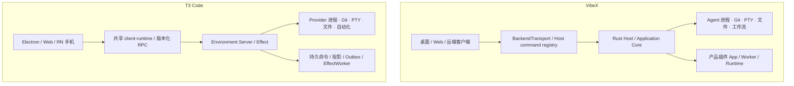

# VibeX 与 T3 Code：技术、功能、用户体验与 UI 对比报告

研究日期：2026-11-13。对比对象：[VibeX 当前工作区](../../CONTEXT.md) 与 [pingdotgg/t3code](https://github.com/pingdotgg/t3code)。

## 1. 核心判断

**双方已经处于同一竞争赛道：以本地或远端开发环境为执行中心，把多个编码 Agent、代码上下文、文件、Git 和跨端控制组织成一个产品。** T3 Code 当前已不是早期的 Codex 专用聊天壳；多 Agent、ACP、自动化、浏览器选取、内置编辑器和手机控制都不能再作为 VibeX 的独占优势。[V01] [T01] [T02]

基于本次源码和官方资料，可以作出四个主要判断：

1. **VibeX 的差异在“如何组织复杂工作”。** 持久 DAG 工作流、审批节点与派生运行、产品级插件生命周期、Bot 私聊/群聊，以及可组合的多面板工作台，是当前最值得投入和展示的能力。[V07] [V08] [V10] [V11] [V12]
2. **T3 Code 更突出的部分是“如何把一次编码任务持续推进到交付”。** 跨 Provider 的历史交接、多 forge PR 与 CI 跟进、跨机器/手机接续、访客输入，以及 Webhook 触发，都有明确的产品和实现证据。这里的“更突出”指本次可验证的覆盖与路径，不代表实测稳定性胜出。[T05] [T08] [T10] [T14] [T15]
3. **VibeX 的多面板密度适合专家并行作业，但增加了首次理解成本；T3 的 thread 主线更容易形成任务焦点。** 这是根据仓库截图与布局实现作出的设计判断，还需要同任务用户测试来验证。[V12] [V17] [T20]
4. **不能从 Tauri/Rust 与 Electron/TypeScript 的标签推导性能胜负。** VibeX 有减轻渲染与历史加载的措施，T3 则有相当具体的传输预算、恢复与分页回归验证。启动、内存、长会话和多 Agent 并发仍需同机测量。[V05] [V06] [V19] [T03] [T22]

### 1.1 场景选择

| 目标场景 | 本次证据支持的倾向 | 原因与边界 |
|---|---|---|
| 单个任务从提出需求到审查、PR、跟进 CI | T3 Code | thread、变更、PR 和持续跟进连接紧密；VibeX 也有 Git/PR 能力，差距在覆盖与闭环深度 |
| 多阶段、可审批、可重跑的 Agent 流程 | VibeX | 宿主级版本化 DAG、Approval、派生运行、上游复用和 Studio 有实现 |
| 长期 Bot 角色、私聊与群聊组织 | VibeX | 有独立的长期身份与 IM 领域模型；T3 主要是 thread、子任务与任务谱系 |
| 手机继续观察、审批、输入并使用开发工具 | T3 Code 的验证证据更完整 | 有同仓 RN/Expo 工程、原生模块和商店入口；VibeX 本次未取得移动子仓库源码 |
| 扩展宿主产品：App、Worker、Runtime、市场 | VibeX | 有产品插件平台；T3 的 Agent 插件、Skills 和 MCP Apps 属于另一层扩展 |
| 多代码托管平台与外部事件驱动 | T3 Code | 多 forge、PR watch、Webhook 等覆盖更广 |
| 可自由安排编辑器、终端、预览和多会话 | VibeX | Dockview 空间组织是产品核心之一；也带来布局状态和焦点管理成本 |
| 中文与本地 Agent 管理 | VibeX 有针对性深度，不能判定语言全面领先 | VibeX 有中英界面和较宽的内置 Agent 管理；T3 也有中文，且配置了九种语言 |

## 2. 研究口径与可信度

### 2.1 固定版本

| 项目 | 本次基线 | 说明 |
|---|---|---|
| VibeX | HEAD `457d3525a3554fe9a867feb946c69c830c541fce`；manifest `0.4.4` | HEAD 为 2026-11-12 的 unified-shell-layout 合并；分析包含当前磁盘未提交修改，特别是布局、会话创建与 Agent 配置部分 |
| T3 Code | HEAD `e0d6aadb88d229746be9503c510baaccbad84f4f` | 提交时间为北京时间 2026-11-13；server/web/desktop manifest 为 `0.1.9`，移动 app 默认配置版本为 `2.3.0`，均不能直接当作最新稳定渠道版本 |

报告中的 T3 链接固定到该提交。VibeX 链接指向本仓库文件；由于工作区有未提交修改，其结论不能全部仅凭上述 HEAD 复现。

### 2.2 证据层次

- **已核实实现**：实际模块、命令、模型、UI 或测试可定位。说明代码存在，不等于本次运行验收通过。
- **官方产品说明**：第一方用户文档和发布入口。用于说明公开产品路径，发行和平台效果没有逐项实测。
- **设计判断**：结合截图、信息架构与实现推导的可用性影响，不能替代用户测试。
- **未核实/未找到**：本次取证范围内没有找到等价能力，不作绝对不存在的判断。

本次没有启动双方产品进行端到端实测，没有接入真实 Agent 账号，没有跑全量构建或测试。当前电脑交互接口不可用，因此 UI 观察使用仓库既有截图，并对照当前组件、样式与文档。VibeX 移动目录是外部 Git 子模块，本地未展开源码；T3 的商店链接未进一步核实下载和上架状态。

**本报告比较的是产品与工程设计，不能用于证明模型答题质量。** 同名 Agent 在不同版本、模型、权限、提示词和上下文下，结果也可能不同。

## 3. 技术架构

### 3.1 技术栈与边界

| 层面 | VibeX | T3 Code | 对产品的影响 |
|---|---|---|---|
| 桌面容器 | Tauri 2 + 系统 WebView | Electron | 前者借助系统 WebView，后者自带 Chromium；分发成本、跨系统一致性与排障方式不同 |
| 核心服务 | Rust workspace，Tokio、Axum、SQLx、Git 库与 CLI | Node/TypeScript、Effect、共享 contracts；也有 Rust/原生组件 | VibeX 跨 Rust/TS 边界更多；T3 更易共享 TS 领域代码，但仍需维护原生模块 |
| Web UI | React 19、TypeScript、Vite、Tailwind 3、Astryx/Radix | React 19、Vite+、Tailwind 4、Base UI、cva | 两者均有现代 React 基础；依赖版本本身不能证明设计或速度更好 |
| 工作台与内容 | Dockview、Monaco、Lexical、xterm、XYFlow | thread 布局、pele 文件编辑器、Ghostty 终端、丰富文件预览 | VibeX 侧重空间可组合性；T3 也具备真实编辑和终端能力 |
| 桌面/远端共用 | Host command registry、Application Core、统一 transport | environment server、versioned RPC、client-runtime | 双方都在避免“本地一套、远程一套”的业务实现 |
| 移动 | Android Kotlin/Compose、iOS SwiftUI 的独立子仓库路线 | 同仓 RN/Expo，辅以 Swift/Kotlin 模块 | VibeX 更偏平台原生分工；T3 更偏共享跨端领域状态与 UI 基础 |
| 持久层 | SQLite 控制状态 + JSONL/vendor 会话正文 | SQLite 规范状态/投影 + 有保留期的事件记录 | 崩溃恢复、历史导入、备份与协议兼容的关注点不同 |
| 根许可证 | Apache-2.0 | MIT | 都提供宽松开源基础；实际复用仍需保留许可并检查依赖条款 |

证据：[V02] [V03] [V04] [V05] [V15] [V21] [T02] [T03] [T16] [T23]。

### 3.2 执行宿主：双方已趋于同一方向

VibeX 的统一 Host seam 已有命令注册表、前端 transport 与实际 Host domain 实现。不能再沿用旧架构中桌面与服务器重复实现的历史数字，把它当作当前缺陷。与此同时，部分接口仍保留通用字符串/unknown 入口，也不宜声称所有调用都已经端到端静态类型安全。[V04]

T3 把文件、Git、PTY、凭据和 Provider 执行归属到 environment server；客户端共享连接与领域状态。桌面虽然捆绑服务器，仍遵循相同边界。它在“同一环境被不同客户端控制”上的架构表达很直接。[T03]

**技术判断：VibeX 无需为了追赶而重写成 Electron 或全 TypeScript。** 更有价值的是继续验证统一 Host 能否覆盖完整用户旅程，并让桌面、Web、远端的行为和故障恢复一致。T3 值得借鉴的是共享状态边界与命令完成语义，而非语言选择。

### 3.3 会话数据与可靠性：需要精确区分

**VibeX 当前的会话正文权威是 JSONL/vendor transcript。** SQLite 仍保存输入队列、权限、Turn 终态、会话控制和用量等状态；不是把所有实时正文增量都写入 `conversation_events`。默认历史窗口为 120 个回合，缺口通过重新读取文件窗口恢复。[V05] [V06]

这有利于对齐 Agent 原生会话文件、窗口化读取和降低实时数据库写入，但也意味着：

- 正文文件与控制状态需要作为一组一致地备份、迁移和诊断。
- 文件解析兼容、截断与前缀变化是实际恢复路径的一部分。
- best-effort 写入存在最后一小段内容只在内存中的窗口；不能承诺进程崩溃后零正文损失。
- 读取事件日志的插件不能假定日志包含全部正文增量。

**T3 的 v2 编排更显式地把“接受命令”和“完成副作用”分开。** EventSink 同事务提交事件、持久投影、命令回执和 outbox；EffectWorker 再执行外部动作并报告结果。这让重试、幂等和“已收到但尚未执行成功”的状态更容易形成明确契约。[T03]

但 T3 **不是无限保留所有事件、随时重建全部历史的完整事件溯源系统**。其事件日志约保留一天用于重连和重试，长期权威由持久投影与规范化数据承担。旧游标需要快照恢复。命令回执的保留与事件清理也有独立语义。[T03]

两种设计不能简单排列为高级/低级。对 VibeX 更有用的问题是：断电、JSONL 部分写入、控制状态已提交但进程未执行、重复输入、跨端重连时，用户分别看到什么，以及能否明确恢复。

### 3.4 Agent 接入与配置治理

VibeX 当前 bundled catalogue 有 **20 个 Profile**，包括 Claude、Codex、Pi、OpenCode、Grok、Cursor、DeepSeek Harness、Antigravity、Cline、OpenClaw、Hermes、CodeBuddy、Kimi、Qoder、Kiro、Auggie、TRAE、Command Code、ZCode 和 OMP。Profile 名单与管理目录不是同一集合，不能把存在于源文件中的全部 Profile 都算作默认内置。[V09]

VibeX 的深度主要是安装、探测、激活、鉴权、原生配置与 Provider 管理，且能对不同 Agent 的事实配置作针对性处理。它适合同时管理多个 CLI 与账号的用户。不过，20 个入口不代表全部平台和功能都等价验证，也会扩大设置界面与适配维护成本。[V09] [V01]

T3 也有多种专用 driver 与通用 ACP；既有 Claude SDK、Codex app-server 等专门适配，也允许本地 ACP 命令。其 ACP 注册表分发使用工具版本目录与精确安装路径，并在提供校验和时验证。VibeX 的管理约束与 T3 的本地接入自由形成不同取舍。[T02] [T04]

**应比较的不是图标数量，而是同一 Agent 的完整生命周期**：安装失败、认证过期、版本升级、模型切换、队列、Steer、权限提问、重连、导入与错误恢复，哪些可以在产品内完成。

### 3.5 性能与工程质量

VibeX 已有会话窗口化、虚拟列表、requestAnimationFrame 合批、面板懒加载及错误重试等措施。当前数据库配置是 WAL、Normal synchronous、10 秒 busy timeout，约 4 MiB/连接缓存；普通连接池为 3，另有不同用途的池。旧性能 ADR 中的缓存和池大小不能当作当前实现。[V05] [V12] [V19]

T3 的性能证据更偏向具体协议契约：有界历史窗口、shell 与 thread detail 分开、受限重放、工具输出按展开订阅、避免启动时加载全部已完成历史，并有传输预算回归与 CI 报告。约 1 MiB 是特定窗口/编码预算，存在控制记录和运行中数据等例外，**不是服务器堆内存上限**。[T22]

双方都有测试、发布与静态检查体系。VibeX 包括前端测试、Rust 检查、类型/SQLx 生成一致性、依赖与 bundle 检查；T3 有 Provider fixture、恢复/竞态、跨端行为和传输预算测试。测试存在只能说明工程防线，不能证明本次快照全套通过。[V20] [T21]

建议未来使用相同机器、仓库、Agent 版本与模型，至少测量：

| 基准 | 应记录的数据 |
|---|---|
| 冷启动与热启动 | 到首屏、可输入、可发送的耗时；整个进程树的峰值和稳定内存 |
| 1/5 个活跃会话 | UI 帧耗时、CPU、Agent 与宿主分别占用、后台会话是否仍触发大量渲染 |
| 长会话 | 首开、向上翻页、搜索、切走再切回；传输量与解码/渲染时间 |
| 大仓库 | 文件树、status、diff、分支切换和冲突编辑的等待与阻塞 |
| 远程重连 | 断网期间状态、重传量、恢复耗时、重复输入与审批状态是否正确 |
| 生命周期 | 关闭面板、关闭会话、终止任务后资源是否回收 |

这些是建议的比较项目，没有虚构现有基线或性能数字。

### 3.6 安全与信任

VibeX 产品插件明确采用 **Full Trust**：Worker 独立进程与 App frame 主要解决生命周期、热更新和崩溃隔离，并不限制恶意插件的本机文件、凭据、网络或进程访问。安装信任决定不能被“进程隔离”这一技术表象掩盖。[V11]

T3 的 MCP Apps iframe 沙箱、机器 managed policy 与凭据功能解决的是不同问题：前者约束特定嵌入 UI，policy 管理客户端/Provider/权限等配置；它们不等于整个编码 Agent 已获得 OS 级安全沙箱。其 1Password 设置还有 preview/构建启用边界。[T13] [T17]

VibeX 当前 Tauri 配置的 CSP 为 null，因此同样不能仅凭使用 Tauri 推导 Web 内容安全更强。[V03]

结论是：**将本机 Agent 执行权限、宿主扩展信任、网页访问授权、远程设备 scope 分开评估。** 双方都能本地执行，但模型调用、更新、注册表或可选远程服务仍可能需要网络；“local-first”不是完全离线或没有外部请求。

## 4. 功能对照矩阵

下表中的“未核实”表示本次没有找到等价的产品路径。“有”也不表示各 Provider 或各客户端完全同等支持。

| 能力 | VibeX 当前证据 | T3 Code 当前证据 | 差异判断 |
|---|---|---|---|
| 多编码 Agent | 20 个 bundled Profile，专门管理与 ACP 适配 | 多个 built-in driver，ACP Registry 和本地 ACP 命令 | 都已具备；管理深度、自由接入与兼容性才是比较重点 |
| 模型/账号/Provider 管理 | 安装、探测、鉴权、原生配置和模型管理 | 多 Provider 实例、账号/config 隔离，具体能力依 driver | VibeX 面向多 CLI 配置的产品投入明显；不宜宣称全面胜出 |
| 工作中输入 | 持久队列、重排/取消、Steer 独立语义 | 持久队列、编辑/重排、提升 Steer、hold/resume | 共同基础；都应受 Provider capability 约束 |
| 中途跨 Provider 接续 | 未核实与 T3 相同的用户级可移植交接；rebind 主要不能当作此能力证据 | 历史选择、portable restart、跨 Provider handoff | T3 有更明确的产品契约 |
| 会话历史与分叉 | JSONL/vendor 权威，窗口、独立副本语义 | 历史分页、fork、原生或 portable 恢复 | 两边均有，数据权威和上下文完整性不同 |
| 权限/提问 | 会话审批与输入控制面 | 多种 permission mode、问题卡与手机审批 | 不按模式名称数量排名；需要逐 Agent 核对 |
| worktree 隔离 | 核心工程能力，工作区与任务隔离 | 每 thread worktree、checkpoint、handoff | 共同基础；隔离不能消除后续合并冲突 |
| Git/差异审查 | 文件/分支/diff/日志、PR 与三栏冲突编辑等 | turn/branch/commit/PR diff、checkpoint 与 PR 工作流 | VibeX 偏工作台深度；T3 偏任务交付闭环 |
| 代码托管平台 | GitHub + Azure DevOps，Azure 部分路径尚缺失 | GitHub、GitLab、Forgejo/Gitea、Bitbucket、Azure 等 | T3 覆盖更广；各 forge 能力仍有差异 |
| PR/CI 持续跟进 | 有 PR 相关功能；Azure open PR listing 尚未实现 | PR watch 可因 CI/review/冲突等变化唤醒 Agent | T3 的持续交付跟进证据更完整 |
| 文件编辑与终端 | Monaco、富文本、xterm、多面板 | 内置文件编辑/保存协调、终端和丰富预览 | 都不是“只聊天、外跳 IDE” |
| 浏览器与元素选取 | 系统 WebView、共享读/操作级别、元素 token、JS 确认 | server-owned browser、远程流、DOM 选取与裁剪标注 | 都有；浏览器进程归属与远端能力不同 |
| 多 Agent 委派 | Bot/群聊、异步委派、角色与工作区 | delegate_task、子 Agent 结果/取消/父任务唤醒、顶层 thread | 都有真实执行；组织模型不同 |
| 长期 Bot 私聊/群聊 | 内置 IM 域、长期身份、各群隐藏会话与房间日志 | 未找到等价 IM 产品模型；有任务/子任务关系 | VibeX 的明确差异 |
| 通用持久工作流 | DAG、版本、Agent/Approval/Notify、Studio、暂停/派生运行与复用 | 有 Claude 原生 workflow 展示/停止；未找到等价宿主级通用 DAG Studio | VibeX 的明确差异；不能写 T3“没有工作流” |
| 定时自动化 | 手动/cron + 时区，触发 Turn 或已发布工作流 | interval/fixed_time/once/webhook，thread/session 策略 | 两边都有；VibeX 强在流程目标，T3 强在触发方式 |
| Webhook | 当前 ScheduleSpec 未找到等价触发类型 | HMAC、过滤、去重、合并窗口、delivery 日志 | T3 的外部事件集成更具体 |
| 产品插件平台 | manifest、市场、SDK、App/Worker/Runtime、激活与更新 | 未找到等价宿主产品插件市场与生命周期 | VibeX 的明确差异 |
| Agent Skills / MCP / 交互 UI | 原生 Agent 配置与产品扩展体系 | 原生插件/Skills/MCP，且有 MCP Apps 三端交互 UI | 不得将“支持扩展 UI”或“MCP”说成 VibeX 独有 |
| 远程访问 | 同 owner 设备配对、scope、桌面/Web/headless 统一 Host | LAN/Tailscale/SSH/Connect、多环境/路由恢复 | 都有；T3 多环境与接续覆盖证据更广 |
| 手机端 | 原生 companion 路线；本地子模块源码未展开 | RN/Expo 实现、原生输入模块、商店入口、终端/预览等 | T3 可验证功能和分发路径更多 |
| 离线交互 | companion 约定为只读缓存，不离线排队写入 | 手机持久草稿/附件与离线队列，重连上传 | 不同一致性取舍；不是同等能力 |
| 其他人协作 | 当前 Server owner + 多设备，不等同多租户团队 | guest 单 thread 实时查看与输入，owner 逐条接受/丢弃 | T3 有轻协作；双方均不能据此推定完整企业团队空间 |
| 组织管理 | 未在本次范围核实等价 managed policy | macOS/Windows/Linux 机器级配置与锁定 | T3 有更明确的组织部署入口 |
| 多语言与主题 | zh-CN/en、多主题与语义 token | en + de/es/fr/ja/ko/pt-BR/ru/zh、主题/字体/布局 | T3 不是英文-only；语言数量不代表翻译质量 |

功能证据集中于：[V04] [V05] [V07] [V08] [V09] [V10] [V13] [V14] [V15] [V16] [V22] [V23] [T04] [T05] [T06] [T07] [T08] [T09] [T10] [T11] [T12] [T13] [T14] [T15] [T16] [T17] [T19]。

### 4.1 两个容易被误读的差异

**第一，VibeX 的工作流是独立产品层，不能与定时执行一条 prompt 混为一谈。** 当前 `WorkflowDefinition` 有步骤依赖、输入绑定和策略；步骤类型为 Agent、Approval、Notify，工作区写入策略区分共享只读、串行写、隔离写等。服务和 Studio 对应发布、运行、审批、暂停、继续及从指定步骤派生的操作。[V07] [V08]

派生运行的价值在于保留原运行作为证据，并在定义、输入与检查点条件满足时复用上游，再执行变更点及下游。这比“让模型自己安排几个子 Agent”提供了更明确的运行结构。不过，当前 CONTEXT 对接受输出的定义是原始 assistant 文本，不能因为旧 ADR 或字段里出现 `output_schema` 就宣称所有结果都有强制 JSON Schema 保证。[V01] [V07]

**第二，T3 的跨 Provider 切换是有损但有契约的上下文交接。** 短会话可以完整迁移已保存对话；长会话按预算选择原任务、近期请求/回答和相关活动，保留遗漏历史的读取引用。它不是模型生成摘要，也不迁移原 Provider 的隐藏推理、工具执行状态和全部附件。默认历史预算还有上限，不能叫作“原生上下文无损转移”。[T05]

VibeX 的 rebind 和内部绑定恢复不能直接证明已有同等体验。这个差距值得通过明确的产品路径验证，而不宜靠 API 名称类比。

## 5. 用户体验：沿真实任务路径比较

### 5.1 首次运行到完成第一个任务

VibeX 提供 Agent 安装、认证和配置的可见管理入口，这对多个 CLI 并存、账号或本地配置复杂的用户很实用。代价是用户容易过早接触项目、工作区、会话、Agent、Provider、模式、布局和插件等多个概念。[V09] [V12] [V17]

T3 的 thread 导向更容易表达“选项目和 Agent，给任务，跟踪结果”，但同样存在 Provider 安装/登录、权限、worktree、账号与环境选择，并不是零配置产品。[T01] [T04] [T06]

**对 VibeX 的建议**：首任务路径只要求完成必要选择，把已探测到的可用 Agent 和合理默认值前置；认证失败再展开针对性处理，不让用户先理解整个设置体系。首次成功后再引入布局、Bot、工作流与插件。验收应观察首次有效发送前的必需选择数、失败恢复和求助次数，而不是只统计设置项减少了多少。

### 5.2 Agent 正在工作：继续说、纠偏还是停止

双方都区分队列和 Steer。这是重要的可用性基础：用户的下一条输入究竟等待下一回合，还是进入当前运行，必须可判断、可撤回、可恢复；Provider 不支持时不能悄悄改成另一种语义。[V04] [T06]

VibeX 可以把持久输入控制面的优势转成清晰反馈：显示当前输入目标、交付状态、队列顺序以及本次是否支持 Steer。T3 的移动长按发送策略也提供了可参考的紧凑交互，但不同设备上仍应保持相同术语。

### 5.3 审批与任务状态

多 Agent 产品最有价值的信息通常是“现在需要我做什么”，而不只是“谁还在输出”。VibeX 看板能展示多个任务现场，便于专家观察；如果每张卡都同时暴露较多正文，用户仍需逐张阅读才能找到审批、失败或待审查任务。[V17]

T3 的 thread 与任务详情布局更容易把一个任务的上下文、权限卡和交付动作放在同一条主线上；复杂多环境和后台任务依然会引入额外状态，不能仅凭 hero 图假定全产品都同样简洁。[T20]

**建议**：优先统一“运行中、等待输入/审批、待审查、失败、已完成”的显示与排序，再考虑增加观察面板。状态需要文字或图形辅助，不能只靠卡片颜色。现有多个入口应共享状态派生规则，避免出现看板、会话和通知各讲一套状态。

### 5.4 从结果到 diff、提交和 PR

VibeX 的优势是让编辑器、diff、终端、浏览器与会话并置，开发者能直接检查和修改结果。三栏冲突编辑和 merge/rebase/cherry-pick/revert 的继续路径也有实现，不能因为对应 ADR 仍标 proposed 就判定不存在。[V12] [V13]

T3 将交付动作和 thread 绑定得更明确，并扩展到多 forge、PR review、PR watch、CI 和后续 Agent 唤醒。它更接近“任务完成之后仍能推进”的交付循环。[T10]

**建议**：VibeX 应以一个任务为单位串联“本次改了什么→测试证据→审查→提交/PR→跟进”，并保留跳转到专业面板的能力。价值在缩短上下文切换，不是再新增一个功能总览页。

### 5.5 多 Agent 并行：临时分工、长期角色与固定流程

这里是 VibeX 最有潜力的区域，但必须解释三种不同机制：

- **临时委派**：把一次子任务交给另一个 Agent；适合开放问题。
- **Bot 私聊/群聊**：以长期角色和对话关系组织工作；适合持续协作。
- **持久 Workflow**：有明确依赖、审批与可恢复运行；适合重复、受控流程。

VibeX 已有后二者的独立领域表达；`&Agent` 等提示式委派则是让模型考虑调用，不应承诺出现标记就一定执行。T3 也有真实子 Agent 启动、结果与取消、父任务唤醒，因此不能只以“多 Agent”三个字区分。[V01] [V07] [V10] [T07]

**建议**：用可完成的场景展示差异，例如“需求拆解→实现→独立审查→人工批准”，并直接显示每种机制的执行证据、失败和重跑方式。不要要求新用户先学习整套编排术语。

### 5.6 切换模型或 Agent 继续做

T3 的历史交接能降低重新复述的成本，尤其是成本控制、不同 Agent 交叉复核和某个 Provider 故障时。其限制也应显式保留：丢失附件或原生工具状态可能改变后续行为。[T05]

VibeX 可以先验证最常见的两种 Agent 间接续：保留原任务、已做工作、工作区状态和遗漏历史读取入口，明确显示继承了什么，再扩展到更多适配器。不能把“换模型”“换账号”“恢复绑定”“跨 Provider 历史迁移”压成含义不明的同一个按钮。

### 5.7 离开电脑与网络中断

VibeX 的远端模型明确同一 Server owner、多设备配对和可撤销权限；companion 的既定边界是会话、审批、只读材料与离线缓存，不应从协议存在推导手机拥有完整桌面工具。[V01] [V15]

T3 有多路由、多环境、手机本地草稿/附件与离线队列。server-owned 浏览器还允许无客户端连接时继续工作，并让其它客户端接入页面流。这比单纯响应式网页更深入。[T12] [T14] [T16]

对 VibeX 来说，先验证“断网前发出的任务仍在运行吗、重连会不会重复发送、审批是否仍有效、失败能否恢复”比宣称所有端功能对齐更重要。只读离线缓存也可以是清晰可靠的产品选择，不必为了表面 parity 强加离线写入。

### 5.8 请另一个人查看与提意见

VibeX 的多个设备不等于多个团队成员，Bot 群聊也不等于人类团队协作空间。[V01]

T3 guest link 已允许其他人观察一个 thread 并提交问题/附件，owner 逐条决定是否发送；有有效期和浏览器绑定，也不允许 guest 直接审批、改文件或 fork。它解决的是轻量外部参与，而非完整团队权限系统。[T15]

如果 VibeX 目标客户需要结对或向同事解释 Agent 工作，可以考虑先提供任务级受控分享，而不是直接建设多租户组织、成员、RBAC 和整套协作管理。

## 6. UI：视觉表达与信息架构

### 6.1 使用的视觉证据

- [VibeX 工作区截图](../../assets/images/readme/工作区页面.png)：浅色，多列，文件树、会话与右侧编辑内容并置。
- [VibeX 默认看板截图](../../assets/images/readme/默认看板视图.png)：会话分组、主会话和多个并行运行卡片同时可见。
- [T3 官方 hero 图][T20]：深色桌面工作区叠加手机，左 thread、中央对话、右任务控制区。

这些不是本次同条件截屏。T3 hero 是营销合成图；VibeX 的 README 截图也可能落后于当前未提交布局。因此，以下评估关注布局机制和视觉层级，不凭主题偏好评“谁更高级”，也不把截图当作可访问性或响应速度测试。

### 6.2 视觉焦点与信息密度

| 维度 | VibeX 观察 | T3 Code 观察 | 对 VibeX 的启示 |
|---|---|---|---|
| 主焦点 | 可同时观察文件、会话、编辑内容和多个任务 | thread 更突出，交付动作位于邻近的详情区 | 默认布局先让一个任务成为主焦点，再按需展开并行视图 |
| 导航层次 | 项目/工作区、看板、协作、面板与会话存在多个层级 | 项目/thread 主线明显，环境等能力再增加维度 | 用稳定对象层次承载功能，减少并列概念 |
| 并发可见性 | 多卡片、多会话与 Dockview 有优势 | 更偏 thread 切换与任务状态管理 | 保留专家工作区，但卡片先显示决策相关摘要 |
| 色彩 | 中性底色、accent 与状态色；看板多个色块同时出现 | hero 使用克制深色、少量高亮；支持更多主题 | 优先统一选择态与任务状态的含义，不靠增加色块提高可见性 |
| 面板弹性 | 拖拽、拆分、持久布局丰富 | 主结构更固定，也有详情/文件/终端等面板 | 复杂布局需要可靠的恢复、重置和焦点行为 |
| 设置 | Agent 管理和诊断信息深，入口较多 | 同样有 Provider/环境/权限/外观复杂性 | 以当前任务问题组织设置，不将所有诊断信息默认展开 |
| 手机 | 本次未直接检查完整实现 | 有专门手机布局、原生输入与审批路径 | 跨端保持任务语义，布局按设备重新组织 |

依据：[V12] [V17] [V18] [T16] [T18] [T20]。

VibeX 的密度并非天然缺陷。对于连续数小时比较输出和审查代码的专家用户，并置可以减少切换。真正的风险是所有面板都具有相近的视觉权重，让“当前需要我判断的地方”不够突出。

### 6.3 字体、间距与控件一致性

VibeX 已有系统化基础：平台字体策略、10/11/12/13/14/16/18 的字号梯度、中性配色、语义 token，以及不同层级的圆角。它不需要为了现代感重做成大卡片或装饰性渐变界面。[V18]

需要重点观察的是小字号和高密度组合：正文、时间、路径、状态、工具结果和多卡片都使用紧凑尺寸时，虽然能容纳更多内容，层次容易变薄。应优先区分任务标题、决策信息和次要元数据，而不是整体放大所有组件。

T3 的 Web 样式定义了较明确的聊天内容宽度、详情区宽度与顶部栏尺度，并通过 Base UI/语义 token 建立组件基础。这样的约束有助于保持阅读节奏，但并不证明每个复杂页面都一致。[T18]

### 6.4 状态、动效与稳定感

VibeX 的布局自由度会放大窗口尺寸、首开恢复、面板最小宽度、滚动与焦点问题。当前工作区恰有相关 sizing/constraints 的未提交修改，因此报告不把旧截图中的几何关系认定为最终状态。[V12]

T3 文档明确面板默认即时切换、可调整动画、尊重 reduced motion，thread 切换不重复播放布局动效。这是值得参考的操作型 UI 原则：用户要看状态变化，工作台几何结构尽量稳定。[T18]

对 VibeX，更有价值的是面板出现/关闭时不挤压关键操作、流式内容不抢滚动、计时/用量数字不抖动、审批出现时不改变输入焦点，而不是增加动画表现。

### 6.5 可访问性和本地化

VibeX 的 DESIGN/PRODUCT 有键盘、对比度、非纯颜色状态和 reduced-motion 目标；实际是否达标仍需检查。T3 也有语义组件与动效设置，不能只因采用 Base UI 就认定可访问性全面合格。[V17] [V18] [T18]

VibeX 有 zh-CN/en 资源，但存在逐步覆盖的语境；T3 Web/Mobile 配置了包括中文在内的九种语言并有翻译产物。合理比较应覆盖错误提示、认证失败、排队、权限卡、PR 操作、长文本布局和中文字体，而不是只数语言文件。[V16] [T19]

## 7. VibeX 当前值得守住的优势与主要风险

### 7.1 值得守住的四项优势

**一，Workflow 是能形成产品壁垒的结构。** 它将模型的开放执行能力变成可检查的步骤、人工决策与可恢复运行。价值在可靠完成重复工作，而不在画出复杂节点图。应优先展示审批、失败恢复、局部重跑和证据保留。[V07] [V08]

**二，产品插件平台比 Agent 配置层扩展更深。** 用户可以扩展宿主 App/Worker/Runtime 和产品表面，而不只是给 Agent 添一个工具。已有市场、SDK、激活和更新机制，适合沉淀垂直工作台；实际生态价值还取决于可用插件质量，不能由 SDK 存在推导生态已经繁荣。[V11] [V12]

**三，长期 Bot 组织让产品超出临时任务列表。** 私聊/群聊与长期角色适合持续产品研发、研究或运营。但也需要控制消息噪音、重复上下文和用户对委派确定性的预期。[V10]

**四，工作台的空间能力与 Agent 管理深度适合专家。** 多种专业面板可以把观察、编辑与决策放在同一环境中，原生配置管理也有真实价值。这些优势应建立在默认路径可理解、布局稳定和失败可恢复之上。[V09] [V12]

### 7.2 需要正视的五项风险

1. **功能广度掩盖完成度。** 同时拥有看板、协作、工作流、插件、浏览器、移动端，不代表每条核心旅程都比对方完整。应按用户任务而不是导航入口验收。
2. **领域边界正确，但用户概念过多。** Workspace、Conversation、Bot、Group、Workflow、Automation 等在代码里需要区分，界面不必一次教完。
3. **差异宣传已经容易过时。** 多 Agent、远程、手机、中文、自动化、内置浏览器、交互扩展 UI 都不再是单方面优势。
4. **历史文档与当前实现存在漂移。** CEF 旧方案、旧 transcript 权威、旧 DB 预算、旧 Agent 数量，以及 ADR proposed/代码已实现等情况，会导致内部判断错误。事实应回到当前权威模型和实际路径。
5. **平台型系统的维护面较大。** Rust/TS、各平台 WebView、移动子仓库、插件 Node Runtime 与多 Agent 配置都要共同演进。平台扩展收益必须覆盖兼容与支持成本。

## 8. 建议优先级

以下是基于本次对比提出的产品建议，不是已批准的实施计划，也不新增治理脚本或独立门禁。

| 优先级 | 建议 | 具体用户结果 | 如何验证 |
|---|---|---|---|
| P0 | 打通“第一个任务→审查→交付”默认路径 | 用户不用先配置工作台，就能发任务、理解状态、看改动并提交/PR | 使用固定新用户任务观察成功率、必需选择、求助与回退；先取得基线 |
| P0 | 统一任务状态与下一步动作 | 用户一眼识别审批、失败、待审查，且不同页面一致 | 用运行/排队/等待输入/断线/失败/完成的同一组状态核对全部入口 |
| P1 | 用现有工具建立同机性能对比 | 知道慢在哪里，避免按壳和语言猜测 | 按第 3.5 节记录完整进程树、长会话与重连数据；区分宿主和 Agent 成本 |
| P1 | 验证跨 Provider 历史交接 | Agent 故障或需交叉复核时能继续工作 | 两个常用 Provider 起步，明确历史预算/附件/工具状态边界，检查失败与重复发送 |
| P1 | 把 Workflow 与插件变成可完成的示例 | 新用户能实际体验差异，而非看到更多入口 | 一个审批型研发流程、一个垂直插件，完整演示安装/运行/失败恢复/更新 |
| P1 | 验证移动与远端发行旅程 | 电脑运行、手机观察审批、断线后恢复有清晰边界 | 使用真实发布构建和已配对子设备验证，不以协议或子模块存在代替验收 |
| P2 | 按目标用户补 Webhook/forge | 外部事件可以触发工作，常用托管平台不迫使用户外跳 | 先确认用户平台分布和触发需求，再选择最常用闭环 |
| P2 | 任务级受控人类分享 | 同事可看现场、提出问题，执行权仍由 owner 掌握 | 明确分享范围、有效期、输入接受流程与撤销；无需先建设完整多租户 |

### 8.1 UI 可以优先做的具体调整

- 默认布局保持一个主任务；并行看板与多面板作为可立即进入的专业模式。
- 任务列表先显示状态、阻塞原因与下一步动作；将长正文降为按需展开。
- 把 diff、验证证据和提交/PR 连接到当前任务，减少用户在独立面板中重新定位上下文。
- Agent 设置先显示当前选中 Agent 的可用性和下一步，认证细节及高级配置按需展开。
- 保留稳定的面板宽度、焦点和滚动，提供可靠的恢复默认布局路径。
- 用真实产品截图展示一次任务如何完成；Workflow 展示局部重跑，插件展示实际产物，而不是只展示设置页和功能数量。

### 8.2 不建议直接照搬

不建议仅因对方采用 Electron/Effect 就重写现有 Host；不建议把工作流和 Bot 协作删成单一聊天窗口；也不建议为追齐九种语言、所有 forge 和所有远程路线而同时铺开多个不完整分支。应以目标用户最常执行的任务为顺序，优先完成闭环。

## 9. 最终结论

**如果目标是让开发者快速开始一个编码任务，并在不同 Agent、设备与代码托管平台之间持续推进交付，T3 Code 是当前需要认真对标的直接竞品。** 它已经具备相当广的产品能力，不能再用“聊天壳”解释其定位。

**如果目标是把多个 Agent 组织成长期协作、可复用流程和可扩展工作台，VibeX 有清晰的差异基础。** 最值得继续投入的是持久 Workflow、产品插件、Bot 组织与专业工作台之间的协同，同时减少用户在首次任务和日常交付中的选择与切换。

下一步的关键判断应来自相同任务、相同机器和真实发布构建下的体验与性能证据。当前源码足以说明双方的设计取舍和能力覆盖，还不足以证明总体稳定性、速度或用户满意度的绝对排名。

## 10. 主要证据索引

### VibeX：当前仓库

- [V01] CONTEXT：领域边界、控制面、协作、工作流输出、owner/device 与 companion 约束。
- [V02] Rust workspace；[V03] Tauri 配置；[V04] Host seam 与 transport。
- [V05] JSONL 权威 ADR；[V06] JSONL 历史实现。
- [V07] Workflow 类型、策略与派生运行服务；[V08] Workflow Studio。
- [V09] Agent bundled catalogue；[V10] 内置协作模型与实现。
- [V11] 插件 Full Trust ADR；插件实现另见 [crates/plugins](../../crates/plugins) 与 [packages/plugin-sdk](../../packages/plugin-sdk)。
- [V12] 布局及面板注册；[V13] 冲突编辑后端；[V14] Git host 类型与 Azure 边界。
- [V15] 移动子仓库；[V16] 本地化；[V17] 产品与视觉原则；[V18] 设计规范。
- [V19] 数据库连接与缓存；[V20] CI；[V21] 根许可证。
- [V22] Browser 插件；[V23] Automation 调度类型。

补充实现：[frontend/package.json](../../frontend/package.json)、[conversationTimelineRegistry.ts](../../frontend/src/features/conversation/conversationTimelineRegistry.ts)、[workflow service](../../crates/workflows/src/service.rs)、[PanelRegistry.tsx](../../frontend/src/components/layout/panels/PanelRegistry.tsx)、[Azure provider](../../crates/services/src/services/git_host/azure/mod.rs)、[fonts.css](../../frontend/src/styles/fonts.css)。移动技术路线见 [Android ADR](../adr/0041-native-kotlin-compose-android-companion.md) 与 [iOS ADR](../adr/0084-native-swiftui-ios-companion.md)，不将 ADR 当作完整发行验收证据。

### T3 Code：固定提交的一手资料

- [T01] README 产品定位；[T02] Provider driver 表；[T03] 架构与持久化权威。
- [T04] ACP 接入与分发；[T05] portable handoff；[T06] Composer、Queue/Steer 与离线输入。
- [T07] 子 Agent/调度/原生 Workflow 工具；[T08] 自动化与 Webhook；[T09] Claude 原生 Workflow 映射。
- [T10] Git/多 forge/PR watch；[T11] 文件编辑；[T12] server-owned browser 与远端路线。
- [T13] HTML/MCP Apps；[T14] 多环境与路由；[T15] Guest links。
- [T16] 移动架构；[T17] managed policy；[T18] 外观与动效；[T19] 本地化配置。
- [T20] 官方 hero；[T21] 测试指南；[T22] 性能回归契约；[T23] MIT 许可证。

补充固定提交证据：

- [T3 Web manifest](https://github.com/pingdotgg/t3code/blob/e0d6aadb88d229746be9503c510baaccbad84f4f/apps/web/package.json)、[server manifest](https://github.com/pingdotgg/t3code/blob/e0d6aadb88d229746be9503c510baaccbad84f4f/apps/server/package.json)、[desktop manifest](https://github.com/pingdotgg/t3code/blob/e0d6aadb88d229746be9503c510baaccbad84f4f/apps/desktop/package.json)。
- [移动依赖](https://github.com/pingdotgg/t3code/blob/e0d6aadb88d229746be9503c510baaccbad84f4f/apps/mobile/package.json#L86)、[移动版本配置](https://github.com/pingdotgg/t3code/blob/e0d6aadb88d229746be9503c510baaccbad84f4f/apps/mobile/app.config.ts#L240)、[原生 Swift 输入组件](https://github.com/pingdotgg/t3code/blob/e0d6aadb88d229746be9503c510baaccbad84f4f/apps/mobile/modules/t3-composer-editor/ios/T3ComposerEditorView.swift)。
- [ContextHandoffService](https://github.com/pingdotgg/t3code/blob/e0d6aadb88d229746be9503c510baaccbad84f4f/apps/server/src/orchestration-v2/ContextHandoffService.ts#L24)、[EventSink](https://github.com/pingdotgg/t3code/blob/e0d6aadb88d229746be9503c510baaccbad84f4f/apps/server/src/orchestration-v2/EventSink.ts#L731)。
- [DOM 选取实现](https://github.com/pingdotgg/t3code/blob/e0d6aadb88d229746be9503c510baaccbad84f4f/apps/web/src/components/preview/PreviewView.tsx#L838)、[MCP App frame](https://github.com/pingdotgg/t3code/blob/e0d6aadb88d229746be9503c510baaccbad84f4f/apps/web/src/components/chat/McpAppFrame.tsx#L480)。
- [主题 token](https://github.com/pingdotgg/t3code/blob/e0d6aadb88d229746be9503c510baaccbad84f4f/apps/web/src/index.css#L96)、[Base UI 按钮](https://github.com/pingdotgg/t3code/blob/e0d6aadb88d229746be9503c510baaccbad84f4f/apps/web/src/components/ui/button.tsx)、[mobile 本地化](https://github.com/pingdotgg/t3code/blob/e0d6aadb88d229746be9503c510baaccbad84f4f/apps/mobile/gt.config.json)。
- [外部 Agent MCP](https://github.com/pingdotgg/t3code/blob/e0d6aadb88d229746be9503c510baaccbad84f4f/docs/user/outside-agents.md)、[Secrets preview 边界](https://github.com/pingdotgg/t3code/blob/e0d6aadb88d229746be9503c510baaccbad84f4f/docs/user/secrets.md)。
- [CI](https://github.com/pingdotgg/t3code/blob/e0d6aadb88d229746be9503c510baaccbad84f4f/.github/workflows/ci.yml)、[桌面发布](https://github.com/pingdotgg/t3code/blob/e0d6aadb88d229746be9503c510baaccbad84f4f/.github/workflows/release-desktop.yml)、[移动发布](https://github.com/pingdotgg/t3code/blob/e0d6aadb88d229746be9503c510baaccbad84f4f/.github/workflows/mobile-eas-production.yml)。

[V01]: ../../CONTEXT.md
[V02]: ../../Cargo.toml
[V03]: ../../src-tauri/tauri.conf.json
[V04]: ../../docs/adr/0078-host-command-registry-single-seam.md
[V05]: ../../docs/adr/0082-jsonl-transcript-window.md
[V06]: ../../crates/conversations/src/jsonl_history.rs
[V07]: ../../crates/workflows/src/spec.rs
[V08]: ../../frontend/src/features/workflow/workflow-studio/WorkflowStudio.tsx
[V09]: ../../crates/agents/src/profiles.rs
[V10]: ../../docs/collaboration-member-identity.md
[V11]: ../../docs/adr/0048-full-trust-plugin-execution-model.md
[V12]: ../../frontend/src/components/layout/IDELayout.tsx
[V13]: ../../crates/git/src/conflict_ops.rs
[V14]: ../../crates/services/src/services/git_host/types.rs
[V15]: ../../.gitmodules
[V16]: ../../frontend/src/i18n/index.ts
[V17]: ../../PRODUCT.md
[V18]: ../../DESIGN.md
[V19]: ../../crates/db/src/lib.rs
[V20]: ../../.github/workflows/test.yml
[V21]: ../../LICENSE
[V22]: ../../plugins/browser/README.md
[V23]: ../../crates/automation/src/schedule.rs
[T01]: https://github.com/pingdotgg/t3code/blob/e0d6aadb88d229746be9503c510baaccbad84f4f/README.md#L21
[T02]: https://github.com/pingdotgg/t3code/blob/e0d6aadb88d229746be9503c510baaccbad84f4f/apps/server/src/provider/builtInDrivers.ts#L33
[T03]: https://github.com/pingdotgg/t3code/blob/e0d6aadb88d229746be9503c510baaccbad84f4f/docs/internals/overview.md#L1
[T04]: https://github.com/pingdotgg/t3code/blob/e0d6aadb88d229746be9503c510baaccbad84f4f/docs/user/providers-acp.md#L12
[T05]: https://github.com/pingdotgg/t3code/blob/e0d6aadb88d229746be9503c510baaccbad84f4f/docs/user/portable-handoffs.md#L3
[T06]: https://github.com/pingdotgg/t3code/blob/e0d6aadb88d229746be9503c510baaccbad84f4f/docs/user/composer.md#L65
[T07]: https://github.com/pingdotgg/t3code/blob/e0d6aadb88d229746be9503c510baaccbad84f4f/apps/server/src/mcp/toolkits/orchestrator/tools.ts#L89
[T08]: https://github.com/pingdotgg/t3code/blob/e0d6aadb88d229746be9503c510baaccbad84f4f/docs/user/project-settings.md#L79
[T09]: https://github.com/pingdotgg/t3code/blob/e0d6aadb88d229746be9503c510baaccbad84f4f/apps/server/src/orchestration-v2/Adapters/claudeWorkflowProgress.ts#L10
[T10]: https://github.com/pingdotgg/t3code/blob/e0d6aadb88d229746be9503c510baaccbad84f4f/docs/user/source-control.md#L3
[T11]: https://github.com/pingdotgg/t3code/blob/e0d6aadb88d229746be9503c510baaccbad84f4f/apps/web/src/components/files/FilePreviewPanel.tsx#L609
[T12]: https://github.com/pingdotgg/t3code/blob/e0d6aadb88d229746be9503c510baaccbad84f4f/docs/user/remote-access.md#L238
[T13]: https://github.com/pingdotgg/t3code/blob/e0d6aadb88d229746be9503c510baaccbad84f4f/docs/user/html-renders.md#L13
[T14]: https://github.com/pingdotgg/t3code/blob/e0d6aadb88d229746be9503c510baaccbad84f4f/docs/user/remote-access.md#L109
[T15]: https://github.com/pingdotgg/t3code/blob/e0d6aadb88d229746be9503c510baaccbad84f4f/docs/user/guest-links.md#L1
[T16]: https://github.com/pingdotgg/t3code/blob/e0d6aadb88d229746be9503c510baaccbad84f4f/docs/internals/mobile-layout.md#L1
[T17]: https://github.com/pingdotgg/t3code/blob/e0d6aadb88d229746be9503c510baaccbad84f4f/docs/user/managed-policy.md#L1
[T18]: https://github.com/pingdotgg/t3code/blob/e0d6aadb88d229746be9503c510baaccbad84f4f/docs/user/appearance.md#L1
[T19]: https://github.com/pingdotgg/t3code/blob/e0d6aadb88d229746be9503c510baaccbad84f4f/apps/web/gt.config.json#L1
[T20]: https://github.com/pingdotgg/t3code/blob/e0d6aadb88d229746be9503c510baaccbad84f4f/.github/readme/hero.webp
[T21]: https://github.com/pingdotgg/t3code/blob/e0d6aadb88d229746be9503c510baaccbad84f4f/docs/internals/testing.md#L1
[T22]: https://github.com/pingdotgg/t3code/blob/e0d6aadb88d229746be9503c510baaccbad84f4f/docs/internals/performance-regressions.md#L1
[T23]: https://github.com/pingdotgg/t3code/blob/e0d6aadb88d229746be9503c510baaccbad84f4f/LICENSE#L1
