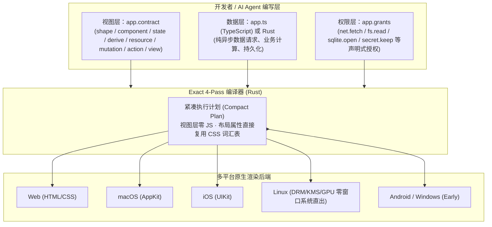

# `expo/exact` (exact2) 深度调研：对 VibeX 的影响评估与工程借鉴报告

> **调研对象**：[`expo/exact`](https://github.com/expo/exact)（Expo 团队 Charlie Cheever 等人发起的 Agent-Native 跨端应用运行时与编译器，内部代号 `exact2`）  
> **对比基准**：**VibeX**（多 Agent 协同工作空间、桌面/Web 客户端、插件生态 `@vibex/plugin-sdk`、浏览器/桌面自动化工具 `vibex-browser` / `computer-use` 及技能体系 `.agents/skills`）  
> **调研日期**：2026-11-10  
> **一手信息来源**：`expo/exact` 仓库源码（`README.md`、`AGENTS.md`、`rules/RULES.md`、`skills/orchestrate/SKILL.md`、`skills/panel/SKILL.md`、`grants/src/lib.rs`、`docs/diary.md`、`scripts/agent.mjs`）

---

## 一、 核心结论（Executive Summary）

### 1. 对 VibeX 有什么影响？（竞争与技术栈影响：**无直接替代威胁，无需迁移底座**）
- **赛道错位（互补大于竞争）**：
  - `expo/exact` 是一个 **“供 AI Agent 编写和操控跨端原生应用（Web / macOS / iOS / Linux）”的声明式 UI 编译器与运行时**（用自创的 `.contract` DSL 替代 React/JSX，用 Rust + 平台原生控件直接渲染，视图层零 JS）。
  - **VibeX** 是一个 **“多 Agent 协同工作空间与 AI 生产力宿主平台”**（承载 BotSpace 群聊协作、MCP 工具链、插件系统与各种 Coding/Research Agent）。
  - 两者处于上下游关系：`expo/exact` 是 VibeX 未来可以驱动的“目标应用开发框架”之一，而**不是** VibeX 的竞品。
- **技术栈影响（切勿用 Exact 重写 VibeX）**：
  - Exact 刻意砍掉了 React/JSX、HTML/DOM 以及任意第三方 npm 运行时包导入（`app.ts` 仅允许纯数据变换，且运行在无 Node API 的 Hermes/沙箱中），并且目前处于 Pre-1.0 早期阶段（Windows 原生后端尚处于 `early` 阶段）。
  - VibeX 重度依赖 React 生态、富交互编辑器、流式 Markdown/代码渲染及 Electron/Node 插件生态，继续保持现有 TypeScript + React 技术栈是唯一正确的选择。

### 2. 对 VibeX 有什么帮助？（工程与产品借鉴：**极高价值，6 大设计可直接移植**）
`expo/exact` 真正的宝藏不在于它的 `.contract` 语言本身，而在于 **Expo 团队为了用多 Agent 从零高效构建一个跨端引擎，在仓库内沉淀出的一整套“Agent 协同治理、UI 自动化算子压缩、权限沙箱与自我进化闭环”**。以下 6 个模块可直接反哺 VibeX：

| 优先级 | `expo/exact` 核心机制 | 对应源码位置 | 对 VibeX 的直接帮助与落地点 |
| :--- | :--- | :--- | :--- |
| **P0** | **10 算子极简 UI 驱动 + 虚拟时钟/序列帧快照** | `scripts/agent.mjs`<br>`AGENTS.md` | 升级 `vibex-browser`、`computer-use` 与 `video-shotcraft`：拒绝算子膨胀（从 80 个压缩到 10 个），引入 **`clock`（确定性时间快进）** 和 **`screenshot over N every M`（动画序列帧接触表）**，解决 Agent 截屏抓不到过渡态和 `sleep` 脆弱等待的顽疾。 |
| **P0** | **多家族模型盲审团（`panel`）与自主督导协议（`orchestrate`）** | `skills/panel/SKILL.md`<br>`skills/orchestrate/SKILL.md` | 直接移植为 VibeX 内置技能与 BotSpace 协作机制：引入 **“4 异构模型家族并行盲审”**、**“80% 置信度自主决策 + `DECIDED WITHOUT ASKING` 事后账本”**、**“可计数进度百分比（N/M）”** 与 **“熔断升级规则”**。 |
| **P1** | **Carried Authority 声明式权限清单与路径/URL 防护** | `grants/src/lib.rs` | 反哺 `@vibex/plugin-sdk` 与 Agent 工具审批：采用极简行式权限声明（`net.fetch`、`fs.read`、`env.read` 等），直接复用其防路径穿越、防 `@` 域名欺骗、防云元数据 SSRF 的安全校验逻辑。 |
| **P1** | **Friction Diary（Agent 实时摩擦日记闭环）** | `docs/diary.md`<br>`AGENTS.md` | 在 VibeX 的 Skill 执行与多 Agent 协作中增加轻量级 `feedback note` 旁路记录：当 Agent 遇到文档过时、工具报错或不得不手写 workaround 时实时记一笔，用于自动蒸馏优化 VibeX Skills。 |
| **P2** | **反膨胀工程治理（“每个预算都是置换而非上限”）** | `rules/RULES.md` | 升级 VibeX 自身的 `AGENTS.md` / `maiden-skill` 质量门禁：全量报错不搞 fail-fast、限制阻塞式检查数量（加新检查必须删旧检查）、单文件行数红线、严禁 Agent 未经批准增加脚本/脚手架。 |
| **P2** | **跨端字体与数字排版规范（`tabular-nums` 铁律）** | `AGENTS.md` | 结合我们此前对 VibeX 字体栈的优化，直接吸收其数字排版准则：动态跳动数字、表格列、计时器/Token 计数器强制开启 `tabular-nums`，正文数字保持比例字宽。 |

---

## 二、 `expo/exact` 项目深度拆解（它是做什么的？）

### 1. 解决的核心痛点：为什么 Expo 团队要重造轮子？
Expo 团队在长期使用 AI Coding Agent 编写 React Native / Web 应用时发现：
1. **React/HTML 状态空间过大且充满隐式副作用**：Agent 在写 JSX + Hooks + CSS 时，极易写出闭包陷阱、重渲染死循环或平台不一致的样式。
2. **UI 自动化测试工具对 Agent 极其不友好**：在第一代实验项目 `exact1` 中，团队定义了 **80 个工具命令（wire tool names）**，结果 Agent 经常记错工具名、参数幻觉严重，且传统截图工具无法验证动画和异步加载态。
3. **跨端运行时的 JS 桥接开销**：传统框架在视图层运行大量 JS，导致低端设备掉帧、包体积臃肿。

### 2. 核心架构：`.contract` 视图契约 + 数据缝隙（Data Seam）+ 多端原生直出
`expo/exact` 将应用严格切分为上下两层（中间称为 **The Seam**）：



- **视图层零 JS（No JS in the view）**：`.contract` 文件只包含 8 种顶层构造（`shape`、`component`、`state`、`derive`、`resource`、`mutation`、`action`、`view`），表达能力被刻意限制在“有限状态转换 + 相邻派生计算”，经 4 趟编译生成紧凑的 `plan`。
- **复用 CSS 词汇表而非重造布局属性**：虽然没有 HTML/DOM，但所有样式与布局直接采用 Agent 预训练语料中最熟悉的 CSS 属性名（`flex-direction`、`gap`、`padding`、`oklch(...)` 等），降低 Agent 的幻觉率。
- **同一套命令驱动所有平台**：无论底层跑在 Web、macOS AppKit、iOS 模拟器还是 Linux 帧缓冲（DRM/KMS）上，Agent 都通过完全相同的 `exact agent <op>` 命令观测和操控 UI。

---

## 三、 对 VibeX 的 6 大高价值工程与产品借鉴（深度拆解）

### 借鉴 1：从 80 个工具压缩到 10 个算子——升级 `vibex-browser` 与 `computer-use`

#### （1）`expo/exact` 的血泪教训与重构（已核实事实）
在 [`docs/diary.md`](https://github.com/expo/exact/blob/main/docs/diary.md) 与 [`AGENTS.md`](https://github.com/expo/exact/blob/main/AGENTS.md) 中，Expo 团队明确记录：
- 第一代 `exact1` 暴露了 **80 个 wire tool names**，导致模型频繁混淆语义相近的命令。
- 在 `exact2`（即当前仓库）中，[`scripts/agent.mjs`](https://github.com/expo/exact/blob/main/scripts/agent.mjs) 将整个跨平台 UI 自动化接口严格收敛为 **10 个正交算子**：
  1. `tree`：输出可交互节点树，且**每个节点自带源码文件名与行号反向指针（source-map back-pointers）**。
  2. `screenshot`：支持单帧截图（`.png`）与**时间跨度序列帧（`screenshot film.png over 600 every 50`）**。
  3. `tap`：按节点名、文本或坐标点击。
  4. `type`：向目标输入文本。
  5. `state`：直接读取或注入组件状态（无需通过繁琐的 UI 前置点击构造状态）。
  6. `layout`：直接断言节点几何位置关系（如重叠检测、对齐检测）。
  7. `logs`：查看结构化日志。
  8. `clock`：**虚拟时钟控制（`clock +60000` 快进 60 秒、`clock settle` 立即跳过动画过渡直到静止）**。
  9. `prefer`：秒级切换系统环境偏好（深浅色主题 `scheme dark/light`、字号缩放 `scale`、减弱动态效果 `motion`、语言区域 `locale`）。
  10. `perf`：采集帧耗时与布局性能指标。
- **陈旧构建拒止（Stale-build refusal）**：如果当前运行的构建产物时间戳早于源码修改时间，`agent` 驱动直接拒绝执行测试并报错提醒重新构建，防止 Agent 在旧界面上空转调试。

#### （2）对 VibeX 的落地建议
- **为 `vibex-browser` / `computer-use` / `video-shotcraft` 引入“序列帧接触表（Contact-Sheet Film）”**：
  - 目前 Agent 用 `browser_screenshot` 或 `computer_screenshot` 只能抓单张静态图，无法判断加载骨架屏、过渡动画、弹窗滑入是否卡顿或闪烁。
  - 可借鉴 `screenshot over <ms> every <ms>`，在 `vibex-browser` 中提供一个连拍拼图模式（例如在 600ms 内每 100ms 抓一帧，自动拼接成一张带时间戳标注的 6 宫格长图返回给多模态模型），让 Agent 一眼看清动态交互全过程。
- **在前端预览/测试工具中加入 `prefer` 与 `clock settle` 能力**：
  - 在 `vibex-browser` 中封装一键切换 `prefers-color-scheme`（深色/浅色）、`prefers-reduced-motion`（禁用 CSS 动画以实现瞬时稳定截图）的快捷参数，消除 Agent 截图遇到半透明动画残影的问题。

---

### 借鉴 2：多家族盲审团（`panel`）与自主督导协议（`orchestrate`）——升级 VibeX 多 Agent 协作

`expo/exact` 在 [`skills/panel/SKILL.md`](https://github.com/expo/exact/blob/main/skills/panel/SKILL.md) 和 [`skills/orchestrate/SKILL.md`](https://github.com/expo/exact/blob/main/skills/orchestrate/SKILL.md) 中沉淀了两套极其精炼的多 Agent 协作协议，与 VibeX 的 **BotSpace 多角色协同** 及 **`code-review` 技能** 高度契合：

#### （1）`panel` 技能：4 异构模型家族并行盲审（Multi-Model Blind Review）
- **核心机制**：
  - 当遇到重大架构分叉、RFC 方案评审或复杂设计决策时，同时调用 **4 个不同模型家族**（如 Claude Opus、GPT-5.4、Gemini 3.1 Pro、Grok-4）组成评审团。
  - **严格盲审（Mutually Blind）**：4 个评审 Agent 并行运行，**严禁看到彼此的发言**（防止群体思维羊群效应和顺从偏见）。
  - **聚焦根本性问题**：提示词强制要求每个席位**只允许提出最多 5 个根本性方向问题（Fundamental directional issues）**，禁止纠结命名或表面代码风格；默认只跑 **1 轮**（最多不超过 2 轮）。
- **信号合成法则（Synthesis Rules）**：
  - **跨家族共识 = 强信号（Agreement across families = signal）**：两个以上不同训练谱系的模型独立指出同一个隐患，直接采纳修复。
  - **单席位孤立意见 = 待验证假设（Single-seat concern = hypothesis）**：主持 Agent 必须亲自查源码验证真伪，验证不成立则直接丢弃，不打扰用户。
  - **评审团分裂 = 呈交用户裁决（Split panel = bring to user）**：附上正反双方最强论据交由人类拍板。

#### （2）`orchestrate` 技能：消除“事事请示”与“死循环空转”的督导协议
- **80% 置信度法则 + `DECIDED WITHOUT ASKING` 事后账本**：
  - 传统 Agent 要么遇到小事就停下来问用户（打断心流），要么自作主张改错方向且隐瞒不报。
  - `orchestrate` 规定：当置信度 **≥ 80%** 时，主控 Agent **必须自主拍板继续推进，绝不阻塞等待用户**；但在下一次向用户汇报进度时，必须专门列出 `DECIDED WITHOUT ASKING`（未请示自主决策清单，每条 1 行说明选了什么、放弃了什么）。用户如果不满意可以随时推翻，满意则零沟通成本通过。
- **可计数进度百分比（Countable Percent）与 ETA 滑点追踪（ETA Slip Tracking）**：
  - 严禁 Agent 拍脑袋报“进度 70%”。百分比必须对应具体可核验的分母（例如 `5 of 8 checklist items = 63%`）。
  - 汇报剩余时间时必须附带历史偏移轨迹：`ETA 40m (was 20m, second slip)`。
- **三大熔断升级红线（Circuit-Breaker Escalation）**：
  - 出现以下任一情况，主控 Agent 必须立即停止死磕并向人类升级汇报：
    1. 同一问题连续 **3 轮修复（3 fix rounds）** 仍未通过；
    2. 连续 **2 个检查周期进度移动为 0%（2 consecutive ticks with 0% movement）**；
    3. **ETA 连续推迟 2 次（2 ETA slips）**。

#### （3）对 VibeX 的落地建议
- **直接将 `DECIDED WITHOUT ASKING` 账本机制与“熔断红线”写入 VibeX 的 BotSpace 委派规范与主控 Agent 提示词**：这能显著提升 VibeX 群空间内 Leader Agent 调度 Subagents 时的自主性与透明度。
- **扩展 VibeX 的 `.agents/skills/code-review` 或新增 `panel` 技能**：在 VibeX 支持多模型路由的基础上，提供一键“异构模型盲审”工作流。

---

### 借鉴 3：Carried Authority 声明式权限清单（`grants`）——反哺 `@vibex/plugin-sdk` 与安全沙箱

#### （1）`expo/exact` 的权限实现（[`grants/src/lib.rs`](https://github.com/expo/exact/blob/main/grants/src/lib.rs)）
Exact 摒弃了复杂的 JSON Schema 权限配置，采用极简的按行声明语法（`.grants`），并在 Rust 层做了严密的结构化校验：
```text
net.fetch https://api.stripe.com https://*.example.com
net.websocket wss://stream.example.com
fs.read $APP_DATA/cache $HOME/Documents/exports
fs.write $APP_DATA/cache
env.read STRIPE_PUBLIC_KEY NODE_ENV
sqlite.open main
secret.keep stripe_token
storage.kv preferences
```
其 [`grants/src/lib.rs`](https://github.com/expo/exact/blob/main/grants/src/lib.rs) 中有几处非常扎实的安全工程细节：
1. **防路径前缀欺骗（Component-wise Path Prefix）**：校验文件系统权限时按路径段（Component）匹配而非字符串前缀，确保授权 `/home/user` 时**绝不会误放行** `/home/user2`，且一旦路径段中出现 `..`（父目录穿越）立即拒绝。
2. **防 URL `@` 凭证欺骗与云元数据 SSRF**：在解析 `net.fetch` 白名单时，显式拦截包含 `@`（userinfo，如 `https://api.stripe.com@evil.com`）的 URL，并默认封禁 `169.254.169.254` 等云厂商元数据链路本地 IP。
3. **环境变量快照隔离（Explicit Env Snapshot）**：应用无法读取宿主机完整的 `process.env`，只能拿到 `env.read` 显式列出的变量键名快照。

#### （2）对 VibeX 的落地建议
- 结合我们此前在《`stablyai/orca` 统一权限模型调研与 VibeX 落地评估》中的规划，VibeX 在演进 **v4 插件权限声明（`.vibex-plugin/plugin.json`）** 和 **Agent 工具调用白名单规则** 时，可直接参考 `grants/src/lib.rs` 的 8 大能力分类与路径/URL 边界校验规则（尤其是防 `..` 穿越、防前缀包含 `/dir` vs `/dir2`、防 `@` URL 欺骗）。

---

### 借鉴 4：Friction Diary（实时摩擦日记）——构建 VibeX 技能与工具的自我进化闭环

#### （1）`expo/exact` 的做法（[`docs/diary.md`](https://github.com/expo/exact/blob/main/docs/diary.md)）
在 `AGENTS.md` 中有一条强制规定：
> **Friction notes — live, not post-hoc**：每当 Agent 在执行任务时发现文档与实际不符、某个命令报错难懂、或者不得不手写绕过方案（workaround）时，必须**当场**执行一行 `node scripts/exact.mjs feedback note "<what happened>"`（耗时不到 1 秒），严禁留到任务结束再回忆。

这些记录按 4 个维度归档在 `docs/diary.md` 中：
- `Rough`（哪里卡壳、报错误导或耗时过长）
- `Lean in`（哪个工具或设计特别顺手）
- `Needed — provided / Needed — by hand / Needed — missing`（哪些能力现成可用、哪些被迫手写胶水代码、哪些完全缺失导致阻塞）

#### （2）对 VibeX 的落地建议
- VibeX 拥有丰富的 `.agents/skills` 与 MCP 工具链。我们可以在 VibeX 的内部技能规范（或 `memory_write` / 空间日志）中引入轻量级的 **Friction Log（摩擦日志）**：当任何 Bot 在使用某个 Skill 或 MCP 工具遇到参数歧义、环境报错或文档过时，随手追加一行记录到 `docs/friction-diary.md`。定期汇总即可精准定位哪些 Skill 或 MCP 工具需要升级。

---

### 借鉴 5：反膨胀工程治理（`rules/RULES.md`）——守护 VibeX 代码库整洁度

`expo/exact` 的 [`rules/RULES.md`](https://github.com/expo/exact/blob/main/rules/RULES.md) 只有短短 60 多行，但条条切中多 Agent 协作写代码时的“代码库腐化”要害：
1. **“每个预算都是置换，而非上限（Every budget is a trade, not a limit）”**：
   - 阻塞式 CI 检查上限严格定死为 **6 项（总耗时 ≤ 65 秒）**。想要增加第 7 项检查，**必须先删除或合并现有的某一项**。
2. **严禁 Fail-Fast（No fail-fast）**：
   - 所有的静态检查、编译器和门禁脚本必须一次性遍历并报出**全部错误**，绝不能遇到第一个错就退出——“发现 N 个 bug 绝不能耗费 Agent N 次运行回合”。
3. **非对称治理权（Asymmetric Apparatus Rule）**：
   - **“Agent 可以自由删除冗余的脚手架/辅助脚本，但未经人类明确批准，严禁新增任何治理脚本、wrapper 或配置文件。”** 这直接遏制了 AI Agent 最喜欢干的“为了修一个小问题，顺手造一套新的 lint 脚本或 wrapper”的膨胀病。
4. **单文件硬上限（1,500 行）**：任何源码文件超过 1,500 行直接触发门禁拦截，倒逼深模块拆分。

---

### 借鉴 6：字体与数字排版铁律（`tabular-nums` vs 比例数字）

联系我们近期对 VibeX 前端字体渲染的专项优化，`expo/exact` 在 [`AGENTS.md`](https://github.com/expo/exact/blob/main/AGENTS.md) 的 `Typography` 章节中专门立了一条由编译器与视觉规范共同保障的规则：
- **所有列对齐数字、动态变化数值（计时器、进度百分比、价格、Token 消耗、表格数据）强制开启 `font-variant-numeric: tabular-nums`**，防止数字跳动时引发文本抖动（layout jitter）或列错位。
- **正文散文中的年份、门牌号等静态数字保持比例字宽（proportional digits）**，以获得更自然的阅读韵律。
- **三级样式优先级（Author > Platform > CSS default，“No tells”）**：组件库默认继承宿主操作系统的原生光标、滚动条与字重特征，消除一眼看出的“套壳 Web 应用感（no tells）”。

---

## 四、 总结与行动路线图（Action Plan for VibeX）

| 阶段 | 行动项 | 目标模块 | 预期收益 |
| :--- | :--- | :--- | :--- |
| **短期（立即可做）** | 1. 将 `orchestrate` 的 **80% 置信度法则 + `DECIDED WITHOUT ASKING` 账本 + 三大熔断红线** 融入 VibeX 多 Agent 协作规范；<br>2. 在 VibeX 全局样式表中为计数器、表格、耗时统计统一补齐 `tabular-nums` 工具类。 | `.agents/skills`<br>VibeX 前端样式 | 减少 Agent 无效追问与死循环空转；消除前端动态数字跳动抖动。 |
| **中期（1~2 周）** | 3. 借鉴 `panel` 技能，在 VibeX 中封装 **多家族模型并行盲审（Multi-Model Blind Review）** 技能；<br>4. 在 `vibex-browser` / `computer-use` 中引入 **序列帧连拍拼图（`screenshot over N every M`）** 与快速主题/动画控制。 | `code-review` / `panel` 技能<br>`vibex-browser` MCP | 大幅提升复杂架构评审的信噪比；让 UI 自动化工具具备捕捉动画与过渡态的能力。 |
| **中长期（架构演进）** | 5. 在 `@vibex/plugin-sdk` 权限模型与 Agent 路径/网络白名单校验中，吸收 `grants/src/lib.rs` 的安全边界检查逻辑（组件级路径前缀、防 `@` 欺骗、防元数据 SSRF）。 | `@vibex/plugin-sdk`<br>VibeX 权限审批层 | 以极简配置实现高安全等级的插件与 Agent 沙箱隔离。 |
