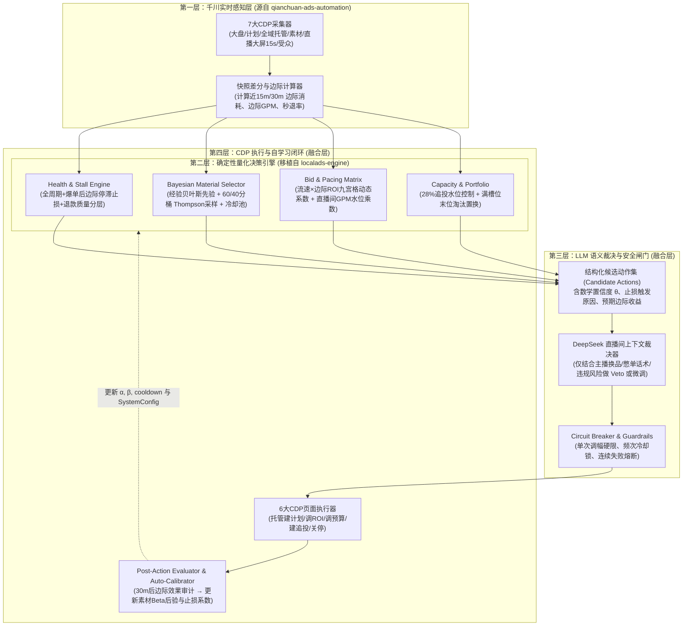

# 千川投放自动化算法升级方案：用 `localads-engine` 量化自学习大脑改造 `qianchuan-ads-automation`

> **调研日期**：2026-11-08
> **核心议题**：能否将 `fengx8534-tech/qianchuan-ads-automation` 与 `Prajna11/localads-engine` 结合，用后者的量化决策与自学习校准算法优化前者的千川直播决策算法？
> **调研结论**：**不仅完全可行，而且两者是天然互补的「黄金组合」**。
> - `qianchuan-ads-automation` 拥有极强的**「千川手眼层」**（7 个全域 CDP 实时采集器 + 6 个全自动托管/追投页面操作脚本 + 直播大屏实时秒级信号），但其**「决策大脑层」**非常薄弱（全靠硬编码在 `ai-prompt.js` 里的 60 行静态规则发给 DeepSeek 做算术，素材筛选仅靠 `sortBy` 贪心排序，`operation-learner.js` 只是拼字符串日志，没有任何统计学习能力）。
> - `localads-engine` 则拥有工业级的**「量化决策与自学习大脑层」**（经验贝叶斯 + Beta-Bernoulli Thompson Sampling 60/40 探索利用选材、全生命周期质量分层与边际停滞止损、动态系数自校准 `auto_calibrate`、容量槽位与末位淘汰 `capacity/portfolio`、两阶段预检与熔断），但它原本针对本地推线索（CPL），缺乏千川直播间的实时 CDP 感知与全域追投执行器。
> - **最佳融合范式**：保留 `qianchuan-ads-automation` 的 Node.js CDP 采集与执行底座，将原本直接塞给 DeepSeek 的「算术与规则判断」抽离出来，替换为移植自 `localads-engine` 的 **「确定性量化决策引擎 + 贝叶斯自学习反馈环」**，让大模型（DeepSeek）退居二线，仅负责「结合直播间主播状态/换品节奏做最终语义裁决与人话解释」。

---

## 一、 现有痛点诊断：`qianchuan-ads-automation` 的算法短板在哪里？

通过逐行拆解 `fengx8534-tech/qianchuan-ads-automation` 的决策核心源码（`local-backend/lib/ai-prompt.js`、`local-backend/lib/operation-learner.js`、`local-backend/executor/material-screener.js`），可以清晰定位其现有算法的 **5 大结构性缺陷**：

| 维度 | `qianchuan-ads-automation` 现状（源码定位） | 实战投放中的致命缺陷 |
| :--- | :--- | :--- |
| **1. 核心决策机制** | **纯 Prompt 自然语言算术**（`ai-prompt.js` 的 `buildSystemPrompt`）<br>把全部计划数组、素材数组、大盘快照拼成大 JSON 发给 DeepSeek，在 Prompt 里写死：`task.roi > targetRoi * 1.2` 加预算、`spend >= budget * 0.8 && dealAmount == 0` 关停、`329 / targetRoi` 算出价。 | 1. **算术幻觉与漂移**：LLM 对多计划长 JSON 的浮点比大小、边际变化率极易算错；<br>2. **Token 昂贵且延迟高**：每 5 分钟全量快照投喂；<br>3. **静态魔数死板**：`1.2`、`0.8`、`6.0`、`329` 全是硬编码，换品类/换客单价即失效。 |
| **2. 素材筛选与追投算法** | **纯贪心单指标排序**（`material-screener.js` & `ai-prompt.js`）<br>`screenMaterials()` 仅用 `sortBy(all, "materialRoi")` / `"ctr"` / `"spend"`；`potentialMaterials()` 仅做 `spend <= medianSpend && materialRoi >= 2` 过滤。 | 1. **赢家通吃导致素材极速衰退**：永远只挑历史 Top3，老素材被反复追投至疲劳；<br>2. **小样本幸存者偏差**：刚消耗 30 元碰巧出 1 单（ROI=10）的新素材会被误判为爆款狂加预算；<br>3. **缺乏冷却期与跨计划去重状态机**。 |
| **3. 止损与健康度评估** | **单时间截面一刀切**（`ai-prompt.js` 第 124~129 行）<br>仅看当前快照：`消耗 >= 预算80% 且 0成交` 或 `消耗 >= 预算50% 且 ROI < 目标50%` 才暂停。 | 1. **止损过晚浪费预算**：高预算计划（如 5000 元）要烧掉 4000 元才触发 80% 零单止损；<br>2. **忽略退款率与结算质量**：千川「通投成交 ROI」包含秒退/刷单，未结合真实结算/退货分层；<br>3. **无视「爆单后停滞」**：上午爆单拉高全天累计 ROI，下午连烧 1000 元 0 单，累计 ROI 仍达标，系统不会止损。 |
| **4. 追投容量与组合管理** | **被动硬卡 28% 上限**（`ai-prompt.js` 第 116~119 行）<br>只规定 `追投消耗占比 >= 28% 严禁新建追投`，未满 28% 时只要有素材就不断新建追投。 | **缺乏组合槽位与末位淘汰（Portfolio Replacement）**：当追投额度打满或预算逼近上限时，无法自动识别「用高潜新素材替换正在衰退的尾部追投计划」。 |
| **5. 所谓“自学习”模块** | **伪学习/纯文本 Diff**（`operation-learner.js`）<br>`recordSnapshotAndLearn()` 只是对比前后两次快照的 `budget` / `roiTarget` 差异，把最近 5 条人工修改记录塞进 Prompt。 | **没有任何统计学习与参数校准能力**：它既不评估某次加预算/调 ROI 2 小时后的真实效果（Audit），也不会根据历史转化分布自动校准止损线或出价系数。 |

---

## 二、 核心算法映射：如何用 `localads-engine` 的 5 大算法模块精准改造？

`Prajna11/localads-engine` 的 `src/decision/*` 与 `src/learner/*` 模块恰好为上述 5 大痛点提供了经过数学推导与工程验证的现成解法。下表展示如何将 `localads-engine` 的核心算法概念**从“本地推 CPL 域”无损映射到“千川直播 ROI/GPM 域”**：

### 升级点 1：用「经验贝叶斯 + 60/40 分桶 Thompson Sampling」替代 `material-screener.js` 的贪心排序

* **源码对标**：`localads-engine/src/learner/posterior.py` + `src/decision/material_selector.py` $\longrightarrow$ 升级 `qianchuan-ads-automation/local-backend/executor/material-screener.js`。
* **算法改造细节**：
  1. **经验贝叶斯先验（Empirical Bayes Prior）解决新素材小样本偏差**：
     - 在千川场景下，将每个素材的「点击转化率（CVR）」或「千次曝光成交额达标率」建模为 $\text{Beta}(\alpha_i, \beta_i)$ 分布。
     - 先计算账户大盘平均点击转化率 $\text{CVR}_{\text{account}}$，取先验强度 $m = 30$（可配置），得到先验参数：
       $$\alpha_0 = \text{CVR}_{\text{account}} \times m, \quad \beta_0 = (1 - \text{CVR}_{\text{account}}) \times m$$
     - **效果**：一个刚有 5 次点击、碰巧成交 1 单的新素材，在原系统中 CVR=20% 排第一；在贝叶斯后验中，$\mathbb{E}[\theta] = \frac{\alpha_0 + 1}{\alpha_0 + \beta_0 + 5}$，会被大盘先验平滑拉回合理区间，彻底杜绝「1 单暴击误导追投」。
  2. **指数时间衰减（Exponential Decay）解决老素材审美疲劳**：
     - 直接复用 `posterior.py` 的 `DECAY_GAMMA = 0.95` 与 `STALE_DAYS = 7` 机制：对于历史爆款但近期未跑或衰减的素材，将历史累积成功/失败计数乘上 $\gamma^{\Delta t}$，向先验 $(\alpha_0, \beta_0)$ 收缩，避免「三个月前的老爆款霸榜」。
  3. **成本风险过滤（Cost Risk Gate）+ 60/40 探索利用分桶（`_bucketed_select`）**：
     - **风险硬过滤**：根据千川目标 ROI 与客单价 $AOV$ 折算最低要求转化率 $\text{CVR}_{\min} = \frac{\text{CPC} \times \text{TargetROI}}{AOV}$，利用 Beta 累积分布函数计算 $P(\theta_i < \text{CVR}_{\min}) > 0.70$ 的素材直接剔除。
     - **60/40 探索-利用分桶**：每次筛选 Top $N$（如 Top 5）追投素材时：
       - **60% 槽位（Exploit 利用桶）**：从已出单且 ROI 达标的素材中，按成交单数与 Thompson 采样值 $\theta_i \sim \text{Beta}(\alpha_i, \beta_i)$ 选出主力爆款；
       - **40% 槽位（Explore 探索桶）**：从**消耗低于中位数、高点击率（CTR）但尚未充分跑出成交**的新素材中，按低消耗优先 + $\theta_i$ 决胜选出潜力股；
       - **连日复用软惩罚（`_daily_reuse_penalty`）**：过去 24 小时内已被高频追投过的素材，对采样出的 $\theta_i$ 乘以 `0.8` 折扣因子，强制轮换素材池。

---

### 升级点 2：用「全生命周期多维健康度与边际停滞止损」替代 `ai-prompt.js` 的 80% 静态止损

* **源码对标**：`localads-engine/src/decision/health.py` + `src/decision/timing.py` $\longrightarrow$ 抽离为千川独立的 `qianchuan-health-engine.js`。
* **算法改造细节**：
  1. **引入「爆单后边际停滞止损（Post-Effective Stall Spend）」**（极其适合千川直播间！）：
     - 原系统只看累计 `task.roi`，如果上午主播福利款爆单让计划累计 ROI 冲到 8.0（目标 4.0），下午该计划连烧 1500 元 0 成交，累计 ROI 仍有 4.5，原系统不仅不止损还会继续加预算！
     - 移植 `health.py` 中的 `_post_effective_stall_spend` 逻辑：记录每个计划/素材自**上一次成交（`latest_deal_time`）以来的新增消耗 $\Delta \text{Spend}_{\text{post}}$**。一旦：
       $$\Delta \text{Spend}_{\text{post}} \ge \frac{AOV}{\text{TargetROI}} \times \lambda_{\text{stall}} \quad (\text{默认 } \lambda_{\text{stall}} = 1.2 \sim 1.5)$$
       且期间新增成交为 0，即使全天累计 ROI 依然高于目标，也立即打入 `WARNING_STALL`（降预算/降出价观察）或直接暂停追投！
  2. **引入「按目标 CPA 倍数的绝对金额零单止损（Rule 0）」替代「80% 预算比例止损」**：
     - 原系统 `spend >= budget * 0.8 && dealAmount == 0` 在大预算计划下亏损惨重。
     - 移植 `health.py` Rule 0：定义目标单均成交成本 $\text{TargetCPA} = \frac{AOV}{\text{TargetROI}}$。只要累计消耗 $\text{Spend} \ge \text{TargetCPA} \times \text{zero\_deal\_spend\_ratio}$（例如 `1.2` 倍目标单客成本）且仍为 0 成交（且非支付延迟），无视总预算是多少，立即触发早停止损！
  3. **引入「真实结算质量层（QualityLayer）」**：
     - 将 `health.py` 的「来客有效线索/无效线索/待判定（Pending）」映射为千川的 **「整体支付 ROI（Raw）」vs「净成交/预估结算 ROI（Effective，扣除秒退与历史品类退货率）」vs「未支付锁单/购物车（Pending）」**：
     - 若某计划虽然表观支付 ROI 达标，但直播大屏/订单流显示**秒退率 $\ge 60\%$**，触发 `Quality Rule B` 直接判定 `INVALID` 停投；
     - 若某计划 0 支付成交，但近 15 分钟有高密度「直播间购物车点击 / 创建未支付订单」，视为 `OBSERVING_PENDING`，给予延迟保护而不盲目秒关。

---

### 升级点 3：用「阶梯式动态出价/ROI 系数引擎」替代 `ai-prompt.js` 的硬编码公式

* **源码对标**：`localads-engine/src/decision/bid_engine.py` + `src/decision/timing.py` $\longrightarrow$ 升级千川的 ROI 目标调节与预算步长控制。
* **算法改造细节**：
  1. **跑量速度（Pacing）与边际 ROI 双因子矩阵调节**：
     - 原系统硬编码：`329 / targetRoi`，且加预算固定 `+20%~+50%`、压 ROI 每次 `-0.2~-0.5`。
     - 移植 `bid_engine.py` 的分档系数思想，构建千川 **「消耗流速比（$\text{SpendRate} / \text{TargetRate}$） $\times$ 边际 ROI 达标率（$\text{MarginalROI} / \text{TargetROI}$）」** 九宫格确定性查表引擎：
       - **高 ROI + 消耗流速慢（不起量）**：自动小步下调 `roiTarget`（乘以系数 `0.95`，即放宽 ROI 目标以抢夺流池曝光），而非盲目傻加虚高预算；
       - **高 ROI + 消耗流速快（起量顺畅）**：保持 `roiTarget` 不变或微提 `1.03` 锁利润，同时按账户剩余预算水位阶梯放大计划预算（`+25%`）；
       - **临界 ROI（0.85~1.0x 目标）+ 消耗过猛**：自动上调 `roiTarget`（乘以 `1.08` 压流速控成本）。
  2. **直播间分时水位系数（`timing.py` 改造为直播间实时在线人数/GPM 水位）**：
     - 结合 `qianchuan-ads-automation` 独有的 `live-screen-collector.js`（15 秒一次采集在线人数、GPM、评论率），当直播间自然流在线人数与 GPM 处于波峰时，乘以动态扩量系数 $\eta_{\text{live}} \in [1.1, 1.3]$；当主播换场/低互动低谷期，$\eta_{\text{live}} \in [0.7, 0.9]$ 自动收紧追投。

---

### 升级点 4：用「容量槽位与末位淘汰（Capacity & Portfolio Replacement）」优化 28% 追投上限

* **源码对标**：`localads-engine/src/decision/capacity.py` + `src/decision/portfolio.py`。
* **算法改造细节**：
  - `qianchuan-ads-automation` 目前遇到「追投占比逼近 28%」或「在投追投条数过多」时只能死板停止新建。
  - 引入 `capacity.py` 的 `_full_capacity_tradeoff`（满载置换算法）：
    1. 设定并发追投槽位上限（如 `max_active_boost = 5`）及追投消耗占比安全线（如 `25%`）；
    2. 当槽位已满且材质筛选器（Thompson Sampling）发现了后验得分 $\theta_{\text{new}}$ 极高的新爆款素材时，调用 `_health_priority` 对在投追投计划排序；
    3. 若最差的一条在投追投计划处于 `WARNING` 或边际 ROI 低于新素材预期收益的 `70%`，自动生成 **「组合置换指令（`replace_worst_boost`）」**：先关停最差追投释放槽位，再为高潜新素材开启追投，实现追投池的**新陈代谢**。

---

### 升级点 5：用「闭环效果审计 + 自动小步参数校准（`auto_calibrate`）」替代 `operation-learner.js`

* **源码对标**：`localads-engine/src/learner/evaluation.py` + `calibration.py` + `auto_calibrate.py` + `cooling.py` $\longrightarrow$ 彻底重构 `local-backend/lib/operation-learner.js`。
* **算法改造细节**：
  1. **操作后效果归因审计（Action Evaluation）**：
     - 每次系统或人工执行 `increase_budget`、`adjust_roi`、`create_boost` 后，记录操作前 30 分钟与操作后 30~60 分钟的 $\Delta \text{Spend}$、$\Delta \text{GMV}$、$\text{MarginalROI}$。
     - 将每次操作判定为 `POSITIVE`（边际 ROI $\ge$ 目标且放量）、`NEUTRAL` 或 `NEGATIVE`（加预算后 ROI 崩盘或调低 ROI 后光烧钱不出单）。
  2. **素材冷却状态机（`cooling.py`）**：
     - 被止损关停的追投素材自动打上 `cooldown_until = now + 12h`（场次级冷却）或连续 2 次追投失败打入 `deprecated`（永久黑名单），防止同一场直播每隔半小时把同一个亏钱素材捞出来重复追投。
  3. **无人值守自动参数微调（`auto_calibrate.py`）**：
     - 每场直播结束后（或每 4 小时），统计本账户真实的「零单转化分布分位数」与「最优 ROI 出价乘数」：
     - 例如分析历史 50 次出单计划首次出单前的消耗分布，若 90% 的有单计划都在消耗 $1.1 \times \text{TargetCPA}$ 内出首单，则通过 `_auto_apply()` 自动将 `zero_deal_spend_ratio` 从默认 `1.5` 向 `1.1` 每次微调 `max_step = 0.1`（并限制在安全边界 `[0.8, 2.0]` 内），实现**越投越懂该直播间脾气**的自进化闭环。

---

## 三、 融合后的系统整体架构图（Quantitative Brain + LLM Adjudicator）

将两者结合后，最大的架构变革是**把 DeepSeek 从「直接做算术的苦力」升级为「审查量化方案的直播间总控」**：



---

## 四、 工程落地的两种实现路径对比

因为 `qianchuan-ads-automation` 的本地后端是 **Node.js**（`local-backend/server.js`），而 `localads-engine` 是 **Python 3.11 + SQLAlchemy + NumPy/SciPy**，工程结合共有两条路径，**强烈推荐路径 A**：

| 维度 | 路径 A（推荐）：核心算法轻量化移植为纯 Node.js 模块 | 路径 B：Python Sidecar 决策微服务（双进程架构） |
| :--- | :--- | :--- |
| **实现方式** | 将 `localads-engine` 的 5 个核心纯函数模块（Beta 后验更新、Marsaglia-Tsang Gamma/Beta 随机数采样、60/40 分桶选材、边际停滞健康度状态机、`auto_calibrate` 步进器）直接用 **JavaScript (约 600~800 行代码)** 写入 `qianchuan-ads-automation/local-backend/lib/quant-engine/`，持久化复用现有的本地 JSON / SQLite。 | 保持 `localads-engine` Python 进程独立运行，改造其 SQLAlchemy 模型适配千川字段，Node.js 采集完数据后通过 HTTP POST 发给 Python `/decision/evaluate` 接口获取指令。 |
| **开发工作量** | **小（约 2~3 天）**。Beta 采样在 JS 中仅需 25 行数学函数即可零依赖实现，无需额外部署 Python 环境。 | **中（约 5~7 天）**。需重写 `localads-engine` 中深度耦合本地推 CPL 的 ORM 表结构（`CampaignStat`、`Lead` 等）。 |
| **运行稳定性与部署** | **极高**。单语言单进程，直接内嵌在你现有的桌面脚本或 `local-backend` 中开箱即用。 | 需同时维护 Node.js CDP 进程与 Python FastAPI/CLI 进程。 |

---

## 五、 关键改造代码示例（Node.js 零依赖移植 Beta-Thompson 选材与边际止损）

以下为你可直接嵌入 `qianchuan-ads-automation` 的核心算法改造骨架（将 `localads-engine` 的数学灵魂注入千川）：

### 1. 经验贝叶斯 + 60/40 Thompson Sampling 素材筛选器（替代原 `material-screener.js` 排序）

```javascript
// quant-material-selector.js —— 移植自 localads-engine/src/decision/material_selector.py & posterior.py

// 零依赖标准 Gamma / Beta 采样实现 (Marsaglia & Tsang 算法)
function sampleNormal() {
  let u = 0, v = 0;
  while (u === 0) u = Math.random();
  while (v === 0) v = Math.random();
  return Math.sqrt(-2.0 * Math.log(u)) * Math.cos(2.0 * Math.PI * v);
}

function sampleGamma(shape) {
  if (shape < 1) {
    return sampleGamma(1 + shape) * Math.pow(Math.random(), 1 / shape);
  }
  const d = shape - 1 / 3;
  const c = 1 / Math.sqrt(9 * d);
  while (true) {
    let x, v;
    do {
      x = sampleNormal();
      v = 1 + c * x;
    } while (v <= 0);
    v = v * v * v;
    const u = Math.random();
    if (u < 1 - 0.0331 * x * x * x * x) return d * v;
    if (Math.log(u) < 0.5 * x * x + d * (1 - v + Math.log(v))) return d * v;
  }
}

function sampleBeta(alpha, beta) {
  const a = sampleGamma(Math.max(alpha, 0.01));
  const b = sampleGamma(Math.max(beta, 0.01));
  return a / (a + b);
}

/**
 * 千川素材经验贝叶斯 + 60/40 分桶 Thompson Sampling 筛选器
 * @param {Array} materials 采集到的素材列表
 * @param {Object} config { targetRoi: 4.0, aov: 199, topN: 5, priorStrength: 30, exploitRatio: 0.6 }
 * @param {Object} stateStore 记录素材历史后验与冷却时间 { [materialId]: { cooldownUntil, lastBoostedAt } }
 */
function selectMaterialsWithBandit(materials, config = {}, stateStore = {}) {
  const { targetRoi = 3.5, aov = 199, topN = 5, priorStrength = 30, exploitRatio = 0.6 } = config;
  const now = Date.now();
  const targetCpa = aov / targetRoi; // 目标单均成交成本

  // 1. 硬约束过滤：排除审核未通过、已在追投中、处于冷却期、或已证明严重亏损的素材
  const pool = materials.filter((m) => {
    const id = String(m.materialId || m["素材ID"] || "");
    const state = stateStore[id] || {};
    if (state.cooldownUntil && state.cooldownUntil > now) return false;
    if (/未通过|拒绝|失败/.test(String(m.auditStatus || ""))) return false;
    if (String(m.boostStatus || "") === "追投中") return false;

    const spend = Number(m.spend || 0);
    const orders = Number(m.dealOrderCount || (m.dealAmount ? Math.round(m.dealAmount / aov) : 0));
    // 历史质量门控 (_passes_quality_filter)：0单且消耗超 1.5 倍目标CPA，或有单但ROI低于目标50%且消耗超2倍CPA
    if (orders === 0 && spend > targetCpa * 1.5) return false;
    if (orders > 0 && spend > targetCpa * 2.0 && Number(m.materialRoi || 0) < targetRoi * 0.5) return false;
    return true;
  });

  // 2. 计算账户大盘经验贝叶斯先验 CVR (Empirical Bayes Prior)
  const totalClicks = pool.reduce((sum, m) => sum + Math.max(Number(m.clickCount || 0), 0), 0);
  const totalOrders = pool.reduce((sum, m) => {
    const orders = Number(m.dealOrderCount || (m.dealAmount ? Math.round(m.dealAmount / aov) : 0));
    return sum + Math.max(orders, 0);
  }, 0);
  const accountCvr = totalClicks > 50 ? Math.min(Math.max(totalOrders / totalClicks, 0.005), 0.3) : 0.02;
  const alpha0 = accountCvr * priorStrength;
  const beta0 = (1 - accountCvr) * priorStrength;

  // 3. 计算每个素材的 Beta 后验并执行 Thompson Sampling
  const scored = pool.map((m) => {
    const id = String(m.materialId || m["素材ID"] || "");
    const clicks = Math.max(Number(m.clickCount || 0), 0);
    const roiRatio = Math.min(Number(m.materialRoi || 0) / targetRoi, 2.0);
    const rawOrders = Number(m.dealOrderCount || (m.dealAmount ? Math.round(m.dealAmount / aov) : 0));
    // 用 ROI 达标度加权有效成交数（对应 localads-engine 的 effective_leads 质量折算）
    const effectiveSuccesses = rawOrders * Math.max(roiRatio, 0.2);
    const failures = Math.max(clicks - effectiveSuccesses, 0);

    const alpha = alpha0 + effectiveSuccesses;
    const beta = beta0 + failures;
    let theta = sampleBeta(alpha, beta);

    // 24小时内重复追投软惩罚 (_daily_reuse_penalty)
    const lastUsed = stateStore[id]?.lastBoostedAt || 0;
    if (now - lastUsed <= 24 * 3600 * 1000) {
      theta *= 0.8;
    }

    return { material: m, id, rawOrders, spend: Number(m.spend || 0), alpha, beta, theta };
  });

  // 4. 60/40 分桶选择 (_bucketed_select)：60% 确定性爆款利用 (Exploit) + 40% 低消耗高潜探索 (Explore)
  const nExploit = Math.round(topN * exploitRatio);
  const exploitBucket = scored
    .filter((s) => s.rawOrders > 0 && Number(s.material.materialRoi || 0) >= targetRoi * 0.85)
    .sort((a, b) => b.rawOrders - a.rawOrders || b.theta - a.theta)
    .slice(0, nExploit);

  const pickedIds = new Set(exploitBucket.map((s) => s.id));
  const nExplore = topN - exploitBucket.length;

  const exploreBucket = scored
    .filter((s) => !pickedIds.has(s.id) && Number(s.material.ctr || 0) > 0)
    .sort((a, b) => a.spend - b.spend || b.theta - a.theta) // 消耗低优先 + Thompson 采样值决胜
    .slice(0, nExplore);

  return [...exploitBucket, ...exploreBucket];
}
```

### 2. 全周期 + 爆单后边际停滞健康度引擎（替代 `ai-prompt.js` 的粗糙止损）

```javascript
// quant-health-engine.js —— 移植自 localads-engine/src/decision/health.py

/**
 * 评估单条千川计划/全域托管任务的真实健康度
 * @param {Object} task 当前计划快照 { id, spend, budget, roi, dealAmount, impressions, clicks, createdAt }
 * @param {Object} history 该计划的历史追踪状态 { lastDealTime, spendAtLastDeal, recentRefundRate, coldStartMinutes }
 * @param {Object} config { targetRoi: 3.5, aov: 199, zeroDealSpendRatio: 1.2, postDealStallRatio: 1.5 }
 */
function assessTaskHealth(task, history = {}, config = {}) {
  const { targetRoi = 3.5, aov = 199, zeroDealSpendRatio = 1.2, postDealStallRatio = 1.5 } = config;
  const targetCpa = aov / targetRoi;
  const spend = Number(task.spend || 0);
  const dealAmount = Number(task.dealAmount || 0);
  const roi = Number(task.roi || (spend > 0 ? dealAmount / spend : 0));

  // 1. 质量层止损 (Quality Rule B)：表观有成交，但秒退/退款率过高
  if (dealAmount > 0 && Number(history.recentRefundRate || 0) >= 0.65) {
    const netRoi = roi * (1 - history.recentRefundRate);
    if (netRoi < targetRoi * 0.6) {
      return { tier: "INVALID", action: "pause", reason: `表观ROI=${roi.toFixed(2)}，但退货率${(history.recentRefundRate*100).toFixed(0)}%，净ROI仅${netRoi.toFixed(2)}，触发质量止损` };
    }
  }

  // 2. 零单绝对成本止损 (Rule 0)：不看总预算80%，只要消耗达 1.2 倍目标单客成本仍 0 成交即止损
  const zeroDealCap = targetCpa * zeroDealSpendRatio;
  if (dealAmount === 0 && spend >= zeroDealCap) {
    return { tier: "INVALID", action: "pause", reason: `累计消耗¥${spend.toFixed(0)}已达${zeroDealSpendRatio}倍目标CPA(¥${zeroDealCap.toFixed(0)})仍0成交，触发早停止损` };
  }

  // 3. 爆单后边际停滞止损 (Post-Effective Stall Spend)：防止上午爆单掩盖下午空烧
  const postDealSpend = Math.max(0, spend - Number(history.spendAtLastDeal || 0));
  const stallCap = targetCpa * postDealStallRatio;
  if (dealAmount > 0 && postDealSpend >= stallCap) {
    return {
      tier: "WARNING_STALL",
      action: roi < targetRoi ? "pause" : "TightenRoiOrReduceBudget",
      reason: `虽累计ROI=${roi.toFixed(2)}，但自上次出单后已连续空烧¥${postDealSpend.toFixed(0)}（超停滞线¥${stallCap.toFixed(0)}）无新成交，触发边际停滞保护`
    };
  }

  // 4. 正常 ROI 梯队评估
  if (roi >= targetRoi * 1.2) {
    return { tier: "HEALTHY_STRONG", action: "scale_up", reason: `累计ROI=${roi.toFixed(2)}高于目标1.2倍且无近期空烧停滞，支持扩量` };
  }
  if (roi >= targetRoi * 0.9) {
    return { tier: "HEALTHY", action: "maintain", reason: `ROI=${roi.toFixed(2)}处于健康区间` };
  }
  return { tier: "OBSERVING", action: "observe", reason: `消耗¥${spend.toFixed(0)}，处于冷启动或正常波动观察期` };
}
```
